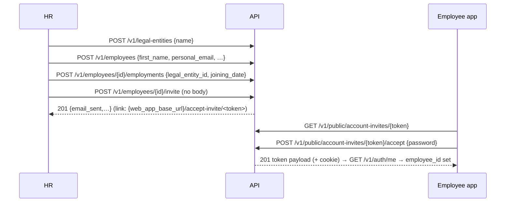
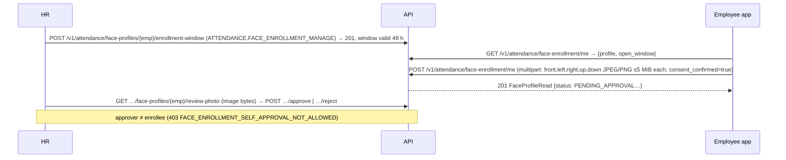
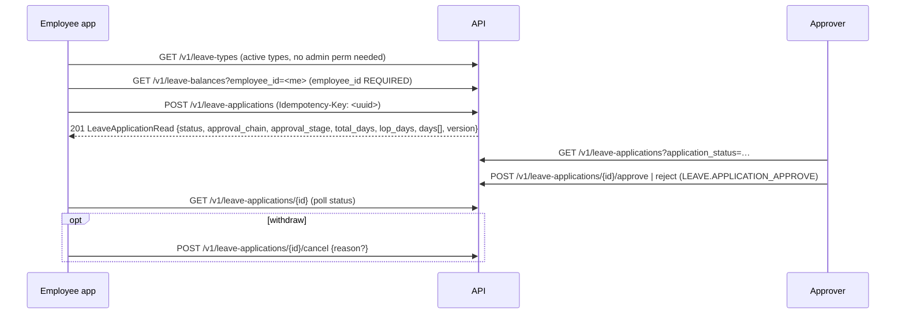

# End-to-end workflows

Only workflows that exist in the code are documented. Each lists the starting state, calls, data, failure paths, final state, and a **status** tag:
* **[recorded]** — executed against a running API; the exchange is in [examples/](examples/).
* **[source]** — traced through the router/service/schema code but *not executed* (usually because it needs configuration the test environment lacks: a face provider, configured policies, a pay run…).
Request/response field tables for each call are in the module docs ([modules/](modules/)); this file explains how the calls fit together.

Contents: 1 Sign-in & session · 2 Company registration · 3 Employee account creation · 4 Manual punch & attendance view · 5 Face enrollment & face punch · 6 Regularization · 7 Leave · 8 Payslips · 9 Pay run lifecycle (HR) · 10 Candidate onboarding · 11 Profile & records · 12 What does not exist

---

## 1. Sign-in & session — [recorded]
See [AUTHENTICATION.md §4](AUTHENTICATION.md). Minimum app bootstrap after login:
1. `POST /v1/auth/login` → store `access_token`, `company_id`, `expires_in_minutes`; the refresh cookie is stored by the cookie jar.
2. `GET /v1/auth/me` → store `employee_id`, `permissions[]`, `company_timezone`, `company_status`. **Everything employee-scoped needs `employee_id`** (leave balances, attendance lists take it as a query parameter).
3. If `company_status ∈ {PENDING_APPROVAL, SUSPENDED}` show the read-only banner and disable writes.
4. Repeat step 2 after each refresh (permissions may have changed).

## 2. Company registration — [recorded]
Starting state: no account. `GET /v1/companies/registration-config` → `{allowed_company_timezones}` (currently `["Asia/Kolkata"]`) → `POST /v1/companies/register` (name, admin_first_name, admin_last_name, admin_email, admin_password; defaults: country `IN`, currency `INR`, timezone `Asia/Kolkata`, `fy_start_month` 4).
* `201` → signed in as the new `COMPANY_ADMIN` (no linked employee ⇒ `employee_id: null`). Company status `PENDING_APPROVAL` (server default) or `TRIAL` (14-day trial) depending on deployment. A verification email is sent; verification is **not** needed for this first session but is for the next `login`.
* Errors: `422 REQUEST_VALIDATION_ERROR` (timezone outside allow-list, bad `company_size` band), `422 VALIDATION_ERROR` with `details[0].code=WEAK_PASSWORD` (`field: admin_password`), `409 CONFLICT "An account with this email already exists"` (this reveals that the email is registered — [audit L-3](API_CONTRACT_AUDIT.md)), `429`.
* Final state: company, subscription (`TRIALING`), 5 system roles, default permissions created (`organisation/service.py`).

## 3. Employee account creation by invitation — [recorded]
Actors: HR (needs `EMPLOYEE.CREATE`, `EMPLOYEE.INVITE`), then the employee.

* The invite uses the employee's **`personal_email`** (`EMPLOYEE_MISSING_EMAIL` 422 if absent). The accepted account ends up with the system `EMPLOYEE` permission set (**[recorded]**: `/auth/me` lists exactly the `EMPLOYEE.VIEW*`, `LEAVE.*`, `PAYROLL.PAYSLIP_VIEW_OWN` codes).
* Invalid/expired/used token → always `404 NOT_FOUND` (indistinguishable by design).
* An employee created without `POST …/employments` has no employment spell: later punches fail with `PUNCH_TIME_BEFORE_EMPLOYMENT`-style errors.
* The accepted account holds the default `EMPLOYEE` role, which (C-1 remediation) now includes SELF-scoped `ATTENDANCE.PUNCH`, `ATTENDANCE.VIEW` and `ATTENDANCE.REGULARIZATION_REQUEST`, so the employee can punch immediately - see [examples/employee-self-service.md](examples/employee-self-service.md). Before the fix this step ended in `403`.

## 4. Manual punch and attendance view — [recorded]
Preconditions: token with non-null `employee_id`; `ATTENDANCE.PUNCH` (+ `ATTENDANCE.VIEW` to read back); an employment spell covering today.
1. `POST /v1/attendance/punches/me` `{"direction":"IN"|"OUT","reference"?,"idempotency_key"?}` → `201 PunchRead`. **The server stamps the time**; the body has no time/employee/source field (extra fields rejected by design, DEC-TZ-01). Recorded: `source` comes back as `"WEB"` for this endpoint regardless of client.
2. Duplicate or out-of-order punches are **accepted** (recorded: two consecutive `IN` → two `201`s). Sequencing/duplicate collapsing happens at calculation time, so the app must not assume the server rejects them; prevent double-taps client-side and use `idempotency_key` (random UUID per tap) so a retried request returns the original punch.
3. `GET /v1/attendance/punches?employee_id=<me>&date_from=&date_to=` → list (newest first, unpaginated).
4. `GET /v1/attendance/days?employee_id=<me>&date_from=&date_to=` → `AttendanceDayRead` with `attendance_status`, `actual_first_in`, `actual_last_out`, `worked_minutes`, `late_minutes`, … Recorded: with no shift/policy resolved the status is `CONFIG_ERROR` — expect this for companies that have not configured calendars/policies.
Errors: `403 PERMISSION_DENIED` (role lacks `ATTENDANCE.PUNCH`), `422 VALIDATION_ERROR "The caller has no linked employee record"` (admin users), `422 REQUEST_VALIDATION_ERROR` (`direction` must be `IN`/`OUT`), employment-window errors. Out-of-scope `employee_id` in a list query → `200` with empty `data` (filtered, not rejected).
Final state: immutable `punch` row; the attendance day is recalculated best-effort (the nightly/periodic sweep repairs it if the immediate calc is skipped).
HR corrections: `POST /v1/attendance/punches` (`ATTENDANCE.PUNCH_ON_BEHALF`) accepts `punch_time` as an **offset-aware ISO-8601** instant (naive timestamps are rejected) — never in the future (`PUNCH_TIME_IN_FUTURE`) and not before employment start.

## 5. Face enrollment and face punch — [source]
Not executed: requires `face_verification_provider=facepp` **and** `face_liveness_engine=minifasnet`; both default to `disabled`, in which case every face route answers `503 FACE_VERIFICATION_UNAVAILABLE` / `FACE_LIVENESS_UNAVAILABLE` (fail-closed, by design). The liveness thresholds are documented in the settings as "UNCALIBRATED engineering defaults" — confirm calibration with the backend team before launch.

### 5.1 Enrollment (HR opens a window, employee captures once)

Errors to handle: `409 FACE_ENROLLMENT_NOT_OPEN` (no window), `409 FACE_ENROLLMENT_IN_PROGRESS`, `409 FACE_PROFILE_ALREADY_ENROLLED`, `422 FACE_CONSENT_REQUIRED`, `422 FACE_IMAGE_INVALID`, `422 FACE_NOT_DETECTED`, `422 FACE_MULTIPLE_FACES`, `422 FACE_ENROLLMENT_ANGLE_MISMATCH`, `429 FACE_ENROLLMENT_ATTEMPTS_EXCEEDED` (5 rejections per window → HR must reopen), `413 PAYLOAD_TOO_LARGE`, `502 FACE_PROVIDER_FAILED`, `503 FACE_VERIFICATION_UNAVAILABLE`. Captured images are not kept except the front review photo until HR decides.
Revocation: `DELETE /v1/attendance/face-profiles/{emp}` (biometric deleted at provider; row kept as audit trail).

### 5.2 Punch (two calls, server-side liveness)
```mermaid
sequenceDiagram
    participant App
    participant API
    App->>API: POST /v1/attendance/face-punches/me/liveness-sessions {direction: IN|OUT}
    API-->>App: 201 {session_id, direction, expires_at, frames_required}   (TTL ≈120 s; an earlier unused session is invalidated)
    Note over App: capture exactly frames_required frames AFTER this response
    App->>API: POST /v1/attendance/face-punches/me  (multipart: direction, liveness_session_id, frames[]×N JPEG/PNG ≤1 MiB, idempotency_key?)
    alt live + matches enrolled face
        API-->>App: 201 {punch, similarity, liveness_score}
    else rejected
        API-->>App: 422/409/429/5xx FACE_* (see table)
    end
```
Rules: the instant is stamped server-side; the client sends no liveness verdict. `idempotency_key` (16–64 `[A-Za-z0-9_-]`) lets a lost-response retry (with a **fresh** session and capture) return the original punch; the same key with a different direction → `409`. Frames must be unique per session (`FACE_CAPTURE_REPLAYED`).
| Code (HTTP) | Meaning | App action |
|---|---|---|
| `FACE_NOT_ENROLLED` (409), `FACE_PROFILE_PENDING_APPROVAL` (409) | No approved profile | Route to enrollment / "awaiting HR approval". |
| `FACE_LIVENESS_CHALLENGE_REQUIRED/INVALID` (422), `…_EXPIRED/USED` (409) | Missing/other-direction/expired/consumed session | Request a new session and recapture. |
| `FACE_LIVENESS_INCONCLUSIVE` (422), `FACE_NOT_DETECTED` (422), `FACE_MULTIPLE_FACES` (422), `FACE_IMAGE_INVALID` (422) | Bad capture | Guide user, retry with new session. |
| `FACE_SPOOF_SUSPECTED` (422) | Presentation attack suspected | Neutral message; counts toward the attempt cap. |
| `FACE_NOT_MATCHED` (422) | Different person / low similarity (min 0.90) | Retry; counts toward cap. |
| `FACE_ATTEMPTS_EXCEEDED` (429, no `Retry-After`) | 5 failures / 10 min | Lock UI ≈10 min or fall back to manual punch if the company allows it. |
| `FACE_PROVIDER_FAILED` (502), `FACE_LIVENESS_TIMEOUT` (503), `…UNAVAILABLE` (503) | Server/provider side | Retry later; hide face punching if persistent. |
The mobile app already contains the capture UI (`camera`, `google_mlkit_face_detection`, `face_punch_card.dart`); client-side pose checks are advisory only.

## 6. Attendance regularization — [source]
Employee submits a correction for a day → approval chain decided by the resolved *regularization policy* (`MANAGER` then possibly `HR` stage) → approval writes real punches.
1. `POST /v1/regularizations` `{attendance_date, request_type, reason?, requested_punches:[{direction, requested_time(ISO-8601 with offset)}], requested_shift_id?, attachment_reference?}`. Omit `employee_id` for self (`ATTENDANCE.REGULARIZATION_REQUEST`, SELF); naming someone else needs `…_ON_BEHALF`. `request_type` ∈ `MISSING_PUNCH, WRONG_PUNCH, WRONG_SHIFT, WRONG_STATUS, WFH, ON_DUTY, EXCESS_BREAK, FULL_DAY, EARLY_DEPARTURE_APPROVAL` ([models/ENUMS.md](models/ENUMS.md)); the employee's *regularization policy* may allow only a subset (`REGULARIZATION_TYPE_NOT_ALLOWED`).
2. `GET /v1/regularizations` (`ATTENDANCE.VIEW`) / `GET …/{id}`; `POST …/{id}/cancel` (submitter only).
3. Approver: `POST …/{id}/approve` | `/reject` (`ATTENDANCE.REGULARIZATION_APPROVE`; MANAGER stage requires being the snapshotted approver, HR stage COMPANY scope). Stage violations → 403/409 domain codes.
Status values: `SUBMITTED`, `APPROVED`, `REJECTED`, `CANCELLED` ([models/ENUMS.md](models/ENUMS.md)). Overtime records follow the same pattern: `GET /v1/overtime`, `POST /v1/overtime/{id}/approve|reject` (`ATTENDANCE.OVERTIME_APPROVE`); statuses `PENDING`, `AUTO_APPROVED`, `APPROVED`, `REJECTED`.

## 7. Leave — [source] (empty-state reads **[recorded]**)
Starting state: employee with `LEAVE.APPLICATION_SUBMIT` + `LEAVE.BALANCE_VIEW` (both in the default `EMPLOYEE` role), a configured leave type/policy, and a resolvable work calendar.

* Body: `leave_type_id`, `start_date`, `end_date` (dates), `half_day` (`FIRST_HALF`/`SECOND_HALF`, single-day only), `reason`, `attachment_reference` (free-text ≤500 — **there is no leave-attachment upload endpoint**), `expected_delivery_date` (maternity types), `employee_id` only for on-behalf.
* Day counts (`total_days`, `lop_days`, balances) are **decimal strings** (`"1.5"`). The server computes them from the resolved work calendar; clients should display, not recompute.
* Approval chains (policy-defined): `AUTO`, `MANAGER`, `MANAGER_THEN_HR`, `MANAGER_THEN_HOD_THEN_HR`, `HR`; `approval_stage` says whose turn it is (`MANAGER`/`HOD`/`HR`/`null` when terminal). Status values include `SUBMITTED`, `APPROVED`, `REJECTED`, `CANCELLED`.
* Retries: re-send the **same** `Idempotency-Key` + identical body to replay; response carries `Idempotent-Replayed: true`. Changing the body under the same key → `409 IDEMPOTENCY_KEY_CONFLICT`.
* Frequent domain errors (full list [modules/leave.md](modules/leave.md#domain-error-codes-raised-by-this-module-47)): `LEAVE_APPLICATION_OVERLAP` 409, `…INSUFFICIENT_BALANCE` 422, `…REASON_REQUIRED` 422, `…ATTACHMENT_REQUIRED` 422, `…HALF_DAY_NOT_ALLOWED` 422, `…WINDOW_EXCEEDED` 422, `…NOT_ALLOWED_DURING_PROBATION` 422, `LEAVE_DATE_OUTSIDE_EMPLOYMENT` 422, `…CALENDAR_NOT_RESOLVED` 422 (company not configured), `…POLICY_NOT_RESOLVED` 422, `…PERIOD_CLOSED` 409 (attendance period locked), `LEAVE_APPLICATION_SELF_APPROVAL_NOT_ALLOWED` 403.
* Balances ledger: `GET /v1/leave-ledger?employee_id=` (paginated). HR: `POST /v1/leave-ledger/adjustments` and `/encashments` (both require `Idempotency-Key`).
* Approved leave **projects into attendance**: attendance days show `attendance_status=LEAVE`; periods that are `CLOSED` refuse changes.

## 8. Payslips — [recorded for the empty state; shape from schema]
`GET /v1/me/payslips` (`PAYROLL.PAYSLIP_VIEW_OWN`, in the default `EMPLOYEE` role) → list (unpaginated) of final payslip summaries; `GET /v1/me/payslips/{run_id}` → `PayslipRead` JSON: header (company/legal entity/PAN masked), `earnings[]`, `deductions[]`, `employer_contributions[]`, `gross_minor`/`deductions_minor`/`net_minor` (**integer paise**), `net_in_words`, `leave_balances[]`. Only `FINALISED`/`PAID` runs are visible to employees. **No PDF** is generated by the API — render natively or ask the backend team for one. For a user with no linked employee the `/me` routes are expected to fail (not exercised).

## 9. Pay run lifecycle (HR/Admin; low priority for mobile) — [source]
`POST /payroll/pay-runs` (DRAFT) → `POST …/lock-inputs` (`INPUTS_LOCKED`) → `POST …/compute` (`COMPUTED`; per-employee results at `GET …/employees`) → optionally `…/employees/{id}/acknowledge-variance` → `POST …/approve` (`APPROVED`, `PAYROLL.RUN_APPROVE`) → `POST …/finalise` (`FINALISED`; payslips become visible) → `POST …/mark-paid` (`PAID`); `POST …/rollback` (`PAYROLL.RUN_PROCESS`) reverses allowed stages. `GET …/bank-advice` returns CSV. Corrections: `POST /payroll/adjustments` (Idempotency-Key required). State-machine violations are `409` payroll codes ([modules/payroll.md](modules/payroll.md)).

## 10. Candidate onboarding portal (public, token link) — [source]
HR: `POST /v1/onboarding-cases` (`ONBOARDING.CREATE`) → `POST …/{id}/send-invite` (emails `{web_app_base_url}/onboarding/<token>`). Candidate (no login; the **token in the path is the credential**):
1. `GET /v1/public/onboarding/{token}` → case + sections + statuses.
2. `PATCH /v1/public/onboarding/{token}/sections/{section}` for each of `personal_info, address_info, emergency_contact, bank_info, statutory_info, previous_employment_info, education_info, nominee_info` (writable while case is `INVITED`, `IN_PROGRESS`, `CHANGES_REQUESTED`).
3. `POST /v1/public/onboarding/{token}/documents` (multipart; PDF/JPEG/PNG ≤10 MiB; rate-limited 30/IP & 10/token per minute) · `GET …/documents` · `DELETE …/documents/{id}`.
4. `POST /v1/public/onboarding/{token}/submit` → `SUBMITTED`.
HR: `GET /onboarding-cases/{id}` → review sections/documents (`…/sections/{section}/review`, `…/documents/{id}/review`) → `POST …/request-changes` (→ `CHANGES_REQUESTED`, candidate edits again) or, once `VERIFIED`, `POST …/activate` (`ONBOARDING.ACTIVATE`, irreversible: creates employee, employment, assignment, bank, statutory).
Case statuses: `DRAFT, INVITED, IN_PROGRESS, SUBMITTED, UNDER_REVIEW, CHANGES_REQUESTED, VERIFIED, ACTIVATED, EXPIRED, CANCELLED`. Token endpoints reveal nothing about validity beyond success/`404`. The mobile app already routes `/onboarding/:token`; email links are https web URLs (see audit H-3).

## 11. Profile & employee records
* Read own record: `GET /v1/employees/{employee_id}` with your own `employee_id` — **[recorded]** `200` for an employee. Sub-resources need extra view permissions (all granted SELF to the default `EMPLOYEE` role): `…/compensation`, `…/statutory`, `…/bank`, `…/experience`, `…/education`, `…/dependents`, `…/documents` list.
* **Employees cannot edit their own profile with default roles**: the `EMPLOYEE` role has no `EMPLOYEE.UPDATE*`; `PATCH /v1/employees/{id}` (needs `If-Match`) is HR-side. There is no change-request/self-edit endpoint.
* Directory/search: `GET /v1/employees` needs `EMPLOYEE.VIEW_ALL` (not in the default `EMPLOYEE` role) — no employee directory for ordinary employees; no search parameter exists.
* Effective-dated histories (assignment, compensation, statutory, bank) use `POST` to close-and-insert with `If-Match` only when a current row exists; reads accept `?as_of=`.

## 12. Capabilities that do **not** exist (so a mobile feature cannot be built end-to-end)
| Wanted feature | Status |
|---|---|
| Push notifications / device-token registration / in-app notification list | **None** (email only) |
| Change password while signed in; list/revoke devices; switch company without password | **None** |
| Download/preview an uploaded employee or onboarding document; profile photo upload | **None** (`photo_url` is a free string field; no upload route) |
| Payslip PDF | **None** (JSON only) |
| Leave attachment upload | **None** (`attachment_reference` is a string) |
| Employee self-service profile edit / change requests | **None** |
| Server-side search / sort on any list | **None** |
| Payments / payment gateway / OAuth / social login | **None** |
| Attendance for ordinary employees with default roles | **Fixed** (C-1): SELF-scoped punch/view/regularization-request in the default `EMPLOYEE` role |
| Offline punch capture | **Not supported by design** (`DEC-TZ-01` server clock); see [OFFLINE_ATTENDANCE_DESIGN.md](OFFLINE_ATTENDANCE_DESIGN.md) |
| Role/permission administration (create role, edit permissions) | **None** — only assign existing role codes |
| Real-time updates/WebSocket/SSE | **None**; poll |
