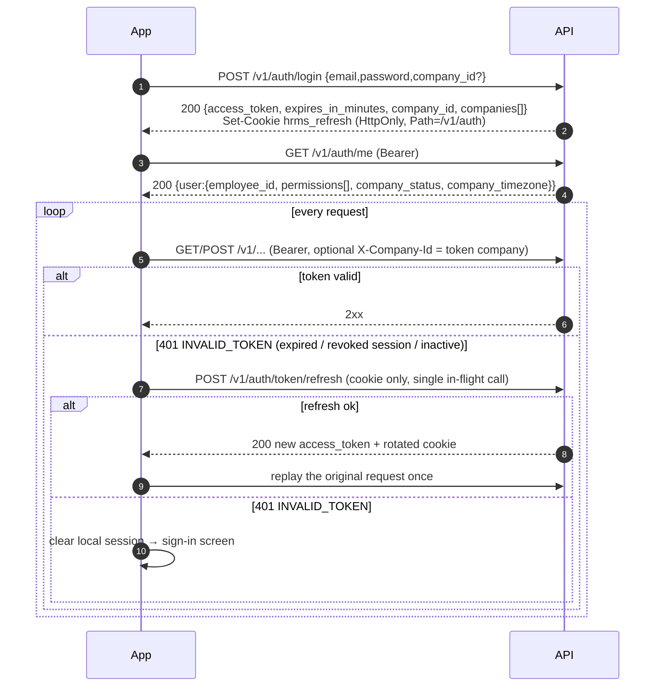
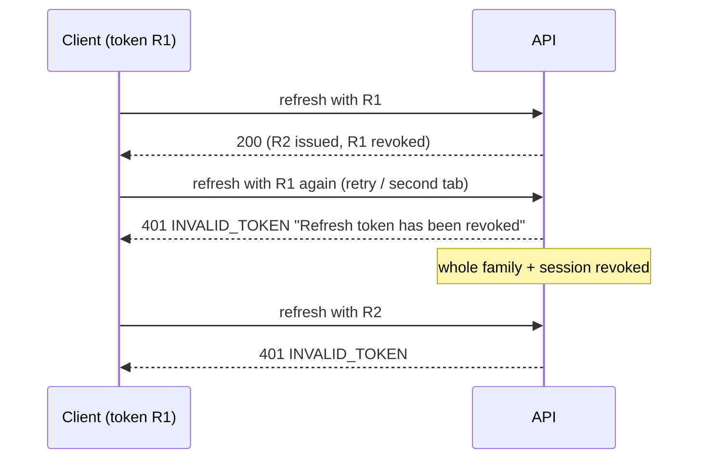
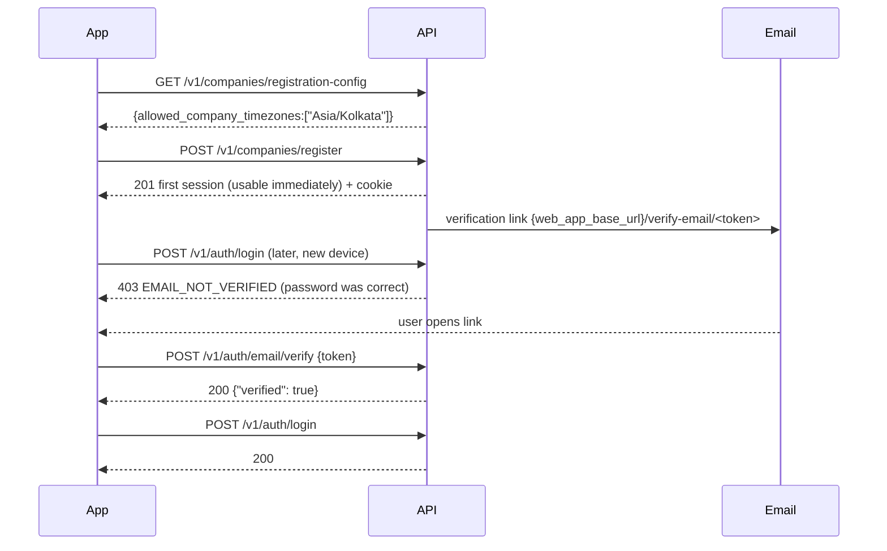

# Authentication, sessions & authorization

Everything here was read from the implementation (`apps/api/src/hrms/core/auth`, `modules/identity`, `core/tenancy`, `core/rbac`) and, where marked **[recorded]**, confirmed against a running API — see [examples/auth-and-session.md](examples/auth-and-session.md). Nothing is assumed from general JWT practice.

## 1. What exists (and what does not)

| Capability | Status | Evidence |
|---|---|---|
| Email + password sign-in | **Yes** — `POST /v1/auth/login` | `modules/identity/router.py:60` |
| Self-service company registration (creates the first admin + first session) | **Yes** — `POST /v1/companies/register` | `modules/organisation/router.py:120` |
| Account creation by invitation (employee/user invite → accept) | **Yes** — `POST /v1/employees/{id}/invite`, `POST /v1/users/invite`, public `GET/POST /v1/public/account-invites/{token}[/accept]` | `modules/account_invite` |
| Short-lived access token (JWT) + rotating refresh token | **Yes** | `core/auth/jwt.py`, `identity/service.py` |
| Logout / server-side revocation | **Yes** — session + refresh family revoked; checked on **every** request | `identity/service.py:289`, `core/auth/dependencies.py:55` |
| Password reset by email link | **Yes** — `POST /v1/auth/password/forgot`, `/reset` | `identity/service.py:421` |
| Email verification | **Yes** — `POST /v1/auth/email/verify`, `/resend-verification` | `identity/service.py:511` |
| Account lockout | **Yes** — 5 consecutive bad passwords → locked 15 min | `core/db/repositories/identity.py` (`increment_failed_login`) |
| Google / Apple / any OAuth / SSO | **No** — no code path | grep of `src/` |
| Biometric / PIN unlock server-side | **No** (local-only concern for the app) | — |
| MFA / OTP | **No** | — |
| Phone-number login | **No** — email only | `LoginRequest` |
| Switch company without re-entering the password | **No endpoint** (see [audit M-5](API_CONTRACT_AUDIT.md)) | — |
| Change password while signed in | **No endpoint** (only the forgot/reset flow) | route inventory |
| "List my sessions / revoke other devices" | **No endpoint** | route inventory |
| Tenant refresh-token in JSON body | **No** — only in a cookie (see §3) | `PublicTokenResponseData` |

A second, unrelated identity space exists for the **platform super-admin console** (`/v1/platform/*`): its own login, its own JWT (`type=platform`, `aud=platform`, 30 min, **no refresh token**), not interchangeable with tenant tokens. It is out of scope for the mobile client ([platform.md](modules/platform.md)).

## 2. Tokens

### Access token
* JWT, `HS256`, signed with the server's `jwt_access_secret`. Sent as `Authorization: Bearer <token>`.
* Claims (`core/auth/jwt.py`): `sub` (user id), `company_id`, `session_id`, `employee_id` (UUID or `null` — see below), `iat`, `exp`, `type="access"`.
* Lifetime: `jwt_access_ttl_minutes`, **default 15**; the response carries it as `expires_in_minutes` (note: *minutes*, not seconds, and not an absolute timestamp).
* The token is **bound to one company**. `employee_id` is `null` for a user with no linked `Employee` row (the company admin created at registration is exactly that). Every `/me/...` style self-service endpoint then fails — **[recorded]** `POST /v1/attendance/punches/me` → `422 VALIDATION_ERROR "The caller has no linked employee record"`.
* Permissions are **not** in the token. They are resolved from the database on each request, so role changes apply immediately; the client reads the effective list from `GET /v1/auth/me` → `data.user.permissions`.
* The token is validated against server state on **every request** (`get_current_user`): user must be `ACTIVE` and not deleted; the `session` row must exist and not be revoked; the company membership must be `ACTIVE`; the company's lifecycle status is evaluated (§6). Consequence: logout, password reset, user deactivation or company suspension take effect **immediately**, not when the 15-minute token expires. **[recorded]** "Access token of the revoked session → 401".
* Not enforced: the `session.expires_at` column is not consulted by `get_current_user` (only `revoked_at`). Practical lifetime of a session is therefore bounded by refresh-token expiry (§3), not by the session row. *(Observation from code; not separately tested.)*

### Refresh token
* Opaque random string (not a JWT); stored server-side only as a hash. Lifetime `jwt_refresh_ttl_days`, **default 30**, re-issued with a fresh 30-day expiry on every rotation (sliding).
* **Delivered only as an HttpOnly cookie** — it is *deliberately absent from the JSON body* (SEC-06). **[recorded]**:
  ```
  set-cookie: hrms_refresh=<refresh-token>; HttpOnly; Max-Age=2592000; Path=/v1/auth; SameSite=lax
  ```
  `Secure` is added only when the request URL scheme is `https` (after trusted-proxy resolution).
* `Path=/v1/auth`: the cookie is only sent to `/v1/auth/*` (refresh, logout), never to business endpoints.
* **Rotation with reuse detection**: each successful refresh revokes the presented token and issues a new one in the same *family*. Presenting an already-rotated/revoked token revokes the **whole family and the session**, so the legitimate newest token and all access tokens of that session die too. **[recorded]** "Replay the rotated refresh token… → 401" followed by "Refresh with the (now revoked) newest cookie → 401".
  * Mobile implication: never retry a refresh that may have succeeded but whose response was lost (see §7); a duplicate refresh from a double-firing interceptor looks exactly like token theft and logs the user out everywhere on that session.
* Refresh accepts the token from the cookie **or** from a JSON body `{"refresh_token": "..."}` (the body form exists for non-browser callers/tests). A native client has two options, both workable:
  1. **Cookie jar (what `apps/mobile` does today)**: use a persistent cookie store (Dart `PersistCookieJar` + `dio_cookie_manager`; `HTTPCookieStorage` on iOS; an OkHttp `CookieJar` on Android) and call `POST /v1/auth/token/refresh` with no body. The app code never touches the secret.
  2. **Manual**: read `Set-Cookie: hrms_refresh=...` from the login/refresh/register/accept response headers, keep it in Keychain/Keystore, and send it back as the body field or a `Cookie` header. *Not exercised by the repository's own client; supported by the router code (`body.refresh_token or request.cookies.get("hrms_refresh")`).*
* Refresh response is the same shape as login (`PublicTokenResponseData`) and sets a new cookie.

## 3. Endpoint summary

| Purpose | Request | Success | Notes |
|---|---|---|---|
| Register company + admin | `POST /v1/companies/register` | `201` token payload + cookie | Rate limit `auth` 10/min/IP. Company starts `PENDING_APPROVAL` when `company_approval_required` (default **true**) else `TRIAL`. Admin email gets a verification mail. |
| Log in | `POST /v1/auth/login` `{email, password, company_id?}` | `200` token payload + cookie | `company_id` selects among the user's companies; omitted → primary (or first) membership. |
| Refresh | `POST /v1/auth/token/refresh` (cookie, no body) | `200` token payload + new cookie | Rate limit `token_refresh` 10/min/IP. |
| Who am I | `GET /v1/auth/me` | `200` `{user:{id,email,company_id,employee_id,permissions[],company_timezone,company_status}}` | Call after login and after every refresh to refresh permissions. |
| Log out | `POST /v1/auth/logout` (Bearer) | `204`, clears cookie | Requires a *valid* access token; if it already expired, just discard local state. |
| Forgot password | `POST /v1/auth/password/forgot` `{email}` | `202 {"accepted":true}` always | Anti-enumeration. |
| Reset password | `POST /v1/auth/password/reset` `{token,password}` | `200 {"reset":true}` | **Revokes every session of the user on every device.** |
| Verify email | `POST /v1/auth/email/verify` `{token}` | `200 {"verified":true}` | |
| Resend verification | `POST /v1/auth/email/resend-verification` `{email}` | `202 {"accepted":true}` always | |
| Accept invite | `POST /v1/public/account-invites/{token}/accept` `{password, first_name?, last_name?}` | `201` token payload + cookie | |

Token payload (all token-issuing endpoints):
```json
{ "data": { "access_token": "<jwt>", "token_type": "Bearer", "expires_in_minutes": 15,
            "company_id": "…", "companies": [ {"id":"…","name":"…","is_primary":true} ] },
  "meta": { "request_id": "…", "server_time": "2026-10-24T13:08:46.137572Z" } }
```
Full request/response tables for each: [modules/identity.md](modules/identity.md).

## 4. Sequence diagrams

### 4.1 Sign-in, authenticated calls, silent refresh


### 4.2 Refresh-token reuse (what a double refresh looks like) **[recorded]**


### 4.3 Registration → verification → login

Important: the **first** session issued by registration is *not* blocked by an unverified email (**[recorded]**: `/auth/me` works right after registering); only a subsequent `login` is. Invite acceptance stamps `email_verified_at` itself (`account_invite/service.py:338`), so invited employees are never blocked by this.

### 4.4 Invite → account
```mermaid
sequenceDiagram
    participant HR as HR (admin app)
    participant API
    participant Emp as Employee (mobile)
    HR->>API: POST /v1/employees/{id}/invite  (EMPLOYEE.INVITE)
    API-->>HR: 201 invite {email_sent,…}; mail → {web_app_base_url}/accept-invite/<token>
    Emp->>API: GET /v1/public/account-invites/{token}
    API-->>Emp: 200 invite preview
    Emp->>API: POST /v1/public/account-invites/{token}/accept {password}
    API-->>Emp: 201 token payload + cookie  (signed in)
```
**[recorded]** in [examples/employee-self-service.md](examples/employee-self-service.md).

## 5. Failure scenarios & client behaviour

| Situation | HTTP / `error.code` | Client action |
|---|---|---|
| Missing/blank `Authorization` | `401 UNAUTHORIZED` ("Authentication required") | Go to sign-in. |
| Token expired, bad signature, wrong `type`, malformed claims | `401 INVALID_TOKEN` | One refresh attempt, then replay once. |
| Session revoked (logout, reset, reuse detection), user inactive, membership removed | `401 INVALID_TOKEN` with a specific message ("Session is no longer valid", "User is not active", "Company membership is not valid") | Refresh will also fail → clear session, sign-in. |
| Wrong password / unknown email / inactive account / not a member of requested company | `401 INVALID_CREDENTIALS` (identical message — no enumeration) | Show generic error. |
| 5 bad passwords | `423 ACCOUNT_LOCKED`, 15 min; the lock is checked **before** the password, so the right password is refused too **[recorded]** | Show lockout message; no auto-retry. |
| Email unverified | `403 EMAIL_NOT_VERIFIED` | Offer resend → verify. |
| Login/refresh rate limit | `429 RATE_LIMITED` + `Retry-After` **[recorded: 11th attempt in 60 s]** | Back off. The login limiter also keeps an **IP-wide** bucket across all emails, so many devices behind one NAT can exhaust it (see [audit M-1](API_CONTRACT_AUDIT.md)). |
| Redis down behind the limiter | `503 RATE_LIMITER_UNAVAILABLE` (`Retry-After: 5`) | Retry with backoff. |
| Company `REJECTED`/`TERMINATED` | `403 COMPANY_REJECTED` / `COMPANY_TERMINATED` on login, refresh and every request | Company-state screen; sign out. |
| Company `PENDING_APPROVAL`/`SUSPENDED` | sign-in works; every non-GET outside `/v1/auth/*` → `403 COMPANY_PENDING_APPROVAL` / `COMPANY_SUSPENDED` | Read-only mode + banner (`company_status` from `/auth/me`). |
| `X-Company-Id` differs from token company | `404 NOT_FOUND "Resource not found"` **[recorded]** | Omit the header (it is optional) or send the token's `company_id`. |

## 6. Company lifecycle gate (read-only companies)
Evaluated per request in `core/auth/company_access.py`:

| Company status | Sign-in / refresh | GET | Writes (POST/PUT/PATCH/DELETE) |
|---|---|---|---|
| `TRIAL`, `ACTIVE` | ok | ok | ok |
| `PENDING_APPROVAL`, `SUSPENDED` | ok | ok | **403** except under `/v1/auth/` |
| `REJECTED`, `TERMINATED` | **403** | **403** | **403** |

New companies start `PENDING_APPROVAL` unless the deployment sets `COMPANY_APPROVAL_REQUIRED=false`, so a mobile build pointed at a default-configured server will show read-only banners for freshly registered companies until a platform admin approves them.

## 7. Authorization: roles, permissions, data scope
* Permissions are dotted codes (`ATTENDANCE.PUNCH`, `LEAVE.APPLICATION_APPROVE`, …) — full list with the routes that use each: [PERMISSIONS.md](PERMISSIONS.md).
* A route is gated either by a **static dependency** (`require_permission(CODE)`) or by an **in-handler check** when the needed code depends on the request body (e.g. `POST /leave-applications` needs `LEAVE.APPLICATION_SUBMIT` for self but `…_ON_BEHALF` for another employee; `POST /employees/{id}/assignments` needs `EMPLOYEE.PROMOTE` or `EMPLOYEE.TRANSFER` by `change_type`). The inventory marks the latter with `*`.
* Each grant carries a **data scope**: `SELF`, `REPORTEES`, `REPORTEE_TREE`, `BRANCH`, `COMPANY`. Out-of-scope reads are generally **filtered, not rejected**: **[recorded]** `GET /v1/attendance/days?employee_id=<someone else>` as an employee → `200` with `data: []`.
* Default roles created at company registration (`organisation/service.py:223-780`): `COMPANY_ADMIN` (all permissions, COMPANY scope), `HR_ADMIN`, `REPORTING_MANAGER`, `BRANCH_MANAGER`, `EMPLOYEE`. The default `EMPLOYEE` role holds `EMPLOYEE.VIEW[_*]` (SELF), `LEAVE.APPLICATION_SUBMIT`, `LEAVE.BALANCE_VIEW`, `PAYROLL.PAYSLIP_VIEW_OWN` and, since the C-1 remediation, `ATTENDANCE.PUNCH`, `ATTENDANCE.VIEW` and `ATTENDANCE.REGULARIZATION_REQUEST` — all **SELF** scope (migration `20261020090000` backfills existing companies). Before the fix the role had no `ATTENDANCE.*` permission and every employee got `403 PERMISSION_DENIED "Permission ATTENDANCE.PUNCH is required"` (recorded in the baseline run); see [REMEDIATION_REPORT.md](REMEDIATION_REPORT.md). Employees still cannot punch for others (`PUNCH_ON_BEHALF`), list company attendance (`VIEW_ALL`), or approve anything.
* Roles are assigned with `PATCH /v1/users/{user_id}/roles {"role_codes":[…]}` (full replace, `SETTINGS.ROLE.MANAGE`). There is **no endpoint to create a role or edit a role's permissions**.
* Gate UI affordances from `permissions` in `/auth/me`; the server is still the authority.

Password policy (register, reset, invite-accept): 8–128 chars, at least one letter and one digit, not in a common-password blocklist (`core/auth/passwords.py`). Failure → `422`, `details[].code = WEAK_PASSWORD` (reset, **[source]**) — for registration the check is at `organisation/service.py:295`.

## 8. Mobile security guidance specific to this API
1. **Access token**: Keychain (iOS, `kSecAttrAccessibleAfterFirstUnlockThisDeviceOnly` or stricter) / Keystore-backed EncryptedSharedPreferences (Android). `apps/mobile` uses `flutter_secure_storage`. Keep it in memory where possible; it only lives 15 min.
2. **Refresh cookie**: store only in the platform cookie store or secure storage; exclude from backups; never log `Set-Cookie`/`Cookie` headers. Persist across app restarts (30-day sliding session) — a non-persistent jar forces a password prompt every cold start.
3. **One in-flight refresh** at a time; queue concurrent 401s behind it (the Flutter client does this with `_refreshOnce`), and **never retry a refresh that timed out** (outcome unknown, see 4.2) — fall back to sign-in instead.
4. **Do not log** request bodies for `/v1/auth/*`, `/v1/public/account-invites/*`, `/v1/companies/register`, or `Authorization`. Safe to log: `X-Request-Id` (the server echoes it, and returns it in `error.request_id`).
5. **Send your own `X-Request-Id`** (≤64 chars; the server validates/bounds it and always echoes it) so a user-visible error can be matched to server logs.
6. **Transport**: `Secure` on the refresh cookie depends on the server seeing `https` (via `X-Forwarded-Proto` from a trusted proxy). Pin to HTTPS in release builds; cleartext only for the dev emulator (`http://10.0.2.2:8000`).
7. **Email links.** Every token email carries the web URL (`{web_app_base_url}/reset-password/<token>`, `/verify-email/<token>`, `/accept-invite/<token>`, `/onboarding/<token>`). When the deployment sets `MOBILE_APP_LINK_BASE=hrms://app` the same email also contains a second link `hrms://app/<path>/<same token>` that the shipped app resolves (custom scheme registered in `AndroidManifest.xml` and `Info.plist`, router test `apps/mobile/test/deep_link_test.dart`). It is off by default. HTTPS Universal/App Links are **not** implemented: they additionally need `assetlinks.json` / `apple-app-site-association` hosted on the web domain and platform signing configuration (deployment work, see [REMEDIATION_REPORT.md](REMEDIATION_REPORT.md) §H-3). Many mail clients do not make custom-scheme links tappable, so keep the web link as the fallback.
8. **Biometric unlock** is a local concern: gate reading the stored session behind `LocalAuthentication`/`BiometricPrompt`; the server has no biometric login.
