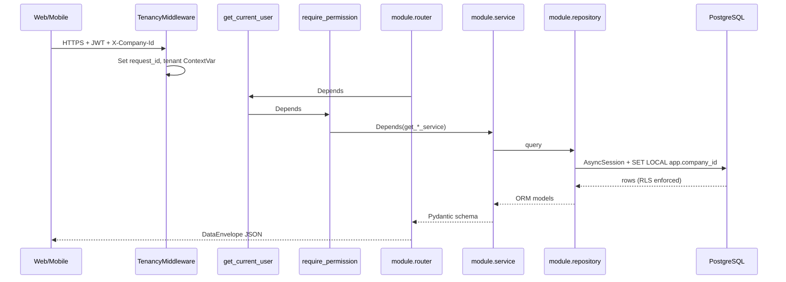

# System Architecture (FastAPI)

**Version:** Sprint 0 — developer guide  
**Authoritative product architecture:** `files/03_System_Architecture.md`  
**Stack detail:** `files/04_Technology_Stack.md`

---

## 1. Technology stack (final)

| Layer | Choice |
|-------|--------|
| API | Python 3.12+, FastAPI, Uvicorn/Gunicorn |
| ORM | SQLAlchemy 2.x async + asyncpg |
| Migrations | Alembic |
| Validation | Pydantic v2 |
| Database | PostgreSQL 16 (RLS, JSONB, pgvector) |
| Cache / broker | Redis 7 |
| Background jobs | **Celery** + Redis |
| Frontend | Next.js 14, React 18, TypeScript, Tailwind, shadcn/ui |
| AI | In-process `modules/ai/` + hosted LLM APIs + scikit-learn/XGBoost/Sentence Transformers |
| Infra | AWS ECS Fargate, Terraform, GitHub Actions, OpenTelemetry, Grafana, Sentry |

**Rejected:** NestJS, Node.js backend, Prisma, BullMQ.

---

## 2. Deployable processes (modular monolith)

One Docker image, four entrypoints (`files/03` §1.1):

```text
┌─────────────────────────────────────────────────────────────┐
│                    ECS Fargate (same image)                  │
├──────────────┬──────────────┬──────────────┬────────────────┤
│  api         │  ingestion   │  worker      │  beat          │
│  entrypoints │  entrypoints │  entrypoints │  entrypoints   │
│  .api        │  .ingestion  │  .worker     │  .beat         │
└──────┬───────┴──────┬───────┴──────┬───────┴────────┬───────┘
       │              │              │                │
       ▼              ▼              ▼                ▼
   FastAPI        FastAPI        Celery          Celery Beat
   (HR API)       (punch only)   workers         scheduler
```

| Process | Port (local) | Responsibility |
|---------|--------------|----------------|
| API | 8000 | All HR REST endpoints |
| Ingestion | 8001 | Biometric/device punch ingestion (isolated surface) |
| Worker | — | Celery consumers (payroll, notifications, AI batch) |
| Beat | — | Scheduled jobs (accrual, outbox sweep) |

---

## 3. Request flow (API)



Steps map to `files/07` §2.1: each step is a `Depends()` or middleware — not NestJS guards.

---

## 4. Database flow

- **One PostgreSQL cluster** per environment (RDS in production).
- **Shared schema**, tenant isolation via `company_id` + **Row-Level Security**.
- Application sets `set_config('app.company_id', …, true)` per transaction (`core/db/session.py`).
- **Alembic** for schema evolution; RLS and exclusion constraints in hand-written SQL (`scripts/sql/`).
- **Money** as `BIGINT` minor units + `currency` column (never float).
- **Effective-dated** child tables with `EXCLUDE USING gist` overlap prevention.

Detail: [Database Architecture](../database/Database_Architecture.md), `files/08`.

---

## 5. AI service flow (Phase 1 — in-process)

AI is **not** a separate NestJS/Node service. It lives in `modules/ai/`:

```text
API request (e.g. parse resume)
    → router → service
    → optional: enqueue Celery task (non-blocking — ADR-0009)
    → worker: OCR / LLM / embeddings
    → store results + pgvector embeddings in Postgres
    → notification module on completion
```

Hosted LLM calls (OpenAI, Claude, Gemini) from worker or API with timeout budgets.
Classical ML (scikit-learn, XGBoost) for scoring/matching runs in workers.

Detail: `files/12_AI_Architecture.md`, [ADR-004](../adr/ADR-004-AI-Service-Architecture.md).

---

## 6. Background job flow

```text
Service commits business transaction
    → outbox_event row (same TX) for money/compliance events (ADR-0012)
    → Beat: outbox sweep every 10s
    → Celery task enqueued (Redis broker)
    → Worker executes module task (company_id as first arg)
    → Idempotent handler; retries with backoff
    → OpenTelemetry trace continues API → queue → worker → DB
```

Detail: [Background Job Architecture](04_Background_Job_Architecture.md).

---

## 7. Notification flow

```text
Domain event (e.g. LeaveApproved)
    → modules/notification consumes event (Celery fan-out)
    → Resolve template + recipients
    → Channel dispatch (in-app, email, push) — async
    → notification_log append-only
```

Modules request sends via `shared/notifications_client/` → `notification.service` (planned B5).

Detail: `files/20_Workflow_Approval_Notification_Engine.md`.

---

## 8. Frontend integration

- **Next.js** (`apps/web/`) calls API at `NEXT_PUBLIC_API_URL` (default `http://localhost:8000`).
- JWT in memory (web); refresh token HttpOnly cookie (planned B1).
- Every mutating request: `Authorization`, `X-Company-Id`, `X-Request-Id`.
- API contract: `files/09_API_Standards.md`, OpenAPI at `/v1/openapi.json`.

---

## 9. Local development topology

```text
docker-compose: postgres:5433, redis:6380, minio:9000
npm run dev → scripts/dev.sh → API :8000 + Web :3000
```

---

## 10. Related documents

| Topic | Document |
|-------|----------|
| Module layout | [01_Backend_Structure.md](01_Backend_Structure.md) |
| Auth | [../security/Auth_Architecture.md](../security/Auth_Architecture.md) |
| Jobs | [04_Background_Job_Architecture.md](04_Background_Job_Architecture.md) |
| Full data dictionary | `files/08_Database_Architecture.md` |
