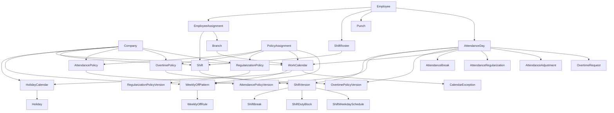

# Workforce, Shift & Attendance Architecture

**Status:** Design + audit only. No application code, migrations, frontend screens, or tests were
created or modified to produce this document. Nothing was committed.

**Date:** 2026-08-17

**Companion:** `docs/architecture/WORKFORCE_ATTENDANCE_DECISION_LOG.md`

**How to use this document:** this is the system design for Workforce Management
(Calendar → Holiday → Weekly Off → Shift → Break → Attendance Policy → Attendance → Leave →
Payroll). Implementation must not start until this architecture is reviewed and explicitly
approved. If an implementation task discovers this document is wrong, the conflict must be
written down — never silently coded around.

**Legend:**

- **FACT** — observed directly in code, schema, migrations, or tests in this audit.
- **DOC** — stated in an authoritative document; not yet built, or not independently verified.
- **DIVERGENCE** — this design consciously disagrees with a prior document. The disagreement is
  named, not silently resolved.
- **LOCKED** — decided in this document (or already locked by an ADR / existing decision log).
- **OPEN** — genuinely unresolved; requires product sign-off. Listed in §32.

---

## 1. Executive Summary

The Employee foundation is **ready** for Attendance to consume. Identity, employment, assignment
(including `shift_id`), compensation, statutory, banking, RBAC data-scope, PostgreSQL RLS via
`hrms_app`, effective-dating, audit logging, and Employee Management UI are live.

Workforce Management is **not** ready. There is no punch, no attendance day, no holiday/weekly-off
application code, no attendance policy, no overtime engine, and no leave/payroll modules. The
existing `Shift` master is definitional-only and currently mixes schedule fields with evaluation
fields (grace, half-day thresholds). Prisma-era stub tables `holiday_calendar` and `holiday`
exist in the database with no ORM, API, or UI.

This design introduces a **typed, configurable policy layer** so different companies can run
substantially different attendance behaviour without code changes — without a generic JSON rules
engine.

The load-bearing product split, used everywhere below:

| Concept | Responsibility |
|---|---|
| **Calendar** | What kind of day it is (working, weekly-off, holiday, shutdown, special working). |
| **Shift** | What the employee is scheduled to work. |
| **Attendance Policy** | How the system evaluates whether the employee followed that schedule. |
| **Leave Policy** | Whether an absence can be treated as leave. (Future module; contract only.) |
| **Payroll** | How approved attendance/leave/compensation facts become money. (Future module; contract only.) |

Do not blur these. The current `Shift` table *does* blur them (FACT). This design separates them
and migrates the evaluation fields off Shift.

**Recommended first implementation task:** Organisation-owned Work Calendar + Holiday Calendar +
Weekly-Off Pattern (expand the existing stubs, add the missing weekly-off table, attach a default
calendar to Branch). This is the structural precondition for any honest attendance status engine.
See §30.

---

## 2. Existing System Audit

Verified against the live repository on 2026-08-17. Prior documents were treated as claims and
re-checked.

### 2.1 What already exists (do not duplicate)

#### Employee identity and lifecycle — FACT

| Concern | Live location | Contract Attendance must use |
|---|---|---|
| Identity | `Employee` (`modules/employee/models.py`) | Permanent `id` / `employee_code`; never reissued on rehire (DEC-016) |
| Employment spell | `Employment` | `get_employment_as_of(employee_id, date)` — population gate |
| Org placement | `EmployeeAssignment` | `get_assignment_as_of(employee_id, date)` — branch, dept, designation, grade, managers, **shift_id**, work location |
| Compensation | `EmployeeCompensation` | Independent effective-dating. Attendance must not read it. |
| Statutory | `EmployeeStatutory` | Independent. Attendance must not read it. |
| Banking | `EmployeeBank` | Independent. Attendance must not read it. |

Employment gate (inclusive both ends, FACT):

```
joining_date <= as_of AND (last_working_day IS NULL OR last_working_day >= as_of)
```

Assignment / compensation / statutory / bank as-of (inclusive both ends, FACT):

```
effective_from <= as_of AND (effective_to IS NULL OR effective_to >= as_of)
```

`NULL` `effective_to` means currently open. Overlaps are structurally impossible via GiST
exclusion constraints (`employee_assignment_no_overlap` and siblings). A change is always
**insert a new row and close the previous** (ADR-0003, DEC-003, DEC-029). There is no generic
effective-dating framework — the pattern is hand-repeated per table.

**Note:** `RBAC_DATA_SCOPE_DECISIONS.md` Decision D describes the assignment predicate as
`effective_to > as_of` (exclusive end). The **running code** is inclusive (`>=`). Attendance must
follow the code (FACT), not the exclusive-end wording in that decision record.

Rehire: same `employee.id`, new `Employment` row linked by `previous_employment_id`. Assignment
keys on `employee_id`, not `employment_id`, so a gap between spells produces zero assignment
rows, not a data-integrity problem (DEC-016).

Termination now closes the current assignment / compensation / statutory rows at
`last_working_day` (FACT in `EmploymentService.terminate_employment`). Banking stays open for
F&F. Some older module docs still say assignment is not auto-closed; those docs are stale.

`employee.status`, `employment.status`, and `is_active` are three independent concepts
(DEC-026). Attendance's population gate is **only** `get_employment_as_of`. Never
`employee.status` or `is_active`.

`employment.status` is `ACTIVE` / `TERMINATED` only. "On notice" is derived (DEC-025).

`work_location_type` is `OFFICE` / `WFH` / `HYBRID` / `FIELD` (FACT). This is a placement hint,
not an attendance status. WFH-as-attendance-day is a separate, policy-driven concept.

`shift_id` on `EmployeeAssignment` is nullable. `NULL` means "no shift resolves" (DEC-018).
Attendance must not invent a Company → Branch → Grade default-shift cascade. BR-14's shift
default chain remains deferred for **Shift**. This design *does* implement a precedence chain
for **policies and calendars**, which is a different problem.

`SHIFT_CHANGE` is a `change_type` gated by `EMPLOYEE.TRANSFER`. Deactivated shifts remain
assignable (deliberate, consistent with branch/department references).

#### Shift master — FACT

`Shift` lives in the **organisation** module, not Attendance.

Live columns: `name`, `code` (optional, no uniqueness), `start_time`, `end_time`,
`break_minutes_paid`, `break_minutes_unpaid`, `grace_in_minutes`, `grace_out_minutes`,
`half_day_threshold_hours`, `min_hours_full_day`, `is_night_shift`, `is_cross_midnight`,
`is_ot_eligible`, `is_active`, `deleted_at`, `version`.

- CRUD: `GET/POST /v1/shifts`, `GET/PATCH/DELETE /v1/shifts/{id}`.
- Permission: `ORG.SHIFT.MANAGE` (not `ATTENDANCE.SHIFT_MANAGE` — product-matrix discrepancy
  already resolved in favour of the Sprint doc).
- Soft-deactivate, optimistic concurrency (`version` / `If-Match`), audit on mutate.
- Cross-midnight time-ordering validated in the service layer.
- **Not** effective-dated. In-place PATCH mutates the master. Historical assignment rows keep
  the same `shift_id` and would therefore see later edits if Attendance read the live row.
- **Not** versioned. No `shift_type`, no flexible/split fields, no break windows, no weekly-off
  FK, no roster, no rotation.
- Frontend: `/app/shifts` list + detail, nav item present.

This is the single most important existing constraint on Shift design: evaluation fields already
live on Shift, and Shift is mutable. Both must change for historical correctness and for the
Shift-vs-Policy split.

#### Organisation masters — FACT

Company (timezone default `Asia/Kolkata`), Legal Entity, Branch (optional `timezone`,
`state_code`, geofence columns, **no** `holiday_calendar_id` / `week_off_pattern_id`),
Department, Designation, Grade. All company-scoped, soft-deactivatable, versioned, RLS'd,
audited. Pattern Attendance config screens must copy.

#### Holiday stubs — FACT (schema only)

`holiday_calendar` (`id`, `company_id`, `name`, timestamps, `deleted_at`) and `holiday`
(`id`, `calendar_id`, `date`, `name`, `is_optional`) exist in `001_init_schema.sql` and have
RLS listed in the unused `002_row_level_security.sql`. **Zero** ORM, repository, service,
router, permission, or UI. No `year`, `state_code`, `type`, `is_paid`, substitution, or
working-holiday columns. `week_off_pattern` does **not** exist even as a stub.

#### RBAC — FACT

`require_permission(code)` returns a real `DataScope` with levels `SELF` / `REPORTEES` /
`REPORTEE_TREE` / `COMPANY` attached to `(role, permission)` (`role_permission.data_scope`).
`EmployeeService.resolve_visible_employee_ids` is the documented cross-module seam.
`DEPARTMENT` / `BRANCH` / `LEGAL_ENTITY` scopes are deliberately not built
(`RBAC_DATA_SCOPE_DECISIONS.md` Decision C). Do not invent them for Attendance.

Employee catalogue is resource/action (`EMPLOYEE.VIEW`, `.TRANSFER`, …), not a single
`EMPLOYEE.MANAGE`. Organisation config uses bundled `.MANAGE` codes. Attendance operational
APIs must follow the Employee pattern; Attendance *config* (policies) may follow the
Organisation `.MANAGE` pattern.

No `ATTENDANCE.*` codes are seeded. `COMPANY_ADMIN` receives every currently seeded permission
at registration. `EMPLOYEE_VIEWER` receives `EMPLOYEE.VIEW` only.

#### RLS / tenancy — FACT

Every tenant table: `company_id` + `ENABLE`/`FORCE ROW LEVEL SECURITY` + `tenant_isolation`
policy comparing `company_id` to `current_setting('app.company_id', true)::uuid`. Applied
inline in each migration (not via `002_row_level_security.sql`). Runtime role is `hrms_app`
(`NOSUPERUSER`, `NOBYPASSRLS`). Cross-tenant access returns **404**, never 403 (DEC-028).

#### Audit — FACT

Insert-only `audit_log` via `AuditService.record()` in the same session as the mutation.
Shape: `action`, `entity_type`, `entity_id`, `before_json`, `after_json`, actor, IP, UA,
request id. No `reason` column today — reason, where required, lives in the entity (e.g.
`change_reason`) and therefore in the JSON snapshot. `sensitive_access_log` is DOC only,
unbuilt.

#### API conventions — FACT

`/v1` prefix. `DataEnvelope` / `ListEnvelope` / `ErrorEnvelope`. `extra="forbid"`.
`If-Match` optimistic concurrency. `?as_of=` on effective-dated employee sub-resources.
Pagination is unimplemented. Module layout: `router` → `service` → `repository` → `models` /
`schemas` / `permissions` / `exceptions`. Cross-module imports: **service and schemas only**
(import-linter). Attendance may call `EmployeeService` and `OrganisationService`; it may not
import their repositories or models.

#### Frontend patterns — FACT

Next.js App Router, list page + `[id]` detail, shared form component, `lib/<entity>/types.ts`
+ `validate-*.ts`, `use-api-resource`, `usePermissions`, `If-Match` via `apiClient`,
concurrency-conflict banner, effective-date badge. Employee detail is tabbed: Overview /
Employment / Assignment / Compensation / Statutory / Banking. Assignment panel already edits
`shift_id` and `SHIFT_CHANGE`. Nav shows only screens that exist.

Employee detail has **no** calendar / attendance-policy / weekly-off assignment UI — because
those concepts do not exist.

#### Background jobs / ingestion — DOC, mostly unbuilt

Celery app exists with a sample `health.ping` task. No module `tasks.py`. Device ingestion
scaffold exists but is not mounted (ADR-0007 locked as design). Outbox table does not exist
(ADR-0002/0012). Caching layer does not exist; leave balances and today's attendance are on
the documented never-cache list.

### 2.2 What product docs already specified (DOC, not built)

SRS `docs/product/17_SRS_Phase1_Core_Modules.md` FR-ATT-001–020, FR-ORG-008/009, FR-LEV-*,
FR-PAY-008. Database architecture `docs/product/08_Database_Architecture.md` §6. ADRs 0003,
0004, 0005, 0007, 0008, 0010, 0011. Baseline `HRMS_SYSTEM_DESIGN_BASELINE.md` §6.

These remain useful. Several are **consciously overridden** by this design (see DIVERGENCE
notes and the decision log), notably:

1. Grace / half-day / min-hours living on Shift (FR-ATT-001, baseline §6.6).
2. Flexible/split fields as JSONB on Shift (`08_Database_Architecture.md` §6.1).
3. A single flattened `attendance_day.status` enum that mixes calendar type with evaluation
   result (FR-ATT-006).
4. Building the generic workflow engine as a prerequisite for Attendance regularisation
   (ADR-0008 / DEC-008).

### 2.3 Constraints Attendance must preserve

1. Inclusive-inclusive effective dating; GiST overlap prevention; insert-new, never PATCH of
   historical core values.
2. `company_id` + RLS + `hrms_app` on every new tenant table.
3. `AuditService.record()` on every mutation.
4. Optimistic concurrency on mutable masters (`version` / `If-Match`).
5. Data-scope via `EmployeeService.resolve_visible_employee_ids`; four levels only.
6. Module Standard file layout; Attendance is its own package (DEC-023).
7. UTC storage; business-day boundaries in an IANA timezone (ADR-0010).
8. Money stays integer minor units in Payroll, never here (ADR-0006).
9. Payroll inputs snapshotted; finalised runs immutable (ADR-0005).
10. Leave balance is an append-only ledger when Leave is built (ADR-0004).
11. Punches immutable once written (baseline §6.2; this design locks it).
12. `NULL` shift is legitimate (DEC-018).
13. Population gate is employment-as-of (DEC-026).
14. ALTER existing tables in place; never drop-and-recreate (DEC-021).
15. No new RBAC scope levels.
16. No generic JSON rules engine.
17. No undocumented statutory OT rates hardcoded.

### 2.4 Stale or contradictory claims (do not trust blindly)

| Claim | Reality |
|---|---|
| Baseline: Employee UI does not exist | Employee UI exists, including shift assignment |
| E-05 module doc: no Employee frontend | Stale; Assignment panel has `SHIFT_CHANGE` |
| Baseline: terminate does not close assignment | Code now closes assignment/compensation/statutory |
| Baseline §6.6: grace belongs on Shift | Product principle of *this* design moves it to Attendance Policy |
| Product matrix: `ATTENDANCE.SHIFT_MANAGE` | Live code uses `ORG.SHIFT.MANAGE` |
| `08_Database_Architecture.md` full Shift column set | Shift Rules slice built the narrow Sprint 3 set only |
| `002_row_level_security.sql` is the RLS registry | Unused; migrations apply RLS inline |
| ADR-0008: generic workflow engine exists | ADR is locked; **code does not exist** |
| Holiday calendar is ready because the table exists | Stub only; unusable |

---

## 3. Design Principles

1. **Five-way split is non-negotiable.** Calendar, Shift, Attendance Policy, Leave, Payroll
   have distinct owners and data. A field that answers "when is the person supposed to be
   here?" belongs on Shift/Calendar. A field that answers "what happens if they weren't?"
   belongs on Attendance Policy.
2. **Configuration over code, typed over generic.** Prefer enums, numeric thresholds, and
   child tables with constrained columns. JSONB is allowed only for (a) computation traces /
   snapshots, (b) device raw payloads, (c) a structured weekly-off custom matrix that is still
   schema-validated. Never a free-form expression language in V1.
3. **Historical attendance must remain reproducible.** Evaluation always uses the policy
   *version* and shift *version* effective on that date, plus a stored computation snapshot.
   Future edits do not rewrite locked history.
4. **Reuse Employee/Organisation patterns.** Effective-dated assignments, as-of reads, audit,
   RLS, optimistic concurrency, module layout, data-scope seam.
5. **Attendance produces facts, not pay.** Minutes, day fractions, OT classification, LOP
   flags. No multipliers-as-money, no PF/ESI, no payslip lines.
6. **Leave is a peer, not a subsystem.** Attendance consumes an approved-leave projection.
   Leave consumes calendar day-type and attendance lock state. Neither writes the other's
   tables (Module Standard).
7. **Derived rows are recomputed, sources are immutable.** Punches and published policy
   versions are immutable. `attendance_day` is derived and idempotently recomputed until
   locked.
8. **No generic framework before a second consumer.** No workflow engine, no employee-group
   dimension, no expression language, no DEPARTMENT data-scope in this slice.
9. **Maximum practical customisation** means a company can express the behaviours listed in
   the product brief by filling in typed policy fields — not by shipping a new code path per
   customer.
10. **Fail closed.** Missing shift, missing policy, unresolved approver, or missing employment
    never silently invents a present day.

---

## 4. Domain Model

### 4.1 Module ownership

```text
organisation/     WorkCalendar, HolidayCalendar, Holiday, CalendarException,
                  WeeklyOffPattern, WeeklyOffRule, Shift (extended), ShiftVersion,
                  ShiftBreak, ShiftDutyBlock, ShiftWeekdaySchedule
                  (org-setup configuration; follows Grade/Shift precedent)

attendance/       AttendancePolicy (+ version + rule children),
                  OvertimePolicy (+ version + rate rows),
                  RegularizationPolicy (+ version),
                  PolicyAssignment,
                  ShiftRoster, ShiftRotationPattern (when built),
                  Punch, AttendanceDay, AttendanceBreak,
                  AttendanceRegularization, AttendanceAdjustment,
                  OvertimeRequest, AttendanceLock, AttendancePeriodSummary
                  (operational + evaluation)

employee/         Unchanged. Consumed via service as-of seams.
leave/            Future. Consumed via a published projection contract.
payroll/          Future. Consumes attendance facts via snapshot.
workflow/         Future shared engine (ADR-0008). Attendance V1 does not build it.
```

**Why not a new `workforce/` package?** Shift already lives in `organisation/`. Holiday was
specified as FR-ORG. A third package would split config that the Organisation UI already
hosts (Shifts nav, Branch, Company). Attendance is the new operational module (DEC-023).

**Why not put policies in organisation?** They evaluate attendance, version with calculation,
and are assigned with attendance-specific precedence. They belong with the engine that reads
them.

### 4.2 Entity catalogue

Entities proposed below are the ones this design needs. Entities listed in the brief but
**not** created as first-class tables are called out.

#### WorkCalendar

| | |
|---|---|
| **Why** | Composes holiday calendars, a weekly-off pattern, and day exceptions into "what kind of day is this for this group." |
| **Problem** | Holiday lists are reusable catalogues; working-day structure is not the same thing. |
| **Owner** | organisation |
| **Relationships** | Company; 1:N HolidayCalendar links; optional WeeklyOffPattern; 1:N CalendarException; assigned via PolicyAssignment and/or `branch.work_calendar_id` |
| **Effective dating** | Assignment is effective-dated. The calendar identity is a mutable master; **day-defining children are dated**. |
| **Versioned?** | Published snapshot of composition stored on `attendance_day` (`calendar_snapshot`). Calendar identity is not versioned like a policy; exceptions are dated. |
| **Immutable after use?** | Historical exception/holiday rows referenced by a locked attendance day must not be mutated; corrections insert a new dated exception and recompute unlocked days. |
| **Historical records** | `attendance_day.work_calendar_id` + `calendar_day_type` + snapshot |
| **Deletable?** | Soft-deactivate. Blocked if referenced by an open assignment or current branch default. |
| **Tenant** | `company_id` |
| **RBAC** | `ORG.CALENDAR.MANAGE` |

#### HolidayCalendar

| | |
|---|---|
| **Why** | Reusable named set of holiday dates (e.g. "India National 2026", "Karnataka 2026", "Company FY26"). |
| **Problem** | Many work calendars share the same regional holidays. |
| **Owner** | organisation |
| **Relationships** | Company; 1:N Holiday; N:N WorkCalendar via `work_calendar_holiday_calendar` |
| **Effective dating** | `year` (or `valid_from`/`valid_to`) on the calendar; holidays are dated rows |
| **Versioned?** | No separate version table. Holidays are append-only dated facts. Changing a holiday date is a new row / dated correction, not an in-place rewrite of a used date. |
| **Immutable after use?** | A holiday date that has been consumed by any `attendance_day` in a locked period cannot be deleted; it can be superseded by a CalendarException. |
| **Deletable?** | Soft-deactivate calendar; individual future holidays may be removed if unused. |
| **Tenant** | `company_id` |
| **RBAC** | `ORG.HOLIDAY.MANAGE` |

**Calendar vs Holiday Calendar: they are separate.** See §6 and WD-01.

#### Holiday

Dated fact on a HolidayCalendar: type, paid flag, optional/restricted, working-holiday flag,
region tags. See §7.

#### WeeklyOffPattern + WeeklyOffRule

Reusable pattern (every Sunday; 2nd/4th Saturday; alternate Saturday). Assigned through
WorkCalendar, optionally overridden per Shift or per employee via PolicyAssignment. See §8.

#### Shift (existing, extended)

Schedule definition only after the field migration in §9. Identity stays the current `shift`
row. **ShiftVersion** captures an immutable published definition for any date Attendance
evaluates.

#### ShiftBreak / ShiftDutyBlock / ShiftWeekdaySchedule

Schedule children of a ShiftVersion. Not policy.

#### ShiftRoster

Per employee per date override of the assigned default shift (FR-ATT-002). Attendance-owned.
Unique `(company_id, employee_id, roster_date)`.

#### ShiftRotationPattern

Deferred past V1 core. Designed as an Attendance-owned generator that writes `ShiftRoster`
rows. Not required to ship punches + status resolution.

#### AttendancePolicy + AttendancePolicyVersion

The evaluation rule layer. Identity + immutable published versions. See §11.

#### OvertimePolicy + OvertimePolicyVersion

Separate from Attendance Policy because eligibility and assignment often differ (grade vs
department vs shift) and because payroll consumes OT as its own fact stream. See §12.

#### RegularizationPolicy + RegularizationPolicyVersion

Who may correct, windows, attachment/reason rules, approval chain, monthly caps. See §13.

#### AttendanceApprovalPolicy

**Not a separate table.** Approval chain is a constrained enum on RegularizationPolicy and
OvertimePolicy (`AUTO` / `MANAGER` / `MANAGER_THEN_HR` / `HR`). Building a third policy type
for four enum values is unjustified. See §14 and WD-08.

#### Punch

Immutable raw event. Partitioned by month. See §19.

#### AttendanceDay (the "AttendanceRecord")

Derived, one row per employee per *attendance date* (shift-start date for overnight shifts).
Recomputable until locked. Stores version FKs + snapshot. See §19.

#### AttendanceBreak

Actual break intervals used in the calculation (auto-deducted and/or punched). Child of
AttendanceDay.

#### AttendanceRegularization

Employee/manager/HR request proposing a correction. Auditable. Approval state machine in V1
is Attendance-owned, designed to become a workflow-engine instance later.

#### AttendanceAdjustment

Direct HR/manager correction that is not a request workflow (payroll-window fix, obvious
wrong status). Still fully audited. Distinct from regularization so self-service caps and
approval chains do not apply to HR override (`ATTENDANCE.OVERRIDE`).

#### AttendancePeriodSummary

Materialised per employee per attendance-lock period (or pay period). The payroll-facing
roll-up. Regenerated only while unlocked; frozen at lock/snapshot.

#### PolicyAssignment

Unified effective-dated assignment of Calendar / Weekly-Off / Attendance Policy / Overtime
Policy / Regularization Policy to a scope. See §15. **Shift assignment stays on
`EmployeeAssignment.shift_id` + `ShiftRoster`** — do not duplicate it here.

#### AttendanceLock

Period lock at company or legal-entity grain. Blocks recompute-as-mutation and
regularization that would change locked facts.

### 4.3 Explicitly not created

| Brief entity | Decision |
|---|---|
| `Calendar` as a third concept besides WorkCalendar and HolidayCalendar | WorkCalendar *is* the calendar. |
| `AttendancePolicy` JSON blob / rules engine | Typed version + child rule tables. |
| `AttendanceApprovalPolicy` table | Enum on the policies that need approval. |
| `EmployeeGroup` | Deferred. Existing org dimensions + Shift + Employee suffice. |
| Generic `workflow_*` tables in this slice | ADR-0008 remains the long-term target; V1 uses a local state machine. |
| Device / geofence / selfie / timesheet tables | Designed as later increments; not required for the policy/calculation core. |

---

## 5. Entity Relationships



Cross-module rule: Attendance persists **IDs** of organisation entities; it loads Shift /
Calendar through `OrganisationService`. It never joins organisation tables from
`attendance.repository`.

---

## 6. Calendar Architecture

### 6.1 WorkCalendar is the assignment-facing calendar

A WorkCalendar answers, for a given date and employee: **what kind of day is this?**

```text
calendar_day_type =
  SHUTDOWN
  | SPECIAL_WORKING          # company declared a holiday/WO as working
  | HOLIDAY                  # including optional/restricted until the employee chooses
  | WEEKLY_OFF
  | WORKING
```

Optional and restricted holidays are still `HOLIDAY` at calendar level. Whether the employee
*used* an optional/RH that day is a Leave/Attendance overlay, not a different calendar type.

### 6.2 How an employee gets a WorkCalendar

Combination of default inheritance and explicit assignment.

**Resolution order (LOCKED — WD-04):**

1. Explicit `PolicyAssignment` of kind `WORK_CALENDAR` for that employee, effective on the
   date.
2. Else `PolicyAssignment` of kind `WORK_CALENDAR` for the employee's **Shift** that date.
3. Else designation / grade / department (same PolicyAssignment machinery, see §16).
4. Else `branch.work_calendar_id` of the assignment-as-of branch.
5. Else company default WorkCalendar (`company` setting / company-scoped assignment with
   `scope_type=COMPANY`).
6. Else: fail closed — `calendar_day_type = WORKING` is **not** assumed. The day is marked
   `INCOMPLETE` / `CONFIG_ERROR` and does not silently become Present or Absent.

Department-specific holidays are **not** modelled as holidays with a department FK. If a
department observes different holidays, it gets a different WorkCalendar (possibly sharing
the same HolidayCalendars plus extra company holidays). This keeps Holiday a dated fact and
puts variation in assignment, which already has precedence.

Location-specific: Branch carries `state_code` and optional timezone. A Karnataka branch
defaults to a WorkCalendar that includes the Karnataka HolidayCalendar. Employee transferred
to a Tamil Nadu branch picks up that branch's calendar from the transfer's `effective_from`
via assignment-as-of — no extra mechanism.

### 6.3 Composition

A WorkCalendar references one or more HolidayCalendars (ordered). Union of holiday dates.
If two calendars mark the same date, **conflict precedence (LOCKED — WD-05):**

1. CalendarException on the WorkCalendar for that date (always wins).
2. `WORKING_HOLIDAY` / `SPECIAL_WORKING` exception type.
3. Company / restricted / optional holiday types beat a public holiday on the same date only
   in *metadata* (name, paid flag) — the day remains `HOLIDAY`.
4. First HolidayCalendar in the WorkCalendar's ordered list supplies the display name if
   types otherwise tie.

Holiday falling on weekly-off: calendar type is `WEEKLY_OFF` with flag `holiday_on_weekly_off`
(the holiday still exists for OT/comp-off and Leave sandwich rules). Default does **not**
move the holiday to the next working day. Substitution is an explicit CalendarException
(`SUBSTITUTED_HOLIDAY` on date B, `SPECIAL_WORKING` on date A).

### 6.4 Timezone of a calendar day

ADR-0010 names `company.timezone` as the business-day boundary. Branch also has `timezone`
(FACT, nullable).

**LOCKED for Attendance (WD-06, compatible extension of ADR-0010):** the attendance-day
boundary for an employee on date D uses:

1. `shift_version.timezone` if set,
2. else `branch.timezone` if set,
3. else `company.timezone`.

All punch timestamps remain UTC. DST: IANA zones; never store local civil time as the source
of truth. India (`Asia/Kolkata`) has no DST; the rule still exists for multi-country tenants.

### 6.5 Effective dates

WorkCalendar identity can be renamed. The *assignment* of a calendar to a scope is
effective-dated (`PolicyAssignment` or `branch.work_calendar_id` change via a dated branch
default history — see §15.3). Holidays and exceptions are dated. Changing next year's
holidays cannot alter last year's locked attendance.

---

## 7. Holiday Architecture

### 7.1 HolidayCalendar

Expand the stub (DEC-021, ALTER in place):

| Column | Notes |
|---|---|
| existing `id`, `company_id`, `name`, timestamps, `deleted_at` | keep |
| `code` | optional, unique per company when present |
| `kind` | `NATIONAL` / `REGIONAL` / `COMPANY` / `LOCATION` |
| `state_code` | nullable; regional calendars |
| `valid_from`, `valid_to` | dates; replaces a single `year` so a calendar can span FY |
| `is_active`, `version` | Organisation master pattern |

A company typically has: one National, one Regional per operating state, one Company.

### 7.2 Holiday

Expand the stub:

| Column | Notes |
|---|---|
| existing `id`, `calendar_id`, `date`, `name`, `is_optional` | keep `is_optional` during migration; also store `holiday_type` |
| `holiday_type` | `PUBLIC` / `COMPANY` / `OPTIONAL` / `RESTRICTED` / `WORKING_HOLIDAY` |
| `is_paid` | fact for payroll; default true for PUBLIC/COMPANY, configurable |
| `is_working` | true for WORKING_HOLIDAY (festival with operations) |
| `region_note` | free text |
| `replaced_holiday_id` | substitution link |
| `company_id` | denormalised for RLS (FACT pattern on every tenant table) |

`is_optional` already exists; `holiday_type=OPTIONAL` becomes the canonical field. Keep both
briefly; stop writing `is_optional` once the type column is live.

**Restricted holidays:** the employee may take N of M per year. Counting and application are
**Leave**'s problem. Attendance only needs to know: this date is a restricted holiday on the
calendar; unless Leave says the employee consumed an RH, treat as WORKING (or HOLIDAY
according to a WorkCalendar flag `restricted_holidays_are_off_by_default`, default **false** —
RH is working unless leave is applied). **OPEN (PD-CAL-1)** if any target customer treats RH
as off-by-default.

**Optional holidays:** same as RH unless the WorkCalendar flag says otherwise. Default: working
until the employee applies the optional holiday as leave.

**Working holidays:** `calendar_day_type=WORKING` with `is_holiday_named=true` so OT/comp-off
policies can still see the festival if needed. Default: evaluated as a normal working day.

**Company shutdown:** CalendarException `SHUTDOWN`, not a Holiday. Shutdown is not a festival;
it is "do not expect attendance." Paid vs unpaid shutdown is a payroll fact flag on the
exception (`is_paid`), default paid.

### 7.3 CalendarException (WorkCalendar-scoped)

| `exception_type` | Meaning |
|---|---|
| `SPECIAL_WORKING` | This date is working despite WO/holiday |
| `SHUTDOWN` | This date is not working despite otherwise WORKING |
| `SUBSTITUTE_HOLIDAY` | This date is a holiday in lieu |
| `CANCEL_HOLIDAY` | Remove a holiday from this work calendar only |

Exceptions have `effective` date (the day they apply), reason, and audit. They are the
supported way to fix "we added the wrong holiday after attendance ran" for **unlocked**
periods: insert exception → recompute. Locked periods: see §13.4 / §17.

---

## 8. Weekly-Off Architecture

### 8.1 WeeklyOffPattern is a reusable master

Not a JSON blob of arbitrary rules. Typed pattern plus child rules.

```text
WeeklyOffPattern
  id, company_id, name, code, pattern_kind, is_active, version
  pattern_kind = FIXED_WEEKDAYS | NTH_WEEKDAY | ALTERNATE | CUSTOM

WeeklyOffRule
  pattern_id, weekday (0-6), nth_in_month NULL|1|2|3|4|5|-1,
  cycle_start_date NULL,  -- for ALTERNATE (week A vs week B)
  off_fraction 1.00 | 0.50,
  week_parity NULL | EVEN | ODD
```

Examples:

| Need | Representation |
|---|---|
| Every Sunday | `FIXED_WEEKDAYS` + rule Sunday `off_fraction=1` |
| Saturday + Sunday | two FIXED rules |
| 1st and 3rd Saturday | `NTH_WEEKDAY` Saturday nth=1 and nth=3 |
| 2nd and 4th Saturday | nth=2 and nth=4 |
| Alternate Saturday | `ALTERNATE` + `cycle_start_date` + Saturday |
| Saturday half-day | Saturday `off_fraction=0.50` |
| Custom | `CUSTOM` = the same child table (any combination of the above rows). Still typed. |

"Different patterns for different employee groups" = PolicyAssignment / WorkCalendar
assignment, not a new group entity.

"Shift-specific weekly offs" = optional `weekly_off_pattern_id` on **ShiftVersion**. When
set, it overrides the WorkCalendar's pattern for employees on that shift that day
(precedence §16). Night-shift workers with a Wednesday off are the motivating case.

### 8.2 Interactions

| Module | Behaviour |
|---|---|
| **Holiday** | WO + holiday → day type WEEKLY_OFF + `holiday_on_weekly_off`. Substitution is explicit. |
| **Leave** | Leave asks Attendance/Calendar: is this date a WO? Sandwich counting is Leave's rule (FR-LEV-004). Attendance does not implement sandwich. |
| **Attendance** | No punch expected. If punches exist → weekly-off work; status stays calendar=WEEKLY_OFF with `worked_on_weekly_off`. Evaluation of those hours is Overtime Policy, not "late." |
| **Overtime** | WO work classified as `OT_WEEKLY_OFF` (or comp-off), never as ordinary OT, unless OT policy says otherwise. |
| **Payroll** | Consumes `weekly_off_days`, `weekly_off_worked_minutes`, not the pattern itself. |

Weekly-off is **schedule/calendar**, not attendance policy. A policy may say "work on WO
without approval = still OT but flagged," but it does not *define* which weekdays are off.

---

## 9. Shift Architecture

### 9.1 What belongs to Shift

Shift is **what the employee is scheduled to work**.

| Belongs on Shift / ShiftVersion | Why |
|---|---|
| name, code | identity |
| `shift_type` `FIXED` / `FLEXIBLE` / `SPLIT` | schedule shape |
| timezone (optional) | when the schedule's civil times mean |
| start_time / end_time (FIXED) | scheduled window |
| flex window start/end, core start/end, required_minutes (FLEXIBLE) | scheduled flexibility |
| duty blocks (SPLIT) | two scheduled presence windows |
| weekday schedule (optional different hours per weekday) | weekly timetable |
| `is_night_shift`, `is_cross_midnight` | schedule properties; cross-midnight may be derived and stored |
| scheduled / standard minutes | length of the planned duty |
| min/max *scheduled* minutes (cap on planned roster length) | still schedule, not evaluation |
| break *definitions* (ShiftBreak) | when breaks are planned |
| `weekly_off_pattern_id` optional | shift-specific offs |
| `operates_on_holiday` / `operates_on_weekly_off` | does this shift even run? |
| `is_ot_eligible` | "this schedule may earn OT" — not how OT is calculated |
| `is_active`, version (row concurrency) | master lifecycle |

### 9.2 What does **not** belong to Shift (move to Attendance Policy)

| Field today on Shift (FACT) | Destination |
|---|---|
| `grace_in_minutes`, `grace_out_minutes` | AttendancePolicyVersion |
| `half_day_threshold_hours` | AttendancePolicy hour bands |
| `min_hours_full_day` | AttendancePolicy hour bands |
| punch rounding | AttendancePolicy |
| late-to-half-day / late-to-absent | AttendancePolicy |
| missing-punch behaviour | AttendancePolicy |
| excess-break penalty | AttendancePolicy |
| OT thresholds, caps, multipliers | OvertimePolicy |
| approval chains | RegularizationPolicy / OvertimePolicy |

**DIVERGENCE** from FR-ATT-001 and baseline §6.6. Those documents placed evaluation on Shift
because Attendance Policy did not exist as a concept yet. Keeping them on Shift makes it
impossible for two groups on the same shift to have different grace, which is a stated
customisation requirement.

**Migration (when implementing, not now):** for each company, copy existing Shift grace /
thresholds into a new default AttendancePolicyVersion; bind that policy at COMPANY scope;
stop *reading* those Shift columns in the calculation engine; keep columns until a later
cleanup migration. Do not drop them in the first Attendance migration.

### 9.3 ShiftVersion (historical correctness)

`Shift` remains the admin identity (list screen, assignment FK). Publishing an edit inserts
`ShiftVersion` (`status=PUBLISHED`, `effective_from`, immutable body + children). Draft
versions are mutable. Attendance evaluation always reads `ShiftVersion` effective on the
attendance date, never the live mutable columns except as a convenience projection of the
current published version.

Until the first version is published, the current `shift` row *is* version 1 (backfill).

Assignment and roster still point at `shift.id`. Version is resolved by date.

In-place PATCH of published schedule fields without a new version is **rejected** once any
AttendanceDay references a version of this shift (or, simpler V1 rule: any published version
is immutable; all edits create a new version).

### 9.4 Shift types

**FIXED:** start/end required. Presence expected in that window (plus policy grace).

**FLEXIBLE:** `window_start`–`window_end` (e.g. 07:00–10:00 start), optional `core_start`–
`core_end` (must be present), `required_minutes`. No single "late vs start_time"; lateness is
defined in §11.8.

**SPLIT:** two `ShiftDutyBlock`s with an unpaid gap. Each block has start/end. Calculation
pairs punches to blocks.

**ROTATIONAL:** not a shift type. It is `ShiftRotationPattern` generating `ShiftRoster` rows
that point at ordinary FIXED/FLEXIBLE/SPLIT shifts.

### 9.5 Cross-midnight / night

FR-ATT-005 is LOCKED: the whole duty attributes to the **shift start date**. Punches after
midnight belong to yesterday's AttendanceDay if they fall in that shift's window.

`is_cross_midnight` must be consistent with start/end (already validated). `is_night_shift`
is an explicit flag (night OT classification), not inferred solely from times.

### 9.6 NULL shift

DEC-018 stands. Calculation: if roster also has no shift, Attendance Policy's
`missing_shift_behaviour` applies (`INCOMPLETE` default, configurable `ABSENT`). Never
synthesize a company default shift.

### 9.7 Roster vs default assignment

```text
shift for employee E on date D =
  ShiftRoster row for (E, D) if present
  else EmployeeAssignment.shift_id as of D
```

Roster may also mark `is_week_off_override` / `is_holiday_working_override` for a single date
(ad-hoc "you work this Sunday"). Those overrides are schedule facts, then evaluated by
policy.

---

## 10. Break Architecture

### 10.1 ShiftBreak (planned)

Child of ShiftVersion, not a JSON window list.

| Field | Notes |
|---|---|
| name | e.g. Lunch |
| `break_kind` | `FIXED_WINDOW` / `FLEXIBLE_DURATION` |
| start_time, end_time | FIXED_WINDOW |
| window_start, window_end | FLEXIBLE: when the break may be taken |
| min_minutes, max_minutes, scheduled_minutes | duration bounds |
| `is_paid` | paid breaks count toward worked/OT base per policy |
| `is_mandatory` | missing mandatory break can flag, not necessarily deduct |
| `allows_split` | one logical break in multiple intervals |
| `crosses_midnight` | allowed; attributed to the shift start date |
| sort_order | |

Examples from the brief map directly: 12:30–13:30 / 60 / unpaid / mandatory is
`FIXED_WINDOW`. 30–60 minutes between 12:00–15:00 is `FLEXIBLE_DURATION`.

Multiple breaks are multiple rows. The current `break_minutes_paid/unpaid` become *derived
sums* of ShiftBreak for display, then those integer columns are deprecated.

### 10.2 AttendanceBreak (actual)

Created during calculation:

- Auto-deduct scheduled unpaid minutes if no break punches exist and policy says
  `DEDUCT_SCHEDULED`.
- Or detect a gap between IN/OUT pairs inside a break window.
- Or explicit BREAK_OUT / BREAK_IN punches (optional later; V1 can infer from gaps).

| Effect | Rule |
|---|---|
| Worked hours | Unpaid break minutes are excluded from worked minutes. Paid break minutes are included. |
| Overtime | OT base = worked minutes after unpaid breaks, subject to OT policy `break_in_ot_base`. |
| Late/early | Breaks do not move shift start/end. Excess break is not "late"; it is `excess_break_minutes` and a policy outcome (none / deduct / flag / require approval). |
| Payroll | Receives `unpaid_break_minutes`, `paid_break_minutes`, `excess_unpaid_break_minutes` as facts. No money. |

Break approval: only when `excess_break_requires_approval` is set on Attendance Policy;
reuses the regularization request type `EXCESS_BREAK` rather than a new engine.

---

## 11. Attendance Policy Architecture

### 11.1 Shape

```text
AttendancePolicy          identity (name, code, company, is_active)
AttendancePolicyVersion   immutable once PUBLISHED; effective_from/to; typed columns
AttendancePolicyHourBand  worked-minutes → PRESENT / HALF_DAY / ABSENT
AttendancePolicyLateBand  late-minutes → flag / HALF_DAY / ABSENT / count-toward-cap
```

No expression language. Bands are ordered, non-overlapping, closed at the engine.

A draft version is mutable. Publishing freezes it. A subsequent edit clones to a new draft.
`effective_from` on publish must not overlap another published version of the same policy
(GiST per policy_id, same ADR-0003 idea).

### 11.2 Canonical evaluation fields (typed)

| Area | Fields (illustrative, not JSON) |
|---|---|
| Grace | `grace_in_minutes`, `grace_out_minutes` |
| Rounding | `punch_rounding` `NONE` / `NEAREST` / `UP` / `DOWN`; `rounding_minutes` 1/5/10/15/custom int |
| Missing punch | `missing_punch_behaviour` `INCOMPLETE` / `ABSENT` / `AUTO_CLOSE` / `REQUIRE_REGULARIZATION` |
| Auto-close | `auto_close_after_minutes`, `auto_close_uses_shift_end` |
| Hour bands | child table |
| Late bands | child table + `late_count_window` `MONTH`; `lates_to_half_day_count` nullable |
| Early departure | parallel to late (`grace_out`, bands, approval required flag) |
| Half-day | `half_day_split` `BY_HOURS` / `BY_MIDPOINT`; first/second half boundary minutes from start |
| Multiple intervals | `multi_punch_mode` `PAIR_ALL` / `FIRST_IN_LAST_OUT` |
| Duplicate collapse | `duplicate_punch_window_seconds` default 60 (FR-ATT-017) |
| Flex | see §11.8 |
| WFH/On-duty | `wfh_requires_punch`, `on_duty_requires_punch`, `wfh_uses_shift_hours` |
| Missing shift | `missing_shift_behaviour` |
| Status precedence | ordered list of primary statuses with a **fixed default**; tenant may only reorder *display*, not the engine's locked overlay order in §19.4 (OPEN PD-POL-1 if full reordering is required) |
| Break excess | `excess_break_behaviour` `IGNORE` / `DEDUCT` / `FLAG` / `REQUIRE_APPROVAL` |

Late-to-half-day-to-absent is data: bands and monthly counters, not code per company.

### 11.3 Attendance status model

**Two stored dimensions** (DIVERGENCE from FR-ATT-006's single enum):

**A. `calendar_day_type`** (from Calendar): `WORKING` / `WEEKLY_OFF` / `HOLIDAY` /
`SPECIAL_WORKING` / `SHUTDOWN`

**B. `attendance_status`** (evaluation primary state, exactly one):

| Status | Meaning |
|---|---|
| `NOT_JOINED` | no employment-as-of |
| `EXITED` | employment ended before this date |
| `NOT_EXPECTED` | shutdown / calendar says no work and no work occurred |
| `PRESENT` | followed schedule (full) |
| `HALF_DAY` | half present (hours or AM/PM) |
| `ABSENT` | expected and not present; not covered by leave |
| `LEAVE` | approved leave covers the expected portion |
| `ON_DUTY` | on-duty overlay |
| `WFH` | work-from-home overlay |
| `INCOMPLETE` | missing punch / missing shift / config error; not yet a pay fact |
| `CONFIG_ERROR` | resolvable admin problem (no policy, no calendar) |

**C. Derived flags** (boolean, combinable with A+B):

`is_late`, `is_early_out`, `is_overtime`, `is_regularized`, `is_pending_approval`,
`worked_on_holiday`, `worked_on_weekly_off`, `missing_punch`, `is_locked`,
`holiday_on_weekly_off`

**Display status** for colour grids is a pure function of A+B+C (e.g. "Late", "Holiday OT",
"Weekly Off"). UI never stores "Late" as a primary state — you can be PRESENT and late.

FR-ATT-006's `COMP_OFF` is **Leave** (a leave type / ledger), not an attendance primary
state. Attendance may show `LEAVE` + leave_type=COMP_OFF.

`PENDING_APPROVAL` is a flag, not a primary status: the underlying status remains whatever
was computed, plus `is_pending_approval` until the request resolves, then recompute.

### 11.4 Paid day fraction

`paid_day_fraction` and `lop_fraction` live on AttendanceDay as **attendance facts**
(0, 0.5, 1.0, and — if hourly leave exists later — finer). Payroll may still apply a
company day-basis (26/30/calendar) on top (FR-PAY-008). Attendance does not know 26 vs 30.

Default mapping (overridable by hour bands / leave):

| Status | paid_day_fraction | lop_fraction |
|---|---|---|
| PRESENT, WFH, ON_DUTY, NOT_EXPECTED (paid shutdown/holiday/WO) | 1.00 | 0 |
| HALF_DAY | 0.50 | 0.50 unless paid half-day leave covers the rest |
| ABSENT | 0 | 1.00 |
| LEAVE | from leave type paid flag | inverse |
| INCOMPLETE | 0 and **not** sent to payroll until resolved or lock-time policy default |

Lock-time default for still-INCOMPLETE: Attendance Policy `incomplete_at_lock_behaviour`
(`TREAT_ABSENT` default).

### 11.5 Missing punch

Configurable. Default `INCOMPLETE` + employee may regularize. `AUTO_CLOSE` uses shift end
(or last IN + scheduled minutes) and flags `auto_closed`. `ABSENT` is harsh and must be an
explicit policy choice. Manager/HR correction is always available via
`ATTENDANCE.OVERRIDE` within the lock window.

### 11.6 Punch rounding

Applied to punch times **for evaluation only**. Raw `punch.punch_time` stays exact UTC.
Rounded instants are stored on AttendanceDay (`first_in_rounded_at`, etc.) and in the
snapshot so history is explainable.

### 11.7 WFH / On Duty

`work_location_type=WFH` on assignment does **not** automatically mark every day WFH.
Day-level WFH is: roster flag, regularization type WFH, or punch source `WEB`/`MOBILE`
combined with policy. This avoids HYBRID employees becoming permanently WFH in attendance.

### 11.8 Flexible working evaluation

Example: start 07:00–10:00, core 10:00–16:00, required 8 hours.

| Question | Rule |
|---|---|
| Present? | worked_minutes (after unpaid breaks) vs hour bands, typically `>= required_minutes` |
| Late? | IN after `window_end` + grace; IN inside the window is never late |
| Core breach? | any absence during core (except approved break) sets `core_hours_breached`; policy maps to FLAG / HALF_DAY / ABSENT |
| Early out? | last OUT before required minutes are met, or before core_end if `early_out_uses_core_end` |
| Multiple intervals | `PAIR_ALL` sums all IN/OUT pairs inside the window |

Flexible breaks use ShiftBreak `FLEXIBLE_DURATION`. Grace windows on a flex shift apply only
outside the start window, not inside it.

---

## 12. Overtime Architecture

Separate policy. Attendance Policy may *detect* extra minutes; Overtime Policy decides
whether they are OT, whether they need approval, caps, rounding, and classification.

### 12.1 OvertimePolicyVersion (typed)

| Field | Notes |
|---|---|
| `eligibility` | `SHIFT_FLAG` (must have `shift.is_ot_eligible`) / `ALWAYS` / `NEVER` / `GRADE_VIA_ASSIGNMENT` |
| `min_ot_minutes` | threshold before counting |
| `rounding_minutes` + mode | |
| `requires_pre_approval` | planned OT request before the day |
| `requires_post_approval` | after the fact |
| `daily_cap_minutes`, `weekly_cap_minutes`, `monthly_cap_minutes` | |
| `comp_off_instead_of_pay` | boolean; if true, Attendance emits a `COMP_OFF_EARNED` fact for Leave, not `ot_payable_minutes` |
| `comp_off_expiry_days` | stored on the fact for Leave to consume (default 90 is **data**, not code) |

Child `OvertimePolicyRateRow`: `day_class` (`NORMAL` / `WEEKLY_OFF` / `HOLIDAY` / `NIGHT`) →
`classification_code` (string payroll will map) + optional `multiplier_decimal`.

**The multiplier is configuration, not a statutory engine.** Do not default-code "factory
workers = 2×". If a company needs 2×, they enter 2.0000. Statutory interpretation remains
Payroll/Statutory's future job (ADR-0011). Attendance may stamp `ot_classification` +
`configured_multiplier` onto the day snapshot so payroll does not re-resolve the version.

Night OT: minutes overlapping a configured night window (`night_window_start/end`) on the
OT policy, independent of `is_night_shift` (both can apply; policy `night_ot_mode`
`SHIFT_FLAG` / `WINDOW` / `BOTH`).

### 12.2 Approval

`approval_chain` enum (same as regularization). Unapproved OT: `ot_minutes` still computed as
*detected*, `approved_ot_minutes=0`, `ot_pending=true`. Payroll consumes **approved** minutes
only (FR-ATT-008: "OT must not be auto-paid without an approval record"), unless policy
`requires_post_approval=false`.

### 12.3 Comp-off

Attendance does not credit a leave ledger (ADR-0004 belongs to Leave). It emits an immutable
fact/event `CompOffEarned { employee_id, date, minutes, expiry_date, source_attendance_day_id }`
for Leave to append a ledger row when Leave exists. Until then, store the fact on
AttendanceDay (`comp_off_minutes_earned`) so nothing is lost.

---

## 13. Regularization Architecture

### 13.1 RegularizationPolicyVersion

| Field | Notes |
|---|---|
| who can request | flags: employee / manager / HR |
| `max_backdated_days` | |
| `max_requests_per_month` | employee self-service cap; HR override does not consume it |
| `reason_required`, `attachment_required` | |
| `allowed_types` | see below |
| `approval_chain` | `AUTO` / `MANAGER` / `MANAGER_THEN_HR` / `HR` |
| `auto_approve_within_minutes` | optional small clock-error window |
| `blocked_when_locked` | default true |

Types: `MISSING_PUNCH` / `WRONG_PUNCH` / `WRONG_SHIFT` / `WRONG_STATUS` / `WFH` / `ON_DUTY` /
`EXCESS_BREAK` / `FULL_DAY`.

### 13.2 Records

`AttendanceRegularization`: request, proposed punches/shift/status, reason, attachment id,
actor, status (`DRAFT`/`SUBMITTED`/`APPROVED`/`REJECTED`/`CANCELLED`), timestamps, approver
actions as child `RegularizationAction` rows (append-only).

On approve: write any synthetic punches with `source=REGULARIZATION` (still immutable
punches), set `attendance_day.is_regularized`, recompute.

Manager/HR **direct** correction without a request uses `AttendanceAdjustment` +
`ATTENDANCE.OVERRIDE`, same punch-append semantics, mandatory reason.

### 13.3 Audit

Every submit/approve/reject/adjust calls `AuditService.record`. Punches are never edited.
The computation snapshot on AttendanceDay records `regularization_id` / `adjustment_id`.

### 13.4 Payroll lock

If `AttendanceLock` covers the date: employee/manager regularization is rejected.
`ATTENDANCE.UNLOCK` (HR) can unlock with reason, or the correction is stored as
`status=APPROVED_PENDING_ARREARS` and **does not recompute** the locked day; it becomes an
arrears input for Payroll (ADR-0005). Default: reject with a clear error; pending-arrears is
an explicit HR action (`ATTENDANCE.OVERRIDE` while locked).

---

## 14. Approval Architecture

ADR-0008 / DEC-008 lock a **future** generic workflow engine. It is not built. Building it
inside Attendance would violate "no generic framework before a second consumer" and would
block the attendance slice on a 79-person-day subsystem.

**V1 (LOCKED — WD-08):** Attendance-local state machine for regularization and OT only.

```text
AUTO                 → approved on submit
MANAGER              → reporting_manager_id as of the attendance date
HR                   → any user with ATTENDANCE.REGULARISE_APPROVE at COMPANY
MANAGER_THEN_HR      → manager then HR
```

Resolution failure (no manager): route to HR, audit `APPROVER_UNRESOLVED`. Never auto-approve
on failure (aligns with Doc 20's failure rule).

Approver identity is snapshotted on the request at submit time (manager as of the **day
being corrected**, not as of today — transfers must not move old requests to the new
manager). OPEN (PD-APR-1): some companies want the *current* manager. Default is
**as-of the attendance date**.

**V2:** when `workflow/` is built (likely with Leave), these four chains become four
`workflow_definition` records; Attendance stores `approval_request_id` and stops advancing
its own status machine. Schema leaves a nullable `approval_request_id` from day one.

Do not implement Doc 20 node types, expression language, or SLA engine in this slice.

---

## 15. Policy Assignment

### 15.1 Unified table

```text
policy_assignment
  id, company_id
  policy_kind     WORK_CALENDAR | WEEKLY_OFF | ATTENDANCE_POLICY | OVERTIME_POLICY | REGULARIZATION_POLICY
  policy_id       UUID  -- identity, not version
  scope_type      COMPANY | LEGAL_ENTITY | BRANCH | DEPARTMENT | GRADE | DESIGNATION | SHIFT | EMPLOYEE
  scope_id        NULL iff COMPANY
  effective_from, effective_to
  priority        INT default 0  -- only consulted within the same scope_type
  reason
  version, deleted_at, timestamps
```

GiST exclusion: no overlap of `(company_id, policy_kind, scope_type, scope_id)` ranges
unless `priority` differs — simpler V1: **forbid overlap at the same
(kind, scope_type, scope_id)** regardless of priority; use `priority` only if we later
allow two assignments at one scope. **LOCKED V1: no overlap at same scope.** To change a
department policy, close the old assignment and insert a new one (DEC-029 pattern).

Version of the policy is **not** stored on the assignment. Evaluation resolves
`PolicyVersion` by `effective_on = attendance_date`. That way a July version of Policy A
applies to everyone assigned Policy A, without re-assigning.

### 15.2 What is not assigned this way

- **Shift:** `EmployeeAssignment.shift_id` + `ShiftRoster` (already built + to-be-built).
- **Leave policy:** future Leave module.
- **Compensation:** already its own table.

### 15.3 Branch default calendar

`branch.work_calendar_id` is a convenience default (fills the BRANCH level of the chain
without a PolicyAssignment row). Changing a branch's default calendar is a **dated** event:
do not PATCH the column in a way that rewrites history. Implement as either:

- PolicyAssignment `scope_type=BRANCH` (preferred, one mechanism), or
- a small `branch_calendar_history` effective-dated table.

**LOCKED:** use PolicyAssignment at BRANCH (and COMPANY) for calendars. Also store
`branch.work_calendar_id` as a cached pointer to the current open assignment for UI
convenience, updated when the current assignment changes — or omit the column and always
query PolicyAssignment. Prefer **no extra column** to avoid two sources of truth.
`branch.work_calendar_id` stays absent (FACT today) until PolicyAssignment ships.

### 15.4 Employee-level explicit assignment

Supported. This is "Employee X: Attendance Policy D". Effective-dated, insert-new.

---

## 16. Precedence Rules

For a given `policy_kind` on date D for employee E, collect all PolicyAssignment rows whose
scope matches E's assignment-as-of D (and shift-as-of D), with `effective_from <= D <=
effective_to`.

**Most specific wins (LOCKED — WD-09):**

```text
1. EMPLOYEE
2. SHIFT          (the shift resolved for that date, including roster)
3. DESIGNATION
4. GRADE
5. DEPARTMENT
6. BRANCH
7. LEGAL_ENTITY
8. COMPANY
```

If none: fail closed (`CONFIG_ERROR` for attendance/OT/regularization policy; calendar
behaviour in §6.2 step 6).

**No Employee Group** in V1. If two matches somehow appear at the same level (should be
prevented by the overlap constraint), the engine picks `effective_from` latest, then
`created_at` latest, and writes a warning into the computation trace. Do not use this as a
feature.

Worked example from the brief:

| Assignment | Level |
|---|---|
| Company default Policy A | 8 |
| Night shift Policy B | 2 (SHIFT) |
| Engineering department Policy C | 5 |
| Employee X Policy D | 1 |

Employee X on a night shift in Engineering → **D**. Another engineer on night shift → **B**
(shift beats department). A day-shift engineer → **C**. Anyone else → **A**.

Weekly-off pattern precedence is the same chain, except ShiftVersion.weekly_off_pattern_id
is treated as a SHIFT-level assignment if no explicit WEEKLY_OFF PolicyAssignment exists at
SHIFT. WorkCalendar's pattern is the COMPANY/BRANCH default, not a hidden extra level.

---

## 17. Effective Dating

Reuse ADR-0003 mechanically:

| Object | Pattern |
|---|---|
| PolicyAssignment | `effective_from`/`effective_to`, GiST, insert-new |
| Policy versions | `effective_from`/`effective_to` per parent policy, GiST, publish-immutable |
| ShiftVersion | same as policy versions |
| EmployeeAssignment | existing |
| Employment | existing |
| Holidays / exceptions | the date *is* the effective date |
| Roster | the roster_date *is* the effective date |

Inclusive-inclusive, matching live Employee code.

Future-dated assignments are ignored until `as_of` reaches `effective_from` (already true
for Employee).

Concurrent policy changes: optimistic concurrency on identity `version`; two publishes with
overlapping version ranges fail the GiST constraint.

---

## 18. Versioning

```text
January Policy A v1  grace=15   published effective_from=2026-01-01
July    Policy A v2  grace=10   published effective_from=2026-07-01
  → v1.effective_to = 2026-06-30
```

Attendance for 2026-03-12 stores:

- `attendance_policy_version_id` → v1
- `shift_version_id`
- `overtime_policy_version_id`
- `computation_snapshot` JSONB (inputs + trace)

Recompute of an **unlocked** day re-resolves versions by date (so a backdated v2 with
`effective_from=2026-01-01` *would* change March if unlocked — backdating is a privileged
act requiring reason and `ATTENDANCE.RECOMPUTE`). Locked days never recompute; snapshot
stands.

Payroll snapshots **facts** from AttendancePeriodSummary / AttendanceDay (`paid_day_fraction`,
OT minutes, …), not policy rows (ADR-0005). A later policy edit cannot change a finalised
payslip.

Published versions cannot be PATCH'd. Correction = new version or a CalendarException.

---

## 19. Attendance Calculation Pipeline

Idempotent. Same punches + versions + leave projection + regularizations → same
AttendanceDay. SRS §5.1 invariant.

### 19.1 Order (LOCKED — WD-10)

```text
 1. Employment-as-of(date)
      none → NOT_JOINED or EXITED; stop
 2. Assignment-as-of(date)
      resolve branch, dept, designation, grade, manager, default shift_id,
      work_location_type
 3. Resolve timezone (ShiftVersion > Branch > Company)
 4. Resolve shift
      roster(date) else assignment.shift_id else missing-shift policy
 5. Resolve WorkCalendar (precedence §16 / §6.2)
 6. Classify calendar_day_type (exceptions > holidays > weekly-off > working)
 7. Resolve AttendancePolicyVersion, OvertimePolicyVersion,
    RegularizationPolicyVersion by precedence + date
 8. If calendar says not expected and shift.operates_on_* is false
      and no roster working override:
        if no punches → NOT_EXPECTED; still run OT if punches appear (step 14)
 9. Load punches in [shift_window in UTC], collapse duplicates
10. Pair intervals (PAIR_ALL or FIRST_IN_LAST_OUT); attribute to shift start date
11. Resolve AttendanceBreaks
12. Worked minutes = presence − unpaid breaks
13. Apply punch rounding (evaluation copies only)
14. Load approved leave projection for this date (Leave contract)
15. Load approved regularization / adjustment for this date
16. Overlay leave / WFH / on-duty (precedence §19.4)
17. Late / early / hour-band / missing-punch / excess-break
18. Detect OT minutes; apply OT policy (caps, approval, classification)
19. Write AttendanceDay + flags + paid_day_fraction + snapshot
20. If period locked, refuse write unless UNLOCK/arrears path
```

Recompute is full replacement of derived fields, not a patch (baseline §6.4, kept).

Debounce: 60s per (employee, date) after punch ingest (ADR-0007 / baseline). Celery task
owned by attendance.

### 19.2 Ingestion vs calculation

Device ingestion (future service) only writes Punch. Core API calculation owns AttendanceDay.
Never compute inside the device handler.

### 19.3 Leave overlay (see also §21)

Approved leave is applied **before** late/absent conversion so a person on approved leave
who does not punch is `LEAVE`, not `ABSENT`. If they punch while on leave, policy
`work_on_leave_behaviour`: `KEEP_LEAVE` (default) / `PRESENT_CANCEL_LEAVE_HINT` (Attendance
sets flag; Leave must cancel — Attendance never writes the leave ledger).

### 19.4 Overlay precedence (LOCKED)

```text
NOT_JOINED / EXITED
  > approved LEAVE covering the full expected day
  > ON_DUTY / WFH (approved)
  > calendar NOT_EXPECTED (holiday/WO/shutdown) without work
  > punch-derived PRESENT / HALF_DAY / ABSENT / INCOMPLETE
```

Work on holiday/WO does not change `calendar_day_type`; it sets `worked_on_*` and evaluates
OT. Primary `attendance_status` becomes `PRESENT` (or HALF_DAY) **in addition to** calendar
HOLIDAY/WEEKLY_OFF.

Half-day leave + half-day work: `attendance_status=HALF_DAY` or `LEAVE` with
`worked_minutes` and `leave_fraction=0.5` both set. Payroll sees `paid_day_fraction=1.0` if
the leave is paid, else `0.5 + 0.5`.

---

## 20. Edge Cases

| Case | Behaviour |
|---|---|
| Overnight shift | All punches in the window belong to start date (FR-ATT-005). |
| Clock-in before midnight, out next day | Same AttendanceDay. |
| Holiday during overnight | Calendar type from **start date**. Working into a holiday morning is not a holiday day. |
| Weekly-off during overnight | Same — start date. |
| Break crosses midnight | ShiftBreak `crosses_midnight`; attributed to start date. |
| Missing OUT | Missing-punch policy. Default INCOMPLETE. |
| Multiple IN/OUT | Policy `multi_punch_mode`. Default PAIR_ALL. Unpaired last IN = missing OUT. |
| Duplicate punches | Collapse within `duplicate_punch_window_seconds` (default 60). Idempotency key rejects exact device duplicates. |
| Late / early | Policy bands after grace and rounding. |
| Shift changed mid-day | Effective dating is daily, not intra-day. Roster or assignment `effective_from` is a date. Mid-day change = the new shift applies from that **calendar date** (the whole duty). Intra-day split shifts are SPLIT type, not two assignments. |
| Transfer | assignment-as-of(date) picks the new branch/calendar/shift from `effective_from`. Prior days unchanged. |
| Termination | employment-as-of false after `last_working_day`; last day is included (inclusive). Assignment closed at last working day. |
| Rehire | gap days NOT_JOINED/EXITED; new spell starts at new `joining_date`. Same employee_id. |
| Policy changed while pending | Unlocked days re-resolve version by **date**, not by "current". Pending regularization stays on its snapshotted proposed values until approved, then recompute with versions-as-of that date. |
| Holiday calendar changed after generate | Unlocked recompute; locked freeze + notify. |
| Leave applied after attendance generated | Event → recompute unlocked day (FR-ATT-019). Locked → Leave must not silently apply; see §21. |
| Regularization after payroll | Reject or arrears path (§13.4). |
| Payroll locked | AttendanceLock aligned with pay-run snapshot. |
| Branch change | Calendar/timezone follow new branch from effective_from. |
| Shift change | SHIFT_CHANGE assignment or roster. |
| Manager change | New regularizations as-of the day; in-flight requests keep snapshotted manager (PD-APR-1). |
| Timezone differences | §6.4. |
| DST | IANA; gap/overlap hours follow zoneinfo. India unaffected. |
| Future-dated assignments | Ignored until date. |
| Concurrent policy publishes | GiST + version column. |
| No shift | Policy missing-shift behaviour. |
| Buddy punching / device bind | Deferred with device management (FR-ATT-012/016). Not in core calculation. |

---

## 21. Leave Integration Contract

Leave is not implemented. Attendance depends on this **read model** published by Leave
(service method, not table sharing):

```text
LeaveDayProjection
  employee_id, date
  leave_application_id, leave_type_id, leave_type_code
  fraction        0.5 | 1.0
  half            FIRST | SECOND | null
  is_paid
  status          APPROVED  -- only approved rows are visible
```

Attendance **may not** write leave tables. Leave **may not** write attendance tables. Leave
approval emits a domain event `LeaveApproved` / `LeaveCancelled`; Attendance recomputes.

| Question | Contract |
|---|---|
| Leave overrides absence? | Yes, if approved and covering the expected portion. |
| Leave overrides late/early? | Full-day leave: late/early not computed. Half-day leave: computed only on the working half. |
| Half-day leave + half-day attendance | Supported; fractions add; paid_day_fraction per §11.4. |
| Leave on holiday / WO | Attendance does not block it. Leave's sandwich / "counts holidays" rules decide whether the leave *consumes a day*. Attendance will still classify the calendar type as HOLIDAY/WO. |
| Unpaid leave → payroll | `attendance_status=LEAVE`, `is_paid=false` → `lop_fraction` += leave fraction. |
| Leave cancellation after payroll | Same as regularization-after-lock: Leave must refuse or mark arrears; Attendance locked day unchanged. |
| Attendance generated before leave approval | Day may be ABSENT/INCOMPLETE; approval triggers recompute to LEAVE. |
| Leave approved after payroll lock | Leave module must consult AttendanceLock (service). Default refuse; HR exception creates arrears, not a rewrite. |

Comp-off consume is Leave. Comp-off earn is Attendance fact (§12.3).

Restricted/optional holiday taking is Leave using Holiday facts from Organisation.

---

## 22. Payroll Integration Contract

Payroll is not implemented. Attendance publishes facts only.

### 22.1 Per day (AttendanceDay, locked subset)

```text
employee_id, attendance_date
calendar_day_type
attendance_status
paid_day_fraction, lop_fraction
worked_minutes, unpaid_break_minutes, paid_break_minutes
ot_minutes_detected, ot_minutes_approved
ot_classification  NORMAL | WEEKLY_OFF | HOLIDAY | NIGHT
configured_multiplier   # informational; payroll may ignore and use its own tables
comp_off_minutes_earned
worked_on_holiday, worked_on_weekly_off
late_minutes, early_out_minutes, late_count_contributed
penalty_codes[]    # e.g. LATE_TO_HALF; no amounts
bonus_codes[]      # attendance bonus flags if policy set; no amounts
is_locked
computation_snapshot_id / version ids
```

### 22.2 Per period (AttendancePeriodSummary)

Present/absent/leave/holiday/WO/half-day counts, LOP days, OT hours by class, late count.
This is FR-ATT-018.

Payroll SNAPSHOT INPUTS copies these rows into `payrun_input_snapshot` (ADR-0005). After
that, AttendanceLock should already be on. Further attendance changes do not mutate
snapshotted rows.

Penalty/bonus **amounts** are Payroll (salary components referencing `penalty_codes` /
attendance values in the future formula builder). Attendance never computes rupees.

Statutory OT, PF on OT, tax: Payroll/Statutory, never Attendance.

---

## 23. RBAC / Security

### 23.1 Do not invent new data-scope levels

Use `SELF` / `REPORTEES` / `REPORTEE_TREE` / `COMPANY`. Resolve employee IDs via
`EmployeeService.resolve_visible_employee_ids`. Team attendance = `ATTENDANCE.VIEW` with
`REPORTEES` or `REPORTEE_TREE`. HR company-wide = `COMPANY` or `ATTENDANCE.VIEW_ALL`.

### 23.2 Permission catalogue (Attendance)

Follow Employee's resource/action style, mapped onto the product matrix without
`VIEW_OWN`/`VIEW_TEAM` as separate codes (those are scopes).

| Code | Typical default scope | Purpose |
|---|---|---|
| `ATTENDANCE.VIEW` | SELF / REPORTEES / COMPANY | Read days, punches, summaries |
| `ATTENDANCE.VIEW_ALL` | COMPANY | Ignore reporting tree (HR) |
| `ATTENDANCE.PUNCH` | SELF | Self punch (web) |
| `ATTENDANCE.PUNCH_ON_BEHALF` | COMPANY | Manual punch for others |
| `ATTENDANCE.EDIT` | COMPANY | Roster / non-override edits |
| `ATTENDANCE.OVERRIDE` | COMPANY | Direct adjustment, including locked-arrears path |
| `ATTENDANCE.REGULARISE_REQUEST` | SELF | Employee request |
| `ATTENDANCE.REGULARISE_APPROVE` | REPORTEES or COMPANY | Approve |
| `ATTENDANCE.OT_APPROVE` | REPORTEES or COMPANY | |
| `ATTENDANCE.LOCK` / `.UNLOCK` | COMPANY | Period lock |
| `ATTENDANCE.RECOMPUTE` | COMPANY | Privileged recompute / backdated policy |
| `ATTENDANCE.POLICY_MANAGE` | COMPANY | Attendance/OT/regularization policies + assignments |
| `ATTENDANCE.ROSTER_MANAGE` | COMPANY | |
| `ATTENDANCE.EXPORT` | COMPANY | |

Organisation:

| Code | Purpose |
|---|---|
| `ORG.SHIFT.MANAGE` | Existing; extended for versions/breaks/types |
| `ORG.HOLIDAY.MANAGE` | Holiday calendars + holidays (named in product matrix) |
| `ORG.CALENDAR.MANAGE` | WorkCalendar + WeeklyOffPattern |

Do not add `ATTENDANCE.SHIFT_MANAGE`. Do not add `DEVICE_MANAGE` / `GEOFENCE_MANAGE` until
those features.

Config screens are COMPANY-scoped (like Grade). Employee self-service never manages policies.

### 23.3 Sensitive attendance data

Punches (location, selfie later) are personal data. `ATTENDANCE.VIEW` is sufficient; no
separate RESTRICTED classification in V1 unless location is stored — if geo columns ship,
treat lat/long as RESTRICTED and omit them from team grid payloads (field-level, not a new
RBAC level).

### 23.4 Tenant isolation

Every new table: `company_id`, RLS policy identical to `shift`, grants to `hrms_app` via
existing default privileges.

---

## 24. Audit

Mutations that must `AuditService.record`:

Policy identity/version publish, PolicyAssignment, Holiday/Exception, WeeklyOffPattern,
ShiftVersion publish, Roster write, Punch manual/on-behalf, Regularization transitions,
Adjustment, OT approve/reject, Lock/Unlock, Recompute (privileged).

Device punches: do not flood `audit_log` per biometric event; Punch row *is* the audit.
Manual punches do both.

Reason: store on the entity (`publish_reason`, `unlock_reason`, regularization `reason`) so
it appears in `after_json`. Do not add a column to `audit_log` in this slice.

Who / what / before / after / when are already in `audit_log`. Previous version = previous
published `*_version` row + assignment close.

---

## 25. API Requirements

Prefix `/v1`. Envelopes, `If-Match` on mutable masters, `?as_of=` on assignment-like GETs,
404 cross-tenant.

### Organisation (config)

```text
/work-calendars  CRUD + exceptions
/holiday-calendars  CRUD
/holiday-calendars/{id}/holidays  POST dated holidays; no PATCH of used dates
/weekly-off-patterns  CRUD + rules
/shifts  existing; extend payloads
/shifts/{id}/versions  list, create draft, publish
/shifts/{id}/breaks     via version
```

### Attendance

```text
/attendance/policies  CRUD identity
/attendance/policies/{id}/versions  draft / publish
/overtime-policies  same
/regularization-policies  same
/policy-assignments  POST insert-new (DEC-029), GET ?as_of=&employee_id=
/rosters  bulk + per employee/date
/punches  POST (self / on-behalf), GET (scoped)
/attendance-days  GET filters: employee, team, date range, status, exceptions
/attendance-days/{id}/recompute  POST privileged
/regularizations  POST/GET/approve/reject
/adjustments  POST OVERRIDE
/overtime-requests  POST/approve
/attendance-locks  POST lock/unlock
/attendance-summaries  GET period
```

Cross-module: Attendance service calls `EmployeeService.get_employment_as_of`,
`get_assignment_as_of`, `resolve_visible_employee_ids`; `OrganisationService.get_shift` (and
new calendar getters).

Events (outbox when ADR-0012 infrastructure exists; until then, in-process service calls are
acceptable for leave↔attendance inside the monolith, documented as a temporary seam):
`AttendanceDayRecomputed`, `AttendancePeriodLocked`, `CompOffEarned`.

---

## 26. Frontend Requirements

No visual design. Functional inventory.

### 26.1 Workforce settings (HR / Company Admin)

| Screen | Data needed |
|---|---|
| Attendance Policies list/detail | identity, versions, hour bands, late bands, publish, effective dates |
| Overtime Policies | eligibility, caps, rate rows, approval chain |
| Regularization Policies | windows, caps, types, approval chain |
| Policy Assignments | kind, scope picker (company/LE/branch/dept/grade/designation/shift/employee), effective dates, live preview "who gets this" |
| Shift Management | existing screens + type, flex/split fields, breaks editor, weekday schedule, version history, publish |
| Holiday Calendars | list, year/state, holiday grid |
| Weekly-Off Patterns | rule builder for the supported kinds |
| Work Calendars | compose holiday calendars + WO pattern + exceptions |

### 26.2 Calendar

Month view for a WorkCalendar: working / WO / holiday / shutdown / special working /
optional / restricted. Create holiday, exception, bulk import national holidays (data, not
hardcoded). Regional calendar clone. Conflict highlighting when a holiday lands on WO.

### 26.3 Employee (extend existing tabs)

Do **not** stuff policies into Assignment unless they are shift. New "Workforce" panel or
sub-section:

- Assigned shift (already on Assignment) + roster peek
- Effective WorkCalendar (resolved + explicit override)
- Effective Attendance / OT / Regularization policies (resolved + explicit override)
- Effective dates and history (as-of timeline, same pattern as compensation history)

### 26.4 Attendance operations

| Screen | Data |
|---|---|
| Daily attendance / matrix | employees × dates, display status colour, calendar type, flags |
| Employee attendance | month calendar + day drawer (punches, breaks, snapshot explain) |
| Team attendance | data-scope filtered |
| Exceptions | INCOMPLETE, missing punch, late, core breach, config error |
| Regularization inbox | pending requests, approve/reject |
| Overtime inbox | detected vs approved |
| Locks | period, legal entity, who, reason |

ESS punch button and "today" status: FR-ESS-001; needs `ATTENDANCE.PUNCH` + SELF view.

Manager one-tap approve: FR-ESS-007; `REGULARISE_APPROVE` + REPORTEES.

---

## 27. Database Requirements

- PostgreSQL 16, UUID PKs, `company_id` NOT NULL, RLS FORCE, `hrms_app` DML.
- Expand `holiday_calendar` / `holiday` in place (DEC-021).
- New tables listed in §4; GiST exclusion on PolicyAssignment, policy versions, shift
  versions (per parent).
- `punch` and `attendance_day` **PARTITION BY RANGE** on local month (DOC 08; required before
  volume, acceptable to ship first migration already partitioned).
- Punch: `UNIQUE (company_id, idempotency_key)`; `punch_time TIMESTAMPTZ`; generated
  `punch_date_local` is *not* the attendance date for overnight shifts — attendance date is
  computed, not the partition key of punches. Partition punches by UTC month of `punch_time`
  (operational), not by attendance date.
- `attendance_day UNIQUE (company_id, employee_id, attendance_date)`.
- Indexes: `(company_id, attendance_date, attendance_status)`,
  `(company_id, employee_id, attendance_date DESC)`,
  `(company_id, employee_id, punch_time)`.
- JSONB: `computation_snapshot`, `raw_payload` only.
- `version INTEGER` on mutable identities; not on Punch.
- Soft-deactivate masters (`is_active`, `deleted_at`); never hard-delete punches or published
  versions.
- Every tenant table in the RLS CI check.

---

## 28. Performance Considerations

- Recompute is per (employee, date), debounce 60s.
- Period recompute (holiday added) is a Celery fan-out by employee batch, not a request-thread
  loop.
- Team matrix: query `attendance_day` by `(company_id, date, employee_id IN visible_ids)`,
  not punches.
- Visible IDs from reporting CTE must be reused, not re-walked per cell.
- Do not cache today's attendance status (product never-cache list).
- Partition maintenance (monthly) is an ops task before 150k-employee scale; V1 tenants will
  not notice.
- Policy resolution: load assignment once, then select matching PolicyAssignment rows for
  those scope ids — not eight queries.

---

## 29. Migration Strategy

1. Expand holiday stubs; create weekly_off_pattern, work_calendar, exceptions; RLS; no
   application cutover issues (unused tables).
2. Additive Shift columns (`shift_type`, flex fields, timezone) with defaults so existing
   FIXED shifts keep working; backfill ShiftVersion v1 from current row.
3. Create ShiftBreak from `break_minutes_*` as a single unnamed unpaid/paid pair if minutes
   > 0.
4. Seed a default AttendancePolicy per company from each distinct Shift grace/threshold
   fingerprint; COMPANY-level PolicyAssignment; engine reads policy, not Shift grace.
5. Leave Shift grace columns in place (read-deprecated) until a later cleanup.
6. Punch / attendance_day partitioned tables empty at first.
7. No data backfill of attendance (no punches exist).
8. Permissions seeded idempotently in `seed_b1_foundation` + granted to COMPANY_ADMIN at
   registration (same pattern as `ORG.SHIFT.MANAGE`).

---

## 30. Implementation Sequence

Do not start until this document is approved.

| Slice | Scope | Why this order |
|---|---|---|
| **W0** | Architecture approval (this doc) | — |
| **W1** | WorkCalendar + HolidayCalendar/Holiday + WeeklyOffPattern + exceptions + ORG permissions + UI | Unblocks day type; expands existing stubs; Organisation pattern is known |
| **W2** | Shift extension: type, flex/split, breaks, ShiftVersion, deprecate evaluation fields in *docs/API* | Schedule vs policy split |
| **W3** | AttendancePolicy + OT policy + RegularizationPolicy + versions + PolicyAssignment + UI | Evaluation config without punches |
| **W4** | Punch (web/manual) + AttendanceDay + calculation engine (no OT approval, no devices) + employee/team views | First operational value |
| **W5** | ShiftRoster + NULL-shift behaviour + overnight tests | FR-ATT-002/005 |
| **W6** | Regularization + local approval + adjustments + audit | Corrections |
| **W7** | Overtime detection + approval + caps + comp-off facts | |
| **W8** | AttendanceLock + period summary + payroll fact contract tests | ADR-0005 seam |
| **W9** | Leave projection adapter (mocked until Leave exists) + recompute-on-event | FR-ATT-019 |
| **W10** | Device ingestion / geo / offline / ESS mobile | ADR-0007; after core is correct |
| **W11** | Rotation pattern generator | Optional |
| **W12** | Migrate approval to workflow engine when that module exists | ADR-0008 |

**Recommended first implementation task:** **W1 — Calendar / Holiday / Weekly-Off in
organisation.**

---

## 31. Risks

| Risk | Mitigation |
|---|---|
| Existing Shift evaluation fields vs new policy | Copy-forward migration; dual-read period; tests that engine ignores Shift grace once policy exists |
| Mutable Shift rewriting history | ShiftVersion before any AttendanceDay write |
| ADR-0008 vs local approvals | Nullable `approval_request_id`; four-chain enum only |
| Inclusive vs exclusive as-of docs | Follow running Employee code |
| Holiday stub too thin | ALTER in place; don't recreate |
| Calculation complexity | Golden-file tests per policy version; snapshot on every day |
| Recompute storms when adding a holiday | Batched Celery; lock check |
| Cross-module leave race | Events + idempotent recompute; lock consultation |
| NULL shift population | Explicit INCOMPLETE; HR dashboard exception |
| Branch timezone vs ADR-0010 | Documented extension WD-06 |
| Data-scope on team matrix cost | Reuse `resolve_visible_employee_ids`; index attendance_day |
| Premature device/geo scope | Explicitly sliced to W10 |
| Generic JSON creeping in | Review gate: new JSONB column requires decision-log entry |
| Statutory OT hardcoded by a well-meaning implementer | Decision log WD-12; no default multipliers |

---

## 32. Open Product Decisions

These cannot be honestly locked from code or docs. Implementation of the affected slice
must not guess.

| ID | Question | Default if we must ship before answer | Impact |
|---|---|---|---|
| **PD-CAL-1** | Are restricted/optional holidays off-by-default or working-until-applied? | Working until Leave applies | Calendar type vs Leave |
| **PD-CAL-2** | Holiday on weekly-off: stay WO, or auto-substitute next working day? | Stay WO; substitution is manual exception | Regional customer expectation |
| **PD-APR-1** | Regularization approver = manager as-of the attendance date, or current manager? | As-of the attendance date | Transfers |
| **PD-POL-1** | Must FR-ATT-006 "precedence order is configurable" be a tenant setting in V1? | Engine order locked (§19.4); display labels configurable | Engine complexity |
| **PD-POL-2** | Should two groups on the same shift ever share grace stored on Shift for convenience? | No; always policy | UI copy / migration |
| **PD-SHIFT-1** | Intra-day shift change (handover at 14:00)? | Not supported; use SPLIT or next-date assignment | Rare manufacturing case |
| **PD-LOCK-1** | Attendance lock grain: company, legal entity, or pay cycle? | Legal entity if payroll will be LE-scoped; else company | W8 |
| **PD-WFH-1** | Does `work_location_type=WFH` auto-mark days WFH without punches? | No | Hybrid staff |
| **PD-OT-1** | Default `requires_post_approval` for OT? | true (FR-ATT-008 spirit) | |
| **PD-SCOPE-1** | Branch HR who is not in the reporting tree — wait for BRANCH data-scope, or COMPANY? | COMPANY for HR roles until Decision C is revisited | Over-grant vs blocked work |
| **PD-BR14-SHIFT** | Revisit DEC-018 default-shift cascade? | Not in this programme; explicit assignment + roster only | |

Employee-module PDs (proxy escalation, compensation scope) remain open and still do not
block Attendance.

---

## 33. Final Deliverable Summary

### 33.1 What already exists

Employee identity/employment/assignment/compensation/statutory/banking; `shift_id` on
assignment; Shift master (schedule+evaluation mixed, mutable); Organisation masters; RBAC
data-scope; RLS `hrms_app`; audit_log; effective-dating as-of seams; Employee + Shift UI;
holiday **stubs** only.

### 33.2 What needs to be built

WorkCalendar, Holiday (real), WeeklyOff, ShiftVersion/breaks/types, policies + versions,
PolicyAssignment, roster, punches, attendance days, calculation engine, regularization, OT,
locks, summaries, permissions, screens — per §30. Leave and Payroll modules later, against
the contracts in §21–§22.

### 33.3 Proposed domain model

See §4–§5. Separate WorkCalendar and HolidayCalendar. Shift = schedule. AttendancePolicy =
evaluation. OT and Regularization are their own versioned policies. No approval-policy table.
No rules engine.

### 33.4 Proposed database entities

WorkCalendar, work_calendar_holiday_calendar, CalendarException, HolidayCalendar (expanded),
Holiday (expanded), WeeklyOffPattern, WeeklyOffRule, Shift (extended), ShiftVersion,
ShiftBreak, ShiftDutyBlock, ShiftWeekdaySchedule, ShiftRoster, AttendancePolicy,
AttendancePolicyVersion, AttendancePolicyHourBand, AttendancePolicyLateBand, OvertimePolicy,
OvertimePolicyVersion, OvertimePolicyRateRow, RegularizationPolicy,
RegularizationPolicyVersion, PolicyAssignment, Punch, AttendanceDay, AttendanceBreak,
AttendanceRegularization, RegularizationAction, AttendanceAdjustment, OvertimeRequest,
AttendanceLock, AttendancePeriodSummary.

### 33.5 Policy hierarchy and precedence

EMPLOYEE > SHIFT > DESIGNATION > GRADE > DEPARTMENT > BRANCH > LEGAL_ENTITY > COMPANY.
Fail closed. §16.

### 33.6 Effective-dating / versioning

Assignments effective-dated (insert-new). Policy/Shift **versions** immutable after publish,
resolved by date. AttendanceDay stores version IDs + snapshot. Payroll snapshots facts.

### 33.7 Calculation pipeline

§19.1 order 1–20.

### 33.8 Leave / Payroll contracts

§21 / §22.

### 33.9 Security model

Existing four data-scope levels; new ATTENDANCE.* and ORG.HOLIDAY/CALENDAR.MANAGE; RLS on
every table; punches immutable; team visibility via Employee seam.

### 33.10 Frontend inventory

§26.

### 33.11 Implementation sequence

W1–W12 in §30.

### 33.12 Risks / open decisions

§31 / §32.

### 33.13 Recommended first implementation task

**W1: Organisation Work Calendar, Holiday Calendar, and Weekly-Off Pattern** — expand stubs,
typed weekly-off rules, exceptions, permissions, and settings UI. No punches. No engine.
Unblocks every later status decision.

**STOP.** Do not start implementation until this architecture is reviewed and explicitly
approved.
