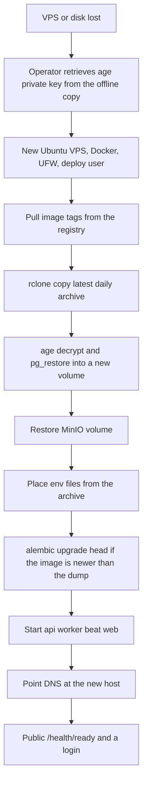

# Backup and disaster recovery audit

Audit date: 2026-11-25. No backup was created, deleted, restored, or decrypted by this audit. Conclusions about success come from systemd state, filenames, and the backup log's own SUCCESS lines.

## 1. What is running

| Question | Answer | Evidence |
|---|---|---|
| Are automated backups configured? | Yes | `hrms-backup.timer` enabled and active. Unit runs `infra/backup/hrms_backup.sh` via the installed path |
| Method | `pg_dump -Fc` per database, `pg_dumpall --globals-only`, `pg_restore --list` check, manifest, `tar` piped to `age`, `rclone` copy. Daily tier adds a restore into a throwaway Postgres and a MinIO volume archive plus env files | Script `infra/backup/hrms_backup.sh`. Server log lines match that script's format |
| Frequency | Hourly at :15 UTC plus a randomized delay up to 120 seconds. First run of the UTC day is also daily, weekly on Sunday, monthly on the 1st, yearly on 1 January | Timer unit and script. A daily file for 2026-11-25 exists |
| Where | Local `/var/backups/hrms/{postgres,minio}`. Remote name in the example env is `hrms-gdrive:HRMS-Backups`. The success line records an off-site destination | Log text. Remote listing not performed from this audit |
| Encrypted | Yes, age, public key on the server | Script refuses to start without the recipients file, and runs are succeeding |
| Off the server | The script copies with rclone and the log says it did | Not independently listed |
| Retention | Local hourly 48 h, local daily 7 days. Remote hourly 2 days, daily 14 days, weekly 8 weeks, monthly 12 months, yearly 7 years | Script defaults and `BACKUPS_GOOGLE_DRIVE.md`. Remote retention was not queried |
| Failures reported | The script writes FAILED and pings `HEALTHCHECK_URL` if set. The example leaves `HEALTHCHECK_URL` empty. systemd `OnFailure` emails. The monitor also reads the log | No FAILED line in the last six hourly lines. Email path unverified |
| Integrity | `pg_restore --list` on every dump. Daily tier restores and compares row counts | Implied by SUCCESS of the daily run. The comparison output was not saved as a separate artifact |

Databases in the example env file are `hrms_demo` and `hrms_prod`. The script requires `BACKUP_DATABASES`. Both databases exist, so a correct env file would dump both. The archive size is 11 MB, which is plausible for a 129 MB database in custom format plus a 15 MB database. This audit did not open the archive to list members.

`pg_backup.sh` and `minio_backup.sh` remain in the repo. The Google Drive document says they are superseded on the VPS. The timer points at `hrms_backup.sh`. The old scripts are not what cron is running.

## 2. Recovery capabilities

| Question | Answer |
|---|---|
| Point-in-time recovery | No. `archive_mode` is off, `archive_command` is disabled, `wal_level` is `replica` which is not enough without archiving |
| WAL archiving | Not configured |
| Documented restore procedure | Yes. `docs/deployment/BACKUPS_GOOGLE_DRIVE.md` and `docs/deployment/DISASTER_RECOVERY.md`. They disagree about which script produced the dump. The Google Drive doc matches the server |
| Has a person restored onto a new machine? | Not recorded in this audit. The daily job restores into a throwaway container on the same VPS and deletes it. That proves the dump can be read on that host. It does not prove a new VPS, a new DNS cut, or that the age private key is where the operator thinks it is |
| RPO | Not written down as a decision. The mechanism supports about one hour, plus the time until the next successful run. Today's runs were roughly hourly |
| RTO | Not written down. A same-day rebuild is realistic for this stack if the age key and the Drive token's data are available. It has not been timed |

Redis is not in the backup. AOF on the local volume survives a container recreate and does not survive a disk loss. Queued jobs would be lost. That matches the data's role.

MinIO is in the daily archive, not in the hourly archive. A disk loss at 23:00 loses up to a day of uploaded documents plus an hour of database changes. Document that asymmetry. It is `R-04`.

The daily archive includes the env files because they contain `PII_MASTER_KEY`. Those files are inside the age encryption. The server cannot read them back. The operator must have the private key. The backup document says the key is in a password manager and a second offline copy. This audit did not ask the operator to produce it.

## 3. Recommended recovery objectives

For a single-company HRMS on one VPS, set and accept:

- RPO: 1 hour for the database, 24 hours for object storage, until MinIO is added to the hourly tier or the business says documents can wait a day.
- RTO: 8 hours to a replacement VPS with DNS updated, assuming the operator has the age key and a written bootstrap. This number is a target, not a measurement.

Do not add WAL archiving until those two numbers are rejected. WAL shipping needs a second disk or a second host and a restore drill that is harder than `pg_restore`. Hourly dumps already match a one-hour RPO.

## 4. Scenarios

| Scenario | What exists | Gap |
|---|---|---|
| VPS destroyed | Off-site age archives, if rclone succeeded and the key exists | No timed rebuild. Host nginx config is not in the archive's documented file list (the script's `ENV_FILES` are compose env and API env). Nginx site files would be rebuilt by hand |
| Database corruption | Hourly dump, daily restore test on the same host | No PITR. Restore is manual |
| Accidental delete | Same dumps. MinIO daily | Point-in-time inside the hour is gone |
| Failed deploy | Previous Docker image if someone tagged it. Web runbook does this. API image on the server is only `latest` from 2026-11-04 | No tagged previous API image was listed |
| Bad migration | Migration job tests some downgrades. Production has not applied the new revisions | Downgrade of an unapplied migration is a no-op. Downgrade after a bad apply is manual |
| Redis loss | AOF for local restart. Tasks are designed to be idempotent or retried | In-flight jobs can rerun or, if not using `acks_late`, disappear. Policy is per task |
| Worker death | Restart policy, `acks_late` on idempotent tasks, heartbeat | Beat has no health check |
| MinIO disk loss | Daily encrypted copy | Up to 24 hours |
| Certificate expiry | certbot timer, expiry 2027-01-30 | Monitor does not appear to check certificate expiry. Add that to the monitor or rely on certbot's own failure mail, which was not confirmed |
| Credential compromise | Rotate env, restart, invalidate JWT secrets | No written incident checklist that was verified as current |
| Backup key loss | All archives become unreadable | No technical recovery. The second offline copy is the control |

## 5. Disaster recovery flow to adopt

Today the "pull image tags" step does not exist. A rebuild means building from a copy of the source. Phase 8's bootstrap and phase 2's registry are what make this diagram true.

## 6. Docs to treat as current

Use `docs/deployment/BACKUPS_GOOGLE_DRIVE.md` and `infra/backup/hrms_backup.sh` as the description of backups. Treat the "backups only live on the VPS" paragraphs in `docs/deployment/DISASTER_RECOVERY.md` as superseded. Task `P10-01` rewrites that page so the next incident does not follow the old path.
