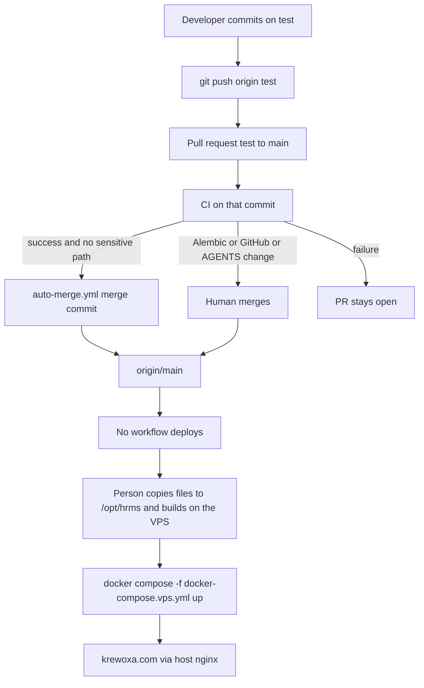

# Current-state DevOps audit

Audit date: 2026-11-25. Classifications follow the brief: implemented and verified, implemented but unverified, partially implemented, configured but inactive, manual process, missing, not applicable.

Every "verified" row has an observation from this audit, not only a file on disk. Detail that would duplicate the inventory is referenced rather than repeated.

## 1. Source control and workflow

| Capability | Status | Evidence |
|---|---|---|
| `test` is the working branch and `main` is the release branch | Implemented and verified | `AGENTS.md`. `origin/main` last moved by merge of pull request #80. Open pull request #81 is `test` into `main` |
| Direct push to `main` refused on this clone | Implemented and verified | `.git/hooks/pre-push` exits 1 when the remote ref is `refs/heads/main`. Git does not ship hooks with the repo, so this does not apply to other clones |
| Direct push to `main` refused by GitHub | Missing | Branch protection API for `main` and `test` returns 404 "Branch not protected". Rulesets list is empty |
| Pull request required to change `main` | Partially implemented | Convention and auto-merge assume a PR. GitHub does not require one |
| Required status checks | Partially implemented | CI runs on `pull_request` to `main` and the six jobs are visible on PR #81. Nothing in GitHub marks them required, because there is no protection rule |
| Failing test can be bypassed | Partially implemented | A red CI run does not auto-merge (`auto-merge.yml` requires `conclusion == success`). A person with write access can still merge or push without that workflow. ESLint is `continue-on-error: true`, so lint failures do not fail CI |
| Auto-merge of `test` to `main` | Implemented and verified | Workflow run `45616675130` and earlier runs completed. PR #81 was not merged; the workflow commented that `apps/api/alembic/versions/20261124090000_notification_device_token.py` (and a second Alembic file) requires a person |
| Auto-merge cannot be edited by the PR under test | Implemented but unverified | `workflow_run` uses the workflow file on `main` and checks `head_repository.full_name == github.repository`. Not attacked in this audit. The design matches the comment in the file |
| Sensitive paths held for a human | Implemented and verified | Comment on PR #81 from `github-actions`, quoting the Alembic path |
| CODEOWNERS | Missing | No file |
| CONTRIBUTING | Missing | No file |
| Commit convention | Partially implemented | Recent history uses `feat`, `fix`, `test`, `docs` prefixes. No commit-msg hook (only a sample) |
| Merge strategy | Implemented and verified | Auto-merge calls `gh pr merge --merge`. `AGENTS.md` says humans use a merge commit as well |
| Release tags and GitHub releases | Missing | One local tag, `backup/main-before-merge`. `gh release list` is empty |
| GitHub environments | Missing | API `total_count` 0 |
| Deployments tied to the verified commit | Missing | CI checks out the PR commit. Production is not deployed from that commit. See section 4 |
| Documented rollback | Partially implemented | Web-only rollback is written in `docs/deployment/HOSTINGER_WEB_DEPLOY_FOR_AI.md` (retag `hrms-web:pre-web-<TS>`). No equivalent checked procedure for API, worker, and Beat together |
| Uncommitted work protected | Implemented and verified at audit start | `git status` was clean on `test`. The local pre-push hook does not protect uncommitted files; it only blocks pushing `main` |

### Answers required by the brief

1. Developers can push to `main` on GitHub if they have write access. This one clone refuses. Other clones and the GitHub UI do not.
2. Pull requests are the agreed path and the only path auto-merge understands. They are not mandatory on the server.
3. The six CI jobs are not required checks. They run, and auto-merge waits for the workflow, but a manual merge does not.
4. A failing CI workflow blocks auto-merge. It does not block a person. ESLint cannot fail the workflow.
5. Deployments are not tied to a verified commit. The server directory is not a git repo. Images are dated 2026-11-04.
6. Release history is the GitHub merge commits on `main` plus deploy notes in chat or docs. There are no version tags.
7. A clean tree was observed here. Nothing in git protects another person's uncommitted work except the rule in `AGENTS.md` to leave it alone.
8. Rollback is documented for the web container. It is not an automated, tested path for the API stack.

## 2. How a change reaches production today

Steps that exist:

| Step | Status |
|---|---|
| Developer changes code | Manual, on `test` |
| Push to GitHub | Manual. This clone blocks a push whose destination is `main` |
| Pull request | Manual. PR #81 is the current one |
| CI | Automated on `pull_request` to `main` |
| Merge | Automated unless a sensitive path is touched |
| Release artifact | Missing. No registry, no version tag |
| Deploy initiated | Manual SSH and `docker compose build` / `up`, documented for web in `HOSTINGER_WEB_DEPLOY_FOR_AI.md` |
| Migrations | Manual one-shot `migrate` service, profile `tools`. Not part of `up` |
| Service update | Manual `up -d`. Web doc says `--no-deps web` so API stays on the old image |
| Health check | Container health checks run. Nothing in CI or a deploy script gates rollout on `/health/ready` |
| Verification | Manual `curl` in the web runbook. Public `/health/live` and `/health/ready` returned 200 during this audit |

Continuous delivery is not in place. Continuous deployment is not in place. What exists is continuous integration plus a manual release.

## 3. Capability catalogue

| Capability | Status | Notes |
|---|---|---|
| API lint, format, mypy, import boundaries | Implemented and verified | Job succeeded on run `45608524544` |
| API unit tests | Implemented and verified | Same run |
| API integration and security tests with Postgres, Redis, MinIO | Implemented and verified | Same run. MinIO image digest matches production |
| Alembic upgrade on a fresh database inside CI | Implemented and verified | Step in the API job, before tests |
| Migration tests that fail if skipped | Implemented and verified | Separate job, ports 15432 and 16379, `HRMS_REQUIRE_MIGRATION_TESTS=1` |
| Web typecheck, Vitest, production build | Implemented and verified | Same CI run |
| Web ESLint | Configured but inactive as a gate | Step runs and is `continue-on-error: true` |
| Mobile analyze and test | Implemented and verified | Flutter 3.29.2. `test/live` is opt-in |
| Secret scanning | Implemented and verified | Blocking. Image tag `zricethezav/gitleaks:latest` is not pinned |
| Dependency scanning | Implemented and verified | Blocking for Python and production npm. Dev-dependency npm findings do not fail the job |
| Test coverage threshold | Missing | No `fail_under` and no coverage upload that gates |
| Container image build in CI | Missing | Dockerfiles exist. CI never runs `docker build` for the API or web images |
| Image publish | Missing | |
| Staging deploy | Missing | |
| Production deploy workflow | Missing | |
| Manual approval environment | Missing | The Alembic hold is a shell `if` in auto-merge, not a GitHub environment |
| Deployment health gate | Missing | |
| Automatic rollback | Missing | Web runbook has a manual retag |
| Release notification | Missing | |
| Prometheus scrape of `/metrics` | Configured but inactive | Compose file and `prometheus.yml` exist. No container on the server |
| Grafana | Configured but inactive | Four dashboard JSON files. Catalog says Grafana is not installed. None on the server |
| Alertmanager | Missing | Block in `prometheus.yml` is commented out |
| Host monitor | Implemented and verified | Timer active, last exit 0 |
| Email alerts | Implemented but unverified | `hrms_notify_email.py` is the unit's `HRMS_ALERT_COMMAND`. No failing check occurred during the audit, so no send was observed |
| Encrypted off-site backup | Implemented and verified | Timer, today's log lines, daily and hourly files on disk. Remote listing not repeated from this machine |
| Daily restore test inside the backup | Implemented but unverified as a separate log | The script runs the restore test on the daily tier and exits non-zero on failure. Today's daily line says SUCCESS. The restore container output was not captured separately |
| Point-in-time recovery | Missing | `archive_mode` off |
| Sentry or equivalent | Missing | |
| Central log search | Missing | JSON logs exist in containers and in host nginx |
| Infrastructure as code | Partially implemented | Compose, nginx templates, and systemd units are in git. The live nginx site and the server itself are not reproducible from a single apply |
| Resource limits | Partially implemented | Monitoring compose sets them. Production services do not, and the running containers confirm memory 0 |
| Redis authentication | Missing | URL form in the production example is `redis://redis:6379/0` with no password. Network is internal |
| Non-root application processes | Implemented and verified | `docker inspect` user `hrms` and `node` |
| TLS | Implemented and verified | Public certificate and HTTPS 200 |
| OS patching | Partially implemented | unattended-upgrades enabled, and 61 packages still upgradable |

## 4. Version skew

Three versions are live in different senses of the word.

| Line | Identity | Schema |
|---|---|---|
| Production containers | Images built 2026-11-04, not a git SHA | `hrms_demo` at `20261108090000` |
| `origin/main` | `76628d44` merged 2026-11-23 | Includes migrations after `20261108` that are on `main` only if they were merged before #81. #81 itself contains `20261124` and `20261125` revisions and is unmerged |
| `origin/test` / PR #81 | `de83274` | Migrations through `20261125090000` |

Files newer than the live head, present in the working tree:

`20261109090000` through `20261125090000` (punch supersede, CompreFace provider, salary structure, company login code, shift remediation, overtime, leave, attendance policy, shift names, branch access, device tokens, digest setting).

Shipping the current tree onto the November images without `alembic upgrade` would boot code that expects columns the database does not have. Shipping the migrations without the matching image would change the database under the old code. The Compose `migrate` service is the right tool and it is not wired to anything automatic.

`hrms_prod` at `20261105090000` is not the database the API opens. The name is the opposite of the usual convention. A restore or a deploy that points `DATABASE_URL` at `hrms_prod` would serve the smaller, older database.

## 5. Workflow weaknesses

- Protection lives in a local hook and a GitHub Actions file, not in branch rules. Deleting or skipping the hook, or merging in the UI, bypasses it.
- The repository is public. That is a choice, and it means the schema, auth design, and Compose layout are readable by anyone. CI does not receive production secrets, which limits the impact of a malicious pull request. A fork pull request still runs the workflow with the default read token (`default_workflow_permissions` is `read`). Actions are allowed from any source (`allowed_actions: all`) and SHA pinning is not required.
- Auto-merge fast-forwards `test` to the merge commit with `force: false`. If someone pushes to `test` during the merge, the workflow warns and leaves `test` ahead. That path is sound. It does not help production, because production does not track either branch.
- There is no pull request template, no code owners, and no review requirement. Codex left review comments on #81. They are not a required check.
- CI has no `timeout-minutes`. A hung job uses the GitHub default of six hours. The API job already takes about 50 minutes.
- Artifact upload is `continue-on-error: true` because the account artifact quota is exhausted (comment in `ci.yml`, dated 2026-09-28). Test results are not retained. JUnit files are generated and then often dropped. This does not turn a test failure into a success. The test step itself still fails the job.
- Gitleaks runs with `--no-git`, so history is not scanned on each PR. A one-time history scan is described in `docs/devops/PHASE_A_CI_IMPLEMENTATION.md`. This audit did not re-run that history scan.
- Dev compose publishes Postgres, Redis, and MinIO on the host. Production vps compose does not publish Postgres or Redis. Dev images for MinIO use a moving `latest` tag. Production is pinned. CI is pinned to the same digest as production.

## 6. Documents that disagree

| Topic | Older or parallel text | What is true now |
|---|---|---|
| Backups | `docs/deployment/DISASTER_RECOVERY.md` still says restore from `pg_backup.sh` and that off-site copy is not done | `docs/deployment/BACKUPS_GOOGLE_DRIVE.md` and `infra/backup/hrms_backup.sh` are what the server runs. Today's log shows off-site copies |
| Edge proxy | `docker-compose.prod.yml` runs nginx and certbot in containers | The VPS uses `docker-compose.vps.yml` and host nginx. Both files are intentional. A reader who follows only the prod file will open ports 80 and 443 inside Docker on a machine that already has them |
| Database name | Examples say `hrms_prod` | The running API uses `hrms_demo` |
| Error tracking | `docs/product/13_DevOps_Architecture.md` lists Sentry | No SDK in the tree |
| Observability | Architecture docs describe Prometheus as optional and not applied | Still true on the server. The host monitor was added later and is applied |

`docs/deployment/HOSTINGER_DEPLOYMENT_RUNBOOK.md` opens with "Nothing here has been executed." The web deploy note says two web deploys were done on 2026-11-04. Both can be true: the full-stack runbook was a proposal, and a narrow web procedure was later used. They should not be followed interchangeably.
