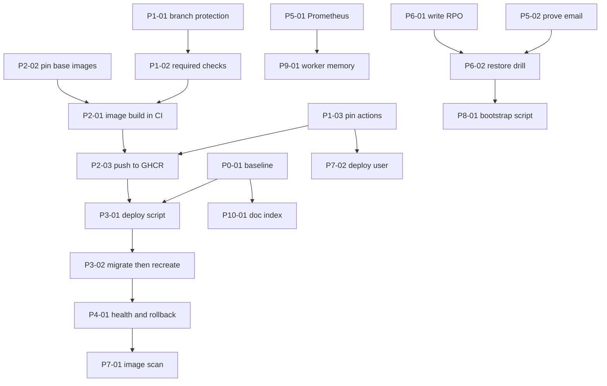

# DevOps implementation plan

Audit date: 2026-11-25. This plan does not implement anything. Tasks are sequenced so a production deploy of the current 28-commit gap cannot happen by accident.

## How to read a task

Each task has the fourteen fields the audit brief asked for. "Current state" is a finding in this package, not a guess. Verification is something a person can observe. Rollback is how to undo the task itself, not how to undo the whole program.

## Dependency map

Independent now: `P0-01`, `P1-01`, `P1-03`, `P1-04`, `P1-05`, `P5-01`, `P5-02`, `P6-01`, `P7-03`, `P10-01`.

Must wait: image publish waits on the build. The deploy script waits on a digest that CI produced. Memory limits wait on a week of Prometheus or on a one-off measurement if Prometheus is delayed. The deploy user waits until actions are pinned, so the key is not introduced into a loose pipeline. Do not put the SSH key in GitHub in this plan at all.

## Phase 0. Baseline

### P0-01 Record the production baseline and freeze ad-hoc deploys

| Field | Content |
|---|---|
| Phase | 0 |
| Priority | Critical |
| Current state | Images `hrms-api:latest` and `hrms-web:latest` created 2026-11-04. Live database `hrms_demo` at Alembic `20261108090000`. `origin/test` is `de83274`, 28 commits ahead of `origin/main` `76628d44`. Inventory is `DEVOPS_INFRASTRUCTURE_INVENTORY.md` |
| Problem | `R-02`. A helpful deploy from the current tree would mix new code with an old schema, or migrate a database that has no previous image tag to return to |
| Proposed solution | Treat this audit's inventory as the baseline. Tag the running image IDs on the server as `hrms-api:baseline-20261104` and `hrms-web:baseline-20261104` so they cannot be lost when the next build overwrites `latest`. Do not copy new source until `P4-01` exists |
| Files / hosts | Server Docker image store only. No repo change required. Optional one-line note in the operator's deploy log |
| Dependencies | None |
| Steps | 1. `docker image inspect` the two IDs and write them down. 2. `docker tag` each to a baseline name. 3. Agree that the next production change uses `P3` and `P4`, including a written migration list from `20261109090000` through the revision the image contains |
| Verification | `docker image inspect hrms-api:baseline-20261104` shows the same ID as today's `hrms-api:latest`. No application container was recreated. `docker ps` uptimes stay in the "weeks" range |
| Rollback | `docker rmi` of the extra tag. The `latest` tag is untouched |
| Risks | Tagging is local to the Docker daemon. It does not survive a daemon rebuild without the image still present. That is still better than only `latest` |
| Acceptance | Baseline IDs recorded, extra tags present, no container restarted, team agrees not to `scp` the current tree |
| Complexity | Small |

## Phase 1. Git and CI hardening

### P1-01 Protect `main` and `test` on GitHub

| Field | Content |
|---|---|
| Phase | 1 |
| Priority | Critical |
| Current state | Protection API returns 404 for both branches. Rulesets empty. Local `.git/hooks/pre-push` refuses `main` only on this clone |
| Problem | `R-01` |
| Proposed solution | A ruleset or classic protection on `main`: pull request required, linear history not required (the project uses merge commits), force-push disabled, deletions disabled. On `test`: force-push disabled. Do not require reviews unless the owner wants them. The auto-merge bot must still be allowed to push the merge commit. If the bot uses `github-actions`, include that actor in the bypass for the merge, or use a ruleset bypass for the Actions app only |
| Files / hosts | GitHub settings. No file until the ruleset is exported. If a ruleset JSON is committed later, that commit is under `AGENTS.md`'s human-merge list because it touches `.github/` only if stored there |
| Dependencies | None. Do this before `P2-03` |
| Steps | 1. Create the rule in the GitHub UI. 2. From a scratch clone without the local hook, attempt `git push origin main` and confirm the server rejects it. 3. Confirm auto-merge can still merge a trivial PR, or document the bypass that lets it |
| Verification | `gh api repos/varunmsaji/HRMS/rulesets` is non-empty, or branch protection returns 200 and shows `required_pull_request_reviews` or required status checks. A push of a test branch to `main` fails |
| Rollback | Delete the ruleset. The local hook remains |
| Risks | A misconfigured bypass blocks auto-merge and also blocks the owner. Keep a personal access token that the rule allows, and test with a disposable commit |
| Acceptance | Direct push to `main` fails from a clone that does not have the local hook. Pull request #81 is still mergeable by a person |
| Complexity | Small |

### P1-02 Require the six CI jobs

| Field | Content |
|---|---|
| Phase | 1 |
| Priority | Critical |
| Current state | Jobs run and show on PR #81. They are not required. A manual merge can ignore a red run. ESLint is not one of the six |
| Problem | `R-01` |
| Proposed solution | Required checks, named exactly as the job `name:` values: `API — lint, typecheck, boundaries, unit, integration`, `API — migration tests (disposable PostgreSQL)`, `Web — lint, typecheck, vitest, build`, `Mobile — analyze, test`, `Security — secret scanning`, `Security — dependency vulnerability scanning` |
| Files / hosts | GitHub ruleset. No workflow edit |
| Dependencies | `P1-01` |
| Steps | 1. Add the six names. 2. Open a PR with a deliberate ruff failure on a branch and confirm the merge button waits. 3. Revert that commit |
| Verification | The PR's merge box lists the six checks as required |
| Rollback | Remove the required checks from the rule |
| Risks | Renaming a job in `ci.yml` silently un-requires it. The acceptance test for any future job rename is to update the rule in the same change. That change is human-merged because it edits `.github/` |
| Acceptance | A failing job blocks merge in the UI, not only in auto-merge |
| Complexity | Small |

### P1-03 Pin third-party actions and stop using `gitleaks:latest`

| Field | Content |
|---|---|
| Phase | 1 |
| Priority | High |
| Current state | `actions/checkout@v4`, `astral-sh/setup-uv@v5`, `actions/setup-python@v5`, `actions/setup-node@v4`, `actions/upload-artifact@v4`, `subosito/flutter-action@v2`, image `zricethezav/gitleaks:latest`. Repo setting `sha_pinning_required` is false and `allowed_actions` is `all` |
| Problem | `R-06` |
| Proposed solution | Pin each action to a full commit SHA with a version comment. Pin Gitleaks to a digest. Turn on SHA pinning in the repo setting after the workflow is updated. Keep `allowed_actions` as the set of those actions, or leave `all` only if SHA pinning is required |
| Files | `.github/workflows/ci.yml`. Repository setting |
| Dependencies | None. Must land before any GitHub secret is created. Editing `.github/` is a human merge under `AGENTS.md` |
| Steps | 1. Resolve current SHAs. 2. Edit the workflow. 3. Let CI run. 4. Enable the repo setting |
| Verification | CI run on the pin commit is green. `gh api repos/varunmsaji/HRMS/actions/permissions` shows `sha_pinning_required: true` |
| Rollback | Revert the workflow commit. Turn the setting off if it blocks a revert PR |
| Risks | A pin of a broken action fails CI closed, which is the desired failure |
| Acceptance | No `@v4`-style tag remains in the workflows. Gitleaks is a digest. A new pull request cannot introduce a floating action once the setting is on |
| Complexity | Small |

### P1-04 Decide the ESLint gate

| Field | Content |
|---|---|
| Phase | 1 |
| Priority | Low |
| Current state | `npx eslint .` is `continue-on-error: true`. The workflow comment says the backlog grew when `eslint-plugin-react-hooks` added `set-state-in-effect` |
| Problem | `R-14`. The job name says lint. The gate does not include lint |
| Proposed solution | Either fix the violations and remove `continue-on-error`, or rename the step so the summary does not imply a gate, and add a comment with the current violation count. Do not leave a green check that looks like lint passed |
| Files | `.github/workflows/ci.yml` and, if fixing, `apps/web` |
| Dependencies | None |
| Steps | 1. Run `npx eslint .` locally and record the count. 2. Choose fix or rename. 3. If fixing, do it in its own PR so it is not mixed with the deploy work |
| Verification | The workflow file no longer claims a lint gate it does not enforce, or ESLint failures fail the job and the count is zero |
| Rollback | Restore `continue-on-error` |
| Risks | Turning it on before the backlog is fixed blocks every PR |
| Acceptance | A reader of the job summary can tell whether lint can fail the build |
| Complexity | Medium if the backlog is fixed. Small if the step is renamed |

### P1-05 Add job timeouts and keep test steps fatal

| Field | Content |
|---|---|
| Phase | 1 |
| Priority | Medium |
| Current state | No `timeout-minutes`. API job runs about 50 minutes. Artifact upload is `continue-on-error` because the artifact quota is full |
| Problem | A hung integration test holds a runner for six hours. `R-15` |
| Proposed solution | Set `timeout-minutes: 90` on `api`, `40` on `migrations`, `30` on `web`, `30` on `mobile`, `15` on the security jobs. Leave artifact upload as continue-on-error. Add a one-line comment that test steps must not copy that flag |
| Files | `.github/workflows/ci.yml` |
| Dependencies | None |
| Steps | Edit, push, confirm the next CI run still passes inside the limits |
| Verification | The run page shows the timeout values. The run succeeds |
| Rollback | Remove the keys |
| Risks | A legitimately slow first run after a cold cache could hit 90 minutes. If it does, raise `api` to 120 and record why |
| Acceptance | Each job has a timeout under two hours, and no test step has `continue-on-error` |
| Complexity | Small |

## Phase 2. Images

### P2-01 Build the API and web images in CI

| Field | Content |
|---|---|
| Phase | 2 |
| Priority | High |
| Current state | Dockerfiles exist and are what production runs, but CI never builds them. A Dockerfile break is found on the VPS |
| Problem | The artifact production runs is not the artifact CI tested |
| Proposed solution | A new job `images` that runs `docker build` for `apps/api/Dockerfile` and `apps/web/Dockerfile` with a dummy `NEXT_PUBLIC_API_URL=https://api.example.com`. Do not push. On pull requests, build only |
| Files | `.github/workflows/ci.yml` |
| Dependencies | `P1-02` so the job can be required. `P2-02` can land in the same PR |
| Steps | 1. Add the job. 2. Confirm it fails if the Dockerfile is broken, by inspection of a bad COPY in a scratch branch if wanted. 3. Require the check |
| Verification | The successful CI run contains an image build log and does not push |
| Rollback | Remove the job |
| Risks | Builds add minutes and disk. Acceptable next to a 50-minute API job |
| Acceptance | A Dockerfile syntax error fails CI before anyone SSHs |
| Complexity | Small |

### P2-02 Pin Postgres, Redis, and the language base images by digest

| Field | Content |
|---|---|
| Phase | 2 |
| Priority | Medium |
| Current state | `postgres:16-alpine` and `redis:7-alpine` float. Server Postgres is 16.15. `python:3.12-slim` and `node:20-alpine` float. MinIO is already pinned |
| Problem | A rebuilt image on the VPS can change the database minor version without a commit |
| Proposed solution | Pin the digests that match what is running now for Postgres and Redis, and pin the builder bases. Leave a comment with the version, the way MinIO is commented `RELEASE.2026-09-16` |
| Files | `docker-compose.vps.yml`, `docker-compose.prod.yml`, `docker-compose.yml`, both Dockerfiles, `ci.yml` service images |
| Dependencies | None. Do it before the next image build so CI and the server match |
| Steps | 1. `docker image inspect` on the server for the postgres and redis image IDs. 2. Pin those digests. 3. Rebuild nothing on the server in this task |
| Verification | CI still passes. Server containers are not recreated. A later build uses the pin |
| Rollback | Restore the tags |
| Risks | A pin of the wrong digest. Take the ID from the running container, not from a fresh pull |
| Acceptance | Compose files name a digest for Postgres and Redis. The running containers are unchanged |
| Complexity | Small |

### P2-03 Publish immutable tags to GHCR from `main`

| Field | Content |
|---|---|
| Phase | 2 |
| Priority | High |
| Current state | No registry. Server builds `latest` |
| Problem | `R-02` and `R-04`. There is no digest to roll back to and no digest to deploy |
| Proposed solution | On push to `main` only, after CI has succeeded for that commit, push `ghcr.io/varunmsaji/hrms-api:sha-<12>` and the same for web. Also move a moving tag `main`. Do not use `latest`. Fork pull requests must not push. Use the built-in `GITHUB_TOKEN` with `packages: write` on that job only |
| Files | `.github/workflows/ci.yml` or a new `release-images.yml` that triggers on push to `main` |
| Dependencies | `P1-01`, `P1-03`, `P2-01` |
| Steps | 1. Add the workflow. 2. Merge a trivial commit. 3. Confirm the package exists and the tag equals the merge SHA. 4. Confirm a pull request from a fork, if one exists, does not push |
| Verification | `gh api` or the packages page shows the digest. The tag is the commit |
| Rollback | Delete the package version. Remove the job |
| Risks | The repo is public, so the image may be public unless the package is made private. Set the package visibility before the first push if the image should not be public. The image must not contain secrets. The Dockerfiles do not copy env files |
| Acceptance | A `main` commit has an image digest. A pull request does not publish |
| Complexity | Medium |

## Phase 3. Deploy

### P3-01 Deploy by pulling a digest, not by copying the tree

| Field | Content |
|---|---|
| Phase | 3 |
| Priority | Critical |
| Current state | `/opt/hrms` is not git. Web deploys copy files and `docker compose build`. Documented in `HOSTINGER_WEB_DEPLOY_FOR_AI.md` |
| Problem | `R-02` |
| Proposed solution | A script `infra/deploy/deploy.sh` that takes a digest, logs in to GHCR as the deploy user, pulls, and retags only the services named on the command line. First version is run by a person over SSH. It refuses to run if the hostname is not `srv1592287`. It does not delete images. It does not touch Hirico |
| Files | New `infra/deploy/deploy.sh`. Docs in phase 10. Server `/opt/hrms` compose `image:` lines eventually point at the registry. That compose edit is a production change and waits until the script has been dry-run |
| Dependencies | `P0-01`, `P2-03` |
| Steps | 1. Write the script and a `--dry-run`. 2. On the server, dry-run against the baseline digest. 3. Do not `up` yet |
| Verification | Dry-run prints the digest, the services, and the hostname check, and `docker ps` is unchanged |
| Rollback | Delete the script. The server is unchanged if `up` was not called |
| Risks | A bug in the script that matches Hirico container names. The script must only accept service names from the set `api`, `worker`, `beat`, `web`, `migrate` |
| Acceptance | Dry-run on the production host succeeds and restarts nothing |
| Complexity | Medium |

### P3-02 Run migrations once, from that digest, before recreating processes

| Field | Content |
|---|---|
| Phase | 3 |
| Priority | Critical |
| Current state | `migrate` is a compose profile. It is not part of `up`. Live head is `20261108090000`. The first real deploy will apply every later revision |
| Problem | `R-02`. An automatic migrate on container start would race. A migrate after the new code starts would crash the new code |
| Proposed solution | The deploy script runs `compose run --rm migrate` using the new digest, then recreates `api`, `worker`, and `beat` together. Web-only deploys skip migrate. The script prints `alembic current` before and after. Migrations in that release must be backward compatible with the previous code, because the old containers run until the recreate. Write that rule at the top of the script |
| Files | `infra/deploy/deploy.sh`, `docker-compose.vps.yml` image line for `migrate` |
| Dependencies | `P3-01`. The first execution is a planned window, not a side effect of writing the script |
| Steps | 1. On a copy of the database restored from the latest dump onto a spare Postgres, run `alembic upgrade head` from the new image. 2. If that succeeds, schedule the production window. 3. Run the script for real. 4. Record the new head |
| Verification | `alembic current` on `hrms_demo` equals the head baked into the image. API `/health/ready` is 200. Worker and Beat are the same image ID as the API |
| Rollback | Application rollback is `P4-01`. Schema rollback is not automatic. If the upgrade fails before the recreate, the old containers are still running and the database is mid-migration. Restore the pre-window dump into a new database name and point back only if the upgrade failed dirty. Practice this on the spare database first |
| Risks | A migration that locks a hot table. Read each revision between `20261109090000` and the target before the window. The attendance and payroll revisions are the ones to read |
| Acceptance | Spare database upgraded cleanly. Production upgraded in the window. Image IDs of api, worker, and beat match. No Hirico container restarted |
| Complexity | Large, because it is the first real schema jump |

## Phase 4. Verify and roll back

### P4-01 Health gate and one-command rollback

| Field | Content |
|---|---|
| Phase | 4 |
| Priority | Critical |
| Current state | Web rollback is a manual retag in the web runbook. API has no previous tag besides the baseline this plan creates. Nothing curls `/health/ready` as a gate |
| Problem | `R-02` |
| Proposed solution | After recreate, the script curls `http://127.0.0.1:8001/health/ready` for 60 seconds. On failure it retags the previous digest onto api, worker, and beat and recreates those three. It does not roll back the database. It prints that fact in capital letters in the log |
| Files | `infra/deploy/deploy.sh` |
| Dependencies | `P3-02` |
| Steps | 1. Implement the loop. 2. On the spare environment or with a deliberately bad port, confirm the script restores the previous tag. 3. Use it for the real window |
| Verification | A forced failure (wrong loopback port in a dry environment) recreates the previous digest and exits non-zero. A good deploy exits zero and the public ready URL returns 200 |
| Rollback | The script is the rollback. Removing the script returns the operator to the web runbook |
| Risks | Rolling back the app onto a migrated database. That is why migrations must be backward compatible. If one is not, the window stops before `up` |
| Acceptance | Documented test of the failure path, and one successful production deploy whose log contains the digest and a 200 |
| Complexity | Medium |

## Phase 5. Signals

### P5-01 Start Prometheus and node_exporter on loopback

| Field | Content |
|---|---|
| Phase | 5 |
| Priority | High |
| Current state | `docker-compose.monitoring.yml` and `alerts.yml` exist. No container is running. The API metrics token file is documented and gitignored |
| Problem | `R-05`, `R-07`. There is no history |
| Proposed solution | Create the token file on the server with mode 0400, matching `METRICS_TOKEN` already in the API env. Start only `prometheus` and `node-exporter` with the existing overlay. Do not publish 9090. Use an SSH tunnel to look. Do not add Grafana yet |
| Files | Server only, plus the existing compose file. If the vps file's network name does not match the overlay, fix the overlay in git first and deploy that file without recreating the app |
| Dependencies | None. Can run the same week as phase 1 |
| Steps | 1. Confirm `api:8000` is on a network Prometheus can join. 2. Place the token. 3. `docker compose -f docker-compose.vps.yml -f docker-compose.monitoring.yml up -d prometheus node-exporter`. 4. From an SSH tunnel, open targets and confirm `hrms-api` is up |
| Verification | Prometheus target `hrms-api` is UP. A query for `hrms_dependency_up` returns a series. App containers keep their old start times |
| Rollback | `docker compose ... stop prometheus node-exporter`. Token file can stay |
| Risks | The overlay was written for `docker-compose.prod.yml` networks. If `up` tries to recreate the app, stop and fix the file. Memory cap in the file is 512 MB. The host can spare that today. Watch available memory after start |
| Acceptance | Targets up for 24 hours, app uptime unchanged, port 9090 not in `ss` on `0.0.0.0` |
| Complexity | Medium |

### P5-02 Send one real alert email and record it

| Field | Content |
|---|---|
| Phase | 5 |
| Priority | High |
| Current state | Mailer is configured. Last monitor exit was 0, so no mail was sent. Delivery is unverified |
| Problem | `R-05` |
| Proposed solution | Run `hrms_notify_email.py` once with a subject `[HRMS ALERT] test` and a body that contains no env data. Confirm the mailbox received it. Then put the monitor back. Do not break production to generate a failure |
| Files | None. Uses `/opt/hrms/infra/monitoring/hrms_notify_email.py` |
| Dependencies | None |
| Steps | 1. Send the test. 2. Screenshot or save the received header's date. 3. Note it in the operations log |
| Verification | The message is in the inbox. The SMTP password is not printed |
| Rollback | None. A test message does not change state, apart from the dedup file if the script writes one. Use a subject path that does not suppress a real alert. Read the script's dedup before sending: a direct `--subject` send from `hrms-alert` path does not use the monitor dedup |
| Risks | The test reveals whether SMTP works, including a failure. That is the point |
| Acceptance | One received message on the audit date's successor, recorded without secrets |
| Complexity | Small |

### P5-03 Teach the monitor the current task and certificate signals

| Field | Content |
|---|---|
| Phase | 5 |
| Priority | Medium |
| Current state | Monitor thresholds and log patterns are in `hrms_monitor.sh`. Prometheus rules name specific tasks. Certificate expiry is not in the monitor. Beat has no Docker health check |
| Problem | `R-07`, `R-13` |
| Proposed solution | Add a check that fails when the krewoxa certificate's `notAfter` is inside 21 days. Add the scheduler heartbeat age, which `job_health` already returns, to the documented threshold list if it is not already a failing check. Compare task names in `celery_app.py` with the names the monitor and `alerts.yml` understand, and add the missing ones. Do this in git and copy the script to the server as its own change, not inside an app deploy |
| Files | `infra/monitoring/hrms_monitor.sh`, `infra/monitoring/prometheus/alerts.yml`, tests in `apps/api/tests/unit/ops/test_host_monitor.py` if they cover the script's expectations |
| Dependencies | `P5-01` for the Prometheus half. The certificate check does not need Prometheus |
| Steps | 1. Diff task names. 2. Add tests. 3. Deploy the script only. 4. Run the monitor once by hand and confirm exit 0 |
| Verification | Hand run exits 0. A unit test or a shell fixture with a near-expiry date exits 1. Production app containers are not restarted |
| Rollback | Restore the previous script from `/opt/hrms-backups` or git |
| Risks | A too-strict new check pages every five minutes. The email dedup limits that to one mail per six hours. Watch the first evening |
| Acceptance | Certificate check exists. Task-name diff is empty or the missing names are in the rules. Hand run recorded |
| Complexity | Medium |

### P5-04 Exception tracker, only if logs are not enough

| Field | Content |
|---|---|
| Phase | 5 |
| Priority | Low |
| Current state | No Sentry SDK. Structured logs exist. The ERR reference work is on `test` and not in the running image |
| Problem | Grouping of 500s is manual |
| Proposed solution | Do not install Sentry in the first six phases. Revisit after one month of Prometheus and the monitor. If adopted, use a self-hosted GlitchTip or Sentry with the existing redaction, and send only unhandled exceptions |
| Files | None until the decision |
| Dependencies | `P5-01`, and the error-handling release that is already on `test` |
| Steps | Review `errors.log` volume. Decide |
| Verification | A written decision in the operations log. No SDK added by default |
| Rollback | Not applicable |
| Risks | Adding a tracker early sends PII if redaction is incomplete |
| Acceptance | Decision recorded. No new service unless the log review says the monitor is insufficient |
| Complexity | Small for the decision. Large for the integration |

## Phase 6. Recovery

### P6-01 Write the RPO and RTO and correct the old disaster-recovery page

| Field | Content |
|---|---|
| Phase | 6 |
| Priority | High |
| Current state | Mechanism is hourly database and daily objects. Documents disagree. No numeric objective |
| Problem | `R-04`, `R-10` |
| Proposed solution | Set RPO 1 hour for Postgres and 24 hours for MinIO, RTO 8 hours, in `docs/deployment/DISASTER_RECOVERY.md`, and point that page at `hrms_backup.sh`. State that these numbers are targets |
| Files | `docs/deployment/DISASTER_RECOVERY.md` |
| Dependencies | None |
| Steps | Edit the doc. Do not change the script in this task |
| Verification | The page no longer tells the operator to start from `pg_backup.sh` as the primary path |
| Rollback | Git revert |
| Risks | None operational |
| Acceptance | One page describes the backup that the timer runs |
| Complexity | Small |

### P6-02 Restore the latest daily archive onto a different machine

| Field | Content |
|---|---|
| Phase | 6 |
| Priority | High |
| Current state | Daily SUCCESS includes an in-script restore on the same VPS. The age private key has not been produced in this audit. A second machine has not been rebuilt |
| Problem | `R-04` |
| Proposed solution | On a laptop or a spare VPS, with the private key, decrypt the latest daily archive, `pg_restore` into a throwaway Postgres, and compare row counts to `manifest.txt`. Do not point DNS anywhere. Time the steps |
| Files | None. Uses the procedure in `BACKUPS_GOOGLE_DRIVE.md` |
| Dependencies | `P6-01`, `P5-02` so a failed drill can be mailed if it is done against the server by mistake. Prefer to do it off the server |
| Steps | 1. Confirm the key opens the archive. 2. Restore. 3. Compare counts. 4. Destroy the throwaway. 5. Write the elapsed time next to the RTO |
| Verification | Row counts match the manifest. The production `docker ps` start times are unchanged. The key never lands on the VPS |
| Rollback | Delete the throwaway container and the decrypted directory |
| Risks | Decrypting on the production VPS would put the private key next to the data. Do not do that |
| Acceptance | A written elapsed time and a match on the manifest, dated |
| Complexity | Medium |

### P6-03 Decide the MinIO gap

| Field | Content |
|---|---|
| Phase | 6 |
| Priority | Medium |
| Current state | MinIO is in the daily archive only. Database is hourly |
| Problem | `R-04` document loss window is 24 hours |
| Proposed solution | Either add the MinIO volume to the hourly tier, or write in the DR page that documents can be 24 hours behind and the business accepts it. Do not add a second cloud until Drive deletion by root is a real concern. Object lock on B2 is the upgrade if that concern is accepted, and it is not phase 6's default |
| Files | `infra/backup/hrms_backup.sh` only if the hourly tier is extended. Otherwise the doc from `P6-01` |
| Dependencies | `P6-01` |
| Steps | Owner chooses. If hourly MinIO, test on the next timer without deleting old archives |
| Verification | Either a new hourly MinIO object appears, or the doc states the 24-hour window |
| Rollback | Revert the script. Old archives remain |
| Risks | Hourly MinIO copies cost Drive space and IO. The volume size was not measured. Measure first |
| Acceptance | A recorded decision and, if the script changed, one successful hourly run |
| Complexity | Small for the decision. Medium for the script |

## Phase 7. Hardening

### P7-01 Scan the image CI builds

| Field | Content |
|---|---|
| Phase | 7 |
| Priority | Medium |
| Current state | No Trivy or Grype step |
| Problem | `S-07` in the security audit |
| Proposed solution | After `P2-01`, run Trivy on the local image with `--severity HIGH,CRITICAL` and `--ignore-unfixed` at first, so the gate is actionable. Fail the job on those. Do not fail on every unfixed Debian finding on day one if the count is large. Publish the count in the job summary |
| Files | `.github/workflows/ci.yml` |
| Dependencies | `P2-01`, `P1-03` so the Trivy action is pinned |
| Steps | 1. Run once as non-blocking and record the count. 2. Fix or ignore with a documented suppress file. 3. Make HIGH and CRITICAL blocking |
| Verification | A CI log shows the scan. After the switch, a known critical in a test image fails the job |
| Rollback | Remove the step |
| Risks | Noise. The two-step introduction is the mitigation |
| Acceptance | The image job fails on a new critical finding in an OS or Python package that has a fix |
| Complexity | Medium |

### P7-02 Add a deploy user and stop using root for deploys

| Field | Content |
|---|---|
| Phase | 7 |
| Priority | High |
| Current state | SSH is root, passwords off, fail2ban on. The key is full admin for both products |
| Problem | `R-08` |
| Proposed solution | Create a `deploy` user in the `docker` group, with its own key, allowed to run the deploy script. Keep root for OS work. After two successful deploys as `deploy`, set `PermitRootLogin no`. Do not do that on the same day as the first deploy |
| Files | Server `/etc/ssh/sshd_config`. No secret in git |
| Dependencies | `P1-03`. A working deploy script so root is not required for a release |
| Steps | 1. Add the user. 2. Confirm `deploy` can `docker ps` and cannot read `/root`. 3. Deploy once as that user. 4. Later, disable root login and confirm a second session is open before reloading sshd |
| Verification | `ssh deploy@host docker ps` works. After the later step, `ssh root@host` fails. Hirico is untouched |
| Rollback | `PermitRootLogin without-password` from the console if SSH is locked. Hostinger's web console is the back door. Confirm it works before the reload |
| Risks | Lockout. The console check is mandatory |
| Acceptance | A deploy has been done without root, and root SSH is off only after that |
| Complexity | Medium |

### P7-03 Classify and apply the 61 upgradable packages

| Field | Content |
|---|---|
| Phase | 7 |
| Priority | Medium |
| Current state | unattended-upgrades enabled. 61 packages still upgradable. Not classified |
| Problem | `R-09` |
| Proposed solution | Produce the list on the server, split security from the rest, apply security updates in a window, reboot only if the kernel changes, and check both HRMS and Hirico health after |
| Files | None in git |
| Dependencies | A maintenance window the Hirico owner agrees to, because the kernel is shared |
| Steps | 1. `apt-get -s upgrade` saved to a file on the server, not committed. 2. Apply. 3. `docker ps` for both products. 4. Public `/health/ready` |
| Verification | The upgradable security count is zero, or the remaining items are listed with a reason. Health 200. Hirico containers still up |
| Rollback | Hostinger snapshot if one exists, otherwise reinstall the previous package versions from the apt cache. Take a snapshot before the window if the provider UI allows it |
| Risks | A reboot takes Hirico down too. Agree the window |
| Acceptance | Written list, health 200, both products' containers running |
| Complexity | Medium |

## Phase 8. Rebuildability

### P8-01 A bootstrap script for a replacement VPS

| Field | Content |
|---|---|
| Phase | 8 |
| Priority | Medium |
| Current state | No Ansible and no Terraform. The host was built by hand. That is acceptable for one server and unacceptable for a rebuild under pressure |
| Problem | `R-04` RTO depends on memory |
| Proposed solution | One shell script, `infra/bootstrap/vps.sh`, that installs Docker, UFW with 22/80/443, fail2ban, the systemd units, and the directory layout. It does not copy secrets. It does not install Hirico. Ansible is unnecessary until a second server exists. Terraform is unnecessary for a single Hostinger VM created in the UI |
| Files | `infra/bootstrap/vps.sh` |
| Dependencies | `P6-02` so the script is what the next drill uses |
| Steps | 1. Write the script from the inventory. 2. Run it on a spare VM. 3. Stop. Do not point DNS at it |
| Verification | Spare VM has Docker, UFW, and the timers installed and not started against production data |
| Rollback | Destroy the spare VM |
| Risks | Running it on the production host would be a mistake. The script must exit if `/opt/hrms` already contains `docker-compose.vps.yml` |
| Acceptance | A spare VM reaches "docker info works and UFW is active" from the script alone |
| Complexity | Medium |

## Phase 9. Capacity

### P9-01 Explain the worker's 2.16 GiB and then set a limit

| Field | Content |
|---|---|
| Phase | 9 |
| Priority | High |
| Current state | One sample, 2.16 GiB, zero restarts, PID 1 is small so children hold the memory. No limit |
| Problem | `R-03` |
| Proposed solution | After Prometheus or a week of `docker stats` samples, identify the child. If it is the face model, set `mem_limit` above the steady state with headroom, for example 3g, so a leak is killed and restarted instead of taking the host. Do not set the limit below the observed steady state |
| Files | `docker-compose.vps.yml` `worker` service |
| Dependencies | `P5-01` or a written week of samples |
| Steps | 1. Sample. 2. Set the limit in git. 3. Apply at the next deploy, not as a surprise recreate |
| Verification | Worker stays healthy for 24 hours under the limit. Restart count stays 0. A lower canary limit is not used on production |
| Rollback | Remove `mem_limit` and recreate |
| Risks | A limit below the real steady state crash-loops the worker and redelivers tasks. The measurement step prevents that |
| Acceptance | A number in the compose file that is above the measured steady state, and a note of what the memory is |
| Complexity | Medium |

### P9-02 Cap Redis

| Field | Content |
|---|---|
| Phase | 9 |
| Priority | Medium |
| Current state | `maxmemory` 0, `noeviction`, 10.5 MB used, no password, not published |
| Problem | `R-12` |
| Proposed solution | Set `maxmemory 256mb` and keep `noeviction`. Add a requirepass and put it in the Redis URL in the env file during a deploy window, so the API and the worker pick it up together. 256 MB is far above 10.5 MB and far below host RAM |
| Files | `docker-compose.vps.yml` redis command. Server env file, not committed |
| Dependencies | A deploy window, because the password change restarts API, worker, and Beat together |
| Steps | 1. Set maxmemory first, which needs a Redis restart and does not need an app change. 2. Add the password in the same window as an app recreate so clients do not lose the broker mid-day |
| Verification | `CONFIG GET maxmemory` shows 256mb. API ready is 200. A queue task still runs |
| Rollback | Remove the setting and restart Redis. If the password was added, roll back the env file in the same recreate |
| Risks | A password mismatch takes down the worker until the env matches. Do both sides in one window |
| Acceptance | maxmemory is 256mb and the app is healthy |
| Complexity | Small for the cap. Medium if the password is included |

## Phase 10. Documentation

### P10-01 One operations index

| Field | Content |
|---|---|
| Phase | 10 |
| Priority | Medium |
| Current state | Deploy, backup, observability, and disaster documents overlap. One runbook says it was never executed. The live database is named `hrms_demo` |
| Problem | `R-10`, `R-11` |
| Proposed solution | Add `docs/operations/README.md` that points at the current page for each job and marks `DISASTER_RECOVERY.md`'s old backup section, `HOSTINGER_DEPLOYMENT_RUNBOOK.md`'s "not executed" banner, and the database name trap. Do not delete history. Do not duplicate procedures |
| Files | `docs/operations/README.md` and short banners on the stale pages |
| Dependencies | `P6-01` for the disaster-recovery wording |
| Steps | Write the index. Link the deploy script once it exists |
| Verification | A new operator can find backup, deploy, rollback, and alerts in one page, and the stale pages point at it |
| Rollback | Delete the index |
| Risks | None |
| Acceptance | The index exists and every link resolves |
| Complexity | Small |

## Effort

| Phase | Effort for one engineer who knows the repo | Calendar |
|---|---|---|
| 0 | A few hours, mostly discipline | Day 1 |
| 1 | Two to four days, including waiting for CI | Week 1 |
| 2 | Three to five days | Week 1–2 |
| 3 and 4 | One week of script work plus a spare-database rehearsal plus one production window | Week 2–3 |
| 5 | Two to four days, overlapping week 1 | Week 1–2 |
| 6 | Two days plus the drill | After phase 5's mail test |
| 7 | Three to five days, the SSH change last | After phase 4 |
| 8 | Two to three days | After the drill |
| 9 | A week of waiting, then a day of changes | After Prometheus |
| 10 | One day | After `P6-01` |

Total focused work is about six to eight weeks if one person does it between product work, or about three to four weeks if it is the main job and the production window is available. Phases 1 and 5 start together. Phase 3 does not start until images exist and the baseline tag exists.

## Definition of done for the program

- `main` cannot be pushed to directly.
- CI builds the image and, on `main`, publishes a digest.
- Production api, worker, and beat run that digest, and the Alembic head matches it.
- A failed health check restores the previous digest.
- Prometheus has been up for a week and one alert email has been received.
- A restore of a daily archive has been done off the server.
- The disaster-recovery page matches the script the timer runs.
