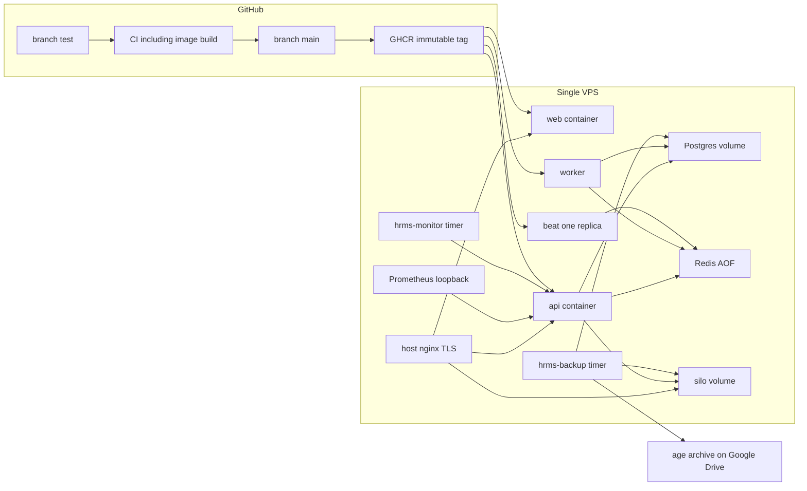
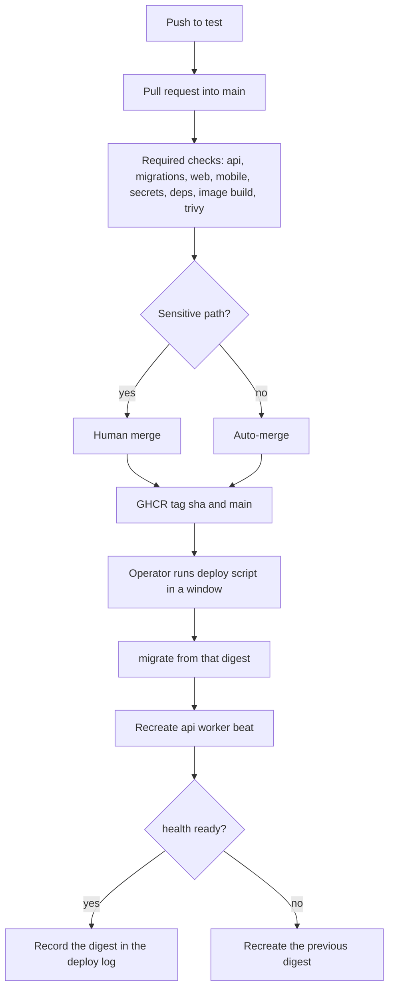

# Target DevOps architecture

Audit date: 2026-11-25. This is the smallest production-grade layout that matches the system that is already running. It does not add a platform for its own sake.

## 1. Keep, improve, add, avoid

| Decision | Tool | Why |
|---|---|---|
| Keep | GitHub Actions for CI | It already tests API, web, and mobile against real Postgres, Redis, and MinIO |
| Keep | Auto-merge from `test` to `main`, with the sensitive-path hold | It matches `AGENTS.md` and it held PR #81 correctly |
| Keep | Docker Compose on one VPS | Seven containers, one host, no traffic evidence that needs a scheduler |
| Keep | Host nginx and certbot on this VPS | They are what serves krewoxa.com. The Compose nginx file stays for a VPS that does not already have nginx |
| Keep | `hrms_backup.sh`, age, rclone to Drive | It ran successfully on the day of the audit, including the daily tier |
| Keep | `hrms_monitor.sh` and the email script | It is the only alert path that is scheduled |
| Keep | Non-root API image, loopback publishes, UFW, fail2ban | They are doing the job |
| Improve | Branch protection | The policy is local and social. It needs to be a GitHub rule |
| Improve | Image identity | `latest` built on the server on 4 November cannot be rolled back or reproduced |
| Improve | Prometheus | The compose file and the rules already exist. Start them on loopback |
| Improve | Disaster-recovery docs | One current procedure |
| Add | GitHub Container Registry | Immutable tags `sha-<commit>` built by CI |
| Add | A deploy script that pulls a digest, runs migrate once, recreates api, worker, and beat together, then checks `/health/ready` | Replaces ad-hoc `scp` |
| Add | One restore drill on a spare machine or a throwaway VPS | The daily restore already proves the dump opens. It does not prove the key and DNS |
| Add later, only if mail proves noisy | Alertmanager | Not before the email path has been seen to send |
| Add later, only if unhandled 500s are hard to find in logs | GlitchTip or Sentry | Redaction must be on before the SDK is |
| Avoid | Kubernetes | Nothing in the capacity audit requires it. It would become the largest operational burden |
| Avoid | A second observability vendor | Prometheus plus the existing mailer covers this size |
| Avoid | Terraform for one server | A shell or Ansible bootstrap is enough to rebuild Ubuntu, Docker, UFW, and the units |
| Avoid | Staging on this same VPS | The worker already holds about 2.2 GiB, and Hirico is here. Staging waits for another machine or for a smaller worker |
| Avoid | PgBouncer, Redis Cluster, multi-region | Connection counts and data size do not justify them |

## 2. Runtime shape

API, worker, and Beat always share one image digest. Web can move on its own when the API contract did not change.

## 3. Release pipeline to build

This is continuous delivery with a human at the production button. It is not continuous deployment. Payroll and attendance migrations should not go out unattended. The auto-merge to `main` can stay automatic. The VPS should not.

## 4. Data and recovery

- Postgres remains a Docker volume on the VPS, dumped hourly, encrypted, copied off-site.
- RPO target: 1 hour for Postgres, 24 hours for MinIO until someone decides documents need the hourly tier.
- RTO target: 8 hours. Untested until `P6-02`.
- No WAL archive in the first iteration.
- Redis stays a disposable broker with AOF for local restarts.
- The age private key stays off the server. A drill includes fetching it.

## 5. Environments

| Environment | Role |
|---|---|
| Developer compose | Unchanged. Fixed dev passwords, host ports 5433 and 6380 |
| CI | Unchanged databases, plus a `docker build` that does not push on pull requests from forks |
| `main` images | Tags in GHCR. Not deployed by themselves |
| Production | The current VPS, deploy script, one digest |
| Staging | A later small VPS, same compose file, other domain, other database. Not this host |

Until staging exists, the production window is the only integration of host nginx and the image. That is acceptable if the deploy script's health check and rollback are real, and if migrations are backward compatible.

## 6. Security end state

- Branch protection on `main`: no force-push, no deletion, pull request required, the CI checks required, conversations not required unless the team wants them.
- Actions pinned by SHA. `allowed_actions` limited to the actions this repo uses, or SHA pinning required at the repo setting.
- Deploy key is a dedicated user on the VPS, not root, and it is not stored in GitHub until branch protection and pinned actions are in place. Even then, prefer the operator running the script over a GitHub-hosted SSH deploy.
- Redis password on the Docker network, `maxmemory` set, policy `noeviction` kept so a full broker fails loudly.
- Container scan on the image CI just built.
- 61 pending packages reviewed and applied in a window, Hirico included in the reboot decision because it shares the kernel.

## 7. Observability end state

- Prometheus and node_exporter from the existing compose overlay, no published port, SSH tunnel for the UI.
- The existing alert rules loaded, with Alertmanager still off.
- The host monitor remains the pager.
- One synthetic failure, or a `hrms_notify_email.py` test send, recorded, so "mail works" is a fact.
- Grafana only after Prometheus has a week of data and someone will look at it. The JSON files can wait.
- Certificate expiry added to the monitor, because certbot's mail was not verified.

## 8. What production means after this

A production release is a digest that CI built from a commit on `main`, migrated with the `migrate` service of that same digest, and left in place only after `/health/ready` returned 200. The previous digest is still on the host for rollback. The live Alembic head matches that image. `hrms_demo` is either renamed in documentation to "the live database" or the URL is pointed at a database whose name matches the environment, as a separate planned change, not as a side effect of the first deploy.
