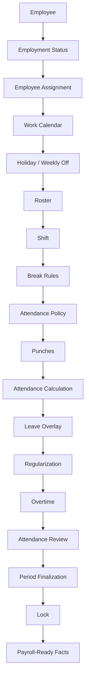
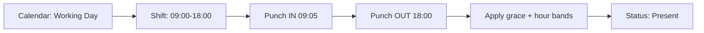
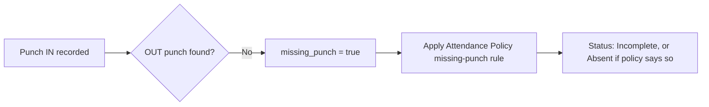
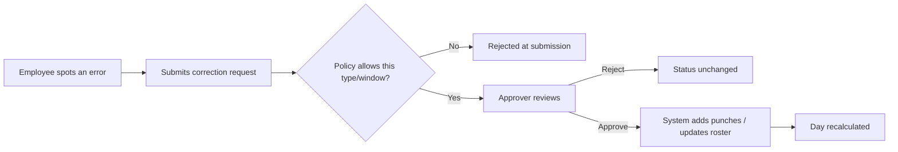
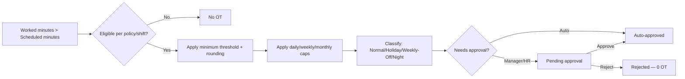
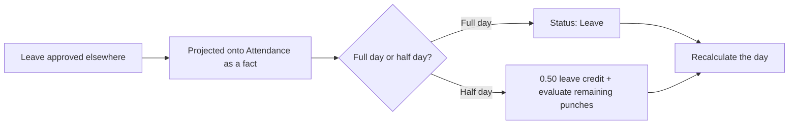
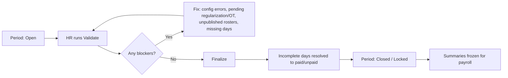

# Attendance V1 — Complete Client-Facing Flow

**Read this first if:** you want to understand how attendance actually works, from an employee's day to a locked, payroll-ready result — without needing to know anything about databases, APIs, or code.

Every rule below is tagged: **CURRENTLY WORKING**, **CONFIGURABLE AND WORKING**, **STORED BUT NOT USED**, **OPEN PRODUCT DECISION**, **FUTURE MODULE**, or **KNOWN LIMITATION**. See [`README.md`](./README.md) for what each tag means.

---

## 1. What attendance answers

Attendance answers three questions, in order, for every employee on every day:

1. **Was the employee expected to work?** (calendar, holiday, weekly-off, roster)
2. **What schedule were they expected to follow?** (shift, breaks, timing rules)
3. **Based on their actual attendance, what should the final result be?** (present, absent, half-day, incomplete, on leave — plus any overtime)

Everything else in this document is detail behind those three questions.

---

## 2. The complete flow, end to end



The table below walks through every stage: what it means, who controls it, what feeds into it, what can override it, what happens if it's missing, and what each audience sees.

### Stage 1 — Employment Status
*Is this person even employed on this date?*

| | |
|---|---|
| **Meaning** | Before anything else, the system checks whether the employee had an active employment record on this date. |
| **Who controls it** | HR (joining date, last working day, rehire records) |
| **Inputs** | Joining date, last working day (if any) |
| **Outcomes** | Not yet joined → day marked **Not Joined**. Employment ended → day marked **Exited**. Otherwise → continue to the next stage. |
| **Override** | Nothing overrides this — it is checked first and is absolute. |
| **If missing** | There is no "missing" case — every date is always classified as one of the three states. |
| **Employee sees** | A day before joining or after exit shows as Not Joined / Exited, not as absent. |
| **HR sees** | Same status; these days are fully paid (Not Joined) or fully unpaid (Exited) automatically — no manual entry needed. |
| **Tag** | **CURRENTLY WORKING** |

### Stage 2 — Employee Assignment
*Where does this employee sit in the organisation on this date, and what is their default shift?*

| | |
|---|---|
| **Meaning** | The employee's branch, department, designation, grade, reporting manager, and default shift, **as they were on that specific date** — not as they are today. |
| **Who controls it** | HR (through employee placement records) |
| **Inputs** | Branch, department, designation, grade, manager, default shift |
| **Outcomes** | Feeds calendar selection, policy selection, and default schedule. |
| **Override** | A published **Roster** entry for that date can replace the default shift for scheduling purposes (see Stage 6). |
| **If missing** | A default shift is allowed to be blank — this is a deliberate design choice, not a bug; there is no automatic "fall back to branch default shift." |
| **Employee sees** | Not directly visible; reflected in which calendar/shift applies. |
| **HR sees** | Assignment history per employee; a transfer or promotion becomes effective from the date recorded, and past days are unaffected. |
| **Tag** | **CURRENTLY WORKING**. Automatic default-shift cascade from branch/company is an **OPEN PRODUCT DECISION** (not built). |

### Stage 3 — Work Calendar
*What calendar applies to this employee — which set of holidays and weekly-off rules?*

| | |
|---|---|
| **Meaning** | Every company can have more than one work calendar (e.g., different states/branches). The calendar assigned to this employee decides which holiday list and weekly-off pattern apply. |
| **Who controls it** | HR/Admin, via calendar assignment rules (can be set at company, branch, department, designation, grade, shift, or individual employee level) |
| **Inputs** | Ordered list of holiday calendars + a weekly-off pattern |
| **Outcomes** | Determines the day-type classification in Stage 4. |
| **Override** | The most specific assignment wins — see [Precedence & Override document](./ATTENDANCE_V1_PRECEDENCE_AND_OVERRIDE.md). |
| **If missing** | The day cannot be classified — the system **refuses to guess** and marks the day as a **Configuration Error**, which blocks period close until fixed. |
| **Employee sees** | Nothing directly; reflected in whether a day is a holiday/weekly-off/working day. |
| **HR sees** | Calendar assignment screens; a resolution preview showing which calendar applies to which employee. |
| **Tag** | **CURRENTLY WORKING**. Missing-calendar fail-closed behaviour is **CURRENTLY WORKING** and deliberate (see §4 below). |

### Stage 4 — Holiday / Weekly Off
*What kind of day is this — working, holiday, or weekly off?*

Covered in full in [§5 below](#5-what-kind-of-day-is-it). In short: an explicit date-specific override beats a holiday, a holiday beats weekly-off, weekly-off beats an ordinary working day.

**Tag:** **CURRENTLY WORKING**

### Stage 5 — Roster
*Has HR/manager scheduled this specific employee differently for this specific date?*

| | |
|---|---|
| **Meaning** | A roster is a per-employee, per-date schedule entry. It can assign a different shift than the employee's default, force a day to be treated as a week-off, or force the employee to be expected to work on a holiday/week-off. |
| **Who controls it** | HR/Admin, or a manager with roster permission |
| **Inputs** | Shift to use for this date, plus optional "treat as week-off" or "treat as working" flags |
| **Outcomes** | Overrides which shift schedule applies for that date; can change whether the employee is expected to work. |
| **Override** | A roster entry must be **published** to take effect. A draft roster is completely ignored by calculation (and blocks period close until published). Roster **never** changes the underlying calendar day-type (a holiday stays a holiday on the calendar) — it only changes whether presence is *expected*. |
| **If missing** | The employee's default assigned shift is used instead. |
| **Employee sees** | Their working hours for that date, if published. |
| **HR sees** | Roster grid per employee/date; draft vs published status. |
| **Tag** | **CURRENTLY WORKING**. **Important limitation:** publishing a roster changes an employee's *schedule*, but if that employee has a policy specifically assigned "by shift," the system still uses their originally assigned shift to pick that policy, not the roster shift. See the [Precedence document, item on Roster vs Shift-scoped Policy](./ATTENDANCE_V1_PRECEDENCE_AND_OVERRIDE.md) — flagged as **OPEN PRODUCT DECISION**. |

### Stage 6 — Shift
*What are the actual work timings, and how many hours are expected?*

Covered in full in [§6 below](#6-the-shift-system). **Tag:** **CURRENTLY WORKING**

### Stage 7 — Break Rules
*What breaks are scheduled, and how do they affect worked-hours calculation?*

Covered in full in [§7 below](#7-break-rules). **Tag:** **CURRENTLY WORKING (partial)** — see the clear "used vs not used" split in that section.

### Stage 8 — Attendance Policy
*What are the rules for judging lateness, absence, half-days, and missing punches?*

Covered in full in [§8 below](#8-attendance-policy-customization). **Tag:** **CONFIGURABLE AND WORKING (subset)**

### Stage 9 — Punches
*What did the employee actually record (in/out times)?*

| | |
|---|---|
| **Meaning** | Every clock-in/clock-out event is recorded permanently — a punch is never edited or deleted once created, only added to. |
| **Who controls it** | Employee (self clock-in/out), device/biometric integration (if connected), or HR/manager on the employee's behalf, or the system itself when a regularization request is approved. |
| **Inputs** | Timestamp, direction (IN/OUT), source (device, manual, regularization) |
| **Outcomes** | Feeds directly into the day's calculation. |
| **Override** | None can be deleted; corrections are always **additional** punches, never edits to history. |
| **If missing** | Governed by the "missing punch" rule in the Attendance Policy — see §8. |
| **Employee sees** | Their punch history for the day. |
| **HR sees** | Full punch list including source and any regularization-created punches. |
| **Tag** | **CURRENTLY WORKING**. Biometric/device integration pipeline itself is **FUTURE MODULE** — punches can be recorded manually or via any connected source today, but a dedicated device-ingestion pipeline is not yet built. |

### Stage 10 — Attendance Calculation
*Turning the day's expectations and punches into a final result.*

The engine runs through, in this exact order:
1. Is the employee employed on this date? (Stage 1)
2. Is calendar/policy configuration present? If not — Configuration Error, stop.
3. Is this a roster week-off with no punches? → Not Expected.
4. Is a shift missing? → follow the "missing shift" rule.
5. Is the day not-expected (holiday/week-off/shutdown, and nobody forced work) with no punches? → Not Expected.
6. Otherwise, pair up the punches, calculate worked minutes, apply late/early/hour-band rules → Present / Half-Day / Absent / Incomplete.
7. Apply leave (see Stage 11).

**Tag:** **CURRENTLY WORKING**

### Stage 11 — Leave Overlay

Covered in full in [§11 below](#11-leave-interactions). **Tag:** **CURRENTLY WORKING (mirror only)**

### Stage 12 — Regularization

Covered in full in [§12 below](#12-regularization-flow). **Tag:** **CURRENTLY WORKING**

### Stage 13 — Overtime

Covered in full in [§13 below](#13-overtime-flow). **Tag:** **CURRENTLY WORKING (partial)**

### Stage 14 — Attendance Review
*HR/manager review before period close.*

| | |
|---|---|
| **Meaning** | Before locking a payroll period, HR reviews attendance for gaps: missing days, unresolved regularization requests, unapproved overtime, unpublished rosters, configuration errors. |
| **Who controls it** | HR/Admin with lock/finalize permission |
| **Tag** | **CURRENTLY WORKING** |

### Stage 15 — Period Finalization & Lock

Covered in full in [§14 below](#14-period-closing). **Tag:** **CURRENTLY WORKING**

### Stage 16 — Payroll-Ready Facts
*What gets handed off.*

| | |
|---|---|
| **Meaning** | Once a period is locked, each day's final status, paid/unpaid fraction, and approved overtime minutes are frozen and summarized per employee — ready for a payroll system to consume. |
| **Outcomes** | Attendance hands off **facts** (days paid, days unpaid/LOP, overtime minutes, comp-off minutes earned). It does **not** calculate money — no pay rates, no salary impact, no statutory deductions. |
| **Tag** | **CURRENTLY WORKING** for the facts; actual payroll computation is **FUTURE MODULE**. |

---

## 3. Smaller flows for specific situations

### Normal attendance day


### Missing punch


### Regularization


### Overtime


### Leave


### Period closing


---

## 4. "What kind of day is it?" — the calendar decision

Every date for every employee is classified into exactly one day type, decided in this strict order:

1. **A specific date-level exception**, if HR has created one for that date (e.g., "this Saturday is a special working day," "this holiday is cancelled this year")
2. Otherwise, **a holiday**, if the date is listed in the employee's holiday calendar
3. Otherwise, **weekly off**, if the date matches the employee's weekly-off pattern
4. Otherwise, a **normal working day**

### The day types

| Day type | Meaning |
|---|---|
| Working day | Ordinary day — presence expected |
| Weekly off | Employee's designated rest day for that week |
| Public / company holiday | A hard holiday — nobody is expected to work unless explicitly scheduled to |
| Optional / restricted holiday | A "soft" holiday — the day counts as a normal working day by default; it only becomes a real holiday if HR turns on a company-wide setting, or (in future) the employee applies leave for it |
| Special working day | HR has explicitly declared a day (which would otherwise be a holiday or weekly-off) as a working day |
| Shutdown | A declared closure — nobody is expected to work unless specifically rostered |
| Substitute holiday | HR has manually declared a specific date as a holiday, typically to compensate for a holiday that fell on a weekly-off |
| Cancelled holiday | HR has explicitly removed a holiday's holiday status for a given date |

### The important case: Holiday falling on a Weekly Off

**Current behaviour (OPEN PRODUCT DECISION, default in effect today):**

If a public holiday falls on an employee's weekly-off day (e.g., a holiday lands on a Sunday, and Sunday is already the weekly off), **the day stays classified as Weekly Off** — it does **not** automatically get a substitute working day added elsewhere. The system does record that a holiday coincided with the weekly-off, so this is visible to HR, but nothing is automatically compensated.

If your business wants employees to get a substitute day off in this situation, HR must **manually** create a "substitute holiday" exception on a different date. There is no automatic substitution today.

**Example:** Independence Day falls on a Sunday, and Sunday is the standing weekly off.
- Result: the day is Weekly Off, flagged as "holiday coincided with weekly off."
- Employee is not expected to work; the day is fully paid, same as any weekly off.
- No extra day off is created automatically.
- If policy is "employees should get that holiday back," HR must add a Substitute Holiday exception on the replacement date by hand.

This is called out because many Indian HR policies expect an automatic substitute — **this needs explicit client confirmation** (see the sign-off checklist).

---

## 5. What kind of day is it? — full precedence walk

See the dedicated [Precedence & Override document](./ATTENDANCE_V1_PRECEDENCE_AND_OVERRIDE.md) for the master table. In short:

1. Date-specific exception always wins.
2. A holiday beats weekly-off **in terms of the label**, but a *hard* holiday landing on a weekly-off day keeps the Weekly Off label (see above) — this is the one place the "usual" precedence order has a documented carve-out.
3. Weekly-off beats an ordinary working day.
4. A roster entry can change whether presence is *expected* (e.g., forcing work on a holiday, or excusing someone from a working day) — but it never changes the calendar's day-type label itself.

---

## 6. The shift system

**Shift** defines the schedule — when someone should work, what breaks apply, and whether the shift is eligible for overtime. It does **not** define how lateness, absence, or half-days are judged — that is the **Attendance Policy**'s job (§8). Think of it as: *Shift = timetable, Attendance Policy = rulebook for judging against that timetable.*

| Concept | Owns |
|---|---|
| Shift | The schedule: start/end times, breaks, whether OT-eligible, whether it operates on holidays/weekly-offs |
| Attendance Policy | How presence is judged: grace periods, late/early bands, half-day rules, missing-punch handling |
| Overtime Policy | Whether/how extra time becomes recorded overtime |
| Regularization Policy | Who can request a correction, and how it gets approved |

### Shift types, with realistic examples

**Fixed shift** — same start and end time every day.
*Example: 09:00–18:00.*
Lateness is measured against the fixed start time; early departure against the fixed end time.

**Flexible shift** — employee can arrive/leave within a window, as long as they complete the required hours.
*Example: any time between 08:00–11:00 to arrive, working 8 required hours.*
**Known limitation:** "core hours" (a middle band where everyone must be present) is a setting that can be entered but is currently **not enforced** by the system — see §17.

**Split shift** — two or more separate blocks of work in the same day.
*Example: 06:00–10:00 and 14:00–18:00 (common for security/field staff).*
Each block needs its own complete IN/OUT punch pair. If a block is missed, the outcome depends on a configurable rule (ignore it, treat as half-day, treat as absent, or require a correction request). Lateness/earliness are **not** calculated for split shifts — only whether required hours were met.

**Night / cross-midnight shift** — starts on one day, ends after midnight.
*Example: 22:00–06:00.*

**Which date owns an overnight shift?** The entire shift — start to end — belongs to the date the shift **started**. If an employee starts work at 22:00 on 20 August and finishes at 06:00 on 21 August, that entire shift is recorded as **20 August's** attendance, not split across two days and not recorded on 21 August.

**Tag:** **CURRENTLY WORKING** for all four shift types and their scheduling. Some individual sub-features are **STORED BUT NOT USED** — see §17.

---

## 7. Break rules

Breaks are defined on the shift and can be:

| Setting | Meaning |
|---|---|
| Fixed break | A specific start/end time window (e.g., 13:00–14:00 lunch) |
| Flexible-duration break | A window during which a break of some minimum/maximum length is allowed |
| Paid / Unpaid | Whether the break time counts toward worked hours |
| Mandatory / Optional | Whether the break is required |
| Maximum duration | A cap on how long the break should be |
| Split-compatible | Whether the break can be taken in more than one sitting |

### What is actually used today vs not

**SUPPORTED AND CURRENTLY USED:**
- Matching a gap between punches to a defined break window
- Deducting **unpaid** break time from worked minutes when a matching gap is found
- Adding back **paid** break time so it still counts as worked
- Flagging when someone takes **longer** than the maximum allowed break

**CONFIGURABLE BUT CURRENTLY NOT USED BY THE ENGINE:**
- "Mandatory" break — if an employee doesn't actually take a gap that matches the mandatory break window, the system does **not** automatically deduct that break time anyway. It only deducts a break if a matching punch gap is found.
- The minimum-duration setting on a break
- The specific action to take when someone exceeds the maximum break duration (the excess is recorded, but no automatic consequence — like flag vs. reduce pay — is applied)

### Worked-minutes example

Shift: 09:00–18:00 (9 hours = 540 minutes). Break: 13:00–14:00, unpaid.

Employee punches IN at 09:00, OUT at 18:00, with a gap between 13:00–14:00 that matches the defined break.

- Total span: 540 minutes
- Unpaid break matched and deducted: 60 minutes
- **Worked minutes: 480**
- Scheduled requirement: 480 minutes (540 − 60 break)
- Result: exactly meets requirement, 0 overtime

If the employee stays until 19:00 with the same break taken: worked minutes = 600 − 60 = 540, which is 60 minutes over the 480-minute requirement — this becomes overtime (subject to eligibility, §13).

**If the employee never actually stepped away for lunch** (no punch gap matches the break window), the system does **not** invent the break — it counts the full span as worked. This is a deliberate simplification, not a bug, but it means "mandatory unpaid lunch" is not force-deducted unless the employee's punches show a gap for it.

**Tag:** **CURRENTLY WORKING (partial)** — see the two lists above.

---

## 8. Attendance policy customization

The Attendance Policy is the rulebook HR configures to decide, from punches, what the final status of a day should be. Full field-by-field catalogue is in the [Configuration Catalog](./ATTENDANCE_V1_CONFIGURATION_CATALOG.md). Summary here:

| Rule | What HR configures | Example | What happens | Status |
|---|---|---|---|---|
| Grace IN | Minutes of leeway before "late" starts counting | Grace = 15 min | Arriving 09:14 for a 09:00 shift is not late; 09:20 counts as 5 minutes late | **CONFIGURABLE AND WORKING** |
| Grace OUT | Minutes of leeway before "early departure" counts | Grace = 10 min | Leaving 17:55 for an 18:00 end is not early | **CONFIGURABLE AND WORKING** |
| Late bands | Thresholds that turn lateness into a half-day or absence | 30+ min late → Half-Day | Arriving 45 min late (after grace) can force Half-Day status | **CONFIGURABLE AND WORKING** |
| Early-departure bands | Same idea, for leaving early | 60+ min early → flag only | Leaving early may just be flagged, or forced to Half-Day, depending on setting | **CONFIGURABLE AND WORKING** |
| Hour-based bands | Minimum worked minutes for Present / Half-Day / Absent | ≥480 min = Present, 240–479 = Half-Day, <240 = Absent | Worked hours below a threshold force a lower status even without a late/early trigger | **CONFIGURABLE AND WORKING** |
| Missing punch behaviour | What happens when IN or OUT is missing | Default: mark as Incomplete | Options: Incomplete (default), Absent, requires a correction request, or "auto-close" | **CONFIGURABLE AND WORKING** for Incomplete/Absent/Require-Correction. **Auto-close is a KNOWN LIMITATION — see below.** |
| Missing shift behaviour | What happens with no assigned shift and no punches | Default varies | Absent or Incomplete, per setting | **CONFIGURABLE AND WORKING** |
| Multi-punch mode | How multiple IN/OUT pairs in a day are summed | "Sum all pairs" or "first-in, last-out only" | Changes how worked minutes are totalled when there are more than 2 punches | **CONFIGURABLE AND WORKING** |
| Duplicate punch handling | Ignore accidental double-taps within a short window | 60-second window | Two IN taps 5 seconds apart count as one | **CONFIGURABLE AND WORKING** |
| Split-shift missed block | What happens if a duty block is missed entirely | Ignore / Half-Day / Absent / Require correction | Controls the outcome for split shifts with a gap | **CONFIGURABLE AND WORKING** |
| Leave behaviour | Whether punches or leave status "wins" the day | Leave wins (default), or keep punch status and just flag it | Determines final status when both leave and punches exist on the same day | **CONFIGURABLE AND WORKING** |
| Lock-time incomplete resolution | What an unresolved Incomplete day becomes when the period is locked | Treat as Absent (default), treat as Present, or leave as Incomplete | Only applied at period close, not during the month | **CONFIGURABLE AND WORKING** |
| Punch rounding | Round punch times to the nearest N minutes | e.g., round to 15 min | *(see below)* | **STORED BUT NOT USED** |
| Core hours | A mandatory presence window inside a flexible shift | e.g., 11:00–16:00 | *(see below)* | **STORED BUT NOT USED** |
| Work-From-Home status | A dedicated "WFH" attendance result | — | *(see below)* | **STORED BUT NOT USED** |
| On-Duty status | A dedicated "On-Duty" (field work) attendance result | — | *(see below)* | **STORED BUT NOT USED** |
| Auto-close | Automatically generate a clock-out if the employee forgets | e.g., close at shift-end + 60 min | *(see below)* | **STORED BUT NOT USED** |
| Late-count rules | Convert repeated lateness (e.g., 3 lates in a month) into a half-day | "3 lates = 1 half-day" | *(see below)* | **STORED BUT NOT USED** |
| Early-departure approval requirement | Require pre-approval to leave early | — | *(see below)* | **STORED BUT NOT USED** |
| Break-excess behaviour | Automatic consequence for exceeding max break time | Flag / deduct / etc. | Excess minutes are recorded as a fact, but no automatic action is taken | **STORED BUT NOT USED** |

**On "Auto-close":** the setting exists and can be turned on, and its name implies the system will automatically generate a clock-out punch if an employee forgets. **It does not do this today.** Turning it on has no additional effect beyond the default Incomplete handling. This is a known naming trap — see the [Gaps document](./ATTENDANCE_V1_GAPS_AND_OPEN_DECISIONS.md).

**On WFH / On-Duty:** these exist as possible day statuses in the system's data model, and a regularization request can be *typed* as "WFH" or "On-Duty" — but the day-end calculation **never actually produces** a WFH or On-Duty result. A WFH regularization request only helps today if it results in ordinary punches or a shift change being applied. Treat these as **not available** until a client decision is made — see [Gaps document](./ATTENDANCE_V1_GAPS_AND_OPEN_DECISIONS.md) (ND-06).

---

## 9. Policy precedence — the most specific rule wins

Attendance Policy, Overtime Policy, Regularization Policy, and Work Calendar assignment can all be set at eight different levels, from most specific to least specific:

```
EMPLOYEE  →  SHIFT  →  DESIGNATION  →  GRADE  →  DEPARTMENT  →  BRANCH  →  LEGAL ENTITY  →  COMPANY
```

**Rule: the most specific level that has a policy assigned wins.** The system checks each level starting from Employee and stops at the first match.

### Ten worked examples

1. **Company sets Grace-In = 15 min. No other level configured.** → Every employee gets 15 min grace (Company level applies, nothing more specific exists).
2. **Company = 15 min, Department "Sales" = 10 min.** → Sales employees get 10 min; everyone else gets 15 min.
3. **Company = 15 min, Department "Sales" = 10 min, Employee "Priya" (in Sales) = 5 min.** → Priya gets 5 min (Employee beats Department beats Company).
4. **Grade "Manager" = Half-day band at 30 min late. No employee/shift/designation override.** → Every Manager-grade employee, regardless of department, gets the 30-minute Half-Day rule.
5. **Shift "Night Shift A" has its own Overtime Policy assigned. Department "Security" has a different Overtime Policy.** → An employee on Night Shift A in the Security department uses the Shift-level policy (Shift outranks Department).
6. **Branch "Mumbai" has a Work Calendar assigned. Legal Entity "ABC Pvt Ltd" also has one.** → Mumbai's calendar applies for Mumbai employees (Branch outranks Legal Entity).
7. **No policy assigned at any level for an employee.** → The system does **not** guess or default — the day becomes a Configuration Error and blocks period close until fixed.
8. **Employee is moved from Department A to Department B mid-month, each with a different Regularization Policy.** → Correction requests submitted before the move use Department A's rules (as of the request date); after the move, Department B's rules apply.
9. **Designation "Team Lead" has an Attendance Policy set; Grade "L3" (which most Team Leads hold) has a different one.** → Designation outranks Grade, so the Designation-level policy wins for anyone with that designation.
10. **Employee has no Shift-level policy, but their assigned Shift itself has one, and their Department also has a different one.** → Shift (not the employee) outranks Department, so the Shift-assigned policy wins.

### An important, deliberate limitation: Roster vs. Shift-level policy

If a policy is assigned at the **Shift** level, and an employee is temporarily moved to a different shift via a **published roster** entry, the system still looks up the Shift-level policy using the employee's **originally assigned** shift — **not** the roster's shift — for that date.

**Practical effect:** if HR temporarily reassigns someone to Night Shift via roster (which correctly changes their working hours), but that person's normal daytime shift has a specific Attendance Policy attached, the daytime shift's policy is still what gets used to judge their attendance that day — not any policy attached to Night Shift.

This is called out explicitly in the architecture notes as a mismatch and is flagged as an **OPEN PRODUCT DECISION** (see [Gaps document](./ATTENDANCE_V1_GAPS_AND_OPEN_DECISIONS.md), ND-02) — it is not a secret bug, but it has not been signed off as intended business behaviour either.

---

## 10. A complete employee day, start to finish

**Setup:** Monday. Calendar says Working Day. Shift is 09:00–18:00 with an unpaid break 13:00–14:00. Attendance Policy: Grace-In 10 min, Grace-Out 10 min, Present ≥ 480 worked minutes.

**Employee punches:** IN 09:05, OUT 18:30.

1. Calendar: Working day → presence expected.
2. Shift: 09:00 start, 18:00 end, 60-min unpaid break.
3. Break: 13:00–14:00 gap matches the defined break, so 60 min is deducted as unpaid.
4. Punch IN 09:05 → 5 minutes after scheduled start, but Grace-In is 10 min → **not late**.
5. Punch OUT 18:30 → 30 minutes after scheduled end → no early-departure issue (they stayed late, not left early).
6. Worked minutes: (18:30 − 09:05) − 60 min break = 505 minutes.
7. Overtime check: scheduled requirement 480 min; worked 505 min → 25 minutes excess. Subject to eligibility/minimum-threshold/rounding rules (§13) before it becomes recorded overtime.
8. Final status: **Present**.
9. Payroll-facing fact: 1.00 paid day, 0.00 unpaid, plus any approved OT minutes.

### Variations on the same day

| Variation | What changes | Result |
|---|---|---|
| Employee comes late (09:40, grace 10 min, late band: 30+ min → Half-Day) | Late minutes = 20 (after grace) → crosses Half-Day threshold | Status: **Half-Day** |
| Employee leaves early (17:00 instead of 18:00) | Reduces worked minutes; may trigger early-departure flag or Half-Day depending on bands | Status depends on configured bands |
| Employee misses the OUT punch | No pairing possible for that IN | Status: **Incomplete** (default) — needs a correction request |
| Employee forgets the IN punch | Orphan OUT punch | Status: **Incomplete** (default) |
| Employee has duplicate punches (two INs 5 seconds apart) | Second IN is collapsed as a duplicate | Treated as a single punch, no effect |
| Employee works through lunch without a break punch gap | No gap matches the break window | The system does **not** deduct the break — full span counted as worked |
| Employee takes a 2-hour lunch instead of 1 hour | Excess over max break duration is recorded | Flagged as excess break minutes; no automatic status change today |
| Employee works on a holiday | Depends on whether the shift/roster expects work that day | If expected: evaluated normally, worked-on-holiday recorded for overtime purposes. If not expected and punches exist anyway: still evaluated (not auto-blocked) |
| Employee works on their weekly off | Same as holiday case above | Same pattern |
| Employee works a night shift (22:00–06:00) | Entire shift attributed to the start date | One attendance record on the start date, not split |
| Employee works a split shift and misses the afternoon block | Missed-block behaviour applies (configurable) | Could be ignored, Half-Day, Absent, or blocked pending correction, depending on setting |

---

## 11. Leave interactions

**Important context:** the Attendance module does **not** contain a Leave application system. It receives a signal — "this employee has approved leave for this date, for this fraction of the day, paid or unpaid" — from wherever leave is approved, and reflects that signal on the attendance day. There is **no** leave balance tracking, accrual, or leave-application workflow inside Attendance. That is entirely a **FUTURE MODULE**.

| Situation | Current behaviour |
|---|---|
| Full-day paid leave | Status becomes **Leave**; day counted fully paid |
| Full-day unpaid leave | Status becomes **Leave**; day counted fully unpaid |
| Half-day leave | 0.50 day credited as leave; if punches also exist and show worked time, status becomes Half-Day rather than full Leave |
| Leave + punches, "leave wins" mode (default) | Status is Leave regardless of punches; late/early flags are cleared |
| Leave + punches, "flag work-on-leave" mode | Punch-based status is kept, but the day is flagged so HR can see the employee actually worked despite being on leave |
| Leave arrives after attendance was already calculated | The day is recalculated automatically to reflect the leave |
| Leave arrives after the period is locked | The leave update is **refused** — the period must be reopened first |

**Known limitation:** half-day leave marked as "first half" vs "second half" of the day is recorded, but the system currently applies a flat 0.50-day credit rather than actually limiting the evaluation to that specific half of the shift. So a "second half" leave doesn't currently exclude the morning hours from evaluation any differently than a "first half" leave would.

**Known limitation:** when leave wins the day's status (full-day, "leave wins" mode), any overtime that was calculated from punches on the same day is **not automatically cleared** — it's possible for a day marked Leave to still carry residual overtime numbers underneath from the punch calculation. This is flagged for product decision (see Gaps document, ND-04).

---

## 12. Regularization flow

Regularization is the correction workflow — how an employee fixes an attendance mistake.

```
Employee notices wrong attendance
        ↓
Requests a correction (with reason, and evidence if required)
        ↓
System checks: is this correction type allowed? Is it within the allowed backdating window? Has the monthly request limit been hit?
        ↓
Manager and/or HR reviews (chain depends on policy: Auto, Manager only, HR only, or Manager then HR)
        ↓
Approve → system adds new punches (and/or updates the roster shift) → day is recalculated
Reject → nothing changes; employee may be able to submit again depending on policy
```

**Correction types:** Missing Punch, Wrong Punch, Wrong Shift, Wrong Status, Work-From-Home, On-Duty, Full-Day correction.

**Important clarification:** regularization does **not** directly overwrite the final attendance status. Approving a "Missing Punch" request adds the missing punch, and the day is recalculated from scratch using the normal rules — the corrected result comes from the same calculation everyone else's attendance goes through. This keeps the process auditable: nothing is hand-edited.

**The WFH / On-Duty types specifically:** submitting and approving a "WFH" or "On-Duty" type of regularization request is allowed by policy today, but by itself it does **not** produce a WFH or On-Duty attendance status (see §8). It only has an effect if the approval also adds punches or changes the roster shift. Treat these two types as **not fully functional yet** — see [Gaps document](./ATTENDANCE_V1_GAPS_AND_OPEN_DECISIONS.md).

**Tag:** **CURRENTLY WORKING** for the workflow and additive-punch correction mechanism; WFH/On-Duty status production is a **KNOWN LIMITATION / OPEN PRODUCT DECISION**.

---

## 13. Overtime flow

```
Scheduled work minutes
        ↓
Actual worked minutes (from punches)
        ↓
Excess = worked − scheduled  (only counts if positive)
        ↓
Is the employee/shift eligible for overtime at all?
        ↓
Does the excess meet the minimum-overtime threshold?
        ↓
Round the minutes (if a rounding rule is configured)
        ↓
Cap against daily / weekly / monthly overtime limits
        ↓
Classify the day: Normal / Holiday / Weekly-Off / Night
        ↓
Does this require approval?
        ↓
Auto-approved, or sent to Manager / HR / Manager-then-HR
        ↓
Approved minutes recorded (+ optional comp-off credit instead of pay)
```

- **Overtime never changes the day's attendance status.** A day can be Present with 0 OT, or Present with 90 minutes of approved OT — the presence status and the overtime record are always two separate facts.
- **Eligibility settings:**
  - "Never eligible" — no OT ever
  - "Only if shift allows it" — the shift itself must be flagged OT-eligible
  - "Always eligible" — no shift check
  - "By grade" — **KNOWN LIMITATION:** this setting exists but currently behaves exactly like "Always eligible" — it does **not** actually check the employee's grade. Flag this if grade-based OT eligibility is a real requirement.
- **Holiday OT / Weekly-off OT:** correctly classified when the employee actually worked minutes on a holiday or weekly-off day.
- **Night OT — KNOWN LIMITATION:** the system has a setting for classifying overtime as "Night," meant to apply special treatment to overnight work. With the default setting, night overtime is **never actually classified as Night** — it falls back to Normal classification. A specific "night time window" setting also exists but is not used. If night-shift OT needs different treatment (e.g., a different rate for payroll reference), this needs a product decision — see Gaps document (ND-03).
- **Split-shift OT:** calculated against the shift's required-minutes baseline.
- **Comp-off:** if configured, approved OT can produce a "comp-off" (compensatory time off) fact — a record of minutes owed and an optional expiry date. **Redeeming** that comp-off against actual leave is a **FUTURE MODULE** (Leave) responsibility — Attendance only produces the fact.
- **No money is calculated anywhere in this flow.** Rate multipliers (e.g., "2x for holiday work") can be entered for reference/reporting, but are never turned into an actual payroll amount by this module — that is a **FUTURE MODULE** (Payroll) responsibility.

**Approval chains:** Auto (no human approval needed), Manager, HR, or Manager-then-HR (escalates to HR if no manager can be resolved for that date). Self-approval is always blocked. Once a decision is Approved or Rejected, it is **frozen** — a later recalculation of the same day (e.g., from a regularization) will not silently change an already-decided overtime record.

**Tag:** **CURRENTLY WORKING** for detection, caps, approval, and comp-off facts. Grade-based eligibility and Night classification are **KNOWN LIMITATIONS**.

---

## 14. Period closing

```
Period: OPEN  (attendance can be freely calculated/corrected)
        ↓
HR runs Validate — a pre-check for blockers
        ↓
   Blockers found?  ── Yes ──→  Fix issues, validate again
        │
        No
        ↓
Finalize
        ↓
Any remaining "Incomplete" days are resolved to a paid/unpaid fraction per policy (the status label itself stays "Incomplete" for record-keeping — only the paid/unpaid fraction changes)
        ↓
Period: CLOSED (locked)
        ↓
Per-employee summaries are frozen and handed off for payroll
```

### What blocks finalization

- **Configuration errors** — any day still showing Configuration Error (missing calendar/policy)
- **Incomplete attendance** — only if the policy setting is "keep as Incomplete" (if the policy instead says "treat Incomplete as Present/Absent at lock time," this is not a blocker)
- **Pending regularization requests** — any correction request still awaiting a decision
- **Pending overtime approvals** — any overtime record still awaiting a decision
- **Unpublished rosters** — any draft roster entry within the period's date range
- **Employees without any attendance record** — a gap in coverage

### What becomes impossible once locked

Once a period is Closed: no new punches can be recorded for those dates, no recalculation can run, roster entries can't be changed, no new regularization request can be submitted, overtime can't be approved or rejected, and leave sync/cancellation is refused — all for dates inside the locked period.

**Reopening:** HR with the right permission can reopen a locked period, which unlocks the days again — but reopening does **not** automatically recalculate anything. Any changes made after reopening need to be manually triggered to recompute. There is currently no built-in "post-lock correction with payroll arrears" feature (e.g., adjusting a already-paid period after the fact) — that is a **FUTURE MODULE**.

**Tag:** **CURRENTLY WORKING** for the full open→validate→finalize→lock→reopen cycle. Post-lock adjustment/arrears tracking is **FUTURE MODULE**. Whether reopening should force an automatic recompute is an **OPEN PRODUCT DECISION**.

---

## 15. Where to go next

- Precise "who wins" rules → [`ATTENDANCE_V1_PRECEDENCE_AND_OVERRIDE.md`](./ATTENDANCE_V1_PRECEDENCE_AND_OVERRIDE.md)
- 50+ worked scenarios, including Indian HR patterns → [`ATTENDANCE_V1_SCENARIO_CATALOG.md`](./ATTENDANCE_V1_SCENARIO_CATALOG.md)
- Everything configurable, who can configure it → [`ATTENDANCE_V1_CONFIGURATION_CATALOG.md`](./ATTENDANCE_V1_CONFIGURATION_CATALOG.md)
- Every setting that looks active but isn't, and every open decision → [`ATTENDANCE_V1_GAPS_AND_OPEN_DECISIONS.md`](./ATTENDANCE_V1_GAPS_AND_OPEN_DECISIONS.md)
- The actual sign-off checklist → [`ATTENDANCE_V1_CLIENT_SIGNOFF.md`](./ATTENDANCE_V1_CLIENT_SIGNOFF.md)
