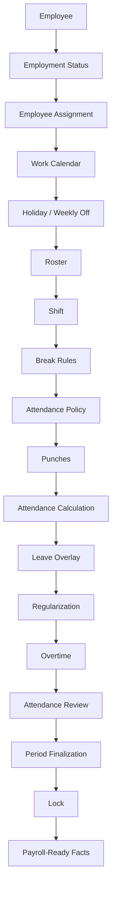
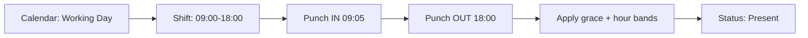
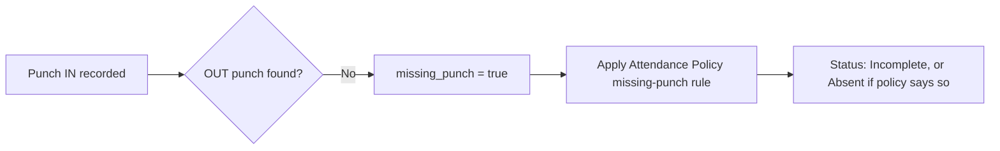
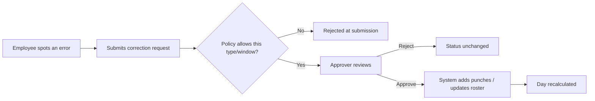
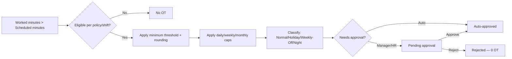
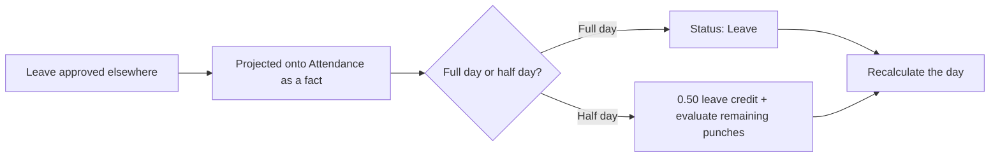
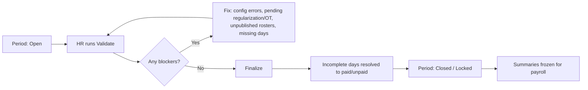

# Attendance V1 — Complete Business Rules & Client Sign-Off (Combined)

**Generated:** 2026-08-21

This file concatenates the full Attendance V1 client-facing document set into a single file for offline reading, printing, or sharing as one package. The individual files remain the maintained sources — edit those, not this file; regenerate this file if any of them change.

- README.md
- ATTENDANCE_V1_CLIENT_FLOW.md
- ATTENDANCE_V1_PRECEDENCE_AND_OVERRIDE.md
- ATTENDANCE_V1_SCENARIO_CATALOG.md
- ATTENDANCE_V1_CONFIGURATION_CATALOG.md
- ATTENDANCE_V1_GAPS_AND_OPEN_DECISIONS.md
- ATTENDANCE_V1_CLIENT_SIGNOFF.md

---


<!-- ============================================================ -->
<!-- SOURCE FILE: README.md -->
<!-- ============================================================ -->

# Attendance V1 — Business Rules Document Set (Client Review)

**Purpose:** Give HR, product owners, and client stakeholders a complete, non-technical picture of how the Workforce Attendance module behaves today, what can be configured, what is not yet built, and what decisions still need a business sign-off.

**Audience:** HR/Admin, client product owner, implementation consultants. No database, API, or code knowledge is assumed.

**Status:** Documentation only. Nothing in this document set changes how the system behaves. It describes the system **as it exists today** (slices W1–W9) and separates that clearly from things that are configurable-but-inactive, not-yet-built, or still awaiting a decision.

**Method:** Every document was checked against the live calculation engine, policy resolution logic, and workflow code (not just design documents), and against the existing technical business-rules set in `docs/business-rules/attendance/`. Where the code and older documentation disagreed, the code wins and the disagreement is called out.

---

## How every statement is labelled

Every rule in this document set carries exactly one tag:

| Tag | Meaning |
|---|---|
| **CURRENTLY WORKING** | Happens automatically today, not configurable |
| **CONFIGURABLE AND WORKING** | HR can change this setting, and the system actually behaves differently as a result |
| **STORED BUT NOT USED** | HR can enter/edit this setting today, but the system currently ignores it |
| **OPEN PRODUCT DECISION** | The current behaviour is a default, not a confirmed business rule — needs client sign-off |
| **FUTURE MODULE** | Owned by a module that doesn't exist yet (Leave, Payroll, Device, Workflow Engine) |
| **KNOWN LIMITATION** | Works, but with an edge case or simplification worth knowing about |

If something is not tagged, treat it as unverified and ask before relying on it.

---

## Documents in this set

| # | Document | What it's for |
|---|---|---|
| 1 | `ATTENDANCE_V1_CLIENT_FLOW.md` | The full attendance story end to end, in HR language, with diagrams |
| 2 | `ATTENDANCE_V1_PRECEDENCE_AND_OVERRIDE.md` | "Which rule wins when two rules apply" — the override matrix |
| 3 | `ATTENDANCE_V1_SCENARIO_CATALOG.md` | 50+ realistic day-in-the-life scenarios, including Indian HR patterns |
| 4 | `ATTENDANCE_V1_CONFIGURATION_CATALOG.md` | Everything HR/Admin can configure, who can configure it, and what it actually affects |
| 5 | `ATTENDANCE_V1_GAPS_AND_OPEN_DECISIONS.md` | Settings that look active but aren't, plus every open decision awaiting sign-off |
| 6 | `ATTENDANCE_V1_CLIENT_SIGNOFF.md` | The actual review checklist — questions the client should answer |

## Recommended reading order

**For the client / product owner (business review):**
README → 1 (Client Flow) → 2 (Precedence) → 3 (Scenarios) → 5 (Gaps & Open Decisions) → 6 (Sign-off checklist)

**For HR configuration owners:**
README → 1 (Client Flow) → 4 (Configuration Catalog) → 5 (Gaps & Open Decisions)

**For anyone who just wants the decisions to sign off on:**
README → 6 (Sign-off checklist) — refer back to 1/2/3/5 for context on any question.

---

## What this module covers today (W1–W9)

Work calendars and holidays, weekly-off patterns, shifts and rosters, break rules, three families of policy (Attendance / Overtime / Regularization), punch capture, day-by-day attendance calculation, leave overlay (as a mirror of approved leave, not a full leave system), regularization (correction) requests, overtime detection and approval, and period close/lock ready for payroll handoff.

## What this module does **not** cover yet

Leave applications, balances, and accrual; payroll money calculations; biometric device connectors; a general-purpose approval-workflow engine; corrections after a period is locked; automatic shift rotation generation. These are called out throughout as **FUTURE MODULE**.

---

## Related technical material

For engineers and implementers, the underlying technical business-rules set remains at `docs/business-rules/attendance/` (rule-by-rule detail, code references, precedence tables in technical form) and the architecture/decision log at `docs/architecture/WORKFORCE_ATTENDANCE_ARCHITECTURE.md` and `docs/architecture/WORKFORCE_ATTENDANCE_DECISION_LOG.md`. This client-facing set is a translation and reorganization of that material for business review — it does not replace it.


<!-- ============================================================ -->
<!-- SOURCE FILE: ATTENDANCE_V1_CLIENT_FLOW.md -->
<!-- ============================================================ -->

# Attendance V1 — Complete Client-Facing Flow

**Read this first if:** you want to understand how attendance actually works, from an employee's day to a locked, payroll-ready result — without needing to know anything about databases, APIs, or code.

Every rule below is tagged: **CURRENTLY WORKING**, **CONFIGURABLE AND WORKING**, **STORED BUT NOT USED**, **OPEN PRODUCT DECISION**, **FUTURE MODULE**, or **KNOWN LIMITATION**. See the README section above for what each tag means.

---

## 1. What attendance answers

Attendance answers three questions, in order, for every employee on every day:

1. **Was the employee expected to work?** (calendar, holiday, weekly-off, roster)
2. **What schedule were they expected to follow?** (shift, breaks, timing rules)
3. **Based on their actual attendance, what should the final result be?** (present, absent, half-day, incomplete, on leave — plus any overtime)

Everything else in this document is detail behind those three questions.

---

## 2. The complete flow, end to end



The table below walks through every stage: what it means, who controls it, what feeds into it, what can override it, what happens if it's missing, and what each audience sees.

### Stage 1 — Employment Status
*Is this person even employed on this date?*

| | |
|---|---|
| **Meaning** | Before anything else, the system checks whether the employee had an active employment record on this date. |
| **Who controls it** | HR (joining date, last working day, rehire records) |
| **Inputs** | Joining date, last working day (if any) |
| **Outcomes** | Not yet joined → day marked **Not Joined**. Employment ended → day marked **Exited**. Otherwise → continue to the next stage. |
| **Override** | Nothing overrides this — it is checked first and is absolute. |
| **If missing** | There is no "missing" case — every date is always classified as one of the three states. |
| **Employee sees** | A day before joining or after exit shows as Not Joined / Exited, not as absent. |
| **HR sees** | Same status; these days are fully paid (Not Joined) or fully unpaid (Exited) automatically — no manual entry needed. |
| **Tag** | **CURRENTLY WORKING** |

### Stage 2 — Employee Assignment
*Where does this employee sit in the organisation on this date, and what is their default shift?*

| | |
|---|---|
| **Meaning** | The employee's branch, department, designation, grade, reporting manager, and default shift, **as they were on that specific date** — not as they are today. |
| **Who controls it** | HR (through employee placement records) |
| **Inputs** | Branch, department, designation, grade, manager, default shift |
| **Outcomes** | Feeds calendar selection, policy selection, and default schedule. |
| **Override** | A published **Roster** entry for that date can replace the default shift for scheduling purposes (see Stage 6). |
| **If missing** | A default shift is allowed to be blank — this is a deliberate design choice, not a bug; there is no automatic "fall back to branch default shift." |
| **Employee sees** | Not directly visible; reflected in which calendar/shift applies. |
| **HR sees** | Assignment history per employee; a transfer or promotion becomes effective from the date recorded, and past days are unaffected. |
| **Tag** | **CURRENTLY WORKING**. Automatic default-shift cascade from branch/company is an **OPEN PRODUCT DECISION** (not built). |

### Stage 3 — Work Calendar
*What calendar applies to this employee — which set of holidays and weekly-off rules?*

| | |
|---|---|
| **Meaning** | Every company can have more than one work calendar (e.g., different states/branches). The calendar assigned to this employee decides which holiday list and weekly-off pattern apply. |
| **Who controls it** | HR/Admin, via calendar assignment rules (can be set at company, branch, department, designation, grade, shift, or individual employee level) |
| **Inputs** | Ordered list of holiday calendars + a weekly-off pattern |
| **Outcomes** | Determines the day-type classification in Stage 4. |
| **Override** | The most specific assignment wins — see the Precedence & Override section below. |
| **If missing** | The day cannot be classified — the system **refuses to guess** and marks the day as a **Configuration Error**, which blocks period close until fixed. |
| **Employee sees** | Nothing directly; reflected in whether a day is a holiday/weekly-off/working day. |
| **HR sees** | Calendar assignment screens; a resolution preview showing which calendar applies to which employee. |
| **Tag** | **CURRENTLY WORKING**. Missing-calendar fail-closed behaviour is **CURRENTLY WORKING** and deliberate (see §4 below). |

### Stage 4 — Holiday / Weekly Off
*What kind of day is this — working, holiday, or weekly off?*

Covered in full in §5 below. In short: an explicit date-specific override beats a holiday, a holiday beats weekly-off, weekly-off beats an ordinary working day.

**Tag:** **CURRENTLY WORKING**

### Stage 5 — Roster
*Has HR/manager scheduled this specific employee differently for this specific date?*

| | |
|---|---|
| **Meaning** | A roster is a per-employee, per-date schedule entry. It can assign a different shift than the employee's default, force a day to be treated as a week-off, or force the employee to be expected to work on a holiday/week-off. |
| **Who controls it** | HR/Admin, or a manager with roster permission |
| **Inputs** | Shift to use for this date, plus optional "treat as week-off" or "treat as working" flags |
| **Outcomes** | Overrides which shift schedule applies for that date; can change whether the employee is expected to work. |
| **Override** | A roster entry must be **published** to take effect. A draft roster is completely ignored by calculation (and blocks period close until published). Roster **never** changes the underlying calendar day-type (a holiday stays a holiday on the calendar) — it only changes whether presence is *expected*. |
| **If missing** | The employee's default assigned shift is used instead. |
| **Employee sees** | Their working hours for that date, if published. |
| **HR sees** | Roster grid per employee/date; draft vs published status. |
| **Tag** | **CURRENTLY WORKING**. **Important limitation:** publishing a roster changes an employee's *schedule*, but if that employee has a policy specifically assigned "by shift," the system still uses their originally assigned shift to pick that policy, not the roster shift. See the Precedence section, item on Roster vs Shift-scoped Policy below — flagged as **OPEN PRODUCT DECISION**. |

### Stage 6 — Shift
*What are the actual work timings, and how many hours are expected?*

Covered in full in §6 below. **Tag:** **CURRENTLY WORKING**

### Stage 7 — Break Rules
*What breaks are scheduled, and how do they affect worked-hours calculation?*

Covered in full in §7 below. **Tag:** **CURRENTLY WORKING (partial)** — see the clear "used vs not used" split in that section.

### Stage 8 — Attendance Policy
*What are the rules for judging lateness, absence, half-days, and missing punches?*

Covered in full in §8 below. **Tag:** **CONFIGURABLE AND WORKING (subset)**

### Stage 9 — Punches
*What did the employee actually record (in/out times)?*

| | |
|---|---|
| **Meaning** | Every clock-in/clock-out event is recorded permanently — a punch is never edited or deleted once created, only added to. |
| **Who controls it** | Employee (self clock-in/out), device/biometric integration (if connected), or HR/manager on the employee's behalf, or the system itself when a regularization request is approved. |
| **Inputs** | Timestamp, direction (IN/OUT), source (device, manual, regularization) |
| **Outcomes** | Feeds directly into the day's calculation. |
| **Override** | None can be deleted; corrections are always **additional** punches, never edits to history. |
| **If missing** | Governed by the "missing punch" rule in the Attendance Policy — see §8. |
| **Employee sees** | Their punch history for the day. |
| **HR sees** | Full punch list including source and any regularization-created punches. |
| **Tag** | **CURRENTLY WORKING**. Biometric/device integration pipeline itself is **FUTURE MODULE** — punches can be recorded manually or via any connected source today, but a dedicated device-ingestion pipeline is not yet built. |

### Stage 10 — Attendance Calculation
*Turning the day's expectations and punches into a final result.*

The engine runs through, in this exact order:
1. Is the employee employed on this date? (Stage 1)
2. Is calendar/policy configuration present? If not — Configuration Error, stop.
3. Is this a roster week-off with no punches? → Not Expected.
4. Is a shift missing? → follow the "missing shift" rule.
5. Is the day not-expected (holiday/week-off/shutdown, and nobody forced work) with no punches? → Not Expected.
6. Otherwise, pair up the punches, calculate worked minutes, apply late/early/hour-band rules → Present / Half-Day / Absent / Incomplete.
7. Apply leave (see Stage 11).

**Tag:** **CURRENTLY WORKING**

### Stage 11 — Leave Overlay

Covered in full in §11 below. **Tag:** **CURRENTLY WORKING (mirror only)**

### Stage 12 — Regularization

Covered in full in §12 below. **Tag:** **CURRENTLY WORKING**

### Stage 13 — Overtime

Covered in full in §13 below. **Tag:** **CURRENTLY WORKING (partial)**

### Stage 14 — Attendance Review
*HR/manager review before period close.*

| | |
|---|---|
| **Meaning** | Before locking a payroll period, HR reviews attendance for gaps: missing days, unresolved regularization requests, unapproved overtime, unpublished rosters, configuration errors. |
| **Who controls it** | HR/Admin with lock/finalize permission |
| **Tag** | **CURRENTLY WORKING** |

### Stage 15 — Period Finalization & Lock

Covered in full in §14 below. **Tag:** **CURRENTLY WORKING**

### Stage 16 — Payroll-Ready Facts
*What gets handed off.*

| | |
|---|---|
| **Meaning** | Once a period is locked, each day's final status, paid/unpaid fraction, and approved overtime minutes are frozen and summarized per employee — ready for a payroll system to consume. |
| **Outcomes** | Attendance hands off **facts** (days paid, days unpaid/LOP, overtime minutes, comp-off minutes earned). It does **not** calculate money — no pay rates, no salary impact, no statutory deductions. |
| **Tag** | **CURRENTLY WORKING** for the facts; actual payroll computation is **FUTURE MODULE**. |

---

## 3. Smaller flows for specific situations

### Normal attendance day


### Missing punch


### Regularization


### Overtime


### Leave


### Period closing


---

## 4. "What kind of day is it?" — the calendar decision

Every date for every employee is classified into exactly one day type, decided in this strict order:

1. **A specific date-level exception**, if HR has created one for that date (e.g., "this Saturday is a special working day," "this holiday is cancelled this year")
2. Otherwise, **a holiday**, if the date is listed in the employee's holiday calendar
3. Otherwise, **weekly off**, if the date matches the employee's weekly-off pattern
4. Otherwise, a **normal working day**

### The day types

| Day type | Meaning |
|---|---|
| Working day | Ordinary day — presence expected |
| Weekly off | Employee's designated rest day for that week |
| Public / company holiday | A hard holiday — nobody is expected to work unless explicitly scheduled to |
| Optional / restricted holiday | A "soft" holiday — the day counts as a normal working day by default; it only becomes a real holiday if HR turns on a company-wide setting, or (in future) the employee applies leave for it |
| Special working day | HR has explicitly declared a day (which would otherwise be a holiday or weekly-off) as a working day |
| Shutdown | A declared closure — nobody is expected to work unless specifically rostered |
| Substitute holiday | HR has manually declared a specific date as a holiday, typically to compensate for a holiday that fell on a weekly-off |
| Cancelled holiday | HR has explicitly removed a holiday's holiday status for a given date |

### The important case: Holiday falling on a Weekly Off

**Current behaviour (OPEN PRODUCT DECISION, default in effect today):**

If a public holiday falls on an employee's weekly-off day (e.g., a holiday lands on a Sunday, and Sunday is already the weekly off), **the day stays classified as Weekly Off** — it does **not** automatically get a substitute working day added elsewhere. The system does record that a holiday coincided with the weekly-off, so this is visible to HR, but nothing is automatically compensated.

If your business wants employees to get a substitute day off in this situation, HR must **manually** create a "substitute holiday" exception on a different date. There is no automatic substitution today.

**Example:** Independence Day falls on a Sunday, and Sunday is the standing weekly off.
- Result: the day is Weekly Off, flagged as "holiday coincided with weekly off."
- Employee is not expected to work; the day is fully paid, same as any weekly off.
- No extra day off is created automatically.
- If policy is "employees should get that holiday back," HR must add a Substitute Holiday exception on the replacement date by hand.

This is called out because many Indian HR policies expect an automatic substitute — **this needs explicit client confirmation** (see the sign-off checklist).

---

## 5. What kind of day is it? — full precedence walk

See the dedicated Precedence & Override section below for the master table. In short:

1. Date-specific exception always wins.
2. A holiday beats weekly-off **in terms of the label**, but a *hard* holiday landing on a weekly-off day keeps the Weekly Off label (see above) — this is the one place the "usual" precedence order has a documented carve-out.
3. Weekly-off beats an ordinary working day.
4. A roster entry can change whether presence is *expected* (e.g., forcing work on a holiday, or excusing someone from a working day) — but it never changes the calendar's day-type label itself.

---

## 6. The shift system

**Shift** defines the schedule — when someone should work, what breaks apply, and whether the shift is eligible for overtime. It does **not** define how lateness, absence, or half-days are judged — that is the **Attendance Policy**'s job (§8). Think of it as: *Shift = timetable, Attendance Policy = rulebook for judging against that timetable.*

| Concept | Owns |
|---|---|
| Shift | The schedule: start/end times, breaks, whether OT-eligible, whether it operates on holidays/weekly-offs |
| Attendance Policy | How presence is judged: grace periods, late/early bands, half-day rules, missing-punch handling |
| Overtime Policy | Whether/how extra time becomes recorded overtime |
| Regularization Policy | Who can request a correction, and how it gets approved |

### Shift types, with realistic examples

**Fixed shift** — same start and end time every day.
*Example: 09:00–18:00.*
Lateness is measured against the fixed start time; early departure against the fixed end time.

**Flexible shift** — employee can arrive/leave within a window, as long as they complete the required hours.
*Example: any time between 08:00–11:00 to arrive, working 8 required hours.*
**Known limitation:** "core hours" (a middle band where everyone must be present) is a setting that can be entered but is currently **not enforced** by the system — see §17.

**Split shift** — two or more separate blocks of work in the same day.
*Example: 06:00–10:00 and 14:00–18:00 (common for security/field staff).*
Each block needs its own complete IN/OUT punch pair. If a block is missed, the outcome depends on a configurable rule (ignore it, treat as half-day, treat as absent, or require a correction request). Lateness/earliness are **not** calculated for split shifts — only whether required hours were met.

**Night / cross-midnight shift** — starts on one day, ends after midnight.
*Example: 22:00–06:00.*

**Which date owns an overnight shift?** The entire shift — start to end — belongs to the date the shift **started**. If an employee starts work at 22:00 on 20 August and finishes at 06:00 on 21 August, that entire shift is recorded as **20 August's** attendance, not split across two days and not recorded on 21 August.

**Tag:** **CURRENTLY WORKING** for all four shift types and their scheduling. Some individual sub-features are **STORED BUT NOT USED** — see §17.

---

## 7. Break rules

Breaks are defined on the shift and can be:

| Setting | Meaning |
|---|---|
| Fixed break | A specific start/end time window (e.g., 13:00–14:00 lunch) |
| Flexible-duration break | A window during which a break of some minimum/maximum length is allowed |
| Paid / Unpaid | Whether the break time counts toward worked hours |
| Mandatory / Optional | Whether the break is required |
| Maximum duration | A cap on how long the break should be |
| Split-compatible | Whether the break can be taken in more than one sitting |

### What is actually used today vs not

**SUPPORTED AND CURRENTLY USED:**
- Matching a gap between punches to a defined break window
- Deducting **unpaid** break time from worked minutes when a matching gap is found
- Adding back **paid** break time so it still counts as worked
- Flagging when someone takes **longer** than the maximum allowed break

**CONFIGURABLE BUT CURRENTLY NOT USED BY THE ENGINE:**
- "Mandatory" break — if an employee doesn't actually take a gap that matches the mandatory break window, the system does **not** automatically deduct that break time anyway. It only deducts a break if a matching punch gap is found.
- The minimum-duration setting on a break
- The specific action to take when someone exceeds the maximum break duration (the excess is recorded, but no automatic consequence — like flag vs. reduce pay — is applied)

### Worked-minutes example

Shift: 09:00–18:00 (9 hours = 540 minutes). Break: 13:00–14:00, unpaid.

Employee punches IN at 09:00, OUT at 18:00, with a gap between 13:00–14:00 that matches the defined break.

- Total span: 540 minutes
- Unpaid break matched and deducted: 60 minutes
- **Worked minutes: 480**
- Scheduled requirement: 480 minutes (540 − 60 break)
- Result: exactly meets requirement, 0 overtime

If the employee stays until 19:00 with the same break taken: worked minutes = 600 − 60 = 540, which is 60 minutes over the 480-minute requirement — this becomes overtime (subject to eligibility, §13).

**If the employee never actually stepped away for lunch** (no punch gap matches the break window), the system does **not** invent the break — it counts the full span as worked. This is a deliberate simplification, not a bug, but it means "mandatory unpaid lunch" is not force-deducted unless the employee's punches show a gap for it.

**Tag:** **CURRENTLY WORKING (partial)** — see the two lists above.

---

## 8. Attendance policy customization

The Attendance Policy is the rulebook HR configures to decide, from punches, what the final status of a day should be. Full field-by-field catalogue is in the Configuration Catalog section below. Summary here:

| Rule | What HR configures | Example | What happens | Status |
|---|---|---|---|---|
| Grace IN | Minutes of leeway before "late" starts counting | Grace = 15 min | Arriving 09:14 for a 09:00 shift is not late; 09:20 counts as 5 minutes late | **CONFIGURABLE AND WORKING** |
| Grace OUT | Minutes of leeway before "early departure" counts | Grace = 10 min | Leaving 17:55 for an 18:00 end is not early | **CONFIGURABLE AND WORKING** |
| Late bands | Thresholds that turn lateness into a half-day or absence | 30+ min late → Half-Day | Arriving 45 min late (after grace) can force Half-Day status | **CONFIGURABLE AND WORKING** |
| Early-departure bands | Same idea, for leaving early | 60+ min early → flag only | Leaving early may just be flagged, or forced to Half-Day, depending on setting | **CONFIGURABLE AND WORKING** |
| Hour-based bands | Minimum worked minutes for Present / Half-Day / Absent | ≥480 min = Present, 240–479 = Half-Day, <240 = Absent | Worked hours below a threshold force a lower status even without a late/early trigger | **CONFIGURABLE AND WORKING** |
| Missing punch behaviour | What happens when IN or OUT is missing | Default: mark as Incomplete | Options: Incomplete (default), Absent, requires a correction request, or "auto-close" | **CONFIGURABLE AND WORKING** for Incomplete/Absent/Require-Correction. **Auto-close is a KNOWN LIMITATION — see below.** |
| Missing shift behaviour | What happens with no assigned shift and no punches | Default varies | Absent or Incomplete, per setting | **CONFIGURABLE AND WORKING** |
| Multi-punch mode | How multiple IN/OUT pairs in a day are summed | "Sum all pairs" or "first-in, last-out only" | Changes how worked minutes are totalled when there are more than 2 punches | **CONFIGURABLE AND WORKING** |
| Duplicate punch handling | Ignore accidental double-taps within a short window | 60-second window | Two IN taps 5 seconds apart count as one | **CONFIGURABLE AND WORKING** |
| Split-shift missed block | What happens if a duty block is missed entirely | Ignore / Half-Day / Absent / Require correction | Controls the outcome for split shifts with a gap | **CONFIGURABLE AND WORKING** |
| Leave behaviour | Whether punches or leave status "wins" the day | Leave wins (default), or keep punch status and just flag it | Determines final status when both leave and punches exist on the same day | **CONFIGURABLE AND WORKING** |
| Lock-time incomplete resolution | What an unresolved Incomplete day becomes when the period is locked | Treat as Absent (default), treat as Present, or leave as Incomplete | Only applied at period close, not during the month | **CONFIGURABLE AND WORKING** |
| Punch rounding | Round punch times to the nearest N minutes | e.g., round to 15 min | *(see below)* | **STORED BUT NOT USED** |
| Core hours | A mandatory presence window inside a flexible shift | e.g., 11:00–16:00 | *(see below)* | **STORED BUT NOT USED** |
| Work-From-Home status | A dedicated "WFH" attendance result | — | *(see below)* | **STORED BUT NOT USED** |
| On-Duty status | A dedicated "On-Duty" (field work) attendance result | — | *(see below)* | **STORED BUT NOT USED** |
| Auto-close | Automatically generate a clock-out if the employee forgets | e.g., close at shift-end + 60 min | *(see below)* | **STORED BUT NOT USED** |
| Late-count rules | Convert repeated lateness (e.g., 3 lates in a month) into a half-day | "3 lates = 1 half-day" | *(see below)* | **STORED BUT NOT USED** |
| Early-departure approval requirement | Require pre-approval to leave early | — | *(see below)* | **STORED BUT NOT USED** |
| Break-excess behaviour | Automatic consequence for exceeding max break time | Flag / deduct / etc. | Excess minutes are recorded as a fact, but no automatic action is taken | **STORED BUT NOT USED** |

**On "Auto-close":** the setting exists and can be turned on, and its name implies the system will automatically generate a clock-out punch if an employee forgets. **It does not do this today.** Turning it on has no additional effect beyond the default Incomplete handling. This is a known naming trap — see the Gaps section below.

**On WFH / On-Duty:** these exist as possible day statuses in the system's data model, and a regularization request can be *typed* as "WFH" or "On-Duty" — but the day-end calculation **never actually produces** a WFH or On-Duty result. A WFH regularization request only helps today if it results in ordinary punches or a shift change being applied. Treat these as **not available** until a client decision is made — see the Gaps section below (ND-06).

---

## 9. Policy precedence — the most specific rule wins

Attendance Policy, Overtime Policy, Regularization Policy, and Work Calendar assignment can all be set at eight different levels, from most specific to least specific:

```
EMPLOYEE  →  SHIFT  →  DESIGNATION  →  GRADE  →  DEPARTMENT  →  BRANCH  →  LEGAL ENTITY  →  COMPANY
```

**Rule: the most specific level that has a policy assigned wins.** The system checks each level starting from Employee and stops at the first match.

### Ten worked examples

1. **Company sets Grace-In = 15 min. No other level configured.** → Every employee gets 15 min grace (Company level applies, nothing more specific exists).
2. **Company = 15 min, Department "Sales" = 10 min.** → Sales employees get 10 min; everyone else gets 15 min.
3. **Company = 15 min, Department "Sales" = 10 min, Employee "Priya" (in Sales) = 5 min.** → Priya gets 5 min (Employee beats Department beats Company).
4. **Grade "Manager" = Half-day band at 30 min late. No employee/shift/designation override.** → Every Manager-grade employee, regardless of department, gets the 30-minute Half-Day rule.
5. **Shift "Night Shift A" has its own Overtime Policy assigned. Department "Security" has a different Overtime Policy.** → An employee on Night Shift A in the Security department uses the Shift-level policy (Shift outranks Department).
6. **Branch "Mumbai" has a Work Calendar assigned. Legal Entity "ABC Pvt Ltd" also has one.** → Mumbai's calendar applies for Mumbai employees (Branch outranks Legal Entity).
7. **No policy assigned at any level for an employee.** → The system does **not** guess or default — the day becomes a Configuration Error and blocks period close until fixed.
8. **Employee is moved from Department A to Department B mid-month, each with a different Regularization Policy.** → Correction requests submitted before the move use Department A's rules (as of the request date); after the move, Department B's rules apply.
9. **Designation "Team Lead" has an Attendance Policy set; Grade "L3" (which most Team Leads hold) has a different one.** → Designation outranks Grade, so the Designation-level policy wins for anyone with that designation.
10. **Employee has no Shift-level policy, but their assigned Shift itself has one, and their Department also has a different one.** → Shift (not the employee) outranks Department, so the Shift-assigned policy wins.

### An important, deliberate limitation: Roster vs. Shift-level policy

If a policy is assigned at the **Shift** level, and an employee is temporarily moved to a different shift via a **published roster** entry, the system still looks up the Shift-level policy using the employee's **originally assigned** shift — **not** the roster's shift — for that date.

**Practical effect:** if HR temporarily reassigns someone to Night Shift via roster (which correctly changes their working hours), but that person's normal daytime shift has a specific Attendance Policy attached, the daytime shift's policy is still what gets used to judge their attendance that day — not any policy attached to Night Shift.

This is called out explicitly in the architecture notes as a mismatch and is flagged as an **OPEN PRODUCT DECISION** (see the Gaps section below, ND-02) — it is not a secret bug, but it has not been signed off as intended business behaviour either.

---

## 10. A complete employee day, start to finish

**Setup:** Monday. Calendar says Working Day. Shift is 09:00–18:00 with an unpaid break 13:00–14:00. Attendance Policy: Grace-In 10 min, Grace-Out 10 min, Present ≥ 480 worked minutes.

**Employee punches:** IN 09:05, OUT 18:30.

1. Calendar: Working day → presence expected.
2. Shift: 09:00 start, 18:00 end, 60-min unpaid break.
3. Break: 13:00–14:00 gap matches the defined break, so 60 min is deducted as unpaid.
4. Punch IN 09:05 → 5 minutes after scheduled start, but Grace-In is 10 min → **not late**.
5. Punch OUT 18:30 → 30 minutes after scheduled end → no early-departure issue (they stayed late, not left early).
6. Worked minutes: (18:30 − 09:05) − 60 min break = 505 minutes.
7. Overtime check: scheduled requirement 480 min; worked 505 min → 25 minutes excess. Subject to eligibility/minimum-threshold/rounding rules (§13) before it becomes recorded overtime.
8. Final status: **Present**.
9. Payroll-facing fact: 1.00 paid day, 0.00 unpaid, plus any approved OT minutes.

### Variations on the same day

| Variation | What changes | Result |
|---|---|---|
| Employee comes late (09:40, grace 10 min, late band: 30+ min → Half-Day) | Late minutes = 20 (after grace) → crosses Half-Day threshold | Status: **Half-Day** |
| Employee leaves early (17:00 instead of 18:00) | Reduces worked minutes; may trigger early-departure flag or Half-Day depending on bands | Status depends on configured bands |
| Employee misses the OUT punch | No pairing possible for that IN | Status: **Incomplete** (default) — needs a correction request |
| Employee forgets the IN punch | Orphan OUT punch | Status: **Incomplete** (default) |
| Employee has duplicate punches (two INs 5 seconds apart) | Second IN is collapsed as a duplicate | Treated as a single punch, no effect |
| Employee works through lunch without a break punch gap | No gap matches the break window | The system does **not** deduct the break — full span counted as worked |
| Employee takes a 2-hour lunch instead of 1 hour | Excess over max break duration is recorded | Flagged as excess break minutes; no automatic status change today |
| Employee works on a holiday | Depends on whether the shift/roster expects work that day | If expected: evaluated normally, worked-on-holiday recorded for overtime purposes. If not expected and punches exist anyway: still evaluated (not auto-blocked) |
| Employee works on their weekly off | Same as holiday case above | Same pattern |
| Employee works a night shift (22:00–06:00) | Entire shift attributed to the start date | One attendance record on the start date, not split |
| Employee works a split shift and misses the afternoon block | Missed-block behaviour applies (configurable) | Could be ignored, Half-Day, Absent, or blocked pending correction, depending on setting |

---

## 11. Leave interactions

**Important context:** the Attendance module does **not** contain a Leave application system. It receives a signal — "this employee has approved leave for this date, for this fraction of the day, paid or unpaid" — from wherever leave is approved, and reflects that signal on the attendance day. There is **no** leave balance tracking, accrual, or leave-application workflow inside Attendance. That is entirely a **FUTURE MODULE**.

| Situation | Current behaviour |
|---|---|
| Full-day paid leave | Status becomes **Leave**; day counted fully paid |
| Full-day unpaid leave | Status becomes **Leave**; day counted fully unpaid |
| Half-day leave | 0.50 day credited as leave; if punches also exist and show worked time, status becomes Half-Day rather than full Leave |
| Leave + punches, "leave wins" mode (default) | Status is Leave regardless of punches; late/early flags are cleared |
| Leave + punches, "flag work-on-leave" mode | Punch-based status is kept, but the day is flagged so HR can see the employee actually worked despite being on leave |
| Leave arrives after attendance was already calculated | The day is recalculated automatically to reflect the leave |
| Leave arrives after the period is locked | The leave update is **refused** — the period must be reopened first |

**Known limitation:** half-day leave marked as "first half" vs "second half" of the day is recorded, but the system currently applies a flat 0.50-day credit rather than actually limiting the evaluation to that specific half of the shift. So a "second half" leave doesn't currently exclude the morning hours from evaluation any differently than a "first half" leave would.

**Known limitation:** when leave wins the day's status (full-day, "leave wins" mode), any overtime that was calculated from punches on the same day is **not automatically cleared** — it's possible for a day marked Leave to still carry residual overtime numbers underneath from the punch calculation. This is flagged for product decision (see the Gaps section below, ND-04).

---

## 12. Regularization flow

Regularization is the correction workflow — how an employee fixes an attendance mistake.

```
Employee notices wrong attendance
        ↓
Requests a correction (with reason, and evidence if required)
        ↓
System checks: is this correction type allowed? Is it within the allowed backdating window? Has the monthly request limit been hit?
        ↓
Manager and/or HR reviews (chain depends on policy: Auto, Manager only, HR only, or Manager then HR)
        ↓
Approve → system adds new punches (and/or updates the roster shift) → day is recalculated
Reject → nothing changes; employee may be able to submit again depending on policy
```

**Correction types:** Missing Punch, Wrong Punch, Wrong Shift, Wrong Status, Work-From-Home, On-Duty, Full-Day correction.

**Important clarification:** regularization does **not** directly overwrite the final attendance status. Approving a "Missing Punch" request adds the missing punch, and the day is recalculated from scratch using the normal rules — the corrected result comes from the same calculation everyone else's attendance goes through. This keeps the process auditable: nothing is hand-edited.

**The WFH / On-Duty types specifically:** submitting and approving a "WFH" or "On-Duty" type of regularization request is allowed by policy today, but by itself it does **not** produce a WFH or On-Duty attendance status (see §8). It only has an effect if the approval also adds punches or changes the roster shift. Treat these two types as **not fully functional yet** — see the Gaps section below.

**Tag:** **CURRENTLY WORKING** for the workflow and additive-punch correction mechanism; WFH/On-Duty status production is a **KNOWN LIMITATION / OPEN PRODUCT DECISION**.

---

## 13. Overtime flow

```
Scheduled work minutes
        ↓
Actual worked minutes (from punches)
        ↓
Excess = worked − scheduled  (only counts if positive)
        ↓
Is the employee/shift eligible for overtime at all?
        ↓
Does the excess meet the minimum-overtime threshold?
        ↓
Round the minutes (if a rounding rule is configured)
        ↓
Cap against daily / weekly / monthly overtime limits
        ↓
Classify the day: Normal / Holiday / Weekly-Off / Night
        ↓
Does this require approval?
        ↓
Auto-approved, or sent to Manager / HR / Manager-then-HR
        ↓
Approved minutes recorded (+ optional comp-off credit instead of pay)
```

- **Overtime never changes the day's attendance status.** A day can be Present with 0 OT, or Present with 90 minutes of approved OT — the presence status and the overtime record are always two separate facts.
- **Eligibility settings:**
  - "Never eligible" — no OT ever
  - "Only if shift allows it" — the shift itself must be flagged OT-eligible
  - "Always eligible" — no shift check
  - "By grade" — **KNOWN LIMITATION:** this setting exists but currently behaves exactly like "Always eligible" — it does **not** actually check the employee's grade. Flag this if grade-based OT eligibility is a real requirement.
- **Holiday OT / Weekly-off OT:** correctly classified when the employee actually worked minutes on a holiday or weekly-off day.
- **Night OT — KNOWN LIMITATION:** the system has a setting for classifying overtime as "Night," meant to apply special treatment to overnight work. With the default setting, night overtime is **never actually classified as Night** — it falls back to Normal classification. A specific "night time window" setting also exists but is not used. If night-shift OT needs different treatment (e.g., a different rate for payroll reference), this needs a product decision — see the Gaps section below (ND-03).
- **Split-shift OT:** calculated against the shift's required-minutes baseline.
- **Comp-off:** if configured, approved OT can produce a "comp-off" (compensatory time off) fact — a record of minutes owed and an optional expiry date. **Redeeming** that comp-off against actual leave is a **FUTURE MODULE** (Leave) responsibility — Attendance only produces the fact.
- **No money is calculated anywhere in this flow.** Rate multipliers (e.g., "2x for holiday work") can be entered for reference/reporting, but are never turned into an actual payroll amount by this module — that is a **FUTURE MODULE** (Payroll) responsibility.

**Approval chains:** Auto (no human approval needed), Manager, HR, or Manager-then-HR (escalates to HR if no manager can be resolved for that date). Self-approval is always blocked. Once a decision is Approved or Rejected, it is **frozen** — a later recalculation of the same day (e.g., from a regularization) will not silently change an already-decided overtime record.

**Tag:** **CURRENTLY WORKING** for detection, caps, approval, and comp-off facts. Grade-based eligibility and Night classification are **KNOWN LIMITATIONS**.

---

## 14. Period closing

```
Period: OPEN  (attendance can be freely calculated/corrected)
        ↓
HR runs Validate — a pre-check for blockers
        ↓
   Blockers found?  ── Yes ──→  Fix issues, validate again
        │
        No
        ↓
Finalize
        ↓
Any remaining "Incomplete" days are resolved to a paid/unpaid fraction per policy (the status label itself stays "Incomplete" for record-keeping — only the paid/unpaid fraction changes)
        ↓
Period: CLOSED (locked)
        ↓
Per-employee summaries are frozen and handed off for payroll
```

### What blocks finalization

- **Configuration errors** — any day still showing Configuration Error (missing calendar/policy)
- **Incomplete attendance** — only if the policy setting is "keep as Incomplete" (if the policy instead says "treat Incomplete as Present/Absent at lock time," this is not a blocker)
- **Pending regularization requests** — any correction request still awaiting a decision
- **Pending overtime approvals** — any overtime record still awaiting a decision
- **Unpublished rosters** — any draft roster entry within the period's date range
- **Employees without any attendance record** — a gap in coverage

### What becomes impossible once locked

Once a period is Closed: no new punches can be recorded for those dates, no recalculation can run, roster entries can't be changed, no new regularization request can be submitted, overtime can't be approved or rejected, and leave sync/cancellation is refused — all for dates inside the locked period.

**Reopening:** HR with the right permission can reopen a locked period, which unlocks the days again — but reopening does **not** automatically recalculate anything. Any changes made after reopening need to be manually triggered to recompute. There is currently no built-in "post-lock correction with payroll arrears" feature (e.g., adjusting a already-paid period after the fact) — that is a **FUTURE MODULE**.

**Tag:** **CURRENTLY WORKING** for the full open→validate→finalize→lock→reopen cycle. Post-lock adjustment/arrears tracking is **FUTURE MODULE**. Whether reopening should force an automatic recompute is an **OPEN PRODUCT DECISION**.

---

## 15. Where to go next

See the sections below in this same combined file: Precedence & Override, Scenario Catalog, Configuration Catalog, Gaps & Open Decisions, Client Sign-Off.


<!-- ============================================================ -->
<!-- SOURCE FILE: ATTENDANCE_V1_PRECEDENCE_AND_OVERRIDE.md -->
<!-- ============================================================ -->

# Attendance V1 — Precedence & "What Overrides What"

**Read this if:** two rules could apply to the same day and you need to know which one actually wins.

See the README section above for the meaning of each tag (**CURRENTLY WORKING**, **CONFIGURABLE AND WORKING**, **STORED BUT NOT USED**, **OPEN PRODUCT DECISION**, **FUTURE MODULE**, **KNOWN LIMITATION**).

---

## 1. Policy specificity order

Work calendars, weekly-off patterns, and the three policy families (Attendance, Overtime, Regularization) can each be assigned at eight levels. **The most specific level with an assignment wins**, checked in this order:

```
EMPLOYEE  →  SHIFT  →  DESIGNATION  →  GRADE  →  DEPARTMENT  →  BRANCH  →  LEGAL ENTITY  →  COMPANY
```

Each of the following is resolved **independently** — having an Employee-level Attendance Policy says nothing about which level of Overtime Policy applies:

| What's being resolved | Uses this 8-level walk? |
|---|---|
| Work Calendar (holidays + weekly-off) | Yes |
| Weekly-Off pattern (may override the calendar's own pattern) | Yes |
| Attendance Policy | Yes |
| Overtime Policy | Yes |
| Regularization Policy | Yes |
| Shift identity itself | No — comes from Employee Assignment or Roster (§3) |
| Roster entries | No — set directly per employee/date |
| Leave projections | No — set directly per employee/date |
| Period lock | No — applies to the whole company for a date range |

**If no level has an assignment at all:** the system does not fall back to any default — the day cannot be evaluated and becomes a **Configuration Error**, which blocks period close. This is intentional (see the Client Flow section above, §4) — **CURRENTLY WORKING**.

---

## 2. Ten worked precedence examples

| # | Scenario | Winner | Why |
|---|---|---|---|
| 1 | Company Grace-In = 15 min; nothing more specific set | Company (15 min) | Only level with an assignment |
| 2 | Company = 15 min; Department "Sales" = 10 min | Department (10 min) for Sales; Company (15 min) for everyone else | Department is more specific than Company |
| 3 | Company = 15 min; Department = 10 min; Employee = 5 min (employee is in that department) | Employee (5 min) | Employee is the most specific level |
| 4 | Grade "Manager" has a Half-Day-at-30-min rule; no Employee/Shift/Designation override | Grade rule applies to all Manager-grade employees | Grade is the only level set |
| 5 | Shift "Night A" has its own Overtime Policy; Department "Security" has a different one | Shift-level policy | Shift outranks Department |
| 6 | Branch "Mumbai" has a Work Calendar; Legal Entity "ABC Pvt Ltd" also has one | Branch's calendar, for Mumbai employees | Branch outranks Legal Entity |
| 7 | No policy assigned at any level | Configuration Error | No silent default — fail closed |
| 8 | Employee transferred from Dept A (Reg Policy X) to Dept B (Reg Policy Y) mid-month | Requests before the transfer use X; after, Y | Policy resolution is always as-of the relevant date |
| 9 | Designation "Team Lead" has an Attendance Policy; Grade "L3" (held by most Team Leads) has a different one | Designation-level policy | Designation outranks Grade |
| 10 | Employee has no Shift-level policy, but their Shift itself does, and their Department also has one | Shift-level policy | Shift outranks Department even though it's the shift's setting, not the employee's |

---

## 3. Schedule precedence (which shift applies)

| Priority | Source | Effect |
|---|---|---|
| 1 (highest) | A **published** roster entry for that employee/date | Overrides the schedule for that date |
| 2 | The employee's assigned default shift | Used when no roster entry exists |
| — | Neither present | Governed by the "missing shift" rule in the Attendance Policy |

A **draft** (unpublished) roster entry has **zero** effect on calculation — it is completely ignored, as if it didn't exist — and it blocks period close until published or removed. **CURRENTLY WORKING.**

**Roster flags** change whether presence is *expected*, but never rewrite the calendar's day-type:

| Roster flag | Effect |
|---|---|
| "Treat as week-off" | Employee is not expected to work that date, even if the calendar says Working Day |
| "Treat as working" (holiday/week-off override) | Employee is expected to work despite the calendar showing a holiday/weekly-off |

---

## 4. Calendar precedence

| Priority | Rule | Result |
|---|---|---|
| 1 (highest) | A date-specific exception (Shutdown, Special Working Day, Substitute Holiday, Cancel Holiday) | Exception's day-type wins outright |
| 2 | A listed holiday (first matching holiday calendar in the assigned order) | Holiday / Working-Holiday / soft-holiday name |
| 3 | Weekly-off pattern match | Weekly Off |
| 4 (lowest) | Nothing else matched | Working Day |

### Special calendar cases

| Situation | Result | Why |
|---|---|---|
| Hard holiday falls on a weekly-off day | Stays **Weekly Off**, flagged "holiday coincided with weekly off" | Documented rule — no automatic substitute (see the Client Flow section above); **OPEN PRODUCT DECISION** on whether this should auto-substitute |
| Holiday explicitly cancelled + day is a weekly-off | Weekly Off | Holiday stripped, weekly-off underneath still applies |
| Holiday explicitly cancelled + day is not a weekly-off | Working Day | Nothing left to classify it as a holiday |
| Special Working Day declared on a weekly-off/holiday | Special Working Day (expected working day) | Exception always wins |
| Shutdown declared on any date | Shutdown | Exception always wins |
| Optional/Restricted holiday, company setting OFF (default) | Working Day (holiday name still shown for reference) | Soft holiday default |
| Optional/Restricted holiday, company setting ON | Treated as a hard holiday | Company-level flag |

---

## 5. Attendance status precedence (inside the day calculation)

Checked in this order — the first one that applies decides the outcome, subject to the leave overlay always running last:

1. **Employment gate** — Not Joined / Exited always wins, absolute, no exceptions
2. **Configuration Error** — missing calendar or missing Attendance Policy
3. **Roster week-off with no punches** → Not Expected
4. **Missing shift** → follows the missing-shift rule
5. **Not-expected day (holiday/week-off/shutdown, nobody forced work) with no punches** → Not Expected
6. **Punch-based evaluation** → Present / Half-Day / Absent / Incomplete, including late/early classification
7. **Leave overlay** (runs last, can still change the outcome — see §7)

A "late → Half-Day" or "late → Absent" classification from step 6 overrides what the hour-based bands alone would have said.

---

## 6. Overtime precedence

| Topic | Rule |
|---|---|
| Eligibility | Policy eligibility setting, plus a shift-level flag check only when eligibility is set to "shift decides" |
| Minute calculation order | Minimum threshold → rounding → daily cap → remaining weekly cap → remaining monthly cap |
| Day classification | Holiday (if worked on a holiday) → else Weekly-Off (if worked on a weekly-off) → else Night (only if the shift crosses midnight **and** the night-classification setting is turned to a mode that actually checks it — the default setting never produces Night, see the Gaps section below) → else Normal |
| Approval | Auto-chain, or "no approval required" setting → auto-approved. Otherwise pending until a human decides |
| Once decided | Approved/Rejected overtime is frozen — a later recalculation of the same day will not silently revise it |
| vs. Attendance status | Overtime **never** changes Present/Absent/Half-Day — always a separate, parallel fact |
| vs. Period lock | Approve/reject actions are blocked once the period is locked |

---

## 7. Leave precedence

| Topic | Rule |
|---|---|
| vs. Calendar | Leave never changes the calendar's day-type (a holiday stays a holiday even with leave applied on top) |
| vs. Not-Expected days | A full-day leave can still turn an otherwise Not-Expected day (e.g. a day with no punches) into a Leave day |
| vs. Punches, "leave wins" mode (default) | Leave status wins outright; punch-based late/early flags are cleared |
| vs. Punches, "flag work-on-leave" mode | Punch-based status is kept; the day is flagged so HR can see the employee worked despite being on leave |
| vs. Overtime | **Known limitation:** in "leave wins" mode, overtime numbers calculated from punches are not automatically cleared — see the Gaps section below (ND-04) |
| vs. Period lock | Any leave sync/cancellation is refused once the period is locked |

---

## 8. Regularization precedence

| Topic | Rule |
|---|---|
| Allowed at all | Governed by policy: who may request (employee/manager/HR), correction types allowed, backdating window, monthly request limit |
| vs. original punches | Corrections are **always additive** — new punches are added, original punches are never edited or deleted |
| vs. roster | Approval can also update the roster's assigned shift for that date |
| vs. day result | Triggers a full recalculation of the day using the normal rules — never a direct status overwrite |
| vs. lock | Submitting a new request is blocked once the period is locked (unless policy explicitly allows it) |
| vs. finalize | Any request still awaiting a decision blocks period close |

---

## 9. Period lock precedence

**Lock outranks every other mutating action** for dates inside the locked range: punches, recalculation, roster changes, regularization submission, overtime approval/rejection, and leave sync/cancellation are all refused. Configuration masters (calendars, policies, shifts) outside the locked date range remain editable as normal. Reopening a period restores mutability but does **not** automatically recalculate anything.

---

## 10. Master "what overrides what" table

| Scenario | Rule A | Rule B | Winner | Why | Configurable? |
|---|---|---|---|---|---|
| Employee-specific policy vs. Company-wide policy | Employee assignment | Company assignment | **Employee** | Most-specific-wins order | Yes — set the assignment level |
| Shift-level policy vs. Department-level policy | Shift assignment | Department assignment | **Shift** | Shift outranks Department | Yes |
| Roster shift vs. Assignment shift | Published roster | Employee's default assignment | **Roster** (for schedule) | Roster is the most specific override for that date | Yes — publish/clear the roster |
| Roster shift vs. Shift-scoped **policy** | Roster changes the schedule | Policy is still keyed to the original assignment shift | **Policy stays on the original shift** — this is a documented mismatch | Code resolves shift-scoped policy from the assignment, not the roster | Only indirectly — change the assignment itself, or the policy assigned to that shift; flagged as **OPEN PRODUCT DECISION** |
| Calendar exception vs. holiday | Date-specific exception | Listed holiday | **Exception** | Exceptions are checked first | Yes — HR creates/removes exceptions |
| Special Working Day vs. Weekly Off | Exception | Weekly-off pattern | **Special Working Day** | Exception always wins | Yes |
| Holiday vs. Weekly Off | Holiday | Weekly-off pattern | **Weekly Off** (with a flag noting the coincidence) | Documented carve-out — see §4 | Only via a manual Substitute Holiday exception |
| Optional/Restricted holiday vs. Working Day | Soft holiday | Default behaviour | **Working Day**, unless the company-wide flag is turned on | PD-CAL-1 | Yes — one company-wide flag |
| Leave vs. Absence | Approved full-day leave | No punches recorded | **Leave** | Leave overlay runs after punch evaluation | Set via leave sync (not an end-user Leave UI yet) |
| Leave vs. Holiday day-type | Leave applied on a holiday | Calendar says Holiday | **Both apply** — status becomes Leave, calendar stays Holiday | Leave never rewrites calendar | — |
| Punch vs. Leave | Employee actually punched in | Approved leave exists for that day | **Conditional** — only under "flag work-on-leave" mode does the punch-based status survive; otherwise Leave wins | Policy setting | Yes |
| Regularization vs. original punch | New corrective punch | Original punch | **Both are kept**; pairing logic considers all of them | Punches are never deleted | — |
| Overtime vs. Attendance status | Detected/approved OT minutes | Present/Absent/Half-Day status | **Neither overrides the other — parallel facts** | Documented design | — |
| Pending overtime vs. Period finalize | Unapproved OT record | Attempt to close the period | **Finalize is blocked** | Validation blocker | Approve or reject first |
| Lock vs. any mutation | Period closed | Punch, correction, roster change, OT decision, leave sync attempt | **Lock wins — action refused** | Documented design | Reopen the period first |
| Draft roster vs. Published roster | Draft entry | Published entry | **Published wins; draft is ignored** by calculation, and blocks finalize if left unresolved | Documented design | Publish or remove the draft |

---

## 11. Quick answers — "Can X override Y?"

| Question | Answer |
|---|---|
| Can an Employee-specific policy override the Company policy? | **Yes** |
| Can a Shift-specific policy override a Department policy? | **Yes** |
| Can a Roster entry override the employee's assigned shift? | **Yes**, for scheduling purposes |
| Does a Roster entry also change which Shift-scoped policy applies? | **No** — documented mismatch, see §10 |
| Can a Calendar Exception override a Holiday? | **Yes** |
| Can a Special Working Day override a Weekly Off? | **Yes** |
| Can a Holiday override a Weekly Off? | **No** — the day stays Weekly Off, with a flag |
| Can Leave override an Absence or a Not-Expected day? | **Yes**, for the day's status |
| Can Leave override a Holiday's day-type? | **No** — the calendar is never changed by leave |
| Can a Punch override Leave? | **Only conditionally** — only in "flag work-on-leave" mode, and even then it doesn't cancel the leave itself |
| Can Regularization override an original Punch? | **Only by adding new punches** — it can never delete or edit an original punch |
| Can Overtime override the Attendance status? | **No** — always a separate, parallel fact |
| Can a Period Lock override all mutating actions? | **Yes** |
| Can a Draft roster override the live schedule? | **No** — only Published entries count |
| Can a soft (optional/restricted) holiday override a Working Day? | **Only conditionally** — only if the company-wide "treat as hard holiday" setting is on |


<!-- ============================================================ -->
<!-- SOURCE FILE: ATTENDANCE_V1_SCENARIO_CATALOG.md -->
<!-- ============================================================ -->

# Attendance V1 — Realistic HR Scenario Catalog

**Read this if:** you want to see, in plain terms, what the system actually does for real day-to-day HR situations — including common Indian HR patterns.

Every scenario shows: the situation, what day-type/shift/policy applies, what punches/leave/regularization/overtime are involved, the expected result and why, what it means for payroll, and whether HR can correct it (and whether that's still possible after the period is locked).

Results marked **FUTURE** or **GAP** are not supported today — see the Gaps section below for the reasoning and recommended path.

---

## A. Everyday attendance patterns

| # | Scenario | Situation | Expected result | Reason | Payroll fact | HR correction (open) | After lock |
|---|---|---|---|---|---|---|---|
| 1 | Normal full day | 09:00–18:00 shift, punches 09:00/18:00, no issues | **Present** | Worked minutes meet the Present threshold | 1.00 paid day | N/A | N/A |
| 2 | Slightly late, within grace | Shift 09:00, grace 15 min, punch IN 09:10 | **Present**, not marked late | 10 min is within the 15-min grace window | 1.00 paid day | N/A | N/A |
| 3 | Late beyond grace, minor | Grace 15 min, punch IN 09:20 (5 min late after grace) | **Present**, flagged late (if no band pushes it further) | Late but not enough to change status | 1.00 paid day | Regularization if disputed | Refused |
| 4 | Late enough to trigger Half-Day band | Grace 15 min, late band "30+ min = Half-Day", punch IN 09:50 | **Half-Day** | Crosses the configured late-to-half-day band | 0.50 paid, 0.50 unpaid | Regularization request | Refused |
| 5 | Early departure | Grace-out 10 min, punch OUT 17:00 for an 18:00 end | Present + flagged early (or Half-Day if band forces it) | Depends on configured early-departure bands | Per resulting status | Regularization | Refused |
| 6 | Missing OUT punch | Punch IN only, missing-punch policy = Incomplete (default) | **Incomplete** | No pairing possible for the IN punch | 0 paid, 0 unpaid until period lock resolves it | Regularization (add OUT) | Locked days can't add punches — must reopen |
| 7 | Missing IN punch | Punch OUT only | **Incomplete** | Orphan punch with no IN to pair | Same as above | Regularization (add IN) | Same as above |
| 8 | Duplicate device punches | Two IN taps 5 seconds apart (duplicate window 60 sec) | Treated as **one punch** | Falls within the duplicate-collapse window | No effect | N/A | N/A |
| 9 | Multiple in/out cycles in a day | IN 09:00, OUT 13:00 (personal errand), IN 14:00, OUT 18:00 | **Present**, worked minutes = sum of both pairs (if "sum all pairs" mode) | Multi-punch mode set to sum-all-pairs | 1.00 paid, minus any gap treated as unpaid break if it matches a break window | N/A | N/A |
| 10 | Odd punch sequence: IN, IN, OUT | Second IN treated as the real start; first IN becomes an orphan | 1 valid pair + 1 orphan; may show **Incomplete** flag on the orphan | Pairing logic assigns IN→OUT to the closest valid pair | Depends on resulting status | Regularization to clarify | Refused |
| 11 | No punches at all on a working day | Employee simply didn't show up, no leave applied | **Absent** (if missing-punch policy = Absent) or **Incomplete** (if default) | Governed entirely by the missing-punch policy setting | 0 paid, 1.00 unpaid (if Absent) | Regularization or manual leave application | Refused |
| 12 | Worked exactly to the minute-boundary | Worked minutes exactly equal the Present threshold | **Present** | Threshold is inclusive | 1.00 paid | N/A | N/A |

## B. Calendar, holiday & weekly-off patterns

| # | Scenario | Situation | Expected result | Reason | Payroll fact | HR correction | After lock |
|---|---|---|---|---|---|---|---|
| 13 | Ordinary weekly off, no work | Calendar says Weekly Off, employee doesn't work | **Not Expected** | Weekly-off, nobody forced work | 1.00 paid | N/A | N/A |
| 14 | Public holiday, no work | Calendar says Holiday, nobody scheduled to work | **Not Expected** | Standard holiday | 1.00 paid | N/A | N/A |
| 15 | Holiday falls on the weekly-off day (e.g. festival on a Sunday) | Hard holiday + weekly-off coincide | **Weekly Off**, flagged "holiday coincided with weekly off" — **no automatic substitute day** | Documented rule — see the Client Flow section above | 1.00 paid, same as any weekly off | HR can manually add a Substitute Holiday exception elsewhere | Calendar exceptions can't be added for locked dates |
| 16 | Holiday, but employee is required to work (e.g., factory/security) | Roster or shift marked "operates on holiday" | Evaluated normally — **Present** (or per punches) | Expectation overridden by roster/shift flag | 1.00 paid + possible Holiday-classified overtime | N/A | N/A |
| 17 | Weekly off, but employee comes in and works anyway (no override set) | No roster/shift override, but punches exist | Still **evaluated** (system doesn't ignore the punches) — typically Present | The system does not silently discard punches on a not-expected day | 1.00 paid + possible Weekly-Off-classified overtime | N/A | N/A |
| 18 | Optional/Restricted holiday, company setting off (default) | E.g., a regional festival marked "Optional" | **Working day** — treated normally, holiday name shown for reference | Soft-holiday default | Normal day rules apply | N/A | N/A |
| 19 | Optional/Restricted holiday, company setting turned on | Same, but the "treat as hard holiday" flag is enabled | Treated as a **hard holiday** — Not Expected | Company-wide flag hardens soft holidays | 1.00 paid | N/A | N/A |
| 20 | "Working Holiday" type | A day marked as a holiday for naming purposes but still a working day | **Working day**, holiday name shown for reference | By design | Normal day rules | N/A | N/A |
| 21 | Special Working Day declared on a normal weekly-off | HR declares a specific Sunday as a special working day | **Expected to work**, evaluated normally | Exception always wins over weekly-off | Per punches | N/A | N/A |
| 22 | Shutdown day (declared company closure) | Exception type = Shutdown | **Not Expected**, unless specifically rostered to work | Exception wins | 1.00 paid (per usual shutdown pay policy) | N/A | N/A |
| 23 | Holiday cancelled for this year | HR removes a holiday's holiday-status via a Cancel-Holiday exception | Reverts to **Weekly Off or Working Day**, whichever underlying rule applies | Exception strips the holiday | Per resulting day type | N/A | N/A |
| 24 | Alternate Saturdays off | Weekly-off pattern: Saturday + alternate-week rule | Correctly alternates **Weekly Off** week to week | Supported natively | 1.00 paid on off Saturdays | N/A | N/A |
| 25 | 1st/3rd Saturday off | Weekly-off pattern: Saturday + "1st and 3rd" rule | Correctly marks only 1st/3rd Saturdays as **Weekly Off** | Supported natively | Same as above | N/A | N/A |
| 26 | 2nd/4th Saturday off | Same pattern, different weeks selected | Correctly marks 2nd/4th Saturdays | Supported natively | Same as above | N/A | N/A |
| 27 | Last Saturday off | Weekly-off pattern: "last occurrence in month" | Correctly marks the final Saturday of the month | Supported natively | Same as above | N/A | N/A |
| 28 | Kerala-specific holiday calendar | A branch/employee assigned the Kerala holiday calendar instead of the national one | Correct regional holidays apply for that branch/employee | Calendar assignment can be scoped per branch/employee | Per resulting day type | N/A | N/A |
| 29 | State holiday differs by branch (e.g. Maharashtra vs. Karnataka) | Two branches, two different holiday calendars assigned | Each branch's employees follow their own branch's calendar | Calendar precedence resolves per employee's assignment | Per resulting day type | N/A | N/A |

## C. Shift types & schedules

| # | Scenario | Situation | Expected result | Reason | Payroll fact | HR correction | After lock |
|---|---|---|---|---|---|---|---|
| 30 | Night / cross-midnight shift, normal | 22:00–06:00, worked as scheduled | **Present** on the **start date**, not split across two dates | Shift-start-date ownership rule | 1.00 paid on the start date | N/A | N/A |
| 31 | Security staff, rotating night shift via roster | Roster assigns Night Shift for specific dates | Schedule uses the roster's shift for those dates | Roster overrides default assignment shift | Per punches | Roster edits while open | Refused once locked |
| 32 | Factory shift, fixed timing, high punctuality enforcement | Tight grace period (e.g. 5 min), strict late bands | Small lateness quickly triggers Half-Day/Absent | Bands are fully configurable per policy | Per resulting status | Regularization | Refused |
| 33 | Split shift (e.g., 06:00–10:00 and 14:00–18:00) | Both blocks fully punched | **Present**, late/early not computed for split shifts | Split-shift rule: lateness not evaluated, only completion | 1.00 paid | N/A | N/A |
| 34 | Split shift, one block missed entirely | Only the morning block punched; afternoon missed | Result depends on the "missed block" setting: Ignore / Half-Day / Absent / Require Correction | Configurable per policy | Per resulting status | Regularization if "require correction" | Refused |
| 35 | Flexible/IT-style shift, arrival within window | Window 08:00–11:00, required 8 hours, employee arrives 10:00 works till 18:00+break | Evaluated against required minutes met, not a fixed start time | Flexible-shift rule | Per resulting status | N/A | N/A |
| 36 | Flexible shift, "core hours" expectation | HR configured a mandatory 11:00–16:00 core window | **Not enforced today** — core hours are stored but never checked | **GAP** — see the Gaps section below | No consequence today regardless of core-hours compliance | — | — |
| 37 | Field employee with On-Duty regularization | Employee requests "On-Duty" type correction for a client-site visit day | Request is accepted by policy, but does **not** produce an On-Duty status — only helps if it results in punches/shift changes | **GAP** — see ND-06 | Depends on what the correction actually changes | Regularization | Refused |
| 38 | Work-From-Home day | Employee expected to be marked WFH | **Not currently produced as a distinct status** | **GAP/FUTURE** — see ND-06 | Falls back to punch-based evaluation if any punches exist, otherwise Incomplete/Absent | Regularization (limited effect) | Refused |

## D. Leave interactions

| # | Scenario | Situation | Expected result | Reason | Payroll fact | HR correction | After lock |
|---|---|---|---|---|---|---|---|
| 39 | Full-day paid leave, no punches | Approved paid leave synced onto the date | **Leave** | Full-day leave overlay | 1.00 paid | N/A (correct via leave source) | Leave sync refused once locked |
| 40 | Full-day unpaid leave | Approved unpaid leave synced | **Leave** | Same overlay, unpaid flag | 0 paid, 1.00 unpaid | N/A | Refused |
| 41 | Half-day leave, employee also works the other half | 0.50-day leave + punches showing worked time | **Half-Day** | Leave credit (0.50) combined with worked punches | ~1.00 paid (0.50 leave + 0.50 worked, depending on exact combination) | N/A | Refused |
| 42 | Leave + punches, "leave wins" mode (default) | Employee has approved leave but also punched in that day | **Leave** status; late/early cleared | Default overlay behaviour | Per leave's paid/unpaid setting | N/A | Refused |
| 43 | Leave + punches, "flag work-on-leave" mode | Same situation, policy set to hint mode instead | Punch-based status is **kept**, flagged "worked despite leave" | Alternate configured behaviour | Per punch-based status | N/A | Refused |
| 44 | Leave synced after attendance was already calculated | Leave approved a few days after the original calculation | Day is **automatically recalculated** to reflect the leave | Sync triggers recompute | Updated to reflect leave | N/A | N/A while open |
| 45 | Leave synced after the period was locked | Same situation, but period is already Closed | **Refused** — leave sync is blocked | Lock precedence | Unchanged | Reopen period first | N/A |
| 46 | Leave on a holiday date | Employee applies leave on a date that's already a holiday | Status becomes **Leave**; calendar day-type stays Holiday underneath | Leave never rewrites the calendar | Per leave's paid/unpaid setting | N/A | Refused |

## E. Regularization (corrections)

| # | Scenario | Situation | Expected result | Reason | Payroll fact | HR correction | After lock |
|---|---|---|---|---|---|---|---|
| 47 | Employee requests missing-punch correction | Forgot to punch OUT, submits request with reason | **SUBMITTED**, pending review | Standard workflow entry | Blocks period finalize until decided | Approve/reject | N/A |
| 48 | Manager approves the correction | Manager reviews and approves | System adds the missing punch → day **recalculated** → e.g. becomes Present | Additive-punch correction model | Updated per recalculated result | N/A | N/A |
| 49 | HR rejects a correction | HR reviews and rejects with a comment | Day **unchanged**; employee may resubmit depending on policy | Rejection has no side effects | Unchanged | Employee can resubmit if allowed | N/A |
| 50 | Correction requested for a date beyond the allowed backdating window | Policy allows max 7 days backdating; request is for 15 days ago | **Rejected at submission** | Policy enforcement | N/A | N/A | N/A |
| 51 | Correction requested for a locked period | Employee tries to submit a correction for an already-closed period | **Refused** (if policy blocks corrections when locked, which is the default) | Lock precedence | N/A | Reopen period first | N/A |

## F. Overtime

| # | Scenario | Situation | Expected result | Reason | Payroll fact | HR correction | After lock |
|---|---|---|---|---|---|---|---|
| 52 | Standard overtime, requires manager approval | Worked 90 min beyond scheduled, policy requires post-approval | Overtime record **PENDING** until decided | Default OT policy setting | Blocks period finalize | Approve/reject | N/A |
| 53 | Overtime auto-approved | Approval chain set to Auto | Overtime **AUTO_APPROVED** immediately | No human approval configured | Recorded OT minutes immediately | N/A | N/A |
| 54 | Overtime rejected | Manager rejects the OT request | OT record **REJECTED**, 0 minutes count | Rejection is terminal and frozen | 0 OT minutes | N/A | N/A |
| 55 | Overtime on a holiday | Worked extra minutes on a day classified Holiday | Overtime classified as **Holiday** overtime | Day-class detection | Fact recorded; no automatic pay multiplier applied | N/A | N/A |
| 56 | Overtime on a weekly off | Same, but on a Weekly-Off day | Overtime classified as **Weekly-Off** overtime | Same mechanism | Same as above | N/A | N/A |
| 57 | Overtime on a night shift | Worked extra minutes past a cross-midnight shift | With the default setting, classified as **Normal** overtime, not Night | **KNOWN LIMITATION** — see the Gaps section below (ND-03) | Recorded as Normal-classified OT | N/A | N/A |
| 58 | Weekly overtime cap reached | Detected OT would exceed the remaining weekly cap | Overtime is **clipped** to whatever remains under the cap | Cap enforcement | Reduced OT minutes recorded | N/A | N/A |
| 59 | Comp-off earned instead of pay | OT policy set to comp-off instead of pay | Comp-off minutes (+ optional expiry) recorded as a **fact** | OT policy setting | No money calculated; comp-off balance itself is tracked by the future Leave module | N/A | N/A |
| 60 | OT approval still pending at month-end | Employee's OT request not yet decided when HR tries to close the period | **Finalize is blocked** | Pending-OT validation blocker | N/A | Approve/reject first | N/A |

## G. Organisational changes

| # | Scenario | Situation | Expected result | Reason | Payroll fact | HR correction | After lock |
|---|---|---|---|---|---|---|---|
| 61 | Branch transfer mid-month | Employee moves to a new branch (different timezone/calendar) partway through | Days before the transfer use the old branch's calendar/timezone; days after use the new one | Assignment is always evaluated as-of the specific date | Split correctly across the transfer date | N/A | N/A |
| 62 | Department transfer mid-month | Same idea, different department (possibly different policy) | Policy resolution follows the department that was active on each specific date | As-of-date resolution | Split correctly | N/A | N/A |
| 63 | Manager change | Employee's reporting manager changes mid-month | Regularization/OT approvals already in the chain use the manager assigned **as of the attendance date**, not today's manager | Documented approver rule (PD-APR-1) | N/A | N/A | N/A |
| 64 | Employee-specific policy override | HR sets a custom Attendance Policy just for one employee (e.g., a senior exec with different grace rules) | That employee's policy overrides company/department/etc. defaults | Employee is the most specific level | Per the custom policy | N/A | N/A |
| 65 | Employee joins mid-month | Joining date falls in the middle of an open period | Days before joining show **Not Joined**, fully paid, no manual entry needed | Employment gate | 1.00 paid for pre-joining days (standard convention) | N/A | N/A |
| 66 | Employee's last working day is mid-month | Last working day recorded partway through the period | Days after the last working day show **Exited**, fully unpaid | Employment gate | 0 paid for post-exit days | N/A | N/A |
| 67 | Employee rehired after a gap | Employee left, then rejoined months later | The gap period shows Exited/Not Joined as applicable; the new spell is evaluated normally from the new joining date | Employment gate treats each employment record independently | Per each period's employment state | N/A | N/A |
| 68 | Policy version changes mid-period (e.g., grace period updated from 15 to 10 minutes, effective next month) | Two policy versions, each with their own effective dates | Each date uses whichever policy version was in effect **on that date** | Effective-dated versioning | Per the version in effect for each date | N/A | Locked days keep whatever version was used when calculated |
| 69 | Holiday calendar updated after attendance was already calculated | HR adds a holiday after some days were already calculated | If the period is still open, recalculating those days will pick up the new holiday | Recalculation reflects current configuration | Updated once recalculated | Manual recalculation trigger | Locked days stay as originally calculated until reopened |
| 70 | Shift schedule changes mid-period | A new shift version published partway through the month | Each date uses whichever shift version was in effect (published) on that date | Effective-dated versioning | Per version in effect | N/A | Same as above |

## H. Period lifecycle

| # | Scenario | Situation | Expected result | Reason | Payroll fact | HR correction | After lock |
|---|---|---|---|---|---|---|---|
| 71 | Period validated with no issues | HR runs Validate, nothing pending | Ready to finalize | No blockers found | N/A | N/A | N/A |
| 72 | Period validated with pending regularization | A correction request is still SUBMITTED | **Blocked** — cannot finalize | Validation blocker | N/A | Approve/reject first | N/A |
| 73 | Period validated with an unpublished (draft) roster | A roster entry inside the period is still Draft | **Blocked** — cannot finalize | Validation blocker | N/A | Publish or remove the draft roster | N/A |
| 74 | Period validated with employees missing attendance entirely | Some employee has no attendance record for a date in range | **Blocked** — flagged as coverage gap | Validation blocker | N/A | Trigger calculation for the missing employee/date | N/A |
| 75 | Period finalized successfully | All blockers resolved, HR runs Finalize | Period becomes **Closed**; incomplete days resolved to paid/unpaid per policy; summaries frozen | Standard close sequence | Final payroll-ready summary produced | N/A | N/A |
| 76 | Attempt to punch on a locked date | Employee tries to clock in for a date inside a closed period | **Refused** | Lock precedence | N/A | Reopen the period first | N/A |
| 77 | Period reopened by HR | HR with unlock permission reopens a closed period | Days become mutable again; **nothing recalculates automatically** | Documented design | Stale until manually recomputed | Manual recompute needed | N/A |

---

## I. Summary of unsupported / future scenarios found above

| Scenario # | Why it's not fully supported | Tracked as |
|---|---|---|
| 36 (Flex core hours) | Setting stored but not enforced | Gaps doc — Attendance Policy fields |
| 37 (On-Duty) | Status never produced by the engine | Gaps doc ND-06 |
| 38 (WFH) | Status never produced by the engine | Gaps doc ND-06 |
| 57 (Night OT) | Default setting never classifies Night | Gaps doc ND-03 |

None of these are silently broken — each has a documented current behaviour and a recommended path in the Gaps & Open Decisions section below.


<!-- ============================================================ -->
<!-- SOURCE FILE: ATTENDANCE_V1_CONFIGURATION_CATALOG.md -->
<!-- ============================================================ -->

# Attendance V1 — Configuration Control Panel

**Read this if:** you're setting up the system and want to know exactly what can be configured, who is allowed to configure it, and — critically — whether the system actually uses that setting or just stores it.

See the README section above for the meaning of each tag. **A setting appearing here does not guarantee it changes behaviour** — check the "Currently consumed?" column every time. Settings marked "No" are detailed further in the Gaps section below.

Who can configure: people holding attendance policy-management, shift-management, roster-management, or period lock/unlock permissions — typically HR/Admin roles, with managers sometimes granted roster access. Exact role assignment is a separate access-control decision, not covered here.

---

## 1. Work Calendar

| Setting | Example | Scope | Who configures | Versioned? | Currently consumed? | Overrides | Overridden by |
|---|---|---|---|---|---|---|---|
| Calendar name/identity | "India — Standard Calendar" | Company | HR/Admin | Yes (change history) | Yes | — | — |
| Weekly-off pattern link | Attach "Mon–Fri" pattern | Calendar | HR/Admin | No | Yes | — | A separately-assigned Weekly-Off policy can replace this |
| "Optional holidays are hard holidays" flag | On/Off | Calendar | HR/Admin | No | Yes | Soft holiday default | — |
| Holiday calendar composition (ordered list) | ["India Public Holidays", "Maharashtra State Holidays"] | Calendar | HR/Admin | Replace-on-change | Yes | — | Calendar Exceptions |
| Calendar Exception (dated override) | Shutdown / Special Working / Substitute Holiday / Cancel Holiday | Calendar + specific date | HR/Admin | Deactivate + re-insert | Yes | Holiday, Weekly-Off | Nothing — highest priority |

## 2. Holiday

| Setting | Example | Scope | Who configures | Currently consumed? |
|---|---|---|---|---|
| Holiday Calendar (named set) | "Kerala Holidays 2026" | Company | HR/Admin | Yes |
| Individual holiday date + name | "26 Jan — Republic Day" | Holiday Calendar | HR/Admin | Yes |
| Holiday type | Public / Company / Optional / Restricted / Working-Holiday | Holiday entry | HR/Admin | Yes |

## 3. Weekly Off

| Setting | Example | Scope | Who configures | Currently consumed? |
|---|---|---|---|---|
| Weekly-Off Pattern (named) | "Standard Mon–Fri" | Company | HR/Admin | Yes |
| Weekday rule | Sunday only | Pattern | HR/Admin | Yes |
| Nth-weekday-in-month rule | 1st and 3rd Saturday | Pattern | HR/Admin | Yes |
| Last-weekday-in-month rule | Last Saturday | Pattern | HR/Admin | Yes |
| Alternate-week rule | Every other Saturday, starting from a chosen date | Pattern | HR/Admin | Yes |
| Off-fraction | Partial day off (e.g. 0.5) | Rule | HR/Admin | **Partial** — the day is still fully classified as Weekly Off; the fraction itself does not currently change the paid/unpaid calculation |

## 4. Shift

| Setting | Example | Scope | Who configures | Currently consumed? |
|---|---|---|---|---|
| Shift identity (name/code) | "General Shift" | Company | HR/Admin | Yes (for assignment/roster reference) |
| Shift type | Fixed / Flexible / Split | Shift version | HR/Admin | Yes |
| Timing (start/end, or window, or duty blocks) | 09:00–18:00 | Shift version | HR/Admin | Yes |
| Required minutes | 480 min | Shift version | HR/Admin | Yes (Flexible/Split baseline, and OT baseline) |
| Cross-midnight flag | On for night shifts | Shift version | HR/Admin | Yes |
| OT-eligible flag | On/Off | Shift version | HR/Admin | Yes (when OT eligibility is set to "shift decides") |
| Operates-on-holiday / Operates-on-weekly-off flags | On/Off | Shift version | HR/Admin | Yes |
| "Is night shift" flag | On/Off | Shift version | HR/Admin | **No** — overtime night-classification actually checks the cross-midnight flag instead; this flag is stored only |
| Timezone | IANA timezone name | Shift version (optional) | HR/Admin | Yes — highest priority timezone source |
| Core hours (start/end) | 11:00–16:00 | Shift version | HR/Admin | **No** — stored only |
| Break definitions | See §5 | Shift version | HR/Admin | Yes (partial — see §5) |
| Publish (Draft → Published) | — | Shift version | HR/Admin | Yes — only Published versions are used in calculation |

Note: an older, legacy "Shift" record type also stores grace-period and half-day settings from a previous design — these are **not read** by the current calculation engine. Only the newer versioned Shift schedule (start/end/breaks/duty-blocks) is used for scheduling.

## 5. Break

| Setting | Example | Currently consumed? |
|---|---|---|
| Break window (fixed start/end) | 13:00–14:00 | Yes |
| Break window (flexible, with min/max duration) | Any 30–60 min window between 12:00–15:00 | Yes for matching; min/max duration limits themselves — **No** |
| Paid / Unpaid | Unpaid lunch | Yes |
| Mandatory / Optional | Mandatory | **No** — a mandatory break with no matching punch gap is not auto-deducted |
| Maximum duration | 60 min | Yes — excess minutes are recorded |
| Action when exceeding maximum | Flag / other | **No** — excess is recorded as a fact only; no automatic consequence is applied |
| Split-compatible | On/Off | **Partial** — matching for split breaks is limited |

## 6. Attendance Policy

| Setting | Example | Currently consumed? |
|---|---|---|
| Grace-In minutes | 15 | Yes |
| Grace-Out minutes | 10 | Yes |
| Missing-punch behaviour | Incomplete (default) / Absent / Require Correction / Auto-Close | Yes for Incomplete/Absent/Require-Correction. **Auto-Close: No** — does not synthesize a clock-out; behaves like the default |
| Missing-shift behaviour | Absent / Incomplete | Yes |
| Multi-punch mode | Sum all pairs / First-in-last-out | Yes |
| Duplicate-punch window | 60 seconds | Yes |
| Split-shift missed-block behaviour | Ignore / Half-Day / Absent / Require Correction | Yes |
| Work-on-leave behaviour | Leave wins / Flag and keep punch status | Yes |
| Incomplete-at-lock behaviour | Treat as Absent (default) / Treat as Present / Keep as Incomplete | Yes — applied only at period finalize |
| Hour bands (worked minutes → status) | ≥480 = Present, 240–479 = Half-Day, <240 = Absent | Yes |
| Late bands (late minutes → classification) | 30+ min = Half-Day | Yes |
| Early-departure bands | 60+ min early = flag | Yes |
| Band "counts toward cap" flag | On/Off | **No** — no feature currently converts repeated late/early events into an automatic half-day |
| Punch rounding + rounding minutes | Round to nearest 15 min | **No** |
| Half-day split method + boundary minutes | — | **No** |
| Core-hours breach behaviour | — | **No** |
| Early-out-uses-core-end | — | **No** |
| Excess-break behaviour | — | **No** |
| Auto-close-after-minutes / uses-shift-end | — | **No** |
| Split-shift block mandatory / allow-hours-compensation | — | **No** |
| WFH requires-punch / On-Duty requires-punch / WFH-uses-shift-hours | — | **No** |
| Late-count window / lates-to-half-day count | "3 lates in 30 days = 1 half-day" | **No** |
| Early-departure-requires-approval | — | **No** |

## 7. Overtime Policy

| Setting | Example | Currently consumed? |
|---|---|---|
| Eligibility mode | Never / Shift decides / Always / By grade | Yes for Never/Shift/Always. **By-grade: behaves like Always — no actual grade check** |
| Minimum OT minutes | 30 min | Yes |
| Rounding rule + minutes | Round up to nearest 30 min | Yes |
| Daily / weekly / monthly caps | 120 / 600 / 2400 min | Yes |
| Requires post-approval | On/Off | Yes |
| Approval chain | Auto / Manager / HR / Manager-then-HR | Yes |
| Comp-off instead of pay + expiry days | On, 90-day expiry | Yes (produces a fact; redemption is Leave's job — **FUTURE MODULE**) |
| Rate rows (day-class → classification code + multiplier) | Holiday = 2x | Classification: Yes. Multiplier: reference/reporting only — **never turned into actual pay** |
| Requires pre-approval | On/Off | **No** |
| Night OT mode | Shift-flag / Window / Both | **Partial — see Known Limitation below** |
| Night window start/end | 22:00–06:00 | **No** |

**Known limitation on Night OT:** the default Night OT mode ("Shift decides") will **never** classify overtime as Night, regardless of whether the shift crosses midnight. Only the "Window" or "Both" modes check night classification at all — and even then, the specific night-window start/end times are not used; only the shift's cross-midnight flag is checked. See the Gaps section below (ND-03).

## 8. Regularization Policy

| Setting | Example | Currently consumed? |
|---|---|---|
| Allow employee / manager / HR to request | On/Off per actor | Yes |
| Max backdated days | 7 days | Yes |
| Max requests per month | 3 | Yes |
| Reason required / attachment required | On/Off | Yes |
| Approval chain | Auto / Manager / HR / Manager-then-HR | Yes |
| Blocked when period is locked | On (default) | Yes |
| Allowed correction types | Missing Punch, Wrong Punch, Wrong Shift, Wrong Status, WFH, On-Duty, Full-Day | Yes — but note WFH/On-Duty types don't produce those specific statuses by themselves (see the Client Flow section above, §12) |
| Auto-approve-within-minutes | e.g., auto-approve corrections under 15 min | **No** |

## 9. Policy Assignment

| Setting | Example | Currently consumed? |
|---|---|---|
| Policy kind | Work Calendar / Weekly-Off / Attendance / Overtime / Regularization | Yes |
| Scope level | Employee / Shift / Designation / Grade / Department / Branch / Legal Entity / Company | Yes |
| Effective from / to dates | 01 Apr 2026 – open-ended | Yes |
| Resolution preview | Shows which policy applies to which employee, for checking | Yes (read-only tool) |

## 10. Roster

| Setting | Example | Currently consumed? |
|---|---|---|
| Shift override for a date | Assign "Night Shift" to Employee X on 20 Aug | Yes, once Published |
| Treat-as-week-off override | On | Yes |
| Treat-as-holiday-working override | On | Yes |
| Status (Draft / Published) | — | Yes — only Published rows affect calculation; Draft rows block period close |

## 11. Leave Projection

| Setting/action | Example | Who can configure | Currently consumed? |
|---|---|---|---|
| Sync a leave projection onto a date | Fraction (0.50/1.00), half (first/second), paid flag, source reference | A system integration with leave-sync permission — **not a dedicated end-user screen today** | Yes |
| Cancel a leave projection | — | Same as above | Yes |

**Note:** this is a mirror of leave decided elsewhere, not a leave-application screen. There is no leave-request UI inside Attendance itself. **FUTURE MODULE** (full Leave application system).

## 12. Period Lock

| Setting/action | Example | Who configures | Currently consumed? |
|---|---|---|---|
| Create an Open period | 01 Aug 2026 – 31 Aug 2026 | HR/Admin | Yes |
| Validate | Pre-check for blockers | HR/Admin | Yes |
| Finalize (lock) | — | HR/Admin with lock permission | Yes |
| Reopen (unlock) | — | HR/Admin with unlock permission | Yes — unlocks days, does **not** auto-recompute |
| Legal-entity-level locking | — | — | **No** — locking currently operates at the whole-company level; a legal-entity-specific field exists but is not used |

---

## Operational defaults worth knowing

These are the out-of-the-box settings that most affect day-to-day results if nobody changes them:

| Setting | Default | Practical effect |
|---|---|---|
| Missing-punch behaviour | Incomplete | A forgotten punch does not silently become Absent |
| Incomplete-at-lock behaviour | Treat as Absent | Any Incomplete day still unresolved when the period closes becomes unpaid |
| Work-on-leave behaviour | Leave wins | Punching in on an approved-leave day does not cancel the leave |
| Overtime requires post-approval | On, Manager chain | OT is never silently auto-approved unless explicitly configured otherwise |
| Optional/Restricted holidays are hard holidays | Off | Soft holidays are working days by default |
| Duplicate-punch window | 60 seconds | Two taps within a minute count as one |
| Multi-punch mode | Sum all pairs | Multiple in/out cycles in a day are all added together |

---

## Reading this table correctly

A row marked **"No"** under "Currently consumed?" means: HR can open the settings screen, enter a value, save it successfully, and see it stored — but the day-to-day attendance calculation **ignores it**. This is not a bug report; it is an honest inventory so nobody assumes a saved setting is doing something it isn't. Every "No" item is discussed further, with a recommended path forward, in the Gaps & Open Decisions section below.


<!-- ============================================================ -->
<!-- SOURCE FILE: ATTENDANCE_V1_GAPS_AND_OPEN_DECISIONS.md -->
<!-- ============================================================ -->

# Attendance V1 — Gaps, Stored-But-Unused Settings & Open Decisions

**Read this if:** you want the honest, complete list of what's not finished, what looks configurable but isn't active, and every decision that needs a client answer before it can be built or hidden.

See the README section above for tag meanings.

---

## Part 1 — Settings that exist but currently do nothing

For each: what HR might reasonably expect it to do, what actually happens today, why it matters, and the recommended path forward. **None of these have been changed — this is an inventory, not a fix list.**

### Attendance Policy fields

| Field | What HR might expect | What happens today | Why it matters | Recommended path |
|---|---|---|---|---|
| Punch rounding / rounding minutes | Punch times round to the nearest 5/10/15 minutes before evaluation | No rounding is applied — the exact punch timestamp is used | Common expectation, especially for biometric devices with slight drift | Implement if a client confirms it's a real requirement; otherwise hide the setting |
| Half-day split method + boundary minutes | A specific minute threshold decides Half-Day | The general hour bands (§Attendance Policy) already do something similar; this specific setting is unused | Risk of HR configuring this and expecting a different threshold to take effect | Consolidate into the hour-bands mechanism, or hide |
| Core-hours breach behaviour / early-out-uses-core-end | A flexible shift's "core hours" (mandatory presence window) is enforced with a specific consequence when breached | Core hours are stored on the shift but never checked at all | Flexible-shift clients often expect this | High-priority candidate for implementation if flexible shifts are widely used |
| Excess-break behaviour | A specific consequence (flag / reduce pay / etc.) when someone exceeds max break time | The excess is recorded as a number, but no automatic consequence happens | HR may assume "flag" already triggers a review step | Implement the chosen consequence, or hide until decided |
| Auto-close-after-minutes / auto-close-uses-shift-end | The system automatically inserts a clock-out for someone who forgot, some time after shift end | Nothing is auto-inserted — the day just falls through to the normal missing-punch handling | The setting's name strongly implies working behaviour — this is the most likely to cause false confidence | Rename/relabel in the UI immediately to avoid confusion, regardless of whether it's later implemented |
| Split-shift block mandatory / allow-hours-compensation | Missing one duty block in a split shift can be compensated by extra hours in another block | Not evaluated — the configured missed-block behaviour (ignore/half-day/absent/require-correction) is the only thing applied | Relevant for field/security staff with irregular block coverage | Needs a product decision on whether cross-block compensation should exist at all |
| WFH-requires-punch / On-duty-requires-punch / WFH-uses-shift-hours | These fields imply a working WFH/On-Duty attendance mode | No day is ever evaluated with a WFH or On-Duty status by the engine (see below) | Tied to the larger WFH/On-Duty gap | See ND-06 below |
| Late-count-window / lates-to-half-day-count | "3 late arrivals within 30 days automatically becomes a half-day deduction" | No such automatic conversion happens; each late day is judged independently | Common Indian HR expectation | Needs explicit design — see ND-01 |
| Early-departure-requires-approval | Leaving early without a pre-approval is blocked or flagged differently | No distinct enforcement — early departure is judged the same way regardless of approval | Lower priority | Hide or implement based on demand |
| Band "counts toward cap" flag (on late/early bands) | Feeds the late-count feature above | Unused, same reason | Tied to late-count feature | Same as above |

### Shift / Break fields

| Field | What HR might expect | What happens today | Why it matters | Recommended path |
|---|---|---|---|---|
| "Is night shift" flag on the shift | Marks a shift as eligible for night-OT treatment | Overtime's night classification actually checks whether the shift **crosses midnight**, not this flag | Confusing duplication — two settings that sound like the same thing, only one is used | Remove the unused flag, or wire it into the night-OT check for clarity |
| Core hours (start/end) on Flexible shifts | A mandatory presence window within the flexible window | Never checked | Same as the Attendance Policy row above | Same recommendation |
| Break "mandatory" flag / minimum-duration | A mandatory break is deducted even if the employee doesn't punch a gap for it | The system only deducts a break if a matching punch gap exists — it never auto-inserts an unpunched mandatory break | Employees who skip lunch without punching out would currently be credited for the full time as worked | Needs a product decision — auto-deducting an unpunched mandatory break changes payroll outcomes and should be explicit |
| Legacy Shift-record grace/threshold fields | Old-style shift settings for late/absence | Not read by the current calculation engine at all — only the current-generation Attendance Policy settings are used | Leftover from an earlier design iteration | Should be cleaned up/removed from the UI to avoid confusion |

### Overtime Policy fields

| Field | What HR might expect | What happens today | Why it matters | Recommended path |
|---|---|---|---|---|
| Requires-pre-approval | Employee must get approval **before** working overtime, not just after | Not enforced — only post-approval (after the fact) is implemented | Some industries require pre-approval by law/policy | Needs a product decision on whether pre-approval workflow is in scope |
| Night OT window start/end | Only count overtime as "Night" if it actually falls within specific clock hours | Not used at all — night classification (when active) only checks the cross-midnight flag | Manufacturing/security clients with strict night-shift pay differentials will notice this | See ND-03 below |
| "By grade" OT eligibility | Only employees at certain grades are OT-eligible | Currently behaves exactly like "Always eligible" — no grade check happens | Could result in OT being detected/approved for employees who shouldn't be eligible | See ND-07 below — high priority to resolve before go-live if grade-based eligibility is a real requirement |

### Regularization Policy fields

| Field | What HR might expect | What happens today | Why it matters | Recommended path |
|---|---|---|---|---|
| Auto-approve-within-minutes | Small corrections (e.g., under 15 minutes) get approved automatically without a human | Not used — the configured approval chain (Auto/Manager/HR/Manager-then-HR) is a separate, all-or-nothing setting per request type, not a minutes-based auto-approval | Could reduce approver workload if implemented | Low priority unless requested |

### Day-status values that are never produced

| Status | What HR might expect | What happens today |
|---|---|---|
| Work-From-Home (WFH) | A day explicitly marked as WFH, separate from Present | Never produced by the calculation engine — even a WFH-typed regularization request only helps if it results in ordinary punches or a shift change |
| On-Duty | A day explicitly marked as field/outdoor work | Same as above |

### Period fields

| Field | What HR might expect | What happens today |
|---|---|---|
| Legal-entity-level lock grain | Locking a specific legal entity's period independently of the rest of the company | Locking currently applies at the whole-company level; a legal-entity field exists on the period record but is not used |
| A "Closing" (in-progress) period state | A visible in-between state while a lock is being processed | Only two states exist: Open and Closed — there is no persisted in-between state |

---

## Part 2 — Open product decisions (existing, from architecture sign-off)

| ID | Topic | Current default behaviour | Needs a decision on |
|---|---|---|---|
| PD-CAL-1 | Optional/Restricted holidays | Working day by default; a company-wide flag can harden them into real holidays | Whether this default is right for your client base, or should be leave-driven instead |
| PD-CAL-2 | Auto-substitute a holiday that falls on a weekly-off | No automatic substitute — manual exception only | Whether automatic substitution should be built |
| PD-APR-1 | Which date's manager approves a request | The manager assigned to the employee **as of the attendance date**, not today's manager | Confirm this matches expectation for transferred/promoted employees |
| PD-POL-1 | Whether HR should be able to reorder the 8-level precedence walk | Fixed order, not configurable | Confirm the fixed order is acceptable (recommended: keep fixed) |
| PD-POL-2 | Whether grace periods should also live on the Shift | Grace lives only on the Attendance Policy | Confirm Attendance-Policy-only grace matches expectation |
| PD-SHIFT-1 | Changing an employee's shift mid-day | Not supported — one schedule per attendance date | Confirm this is acceptable (recommended: keep as-is; mid-day shift changes are rare and complex) |
| PD-LOCK-1 | Locking grain — whole company vs. legal entity | Whole company | Confirm whether multi-legal-entity clients need independent locking |
| PD-WFH-1 | Automatic WFH status from an employee's assigned work-location | Not implemented — placement data exists but doesn't drive attendance status | See ND-06 |
| PD-OT-1 | Whether overtime should default to requiring approval | Yes, post-approval required, Manager chain | Confirm this is the desired default |
| PD-BR14-SHIFT | Automatic default-shift cascade (branch → company) when an employee has no shift assigned | Not implemented — no shift is a valid, deliberate state | Confirm whether a fallback default shift should exist |

---

## Part 3 — New decisions surfaced by this review

Each entry: the problem, the choices, the recommendation, and why.

### ND-01 — What to do about all the stored-but-unused fields
**Problem:** Many settings are visible and editable in configuration screens but don't affect calculation, which risks HR configuring something and assuming it's active.
**Choices:** (1) Build the missing behaviour, (2) Hide/disable the setting in the UI until it's built, (3) Remove the field entirely.
**Recommended:** Hide the unused settings from configuration screens in the near term, with a backlog to build the ones that come up as genuine client requirements (rounding, late-count, WFH, core hours).
**Why:** Prevents false confidence without committing to build everything at once.

### ND-02 — Roster vs. Shift-scoped policy mismatch
**Problem:** Publishing a roster correctly changes an employee's working schedule, but a policy assigned "by shift" still resolves using the employee's original assigned shift, not the roster's shift.
**Choices:** (1) Make shift-scoped policy resolution follow the roster's shift for that date, (2) Keep current behaviour and document it clearly as intentional, (3) Disallow assigning policies at the Shift level at all.
**Recommended:** Option (1) — align policy resolution with the roster, since that matches what most HR teams would expect ("if I moved them to Night Shift, Night Shift's rules should apply").
**Why:** Avoids a silent mismatch when someone is temporarily reassigned.
**Impact:** Correct policy application for temporarily-reassigned staff; fewer HR support queries about "wrong grace period applied."

### ND-03 — Night overtime classification
**Problem:** With the default setting, overtime worked on a night/cross-midnight shift is never actually classified as "Night" — it's recorded as Normal overtime, and the specific night-time-window setting is never checked at all.
**Choices:** (1) Fix the default so a cross-midnight shift correctly produces Night classification, (2) Build proper support for the specific night-window setting, (3) Remove the Night classification option until it's properly designed.
**Recommended:** Do (1) as a quick correctness fix; treat (2) as a later enhancement. No pay/money is affected by this — only the classification label.
**Why:** Manufacturing/security/24x7 operations clients are the most likely to notice and care about this.

### ND-04 — Leave day retaining overtime/worked-minute numbers
**Problem:** When a day's status becomes "Leave" (in the default "leave wins" mode), any overtime or worked-minutes figures calculated from punches on that same day are not automatically cleared out.
**Choices:** (1) Zero out overtime/worked-minutes on a Leave day for payroll-facing purposes, (2) Keep as-is, treating it as a useful audit trail of "worked despite being on leave," (3) Only apply the "flag work-on-leave" behaviour (which keeps the punch-based status) whenever punches exist, instead of Leave always winning.
**Recommended:** Option (1) for the numbers that feed payroll, while still keeping the raw punch record visible separately for audit purposes.
**Why:** Avoids a payroll-facing report showing "Leave" alongside a non-zero overtime figure, which reads as a contradiction.

### ND-05 — "Auto-Close" naming
**Problem:** The setting name "Auto-Close" strongly implies the system inserts a missing clock-out automatically; it currently does not.
**Choices:** (1) Build the actual auto-close behaviour (insert a synthetic clock-out at shift-end or after N minutes), (2) Rename/relabel the option in the UI to avoid the false expectation, (3) Map it internally to "Incomplete" without exposing a separate name.
**Recommended:** Do (2) immediately regardless of the long-term plan, since it's a low-cost fix that prevents ongoing confusion. Consider (1) only if clients specifically request true auto-close behaviour, with explicit rules agreed first (which shift, how many minutes after, what time to close at).

### ND-06 — Work-From-Home / On-Duty statuses
**Problem:** The system's data model anticipates WFH and On-Duty as distinct attendance outcomes, and lets a correction request be typed as either — but the calculation engine never actually produces those statuses.
**Choices:** (1) Build the actual WFH/On-Duty overlay logic, (2) Remove WFH/On-Duty from the list of allowed correction types until it's ready, (3) Keep the types available but document clearly (in the product, not just here) that they currently only work by producing ordinary punches/shift changes.
**Recommended:** Do (2) in client-facing product copy now (don't advertise it as working), and treat (1) as a scheduled future slice if hybrid/remote work tracking is a real requirement for your client base.
**Why:** Prevents managers/employees from submitting a WFH request expecting a WFH-labelled day and getting a generic Present/Incomplete result instead.

### ND-07 — "By grade" overtime eligibility
**Problem:** This eligibility mode is meant to restrict overtime to specific employee grades, but it currently has no grade check at all — it behaves exactly like "Always eligible."
**Choices:** (1) Implement an actual grade-based check, (2) Remove this eligibility mode until it's built, (3) Document it clearly as an alias for "Always eligible" for now.
**Recommended:** If grade-based OT eligibility is a genuine requirement (common in Indian manufacturing, where only certain grades are OT-eligible by policy/law), prioritize building (1) before go-live — this is one of the higher-risk gaps because it could result in unintended overtime approvals.

### ND-08 — What happens when a locked period is reopened
**Problem:** Reopening a locked period restores the ability to make changes, but does not automatically recalculate anything — so a reopened period can sit with stale numbers until someone manually triggers a recalculation.
**Choices:** (1) Force a full recompute automatically whenever a period is reopened, (2) Give HR an explicit checklist/action to run recompute after reopening, (3) Mark reopened-but-not-recomputed days with a visible "stale" indicator.
**Recommended:** Option (2) for now — an explicit, deliberate recompute step is safer than an automatic one that might silently overwrite figures HR didn't expect to change. Consider (1) as an optional, clearly-labelled bulk action.
**Why:** Payroll safety — an accidental silent recompute after reopening could change numbers that were already reported externally.

### ND-09 — Half-day leave "first half" vs. "second half"
**Problem:** Half-day leave records which half of the day (morning/afternoon) is being taken, but the system currently applies a flat 0.50-day credit regardless — it doesn't actually limit evaluation to just that half of the shift.
**Choices:** (1) Actually evaluate only the specified half of the shift for punch purposes, (2) Keep the current flat 0.50 approach, (3) Remove the first/second distinction until it's meaningful.
**Recommended:** Keep the current flat approach until the future Leave module defines exactly how half-day leave should interact with shift timing — trying to build this now, ahead of that design, risks having to redo it.

### ND-10 — Corrections after a period is locked
**Problem:** There is no dedicated "post-lock adjustment" capability — the only way to fix something after lock is a full reopen, which is a blunt instrument (unlocks everything for that date range, no automatic recompute, no arrears tracking for payroll that's already been run).
**Choices:** (1) Build a proper post-lock adjustment/arrears feature, (2) Rely on reopen + manual recompute as the only mechanism, (3) Treat post-lock corrections as strictly a manual/payroll-side process outside this system.
**Recommended:** Plan to build (1) before the first fully paid, closed payroll cycle goes live for a client — this is a common real-world need ("we found a mistake after payroll already ran") and the current tools aren't designed for it.

---

## Part 4 — Explicitly future / not-yet-built modules

These are not gaps in the current module — they are simply **owned by something that doesn't exist yet**:

| Capability | Owned by |
|---|---|
| Leave applications, approval workflow, balances, accrual, sandwich-leave rules | Future Leave module |
| Redeeming comp-off against actual leave | Future Leave module |
| Any payroll money calculation — pay rates, OT pay, LOP deduction amounts, payslips | Future Payroll module |
| Biometric/device connector pipeline (beyond manually-recorded or integrated punches) | Future Device module |
| A general-purpose, reusable approval-workflow engine (current approvals use simpler, purpose-built chains) | Future Workflow Engine |
| Post-lock adjustments / payroll arrears | Future slice — see ND-10 |
| Automatic shift-rotation pattern generation for rotating crews | Future slice (rosters can be entered manually today) |
| Statutory/state-specific overtime pay rules | Future Payroll/Statutory module — this system only classifies OT and stores an informational multiplier, never computes pay |

---

## Part 5 — Known edge cases worth being aware of

These are not necessarily wrong — they are simplifications worth knowing about:

1. A "soft" (optional/restricted) holiday with punches recorded, and no leave applied, is simply treated as a normal working day — nothing special is recorded beyond the holiday's name showing for reference.
2. Multiple overlapping leave projections on the same date are prevented from exceeding 1.00 total, but there's no dedicated screen for HR to review overlaps — this is enforced at the data level only.
3. A day's overtime can be recalculated and come out differently if a related day's overtime record changes (weekly/monthly caps are calculated relative to sibling days) — this is a documented simplification of how caps are tracked, not a bug.
4. Whether an attendance day's "is regularized" indicator is reliably visible across recalculations is inconsistent today — HR should rely on the regularization request history, not this flag, when auditing corrections.
5. Split shifts don't currently give partial credit for a partially-worked duty block — a block is either fully counted or handled via the missed-block rule.
6. Punch de-duplication logic and any concurrent roster update during a regularization approval have a narrow timing edge case that hasn't been stress-tested — low risk in normal usage patterns.
7. If configuration (calendars, policies) changes partway through an open period, only unlocked days recalculate on demand — there's no bulk "recalculate everyone affected by this change" action; each affected day needs to be recalculated individually or in a batch operation run by an administrator.

---

## Where to go next

See the Client Flow section above for the full narrative flow, the Precedence & Override section for override rules, and the Client Sign-Off section below for the actual review checklist to work through with the client.


<!-- ============================================================ -->
<!-- SOURCE FILE: ATTENDANCE_V1_CLIENT_SIGNOFF.md -->
<!-- ============================================================ -->

# Attendance V1 — Client Sign-Off Checklist

**Purpose:** This is the actual review document. Work through each question with the client/product owner. Every question shows the current proposed (default) behaviour and a concrete example — the client's job is to confirm it, or flag it for change.

This checklist covers **business rules**, not technical implementation. No database, API, or code terms are used.

**How to use this document:** for each question, record the client's decision in the "Client decision" line. Leave it blank until answered. Once answered, treat it as the confirmed business rule for the current release.

---

## A. Calendar rules

**Question:** When a public holiday falls on an employee's weekly-off day, should the employee automatically get a substitute day off elsewhere?
**Current proposed behaviour:** No — the day simply stays a weekly off (with a note that a holiday coincided with it). HR must manually add a substitute day if desired.
**Example:** Independence Day falls on a Sunday, which is already the weekly off. No extra day off is created automatically.
**Client decision:** _______________________

**Question:** Should there be a way to declare a specific working day as an exception (e.g., "this Saturday is a working day this month only")?
**Current proposed behaviour:** Yes — this is already supported via a date-specific exception.
**Example:** A company declares a specific Saturday a working day ahead of a long weekend elsewhere.
**Client decision:** _______________________

---

## B. Holiday rules

**Question:** Should "optional" or "restricted" holidays (e.g., regional festivals not everyone observes) count as working days by default, only becoming a holiday if an employee specifically applies leave for it?
**Current proposed behaviour:** Yes, working day by default. There is a company-wide switch that can instead make them hard holidays for everyone if that's preferred.
**Example:** A regional festival is listed as "Optional." By default, employees work normally unless they take leave. If the switch is turned on, nobody is expected to work that day at all.
**Client decision:** _______________________

**Question:** Do different branches/states need entirely separate holiday lists (e.g., Kerala vs. Maharashtra)?
**Current proposed behaviour:** Yes — supported today, via assigning different holiday calendars to different branches or employees.
**Client decision:** _______________________

---

## C. Weekly-off rules

**Question:** What weekly-off pattern(s) does the client need — fixed day, alternate Saturdays, 1st/3rd Saturday, 2nd/4th Saturday, last Saturday, or a custom mix by branch/department?
**Current proposed behaviour:** All of the above are supported today; the specific pattern per branch/department needs to be confirmed and configured.
**Client decision:** _______________________

---

## D. Shift rules

**Question:** Which shift types does the client need — fixed, flexible, split, night/cross-midnight — and for which employee groups?
**Current proposed behaviour:** All four types are supported. Client needs to confirm which groups use which type.
**Client decision:** _______________________

**Question:** For a night/cross-midnight shift, should the entire shift belong to the date it started, even though most of the hours may fall after midnight?
**Current proposed behaviour:** Yes — the whole shift is attributed to its start date.
**Example:** A 22:00–06:00 shift starting 20 Aug is entirely recorded as 20 Aug's attendance, not split or recorded on 21 Aug.
**Client decision:** _______________________

**Question:** For flexible shifts, does the client require a "core hours" window (a period everyone must be present for) to be actually enforced?
**Current proposed behaviour:** This setting exists in configuration but currently has **no effect** — it needs a decision on whether to build it.
**Client decision:** _______________________

---

## E. Break rules

**Question:** Should a "mandatory" unpaid break be deducted from worked hours automatically, even if the employee doesn't punch out/in around it?
**Current proposed behaviour:** No — a break is only deducted if the employee's punches show an actual matching gap. If they work through lunch without punching out, they are currently credited for that time as worked.
**Example:** Shift 09:00–18:00, mandatory unpaid lunch 13:00–14:00. Employee punches only IN at 09:00 and OUT at 18:00 with no gap punches. Today: full 9 hours counted as worked (break not deducted). If this is not the desired policy, it needs to be flagged for a change.
**Client decision:** _______________________

**Question:** Should exceeding the maximum allowed break time trigger any automatic consequence?
**Current proposed behaviour:** No automatic consequence today — the excess is recorded as a number only, for HR to review manually.
**Client decision:** _______________________

---

## F. Late rules

**Question:** What grace period (minutes of leeway before "late" starts counting) should apply, and does it vary by employee group?
**Current proposed behaviour:** Fully configurable per policy, and policies can be assigned at 8 different levels down to an individual employee.
**Client decision:** _______________________

**Question:** Should repeated lateness (e.g., "3 late arrivals in a month") automatically convert into a half-day deduction?
**Current proposed behaviour:** **Not currently supported** — each day is judged independently; there's no cumulative late-count-to-half-day feature active today, even though a related setting exists in configuration.
**Client decision:** _______________________

---

## G. Early departure rules

**Question:** Should leaving early require pre-approval, or is it acceptable to simply flag/classify it after the fact?
**Current proposed behaviour:** Only after-the-fact flagging/classification is supported today; a pre-approval requirement setting exists but is not enforced.
**Client decision:** _______________________

---

## H. Missing punch rules

**Question:** When an employee forgets to punch in or out, should the day default to "Incomplete" (pending correction) or automatically become "Absent"?
**Current proposed behaviour:** Defaults to Incomplete — the employee/manager is expected to submit a correction. "Absent" can be configured as the default instead if preferred.
**Client decision:** _______________________

**Question:** Should the system automatically insert a clock-out for someone who forgot to punch out (e.g., at shift-end time, or some minutes after)?
**Current proposed behaviour:** **Not currently supported**, despite a setting named "Auto-Close" existing in configuration — that setting does not currently do this.
**Client decision:** _______________________

---

## I. Half-day rules

**Question:** What worked-hours thresholds should define Present vs. Half-Day vs. Absent?
**Current proposed behaviour:** Fully configurable (e.g., ≥480 min = Present, 240–479 = Half-Day, below 240 = Absent). Needs client-specific numbers confirmed.
**Client decision:** _______________________

**Question:** For half-day leave, should the system actually evaluate only that half of the shift (e.g., ignore morning punches for a "second half" leave), or is a flat half-day credit acceptable regardless of which half was taken?
**Current proposed behaviour:** Flat half-day credit only — the system does not currently limit evaluation to a specific half of the shift.
**Client decision:** _______________________

---

## J. Absent rules

**Question:** Should an employee with zero punches and no leave on an expected working day default to Incomplete (needs manual resolution) or automatically Absent?
**Current proposed behaviour:** Same as the missing-punch default above — Incomplete unless configured otherwise.
**Client decision:** _______________________

---

## K. WFH rules

**Question:** Does the client need a distinct "Work From Home" attendance status, separate from Present?
**Current proposed behaviour:** **Not currently supported.** The system has a placeholder for this status, and a correction-request type named "WFH," but no working day-result is produced yet. If this is required, it should be scoped as a dedicated future build.
**Client decision:** _______________________

---

## L. On-duty rules

**Question:** Does the client need a distinct "On-Duty" status for field/outdoor work, separate from Present?
**Current proposed behaviour:** **Not currently supported**, same situation as WFH above.
**Client decision:** _______________________

---

## M. Leave interaction

**Question:** When an employee has approved leave for a day but also has punches recorded, should the leave status always win, or should the actual punch-based status be kept (with a flag noting the employee worked despite being on leave)?
**Current proposed behaviour:** Leave wins by default; a "keep punch status + flag" mode is available as an alternate configuration.
**Client decision:** _______________________

**Question:** If a day ends up marked "Leave," should any overtime/worked-hours numbers from punches on that day be cleared for payroll purposes, or kept as an audit trail?
**Current proposed behaviour:** Currently kept as-is (not cleared) — flagged as an open decision, since a payroll report showing "Leave" with non-zero overtime could look contradictory.
**Client decision:** _______________________

**Question:** Is it acceptable that this system only mirrors leave decisions made elsewhere (no leave balance tracking, applications, or approvals happen inside Attendance)?
**Current proposed behaviour:** Yes, that is the current design — a full Leave module (balances, accrual, applications) is a separate future build.
**Client decision:** _______________________

---

## N. Regularization

**Question:** Who should be allowed to submit a correction request — the employee themselves, their manager on their behalf, or HR only?
**Current proposed behaviour:** All three are configurable independently per policy.
**Client decision:** _______________________

**Question:** How far back should an employee be allowed to request a correction (backdating window), and how many requests per month should be allowed?
**Current proposed behaviour:** Both fully configurable; needs client-specific numbers.
**Client decision:** _______________________

**Question:** What approval chain should corrections follow — automatic, manager only, HR only, or manager then HR?
**Current proposed behaviour:** All four options supported, configurable per policy (and can differ by correction type).
**Client decision:** _______________________

**Question:** Should corrections ever be allowed to directly overwrite the final attendance status, or should they always work by adding/adjusting punches and letting the system recalculate?
**Current proposed behaviour:** Always additive — corrections never directly overwrite status; they add punches and/or update the roster shift, then the day is recalculated through the normal rules. This is a deliberate audit-trail design.
**Client decision:** _______________________

---

## O. Overtime

**Question:** Should overtime require approval before it counts, or should it always auto-approve?
**Current proposed behaviour:** Requires approval by default (manager chain); can be configured to auto-approve instead.
**Client decision:** _______________________

**Question:** What daily/weekly/monthly overtime caps should apply?
**Current proposed behaviour:** Fully configurable; needs client-specific numbers.
**Client decision:** _______________________

**Question:** Should overtime eligibility depend on employee grade (e.g., only non-managerial staff are OT-eligible)?
**Current proposed behaviour:** A "by grade" eligibility option exists in configuration, but it currently has **no actual grade check** — it behaves the same as "always eligible." If grade-based restriction is a real requirement, this needs to be built before go-live.
**Client decision:** _______________________

**Question:** Should overtime worked during night-shift hours be classified and reported differently from daytime overtime?
**Current proposed behaviour:** With current defaults, night overtime is **not** classified separately — it's recorded as ordinary overtime. This is flagged as a fix candidate if night-shift differentiation matters to the client.
**Client decision:** _______________________

---

## P. Comp-off

**Question:** Should overtime be convertible into comp-off (time off in lieu) instead of being paid?
**Current proposed behaviour:** Yes, supported as a configurable choice per overtime policy, including an optional expiry period for the comp-off.
**Client decision:** _______________________

**Question:** Is it acceptable that redeeming (using) a comp-off balance against actual leave is not built yet — this system only records that comp-off minutes were earned?
**Current proposed behaviour:** Yes, that is the current scope — comp-off redemption belongs to the future Leave module.
**Client decision:** _______________________

---

## Q. Locking

**Question:** What should block a period from being closed — configuration errors, incomplete attendance, pending correction requests, pending overtime approvals, unpublished rosters, missing attendance records? Should all of these be blockers, or should some be allowed to pass with a warning instead?
**Current proposed behaviour:** All six are hard blockers today — nothing can be waived without resolving it first.
**Client decision:** _______________________

**Question:** When a locked period is reopened, should the system automatically recalculate everything, or should HR trigger recalculation manually as a deliberate step?
**Current proposed behaviour:** Manual — reopening does not auto-recalculate. Recommended to keep it this way for payroll safety, but flagged for confirmation.
**Client decision:** _______________________

**Question:** How should corrections be handled after a period has already been locked (and possibly already paid)?
**Current proposed behaviour:** **Not fully built** — today the only option is to reopen the whole period (a blunt instrument with no arrears tracking). A dedicated post-lock adjustment feature is recommended before the first fully paid, closed payroll cycle.
**Client decision:** _______________________

---

## R. Payroll handoff

**Question:** Is it acceptable that this system produces only *facts* (paid/unpaid days, overtime minutes, comp-off minutes) and does not calculate any actual pay amounts?
**Current proposed behaviour:** Yes, that is the confirmed design — no money, pay rates, or statutory deductions are calculated here. That is entirely a separate, future Payroll module's responsibility.
**Client decision:** _______________________

---

## S. Special Indian HR cases

**Question:** Are the supported weekly-off patterns (fixed day, alternate Saturdays, Nth Saturday, last Saturday) sufficient, or are there additional regional patterns to support?
**Client decision:** _______________________

**Question:** Are state-specific/regional holiday calendars (e.g., Kerala vs. Maharashtra) sufficient as "HR manually loads the list per state," or is a built-in statutory holiday pack expected?
**Current proposed behaviour:** No built-in statutory holiday pack exists — HR loads the dates manually per calendar.
**Client decision:** _______________________

**Question:** Is it acceptable that this system does not calculate statutory overtime pay rates (e.g., legally mandated 2x pay) as actual money — only records a reference multiplier and the classification (Holiday/Weekly-Off/Night/Normal)?
**Current proposed behaviour:** Yes — this is a deliberate design boundary; statutory pay calculation belongs to the future Payroll module.
**Client decision:** _______________________

---

## Sign-off summary

Once every section above has a recorded client decision, this document becomes the confirmed business-rule baseline for Attendance V1. Any question left unanswered, or any answer that differs from the "current proposed behaviour," should be logged as a change request against the Gaps & Open Decisions section above before implementation begins.

| Reviewed by | Role | Date | Sections confirmed |
|---|---|---|---|
| | | | |
| | | | |
