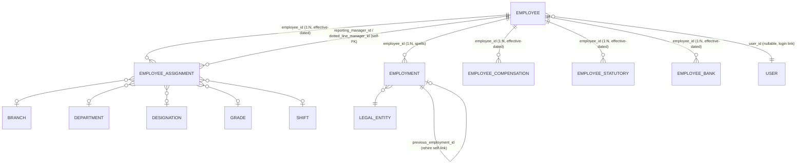
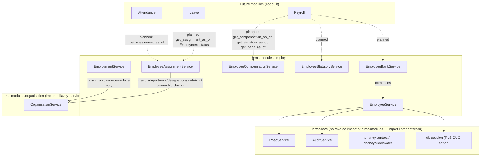
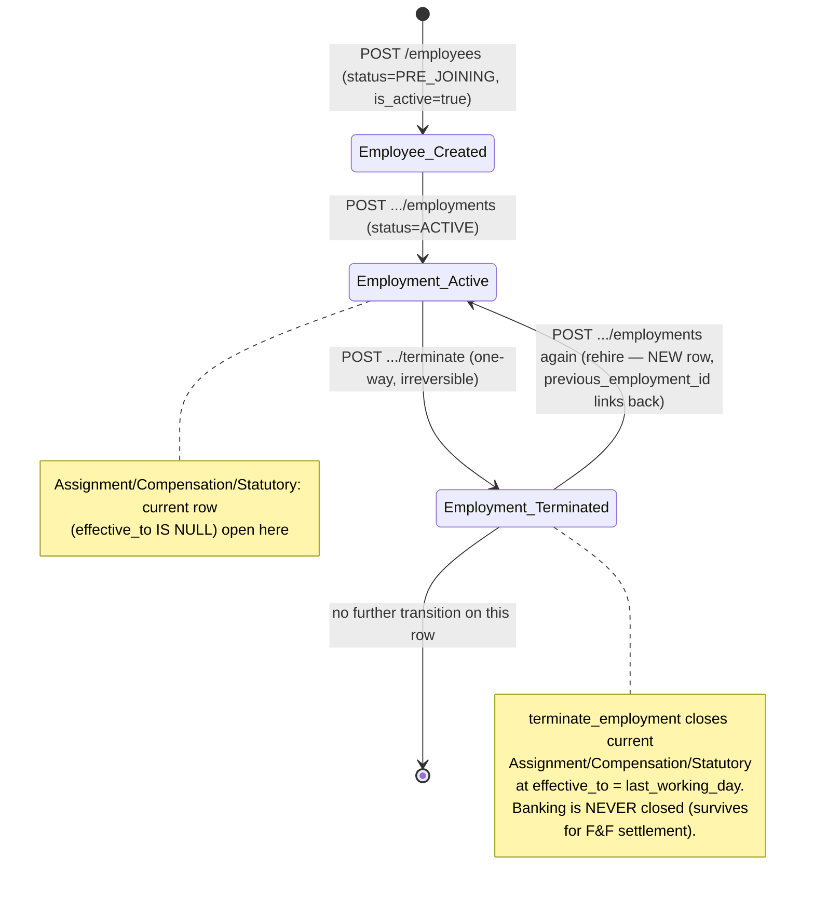

# Employee Domain — Final Integration & Production Readiness Audit

**Date:** 2026-08-15
**Status:** Audit only. No application code, migration, schema, or frontend code was modified to
produce this document.
**Scope:** Employee Foundation (E-01), Employment Lifecycle (E-03), Assignment (E-04), Shift
Assignment (E-05), Compensation (E-06), Statutory (E-07), Banking (E-08), Termination lifecycle
closure, RBAC data-scope (SELF/REPORTEES/REPORTEE_TREE/COMPANY), reporting-manager
self-elevation fix, and the Employee frontend (E-09).

**Method:** Every claim below is classified:
- **VERIFIED** — confirmed directly against live code, the live database (`hrms_dev` on
  `localhost:5433`, migration head `20260815140000`, matches `alembic_version` exactly), or an
  actual test run (`.venv/bin/python -m pytest`, executed this session).
- **INFERRED** — a reasoned conclusion from code structure (e.g. FastAPI dependency-resolution
  order) that was not confirmed by executing a reproducing test.
- **UNKNOWN** — genuinely undetermined; flagged rather than guessed.
- **BLOCKED** — could not be checked in this session (tooling/access limitation).

Prior implementation reports and plans (docs 05–36) were treated as claims to re-verify, not as
ground truth. Where a prior doc's claim still holds, it is cited as corroboration, not as proof.

---

## 1. Executive Summary

The Employee domain (Employee → Employment → Assignment → Compensation → Statutory → Banking) is
**architecturally coherent and functionally correct for a single-tenant, COMPANY-scoped,
admin-operated deployment**. All 290 employee-specific backend tests pass (VERIFIED, live run,
37.5s), the full backend suite passes at 600/607 with the 7 failures isolated to an unrelated
pre-existing `tests/integration/auth/test_auth_security.py` fixture-teardown ordering bug (FK
violation deleting `company` before `legal_entity` — **not** an Employee-domain defect; VERIFIED
this session, not previously known). Effective-dating, overlap prevention (GiST exclusion
constraints), termination cascade (Assignment/Compensation/Statutory close, Banking survives by
design), rehire linkage, and optimistic concurrency (`version` + `If-Match` → 409
`STALE_RESOURCE`) are all implemented consistently across every sub-resource and are the
best-tested part of the domain.

The domain is **not yet production-ready as a multi-role, self-service, or manager-visibility
system**, and this is the audit's central finding, not a minor caveat:

- **The RBAC data-scope engine (`SELF`/`REPORTEES`/`REPORTEE_TREE`) is fully built and
  independently well-tested, but is wired to zero real-world roles.** The live database has 12
  role rows (`SUPER_ADMIN`, `COMPANY_ADMIN`, `HR_MANAGER`, `HR_EXECUTIVE`, `RECRUITER`,
  `REPORTING_MANAGER`, `TEAM_LEADER`, `EMPLOYEE`, `FINANCE`, `AUDITOR`, plus two company-scoped
  instances of `COMPANY_ADMIN`/`EMPLOYEE_VIEWER`), but only `COMPANY_ADMIN` and `EMPLOYEE_VIEWER`
  have any `role_permission` row at all — and every one of those 24 grants is `data_scope =
  'COMPANY'` (VERIFIED, live query). An `EMPLOYEE` role holder or a `REPORTING_MANAGER` role
  holder has **zero** Employee permissions today, not even self-view. This is not a bug in the
  code audited here — it is a gap in role seeding (`seed/bootstrap.py`,
  `organisation/service.py::register_company`) that this audit did not modify per its own
  instructions, but which must be closed before "an employee sees their own record" or "a manager
  sees their team" is a real, usable capability rather than a passing test fixture.
- **Write-path data-scope does not exist.** Every `POST`/`PATCH`/`DELETE`/`terminate` route in the
  module is gated by permission alone (company-wide), never by `SELF`/`REPORTEES`. Today this is
  moot (no role holds a non-COMPANY write grant), but the code has no mechanism to prevent it if
  one were seeded — a role with `SELF`-scoped `EMPLOYEE.UPDATE_COMPENSATION` could still write
  *any* employee's compensation, not just their own, because the write path never checks scope.
- **`sensitive_access_log` (read-path logging of RESTRICTED-tier reads — Compensation, Statutory,
  Banking) does not exist anywhere in the codebase.** This is not an oversight discovered here —
  it is a previously and repeatedly documented, explicitly deferred decision (locked to a future
  "E-10" slice across at least eight prior documents, see §9). It remains open, and its absence
  compounds with each new RESTRICTED-tier table shipped (Statutory, Banking) without it.
- **PAN, Aadhaar, and bank account number are stored in plaintext** despite `_enc` column-name
  suffixes. This is a pre-existing, explicitly named, and repeatedly re-confirmed accepted risk
  (`HRMS_SYSTEM_DESIGN_BASELINE.md` Decision D-2), not new. The same baseline document states
  encryption "must land before real PAN-adjacent/statutory data is written" for Statutory and
  Banking specifically.
- The Employee frontend (E-09) is functionally complete and correctly wired to the API contract
  (If-Match, 409/422/403 handling, masking for bank account numbers), but has real, fixable
  integration gaps: no `as_of` UI (six backend endpoints exist and are never called), inconsistent
  `STALE_RESOURCE` handling (banner vs. silent toast depending on which route), and read
  permissions (`VIEW`, `VIEW_ALL`, `VIEW_COMPENSATION`, `VIEW_STATUTORY`, `VIEW_BANKING`) are not
  gated client-side at all — every tab always renders and relies entirely on the server 403.

**Bottom line for §25 (see there for detail): Attendance and Leave can safely start building
against the Employee domain's stable, well-tested contracts (`get_assignment_as_of`,
`get_compensation_as_of`, `Employment.status`) today. Payroll should not start until the
plaintext-Statutory/Banking encryption gap (D-2) and `sensitive_access_log` are resolved, per the
domain's own already-locked architecture decisions — this audit did not invent that condition, it
found it already on record and still unmet.**

---

## 2. Current Employee Architecture

Six tables, three data-shapes:

1. **Identity, once** — `employee` (`id`/`employee_code` permanent, never reissued, survives
   rehire).
2. **Spell-scoped, non-overlapping** — `employment` (one row per continuous stay at one legal
   entity; `previous_employment_id` self-link on rehire; GiST-enforced at most one `ACTIVE` row
   per employee).
3. **Effective-dated, independently insert-only, `employee_id`-keyed (not `employment_id`)** —
   `employee_assignment`, `employee_compensation`, `employee_statutory`, `employee_bank`. Each has
   its own GiST no-overlap exclusion constraint, its own `version` column, and exactly one
   allowed mutation after insert: closing the current row by setting `effective_to` (never editing
   a business column in place).

All six tables are tenant-owned (`company_id` FK to `company`) with PostgreSQL Row-Level Security
**forced** (`relforcerowsecurity = t`, VERIFIED via `pg_class`), policy `company_id =
current_setting('app.company_id')::uuid`, layered under an explicit `company_id =` filter in
every repository query (belt-and-suspenders — RLS is not the sole tenant boundary anywhere in
this module).



**Deliberate absence, not an oversight:** `employee_assignment`/`employee_compensation`/
`employee_statutory`/`employee_bank` carry **no `employment_id` foreign key**. This is what makes
rehire correct "for free" — a 5-year gap between two employment spells simply produces zero
assignment/compensation rows during the gap, not an orphaned-FK problem. The tradeoff (documented
consistently in every sub-resource's model docstring, and independently confirmed by reading the
live schema) is that nothing at the database level prevents an assignment/compensation/statutory/
bank row from being dated inside a gap where the employee had no active employment — that
integrity rule is enforced only in the service layer (`NoActiveEmploymentError`, checked via
`EmploymentRepository.get_employment_as_of` before every sub-resource insert), not by a
constraint. This is a single, consistently-applied, intentional design choice — flagged here as a
fact, not a defect.

---

## 3. Module Dependency Diagram



The `apps/api/.importlinter` contract (VERIFIED, read directly) enforces a strict one-way layering
— `hrms.modules → hrms.shared → hrms.core` — meaning `hrms.core.rbac`/`hrms.core.tenancy` cannot
import anything from `hrms.modules.employee`. This is why `DataScope` (core) carries only scope
*levels*, never resolved employee IDs — `EmployeeService.resolve_visible_employee_ids` is the
seam where a core-level RBAC decision becomes a module-level set of visible IDs, and is explicitly
documented (in its own docstring) as the reusable entry point future Attendance/Leave/Payroll
modules should call rather than re-deriving reporting-hierarchy logic.

`EmployeeAssignmentRepository.get_assignment_as_of`,
`EmployeeCompensationRepository.get_compensation_as_of`,
`EmployeeStatutoryRepository.get_statutory_as_of`, and
`EmployeeBankRepository.get_bank_as_of` are each explicitly documented in-code as the
cross-module contract future modules will call — these are real, load-bearing seams, not
speculative comments (VERIFIED — each has a corresponding public `*Service.*_as_of` method with
no `_assert_employee_exists` gate, deliberately, so a bulk caller doesn't pay for a redundant
check per employee).

---

## 4. Database State

VERIFIED live against `hrms_dev` (`localhost:5433`), migration head `20260815140000`, which
matches `alembic_version` exactly (single head, no drift between migrations-as-code and the
running schema).

| Table | Rows (dev) | RLS forced | GiST no-overlap | FK to `employee.id` |
|---|---|---|---|---|
| `employee` | live data present | Yes | N/A | — |
| `employment` | live data present | Yes | `employment_no_overlap` | `ON DELETE RESTRICT` |
| `employee_assignment` | live data present | Yes | `employee_assignment_no_overlap` | `ON DELETE RESTRICT` |
| `employee_compensation` | live data present | Yes | `employee_compensation_no_overlap` | `ON DELETE RESTRICT` |
| `employee_statutory` | live data present | Yes | `employee_statutory_no_overlap` | `ON DELETE RESTRICT` |
| `employee_bank` | live data present | Yes | `employee_bank_no_overlap` | `ON DELETE RESTRICT` |

Every one of the six tables' foreign key to `employee.id` is `ON DELETE RESTRICT` — the database
itself makes an `Employee` row physically undeletable while any sub-resource history exists,
which is every employee that has ever had an employment episode. Combined with the fact that
**no code path anywhere in the module ever issues a `DELETE` or sets `deleted_at`** (VERIFIED —
grepped `repository.py`/`service.py`; `deleted_at` appears only as a read-filter
`.is_(None)` predicate on every query, never as a value assigned in an `UPDATE`/`INSERT`), Employee
records are, in practice, **permanent** in this codebase: `deactivate_employee` (`DELETE
/employees/{id}`) only flips `is_active=false`, nothing more.

`role_permission.data_scope` (added by `20260815120000_role_permission_data_scope.py`, purely
additive `DEFAULT 'COMPANY'`): **all 24 live rows are `COMPANY`** (VERIFIED, live query below);
zero rows anywhere in the running database use `SELF`/`REPORTEES`/`REPORTEE_TREE`. See §8.

```
role_code       | permission_code               | data_scope
COMPANY_ADMIN    EMPLOYEE.CREATE                  COMPANY
COMPANY_ADMIN    EMPLOYEE.DEACTIVATE              COMPANY
COMPANY_ADMIN    EMPLOYEE.PROMOTE                 COMPANY
COMPANY_ADMIN    EMPLOYEE.TERMINATE               COMPANY
COMPANY_ADMIN    EMPLOYEE.TRANSFER                COMPANY
COMPANY_ADMIN    EMPLOYEE.UPDATE                  COMPANY
COMPANY_ADMIN    EMPLOYEE.UPDATE_COMPENSATION     COMPANY
COMPANY_ADMIN    EMPLOYEE.UPDATE_SENSITIVE        COMPANY
COMPANY_ADMIN    EMPLOYEE.VIEW                    COMPANY
COMPANY_ADMIN    EMPLOYEE.VIEW_ALL                COMPANY
COMPANY_ADMIN    EMPLOYEE.VIEW_BANKING            COMPANY
COMPANY_ADMIN    EMPLOYEE.VIEW_COMPENSATION       COMPANY
COMPANY_ADMIN    EMPLOYEE.VIEW_STATUTORY          COMPANY
EMPLOYEE_VIEWER  EMPLOYEE.VIEW                    COMPANY
```

Roles present with **zero** permission grants of any kind: `SUPER_ADMIN`, `HR_MANAGER`,
`HR_EXECUTIVE`, `RECRUITER`, `REPORTING_MANAGER`, `TEAM_LEADER`, `EMPLOYEE`, `FINANCE`, `AUDITOR`
(all `company_id = NULL`, i.e. global/system role definitions with no seeded grants at all — see
§8 for why this matters).

---

## 5. Lifecycle State Machine



`Employee.status` is a **10-value enum** (`PRE_JOINING`, `PROBATION`, `ACTIVE`, `ON_NOTICE`,
`SUSPENDED`, `ON_LONG_LEAVE`, `EXITED`, `ABSCONDING`, `RETIRED`, `DECEASED` —
FR-EMP-014) defined in `schemas.py` but **system-managed with no transition logic implemented
anywhere** — every employee is created `PRE_JOINING` and stays there forever; nothing in this
slice ever changes it (VERIFIED — grepped for assignment to `Employee.status`/`"status"` in
`service.py`: only the one literal at creation). This is a real **contradiction** between the data
model (a rich lifecycle enum exists and is exposed in every `EmployeeRead` response) and the
actual implemented behavior (the field is inert) — see §16 finding. `Employment.status` (the
separate, correctly-implemented two-value `ACTIVE`/`TERMINATED` enum) is what the termination
flow actually drives; a caller reading `Employee.status = "PRE_JOINING"` on an employee whose
`Employment.status = "TERMINATED"` would reasonably assume something is broken — it isn't broken,
it's just that `Employee.status` was deliberately scoped out of this domain's implemented slices
and nothing marks it as inert to an API consumer.

### 5.1 Scenario traces (VERIFIED against integration tests + source, not merely inferred)

**A. New employee → Employment → Assignment → Shift → Compensation → Statutory → Banking.**
Each step is independently gated by `NoActiveEmploymentError` (409) if attempted with an
`effective_from`/`joining_date` outside any covering `Employment` episode. No single test
exercises all six creates in one scenario (VERIFIED via test-coverage agent's inventory, §14), but
each pairwise link (Employment→Assignment, Employment→Compensation, Employment→Statutory,
Employment→Banking) is independently tested. Shift is a field on `EmployeeAssignment`
(`shift_id`, nullable), not a separate table — "Shift Assignment" (E-05) is a `change_type`
value (`SHIFT_CHANGE`) on the same Assignment write path, not a sixth lifecycle stage in the data
model, despite being listed as a separate slice in project history.

**B. Termination.** `EmploymentService.terminate_employment` (single transaction) closes: (1) the
current `EmployeeAssignment` row if its `effective_from <= last_working_day`, (2) the current
`EmployeeCompensation` row under the same condition, (3) the current `EmployeeStatutory` row
under the same condition — each closure re-checks `version` (optimistic lock) and the whole
operation rolls back atomically if any closure loses a concurrent race
(`test_terminate_employment_rolls_back_on_compensation_close_failure`, VERIFIED via test-coverage
agent). **Banking is never touched** — `EmployeeBankRepository.close_bank` is called only from
`EmployeeBankService.create_bank`'s own revision path, never from `terminate_employment`
(VERIFIED — grepped `service.py`'s `terminate_employment` body, no `_bank_repo` reference exists
in that class at all). This is a locked, documented, and tested architecture decision (bank
details must survive exit for full-and-final settlement), not an inconsistency — but it means
Banking is the **one** sub-resource whose "current row" can still be open and dated after an
employee's `last_working_day`, and no UI or API surface flags this state explicitly to a caller
(the frontend's own empty-state copy on the Banking tab does mention this in prose, per §13).

**C. Rehire.** A second `POST .../employments` call on an employee whose only prior episode is
`TERMINATED` succeeds, auto-links `previous_employment_id`, and is audited as
`EMPLOYMENT_REHIRED` (vs. `EMPLOYMENT_STARTED`) — this distinction is **audit-trail only**; there
is no separate permission code or API shape for rehire (`EMPLOYEE.CREATE` gates both, deliberately
— rehire is "mechanically the same action as a first hire," per the permission module's own
docstring). What carries forward vs. requires a new record, verified per sub-resource:

| Sub-resource | Carries forward across a rehire gap? |
|---|---|
| `Employee` identity (`id`, `employee_code`) | Yes — permanent, unconditionally |
| `Employment` history | Prior (terminated) rows untouched; new row links via `previous_employment_id` |
| `Assignment` | **No** — rehire's first assignment takes the "no current row" branch; `branch_id`/`department_id`/`designation_id` become mandatory again, and `shift_id` does **not** carry forward from the pre-exit spell (VERIFIED test: `test_rehire_first_assignment_does_not_carry_forward_stale_shift_id`) |
| `Compensation` | No — same "no current row" branch; a fresh CTC must be stated |
| `Statutory` | No — same "no current row" branch |
| `Banking` | **The one exception**: the pre-exit bank row was never closed, so it is still "current" at rehire. The rehire's first bank write therefore takes the **close-then-insert** branch and requires `If-Match` — the opposite requirement from every sibling sub-resource's rehire behavior (VERIFIED test: `test_rehire_first_bank_write_requires_if_match`). This asymmetry is correct given Banking's own design (its row never closes on termination) but is a genuine trap for any future caller (human or Attendance/Leave/Payroll integration) that assumes "rehire always means no current row" across all four effective-dated sub-resources uniformly — it doesn't. |

**D. Future-dated change → terminate before effective_from.** Directly tested for
Assignment and Compensation (`test_terminate_employment_future_dated_assignment_left_open`,
`..._compensation_left_open`): a row whose `effective_from` is after the new `last_working_day` is
left **open**, not force-closed into an invalid `effective_to < effective_from` range — this is a
deliberately unresolved product question (no source document specifies what *should* happen
instead), documented as such in the service docstring, not a bug. **Not tested for Statutory**
(which always closes its current row on termination per its own "last row closed" contract,
regardless of date, so the interaction is different but untested) **or Banking** (moot, since
Banking never closes) — flagged as a coverage gap in §14, not a behavior gap.

**E. `as_of` behavior.** Every effective-dated sub-resource implements `get_X_as_of` identically:
`effective_from <= as_of AND (effective_to IS NULL OR effective_to >= as_of)`, guaranteed
at-most-one-row by the same GiST constraint that prevents overlaps. `Employment`'s equivalent
(`get_employment_as_of`) is the load-bearing "does this employee have active employment on date Y"
check every sub-resource's create path calls before allowing an insert. All five `as_of` boundary
conditions (inclusive start, inclusive end, one day outside each) are tested per sub-resource
(VERIFIED, test-coverage agent). **The frontend never calls `?as_of=`** on any of the five list
endpoints that support it (VERIFIED, frontend agent) — "current" in the UI is always computed
client-side as "the row with `effective_to === null`" from the full unfiltered history, never a
true historical point-in-time query. This is a real, unexploited backend capability.

---

## 6. Effective-Dating Model

Uniform across Assignment/Compensation/Statutory/Bank (confirmed identical in `repository.py`
and `service.py` for all four):

1. Fetch "current" (`effective_to IS NULL`).
2. If none exists: this is the first row — required fields are enforced in the **service**, not
   the schema (varies per sub-resource: Assignment requires `branch_id`/`department_id`/
   `designation_id` only on a true first row; Compensation/Statutory require every field on
   *every* write, including the first, by design — "no carry-forward semantics for a stale CTC/
   statutory value," per their own docstrings).
3. If one exists: `effective_from` on the new row must be **strictly after** the current row's own
   `effective_from` (`InvalidEffectiveFromError`, 422) — not "after `effective_to`," because
   `effective_to` doesn't exist yet on the still-open current row. `If-Match` is **required**
   whenever a current row exists (`*VersionRequiredError`, 422 if omitted) since the version being
   checked belongs to the row about to be closed.
4. Close current (`effective_to = new.effective_from - 1 day`) and insert new, in one transaction.
   A lost race on either step surfaces as 409 `STALE_RESOURCE` with the fresh current-row snapshot
   embedded in the error body (`current:` key), letting a caller retry without a second round
   trip.
5. A `GiST` exclusion constraint is the **database-level** backstop against a genuine
   overlapping insert slipping through a race the application-level version check didn't catch —
   translated to a friendly `*DatesOverlapError` (409) at the service layer, and independently
   proven at the database level by a raw-SQL bypass test per sub-resource (VERIFIED, test-coverage
   agent: `test_raw_overlapping_insert_rejected_at_database_level` × 5).

**No `update_X(values=...)` method exists for any of the four effective-dated repositories** —
`close_assignment`/`close_compensation`/`close_statutory`/`close_bank` are each the *only* allowed
mutation of an existing row (setting `effective_to` alone), enforced structurally (the method
simply doesn't exist to write anything else), not just by convention. `Employment` and `Employee`
are the two exceptions with genuine field-level `PATCH` — `Employment.legal_entity_id` only
(post-creation correction), `Employee`'s full editable-field set.

---

## 7. RBAC Matrix

Permission gate per operation (VERIFIED directly from `router.py`'s `require_permission(...)`
calls; `EMPLOYEE.VIEW` is defined in the sibling `identity` module and reused, not redefined):

| Resource | GET list | GET detail | CREATE | UPDATE | TERMINATE / DEACTIVATE |
|---|---|---|---|---|---|
| Employee | `EMPLOYEE.VIEW_ALL` | `EMPLOYEE.VIEW` | `EMPLOYEE.CREATE` | `EMPLOYEE.UPDATE` | `EMPLOYEE.DEACTIVATE` |
| Employment | `EMPLOYEE.VIEW` | `EMPLOYEE.VIEW` | `EMPLOYEE.CREATE` | `EMPLOYEE.UPDATE` | `EMPLOYEE.TERMINATE` |
| Assignment | `EMPLOYEE.VIEW` | `EMPLOYEE.VIEW` | `EMPLOYEE.TRANSFER` *or* `EMPLOYEE.PROMOTE` (selected by request body's `change_type`, checked explicitly in the route body, not via `Depends`) | N/A (no PATCH exists) | N/A |
| Compensation | `EMPLOYEE.VIEW_COMPENSATION` | `EMPLOYEE.VIEW_COMPENSATION` | `EMPLOYEE.UPDATE_COMPENSATION` | N/A | N/A |
| Statutory | `EMPLOYEE.VIEW_STATUTORY` | `EMPLOYEE.VIEW_STATUTORY` | `EMPLOYEE.UPDATE_SENSITIVE` | N/A | N/A |
| Banking | `EMPLOYEE.VIEW_BANKING` | `EMPLOYEE.VIEW_BANKING` | `EMPLOYEE.UPDATE_SENSITIVE` (same code as Statutory, widened to a second consumer) | N/A | N/A |

Every route (VERIFIED — every function in `router.py`) additionally requires `Depends(
get_tenant_context)`, which cross-validates any `X-Company-Id` header against the JWT's own
`company_id` and 404s on mismatch, and every repository query additionally filters `company_id =`
explicitly (not relying on RLS alone) — tenant protection is present, tested (cross-tenant tests
exist per sub-resource, §14), and layered three ways: JWT-derived context validation, explicit SQL
filter, and forced RLS.

---

## 8. Data-Scope Matrix

`DataScope` resolution (`SELF`/`REPORTEES`/`REPORTEE_TREE`/`COMPANY`, union semantics across
multiple grants) is implemented in `EmployeeService.resolve_visible_employee_ids` and is
**correct and well-tested in isolation** (§14). It is wired into exactly **four** of the module's
~19 routes:

| Route | Data-scope applied? | Default posture if applied |
|---|---|---|
| `GET /employees` | **Yes** | Narrows to `resolve_visible_employee_ids` |
| `GET /employees/{id}` | **Yes** | Same — out-of-scope target → 404 (matches cross-tenant convention) |
| `GET .../bank`, `GET .../bank/{id}` | **Yes** | `SELF`-scoped by default per `RBAC_DATA_SCOPE_DECISIONS.md` Decision E — the *only* sub-resource following that locked decision |
| `GET .../statutory`, `GET .../statutory/{id}` | **No — deliberately discarded** | Resolved `DataScope` is thrown away; route is effectively always `COMPANY`-wide for any holder of `EMPLOYEE.VIEW_STATUTORY`, regardless of what scope their grant carries. Proven directly by test: `test_view_statutory_ignores_non_company_data_scope` — a caller holding `VIEW_STATUTORY` at `SELF` scope with no linked employee still sees *any* employee's statutory row in full. This is a **named, deliberate deviation** from the same locked Decision E that Banking follows — flagged in the Statutory plan itself, not discovered here — but it means Statutory and Banking, two RESTRICTED-tier sub-resources shipped one migration apart, have **opposite** default visibility postures for the same permission-pattern shape, for reasons that are on record but not obvious from the API surface alone. |
| `GET .../employments`, `GET .../assignments`, `GET .../compensation` (list/detail) | **No** | Gated by plain permission only, company-wide for any holder — never scope-narrowed. No test asserts scope-narrowing behavior for these three (test-coverage agent, §14: "Assignment/Compensation list/get endpoints have no SELF/REPORTEES/REPORTEE_TREE data-scope tests at all"). |
| **Every write route** (`POST`/`PATCH`/`DELETE`/`terminate`, all resources) | **No, anywhere in the module** | Company-wide for any permission holder — this is explicit, documented, "separately-sequenced follow-up work" per the RBAC data-scope plan, not an oversight, but it remains completely open today. |

**Self-elevation guard (VERIFIED, tested):** `EmployeeAssignmentService.create_assignment`
unconditionally rejects `reporting_manager_id == caller_employee_id` regardless of which
permission authorized the write (`InvalidReportingManagerError`, 422) — closing the specific
attack where a `REPORTEES`-scoped actor could name themselves someone's manager to
self-expand their own visible set. Tested on both the first-assignment path and the
manager-change path, plus a regression test proving legitimate third-party reassignment still
works (`27_REPORTING_MANAGER_SECURITY_AUDIT.md`'s fix, independently re-confirmed against current
code, not merely cited from the prior report).

**The load-bearing gap is not in this code — it's upstream of it.** `RBAC_DATA_SCOPE_DECISIONS.md`
Decision H (**LOCKED**) proposes exactly three new roles to make `SELF`/`REPORTEE_TREE` usable —
`EMPLOYEE` (self-service, `SELF` scope on `VIEW`/`VIEW_COMPENSATION`/future `VIEW_STATUTORY`/
`VIEW_BANKING`), `REPORTING_MANAGER` (`REPORTEE_TREE` on `VIEW` only, no sensitive-data grant by
default), and `HR_ADMIN` (`COMPANY` scope, full catalogue). **None of the three were ever seeded.**
The live database's `EMPLOYEE`/`REPORTING_MANAGER`/`HR_MANAGER`/etc. role rows appear to originate
from an earlier, broader role catalogue (predating this decision doc) and carry **zero**
permission grants of any kind (§4). Practically: today, only a `COMPANY_ADMIN` (or the
demo-only `EMPLOYEE_VIEWER`) can do anything in the Employee domain at all. The
`SELF`/`REPORTEES`/`REPORTEE_TREE` machinery — resolver, self-elevation guard, Banking's
locked-decision default — is real, tested, and inert in production until role seeding catches up
to it.

**Answering the audit's specific questions (§4 of the task):**

1. *Can a user read another employee?* Only if their role grants `COMPANY`-scoped `VIEW`/
   `VIEW_ALL` (today: only `COMPANY_ADMIN`/`EMPLOYEE_VIEWER`) — otherwise no grant exists at all
   to even attempt it (403).
2. *Read compensation?* Same COMPANY-only posture, `VIEW_COMPENSATION` — no scope-narrowing wired
   at all (§8 table above).
3. *Read statutory?* `VIEW_STATUTORY`, and — uniquely — **scope-immune by design**: even a future
   `SELF`-scoped grant would not narrow visibility, proven by test.
4. *Read banking?* `VIEW_BANKING`, correctly `SELF`-scoped by default per the locked decision —
   the one sub-resource where "an employee can see only their own bank details" actually works as
   designed, once a role holding that grant exists.
5. *Modify another employee?* Gated by `EMPLOYEE.UPDATE` at COMPANY scope only — no data-scope
   check exists on any write route, so any holder of the permission (regardless of what scope
   value their grant nominally carries) can modify any employee in the company.
6. *Modify their own sensitive information?* Same answer — no write-path scope check exists, so
   this is indistinguishable from (5) today: it's not "self-service," it's "whoever holds the
   write permission, company-wide."
7. *Modify reporting hierarchy?* Yes, via `EMPLOYEE.TRANSFER`/`.PROMOTE` (company-wide), with the
   one guard rail being the self-elevation check above.
8. *Elevate their own visibility?* The one specific vector tested and closed
   (`reporting_manager_id` self-assignment). No other elevation vector was found in this session's
   review, but the write-path scope gap (above) is structurally the same *class* of risk waiting
   for the day a `SELF`-scoped write grant is actually seeded.

---

## 9. Sensitive-Data Inventory

| Field | Storage | Encrypted? | API exposure | Frontend exposure | Permission | Data scope | Audit (write) | Read-path log |
|---|---|---|---|---|---|---|---|---|
| `pan_number_enc` | `employee.pan_number_enc TEXT` | **No — plaintext, misleading `_enc` suffix** | No write path exists anywhere; column present but dead (VERIFIED — no schema field, no service write) | Not rendered (field doesn't exist in frontend types) | N/A — no permission gates it because no path uses it | N/A | N/A | N/A |
| `aadhaar_number_enc` | `employee.aadhaar_number_enc TEXT` | **No, same as PAN** | Same — dead column | Not rendered | N/A | N/A | N/A | N/A |
| `uan_number` | `employee.uan_number VARCHAR(20)` | No (plain varchar, never claimed encrypted) | Same — dead column, no write path | Not rendered | N/A | N/A | N/A | N/A |
| `employee_bank.account_number_enc` | `TEXT` | **No — plaintext, misleading `_enc` suffix**, explicitly named accepted risk | Full plaintext value returned in every `GET .../bank` response body to any authorized caller | **Masked** client-side only (`maskAccountNumber`, last 4 digits) — the API still sends the full value over the wire; masking is a UI convention, not a server-side control | `EMPLOYEE.VIEW_BANKING` (read), `EMPLOYEE.UPDATE_SENSITIVE` (write) | **SELF-scoped by default** (read) — the one correctly-scoped RESTRICTED field | Full plaintext value is written into `audit_log.before_json`/`after_json` on every revision (`bank_to_audit_dict` serializes the same `BankRead` model used for the API response — no field is excluded) | **None — `sensitive_access_log` does not exist** |
| `employee_compensation.annual_ctc_minor` | `BIGINT` (not text/PII, but `RESTRICTED`-classified by product) | N/A (numeric, not a secret-shaped field) | Full value, unmasked, everywhere | Unmasked (`formatCtc`) | `EMPLOYEE.VIEW_COMPENSATION` / `.UPDATE_COMPENSATION` | **Not scope-narrowed** (§8) | Full value in `audit_log` | **None** |
| `employee_statutory.pf_number` / `esi_ip_number` / `pt_state_code` / `tax_regime` | Plain columns | N/A | Full values, unmasked | Unmasked | `EMPLOYEE.VIEW_STATUTORY` / `.UPDATE_SENSITIVE` | **Scope-immune, always COMPANY-wide** (§8) | Full values in `audit_log` | **None** |
| `employee.personal_email` / `personal_mobile` | Plain columns, `SENSITIVE`-classified by product docs | N/A | **Serializes unconditionally** to any caller holding plain `EMPLOYEE.VIEW` — no separate permission gates these two fields | Unmasked, always shown on the Overview tab | None beyond `EMPLOYEE.VIEW` itself | N/A | In `audit_log` on any employee update | N/A |

**Confirmed still-live gap (independently re-verified against current `schemas.py`, not merely
cited from a prior doc):** `personal_email`/`personal_mobile` are `SENSITIVE`-tier fields per
product classification but sit inside the same `EmployeeRead` model as every non-sensitive
identity field, gated by nothing beyond ordinary `EMPLOYEE.VIEW`. `RBAC_DATA_SCOPE_DECISIONS.md`
Decision G names this explicitly as "a live gap, independent of data-scope... recommend as an
independent, small, fast-follow fix" — that fix has not landed as of this session's code
(`EmployeeRead` still has no field-level gating; VERIFIED by reading `schemas.py` directly).

**On the plaintext `_enc` columns:** this is not a new finding — `HRMS_SYSTEM_DESIGN_BASELINE.md`
Decision D-2 ("Encryption for `_enc`-suffixed columns — mechanism and timing") is on record, and
that same baseline document states encryption "must land before real PAN-adjacent/statutory data
is written" for both Statutory (E-07) and Banking (E-08) — a condition that predates and is
independent of this audit, and remains unmet: `employee_bank.account_number_enc` is a live,
writable, plaintext column in production schema today, and both the model docstring and the
banking implementation plan explicitly warn "real account numbers must not be written here before
that decision is revisited." Whether real account numbers have in fact been written to the dev
database was not checked in this session (row contents were not inspected beyond schema — treat
as **UNKNOWN**, not confirmed-clean).

**`sensitive_access_log` — the single most consistently and repeatedly documented open item in
this domain's history.** VERIFIED absent from the codebase (zero references in `apps/api/src` or
`apps/api/alembic`) and independently corroborated as a known, named, deliberately-deferred gap in
at least eight prior documents spanning from the original system audit through every subsequent
Statutory/Banking implementation report — each one repeats the same locked framing: "the decision
to build it at all is DECIDED (build now); its exact schema is deferred to a future E-10 slice."
It has now been deferred across E-06, E-07, and E-08 in succession — three RESTRICTED-tier
sub-resources have shipped read paths with zero read-audit trail, each one re-flagging the same
gap rather than closing it. **This audit's own judgment, on top of that record:** the question
posed in the task brief — "should `sensitive_access_log` now become mandatory before production?"
— should be answered **yes** for Compensation/Statutory/Banking specifically, given three
independent RESTRICTED-tier tables are now live with real API surfaces and the gap has compounded
rather than shrunk each time it was deferred; this is a judgment call this audit is making
explicitly, not a rediscovery of a hidden problem.

---

## 10. Audit-Log Inventory

Every write in the module goes through `AuditService.record` (VERIFIED — one call site per
mutating service method, no write path skips it):

| Action | Entity | Before/after captured |
|---|---|---|
| `EMPLOYEE_CREATED` | employee | after only |
| `EMPLOYEE_UPDATED` / `EMPLOYEE_DEACTIVATED` / `EMPLOYEE_REACTIVATED` | employee | before + after |
| `EMPLOYMENT_STARTED` / `EMPLOYMENT_REHIRED` | employment | after only (action name itself encodes hire-vs-rehire) |
| `EMPLOYMENT_UPDATED` | employment | before + after |
| `EMPLOYMENT_TERMINATED` | employment | before + after |
| `ASSIGNMENT_CHANGED` | employee_assignment | before (null on first) + after; also fired for the auto-close performed by `terminate_employment` |
| `COMPENSATION_REVISED` | employee_compensation | same pattern, incl. termination auto-close |
| `STATUTORY_REVISED` | employee_statutory | same pattern, incl. termination auto-close |
| `BANK_REVISED` | employee_bank | same pattern; **never** fired by `terminate_employment` (bank is never touched there) |

Every audit row captures `actor_user_id`, `company_id`, `entity_type`, `entity_id`, `action`,
`before_json`/`after_json` (full response-model snapshots, not diffs), `ip`, `user_agent`, and
`request_id` — consistent shape across every mutation in the module, and consistently sourced from
the same `*_to_audit_dict` helper as the API response model, so the audit trail and the API
contract can never silently diverge for any field the API itself returns.

**What's missing is not coverage of write events — it's field-sensitivity awareness.**
`before_json`/`after_json` embed the **full** response model verbatim for every entity, meaning
`employee_bank`'s audit rows contain the same plaintext `account_number_enc` value the API
returns (§9) — the audit log is exactly as exposed as the API itself, with no additional
redaction, and (per §9) there is no complementary read-path log at all. No missing *write* event
was found in this session's review of the six lifecycle actions; the gap is entirely on the
read side.

---

## 11. Concurrency Analysis

Every mutable resource (`Employee`, `Employment`, and the four effective-dated sub-resources) uses
the same optimistic-concurrency shape: `version INTEGER`, `UPDATE ... WHERE version = :expected
... RETURNING`, `None` result → re-fetch → 409 `STALE_RESOURCE` with the fresh row embedded. This
is uniformly implemented (VERIFIED across all six repositories) and uniformly tested (a basic
stale-version test exists per sub-resource, VERIFIED via test-coverage agent).

**Two genuinely different classes of "concurrency" are tested, and the difference matters for how
much confidence to place in the coverage:**

1. **Application-level lost-update simulation** (mocked repository methods returning `None`/
   raising `IntegrityError`) — proves the *service layer's error-translation and rollback logic*
   is correct, including the one multi-step transactional case that matters most:
   `test_terminate_employment_rolls_back_on_compensation_close_failure` proves that if
   Assignment's close succeeds but Compensation's close loses a race mid-`terminate_employment`,
   the **entire transaction rolls back** — Employment stays `ACTIVE`, Assignment's close is
   undone, no audit rows persist. This is real evidence the multi-table termination write is
   atomic, not just "mostly consistent."
2. **Database-level constraint proof** (raw SQL insert with RLS disabled, one per sub-resource) —
   proves the GiST exclusion constraints genuinely exist and genuinely reject an overlap
   independent of any application code path.

**What is not tested, and is explicitly called out as such in the test suite's own docstrings
(not a gap this audit discovered unassisted):** no test spins up two genuinely concurrent
database sessions/connections racing a real write against each other
(`asyncio.gather`-style). The `PostgreSQL` `UPDATE ... WHERE version = ...` pattern is a
well-established correct primitive for this (VERIFIED as the actual mechanism in use), so the
absence of a true two-connection test is a coverage gap in the proof, not a reason to doubt the
mechanism itself — but it does mean the *specific* interleaving the task brief asks about
("two users modify the same employee," "two users create overlapping assignments," etc.) has
never been reproduced end-to-end against live concurrent connections in this codebase's test
suite, only simulated.

**Termination racing another lifecycle write:** the one scenario with real multi-step-transaction
coverage (above). A race between `terminate_employment` and, say, a concurrent
`create_assignment` for the same employee is not independently tested as a distinct scenario, but
both paths share the same `version`-checked closure primitive on the same row, so the *mechanism*
that would catch such a race (whichever request's `UPDATE` loses gets `None` back, then 409) is
the same one already proven correct in isolation for each operation — this is an **INFERRED**
conclusion (mechanism-level), not a directly observed test result for this exact interleaving.

**RLS session-variable timing (INFERRED, not behaviorally tested this session):** `TenancyMiddleware`
sets the `app.company_id` Postgres session variable's *source contextvar* from the raw,
unauthenticated `X-Company-Id` request header before FastAPI's dependency graph resolves; the
actual `SET_CONFIG` call happens once, inside `get_session()`'s first invocation, which — by
dependency-resolution order — occurs before `get_tenant_context()` has validated that header
against the JWT's own `company_id`. In the both frontend and test-suite's actual usage, the header
is always sent and always equals the JWT's company (VERIFIED via grep — every call site sets
`X-Company-Id` to the caller's own company), so this is not observably wrong in current usage. It
is also not exploitable as a cross-tenant leak: every route additionally depends on
`get_tenant_context` (which explicitly 404s on a header/JWT mismatch, and a mismatch is caught
even earlier — `get_current_user`'s own `user_company` lookup, which itself runs under RLS,
fails closed on a mismatched header, since `user_company` also carries forced RLS). The practical
consequence is architectural, not a live vulnerability: RLS is not functioning as an
independently-authenticated safety net today — its value is set from client-supplied data that
merely happens to be double-checked by unrelated code elsewhere, not from the validated tenant
context itself. A future query that relied on RLS *alone* without an explicit `company_id` filter
(every current query has one) would inherit this fragility. Flagged as a P2 architectural finding
(§18), not a P0/P1 — no exploitable path was found, and this was reasoned from code structure, not
confirmed by a live dual-session reproduction.

---

## 12. API Consistency Analysis (ORM → Repository → Service → Schema → Router → Frontend)

No naming or shape inconsistency was found across the five backend layers for any of the six
resources — every repository method's return type flows through exactly one `*_to_read` /
`*_to_audit_dict` pair per resource, consumed identically by the service and serialized
identically by the router's `DataEnvelope`/`ListEnvelope`. HTTP status codes are consistent and
centrally mapped (`AppError` subclasses → `status_code` class attribute → one global exception
handler — VERIFIED in `core/errors/`): 404 (`NotFoundError`), 422 (`ValidationError`), 409
(`ConflictError`), 403 (`PermissionDeniedError`). No route was found returning an ad hoc status
code outside this mapping.

**Confirmed, real gaps** (cross-referenced against the frontend agent's endpoint-by-endpoint
mapping, §13):

- `PATCH /employees/{id}/employments/{employment_id}` (correcting `legal_entity_id`
  post-creation) has a full backend implementation, a full frontend payload-builder
  (`buildEmploymentCorrectionPatch`), and **no UI element anywhere calls it** — a complete,
  tested backend capability with zero reachable frontend entry point.
- The four single-record `GET .../{sub_resource}/{id}` routes (assignment/compensation/
  statutory/bank) exist and are tested, but the frontend never calls any of them — history rows
  are rendered from the already-fetched list, never drilled into individually.
- `?as_of=` is implemented identically on five list endpoints and exercised by backend tests, but
  never called by the frontend (§5E, §13).
- `ListEnvelope.pagination` is a real, typed field in the shared response envelope
  (`shared/pagination.py`) that `GET /employees` never populates — and the frontend's own
  envelope type doesn't even model a `pagination` field, so the two sides are consistent with each
  other in *not* implementing pagination, but neither is ready to add it without a coordinated
  change (an inconsistency-in-waiting, not a live one).

No route was found that the frontend calls with no backend mapping (checked by the frontend
agent against the full `router.py` route table — zero orphaned frontend calls).

---

## 13. Frontend/Backend Integration Analysis

The Employee frontend (E-09) is real, complete for its stated scope (list, create, six detail
tabs), and was independently verified this session to correctly implement:

- **If-Match propagation**: every write to a resource with a "current row to close" concept reads
  `version` off the already-loaded resource and sends it as `If-Match`, matching the backend's
  optional-only-when-a-current-row-exists contract exactly (assignment/compensation/statutory/
  bank creates, employee/employment PATCH, employment terminate).
- **409 `STALE_RESOURCE` handling** via a dedicated `<ConcurrencyConflictBanner>` — but
  **inconsistently applied**: the employee-identity edit form shows the banner (Reload
  latest / Cancel current changes); the deactivate/reactivate toggle and the employment-terminate
  action instead show a plain toast telling the user to "reload and try again" without offering
  the reload action itself (terminate does auto-reload the panel as a side effect; deactivate does
  not). Same error code, three different UX treatments within one module.
- **422 field-error mapping** — per-field inline errors for every create/patch form, correctly
  keyed to backend field names, with one confirmed asymmetry: the Banking create form maps
  `effective_from`/`payment_mode` field errors but not `account_number_enc`/`ifsc`/others, which
  would fall through to a generic toast instead of the relevant input.
- **409 business-conflict codes** (`*_DATES_OVERLAP`, `NO_ACTIVE_EMPLOYMENT`,
  `TAX_REGIME_SWITCH_NOT_ALLOWED`, `EMPLOYEE_SEAT_LIMIT_EXCEEDED`) each get a specific, correctly
  matched toast — except `BANK_DATES_OVERLAP`, which the backend can raise but the banking panel's
  catch chain has no branch for, falling through to a generic "Could not save bank details" toast.
- **403/404 handling** exists but is per-component/ad hoc (no shared handler component), and 404
  is only specifically handled on the employee-detail page's top-level load — every sub-panel
  treats a 404 as a generic error message, not a distinguished state.

**The two structural gaps most relevant to a production-readiness judgment:**

1. **No client-side gating of read permissions.** All six detail tabs (`Overview`/`Employment`/
   `Assignment`/`Compensation`/`Statutory`/`Banking`) always render regardless of whether the
   viewer holds `VIEW`/`VIEW_COMPENSATION`/`VIEW_STATUTORY`/`VIEW_BANKING` — visibility is decided
   entirely by whether the underlying `GET` 403s, surfaced as an in-tab error card. This is not
   incorrect (the server is still the actual enforcement point, and `use-permissions.ts`'s own
   docstring says as much explicitly), but it is a UX gap: a user with no Compensation access
   clicks the Compensation tab and sees an error card, rather than not seeing the tab at all — a
   fixable but currently-real rough edge, and the six read permissions are the *only* ones with
   zero client-side gating (every write action's button is correctly hidden without the matching
   write permission).
2. **`?as_of=` is entirely unreachable from the UI** — a fully-built, fully-tested backend
   capability (point-in-time history lookup for every sub-resource) with no frontend entry point
   at all. This matters specifically for HR/audit workflows ("what was this employee's assignment
   on March 1st") that the backend already supports and the frontend cannot currently serve.

Both gaps are real integration incompleteness, not backend defects — recorded here per the audit's
instruction not to redesign the UI, only to identify what's "technically possible in the backend
but impossible/confusing in the frontend."

---

## 14. Test Coverage Matrix

**290/290 employee-specific backend tests pass** (VERIFIED, live run this session: 72 in the
first three quartiles + 2, `37.54s`). Full backend suite: **600/607 pass**; the 7 failures are
entirely `tests/integration/auth/test_auth_security.py` teardown-ordering errors (`company`
deleted before `legal_entity` in a fixture, unrelated to any Employee-module code — VERIFIED by
reading the failure traceback, which never touches `hrms.modules.employee`).

| Category | Coverage | Notable gap |
|---|---|---|
| Lifecycle (create → chain) | Each pairwise link tested; no single full 6-step chain test | Minor — coverage is complete via composition, just not as one scenario |
| Termination (closure cascade) | Extensive — closure, non-closure (missing rows), historical-row immutability, future-dated left-open, transactional rollback, cross-tenant non-leakage | None significant |
| Rehire | Well covered per sub-resource, including the Banking If-Match asymmetry (§5C) | None significant |
| Effective-dating / overlap | Boundary-tested per sub-resource at both the app and DB-constraint level | None |
| Future-dated + terminate interaction | Tested for Assignment/Compensation | **Untested for Statutory and Banking's specific future-dated interaction** with termination |
| Tenant isolation | Every sub-resource has its own cross-tenant tests | `test_cross_tenant_isolation.py` (the dedicated cross-tenant suite) covers **only** Organisation routes — zero Employee routes; Employee's tenant-isolation coverage lives exclusively inside each sub-resource's own file, not in the "official" cross-tenant suite |
| RBAC permission-gating | 9 of 12 `EMPLOYEE.*` codes have an explicit 403-when-missing test | **Zero tests** for `EMPLOYEE.UPDATE` (employee PATCH), `EMPLOYEE.DEACTIVATE`, `EMPLOYEE.TERMINATE` permission-denial |
| Data-scope | `SELF`/`REPORTEES`/`REPORTEE_TREE`/`COMPANY` + union + self-elevation guard thoroughly tested for **Employee** and **Banking** routes only | Assignment/Compensation list/get have **no** scope-narrowing tests at all (only permission-presence tests); Statutory has one negative proof (scope-immune) |
| Concurrency | Stale-version test per sub-resource + one real multi-step transactional-rollback test | No genuine two-connection concurrent-session race exists anywhere (all "races" are mocked or single-session raw-SQL bypasses) — explicitly acknowledged in the test suite's own docstrings |
| Sensitive data | Coarse, all-or-nothing gating proven (403 without permission; response shape excludes the field otherwise) | No test proves any masking/redaction for an authorized-but-narrow-scope caller — untested because no such server-side masking exists (§9) |
| Frontend/API integration (E2E) | **None** — no Playwright/Cypress/e2e harness exists anywhere in the repo; frontend tests are Vitest component/unit tests only | Full gap — every integration claim in §13 was verified by reading source, not by an automated test |

**Security-specific test coverage:** `apps/api/tests/security/` contains exactly one file,
`test_organisation_security.py` (16 tests, all passing) — **there is no
`test_employee_security.py`**, unlike Organisation, which has a dedicated security suite. All of
Employee's security-relevant coverage (tenant isolation, RBAC, data-scope, self-elevation) lives
inside its ordinary integration test files rather than a parallel, security-labeled suite. This is
an organizational/discoverability gap, not necessarily a coverage gap (the same assertions exist),
but it means a reviewer scanning `tests/security/` for "what security properties does this domain
guarantee" would miss the Employee domain's substantial coverage entirely.

---

## 15. Production-Readiness Assessment

Summary judgment by area (detail and severity classification in §16–19):

| Area | Assessment |
|---|---|
| Database safety (constraints, FKs, RLS) | **Strong.** Every table forced-RLS, every FK correctly `RESTRICT`/`SET NULL` per its semantics, every effective-dated table GiST-constrained, migration head matches live schema exactly. |
| Migrations | **Clean.** Linear history, no branch heads, each migration's own docstring cites live-schema verification performed at authoring time. Not independently re-verified for reversibility (`downgrade()` bodies were not executed this session) — **BLOCKED**, not checked. |
| Logging/observability | Write-path audit logging is complete and consistent (§10). Read-path logging for RESTRICTED data does not exist (§9). No APM/tracing-specific review was in scope this session — **not assessed**. |
| Error handling | Centralized, consistent, typed (§12). No gaps found. |
| Security | Tenant isolation strong and tested; RBAC scope engine strong in isolation but unwired to real roles (§8); self-elevation guard closed and tested; RLS-timing architectural fragility noted but not exploitable today (§11). |
| Secrets/sensitive data | Plaintext `_enc` columns are a known, accepted, but still-open risk with an explicit "must resolve before Payroll" condition on record (§9, §19). |
| Performance/indexes | `employee_assignment_manager_idx` (partial index on `company_id, reporting_manager_id WHERE effective_to IS NULL`) directly supports the `REPORTEES`/`REPORTEE_TREE` resolver's hot path — deliberately placed ahead of the feature that needed it. `GET /employees` has no pagination — fine at current scale, a real N+1-shaped risk once any tenant has a large headcount, since the entire (data-scope-filtered) result set is always returned in one response. |
| N+1 queries | None found in the reviewed service/repository code — each list/get method issues one query; `resolve_visible_employee_ids` issues at most one additional recursive-CTE query per request for `REPORTEE_TREE`, not per row. |
| Transaction boundaries | Correct — `terminate_employment`'s multi-table closure is proven atomic (§11); every other write is a single insert/update, trivially atomic. |

---

## 16. P0 Findings — Security / Data Corruption / Production Blocker

*None found.* No path was identified in this session that leaks cross-tenant data, corrupts
state, or bypasses tenant/permission enforcement outright. The RLS-timing observation (§11) was
specifically evaluated for exploitability and found not to be one under current code (every route
double-checks tenancy independently of RLS). The absence of `sensitive_access_log` and the
plaintext `_enc` columns are both **P1**, not P0 — they are read-visibility/audit gaps against
data that is otherwise correctly access-controlled by permission, not open data leaks.

---

## 17. P1 Findings — Must Fix Before Dependent Modules

1. **No production-usable role exists other than `COMPANY_ADMIN`/`EMPLOYEE_VIEWER`.** Every
   self-service and manager-visibility use case the data-scope engine was built for is
   unreachable until `EMPLOYEE`/`REPORTING_MANAGER`/`HR_ADMIN` (or equivalent) are actually seeded
   with the grants `RBAC_DATA_SCOPE_DECISIONS.md` Decision H already specifies. Blocks Leave and
   Attendance specifically, both of which are natural self-service/manager-approval surfaces (§20,
   §21).
2. **Write-path data-scope does not exist anywhere in the module.** Latent risk that activates the
   moment any non-COMPANY write grant is seeded (see #1) — a `SELF`-scoped
   `EMPLOYEE.UPDATE_COMPENSATION` grant today would still permit writing any employee's
   compensation, not just the caller's own. Should be closed before #1 is resolved, not after.
3. **`sensitive_access_log` remains unbuilt across three shipped RESTRICTED-tier read surfaces**
   (Compensation, Statutory, Banking). Repeatedly deferred, on record since before E-06; this
   audit's judgment is that Payroll (§22), which will read all three, should not be the fourth
   consumer to ship without it.
4. **Plaintext `account_number_enc`/`pan_number_enc`/`aadhaar_number_enc`.** Already on record as
   a condition that "must land before real PAN-adjacent/statutory data is written" — still unmet.
   Blocking specifically for Payroll, which is the first module that would need to *read* real
   bank account numbers to generate a bank advice file.
5. **Statutory's read path silently discards data-scope** while Banking (shipped one migration
   later, same permission shape) honors it — both postures are individually intentional and
   documented, but the inconsistency itself is undocumented at the API-consumer level (no
   `501`/warning/doc-comment on the route signals this to anyone reading `router.py` in isolation
   from its inline comments). Worth resolving to one consistent posture, or at minimum making the
   asymmetry impossible to miss, before more RESTRICTED-tier sub-resources are added by Payroll.

---

## 18. P2 Findings — Should Fix Before Production

1. `personal_email`/`personal_mobile` (`SENSITIVE`-tier) serialize unconditionally to any
   `EMPLOYEE.VIEW` holder — a named, small, still-open fast-follow fix on record since the RBAC
   decisions doc.
2. RLS `app.company_id` GUC is populated from the unauthenticated `X-Company-Id` header before
   `get_tenant_context` validates it — not exploitable today (every route independently
   re-validates), but RLS is not acting as an independent safety net; a future query that omits an
   explicit `company_id` filter would silently inherit this fragility.
3. `Employee.status` (10-value FR-EMP-014 lifecycle enum) is exposed in every API response but has
   no implemented transition logic anywhere — every employee is permanently `PRE_JOINING`
   regardless of actual `Employment`/exit state, a live contradiction between the exposed data
   model and actual behavior that nothing in the API marks as inert.
4. No hard/soft delete path exists for `Employee` or any sub-resource (`deleted_at` is read-only
   dead weight on every table) — acceptable if permanence is the intended posture (every FK is
   `ON DELETE RESTRICT`, consistent with that), but this should be an explicit, on-record product
   decision rather than an emergent consequence of no delete endpoint ever having been built.
5. Frontend: inconsistent `STALE_RESOURCE` UX (banner vs. silent toast) across otherwise-identical
   409 responses within the same module (§13).
6. Frontend: six read permissions have zero client-side gating — every tab always renders and
   relies on the server 403 surfacing as an in-tab error card, rather than the tab being hidden.
7. `?as_of=` — a complete, tested backend capability on five endpoints — has no frontend entry
   point anywhere.
8. `PATCH /employees/{id}/employments/{employment_id}` and all four single-record sub-resource
   `GET .../{id}` routes are fully implemented and tested but structurally unreachable from the
   current frontend (§12).
9. No dedicated `test_employee_security.py` exists (unlike Organisation) — coverage exists but is
   scattered across ordinary integration files, reducing discoverability of the domain's security
   guarantees.
10. `BankDatesOverlapError` (409) has no matching frontend toast branch (falls through to a
    generic message); the bank create form's 422 handling doesn't map several fields to inline
    errors.
11. `Employment.legal_entity_id` corrections are an in-place `PATCH`, not an effective-dated
    record — a historically-accurate "which legal entity employed this person on date X" query is
    not possible across a correction, unlike every other Employee attribute (re-confirmed against
    current code this session; previously documented as HIGH in the pre-termination-fix
    architecture baseline, still open).
12. `EmployeeAssignment.branch_id` is never cross-checked against the covering
    `Employment.legal_entity_id` — an assignment can reference a branch belonging to a different
    legal entity than the one the employee is actually employed under, with nothing to prevent it
    (re-confirmed against current code this session; previously documented, still open).

---

## 19. P3 Findings — Future Improvement

1. No genuine two-connection concurrent-session test exists for any "two users write at once"
   scenario — current coverage is mocked/simulated, which is adequate evidence for the mechanism
   but not a literal reproduction of the task brief's concurrency scenarios.
2. No test covers the Statutory/Banking-specific interaction of a future-dated row with
   termination (tested only for Assignment/Compensation).
3. No single "full lifecycle in one test" scenario exists (coverage is complete via composition of
   separate tests, so this is a readability/regression-surface observation, not a coverage hole).
4. `EMPLOYEE.UPDATE`/`.DEACTIVATE`/`.TERMINATE` permission-denial (403) paths have no dedicated
   test, unlike every other permission code in the module.
5. Migration `downgrade()` bodies were not executed/verified this session.

---

## 20. Attendance Dependency Assessment

**What Attendance needs from Employee, and its readiness:**

- `EmployeeAssignmentService.get_assignment_as_of(employee_id, date)` — the shift (`shift_id`) and
  work-location (`work_location_type`) an employee had on a given day. **Ready** — this exact
  contract is built, documented in-code as the intended cross-module seam, and tested for
  boundary correctness.
- `Employment.status`/`get_employment_as_of` — whether an employee had any active employment on a
  given day (to exclude pre-joining/post-exit days from attendance expectations). **Ready** —
  same seam, same test coverage.
- Employee identity (`employee_code`, `display_name`) for record linkage. **Ready** — permanent,
  never reissued, exactly the stability Attendance needs to key off of.
- **What must be fixed first:** nothing structural. Attendance is a natural `REPORTEES`/
  `REPORTEE_TREE` consumer (manager approving a team's attendance) — it will inherit the P1 #1
  role-seeding gap the moment it needs "a manager sees their team's attendance," but that is
  Attendance's own role-seeding work, not a defect in what Employee exposes to it.

---

## 21. Leave Dependency Assessment

**What Leave needs from Employee, and its readiness:**

- Same `get_assignment_as_of`/`get_employment_as_of` seam as Attendance, for leave-eligibility
  windows (e.g. no leave applications for a period with no active employment).
- Reporting-hierarchy data (`reporting_manager_id`, effective-dated) for approval routing — the
  exact data the `REPORTEES`/`REPORTEE_TREE` resolver already consumes. **Ready mechanically**,
  but Leave is the module most directly blocked by **P1 #1**: an approval workflow is
  meaningless without a `REPORTING_MANAGER`-shaped role actually holding `REPORTEE_TREE`-scoped
  visibility into their team, which does not exist in seeded data today.
- **What must be fixed first:** P1 #1 (role seeding) is a hard prerequisite for Leave's core
  approval-routing use case, more directly than for any other planned module — Leave should not
  start its own approval-routing implementation until at least a `REPORTING_MANAGER`-equivalent
  role with real grants exists, or it will be building against the same untested-in-production gap
  this audit found in Employee.

---

## 22. Payroll Dependency Assessment

**What Payroll needs from Employee, and its readiness:**

- `get_compensation_as_of`, `get_statutory_as_of`, `get_bank_as_of` — all three exist, are
  explicitly documented as Payroll's intended entry points, and are individually well-tested.
  **Mechanically ready.**
- `Grade.min_ctc`/`max_ctc` (informational bands only, confirmed not enforced against
  `annual_ctc_minor` anywhere — deliberate, documented) — available if Payroll wants them, not
  load-bearing.
- **What must be fixed first — and this is the one place this audit disagrees with "just start
  building":** Payroll is the first module that turns Statutory's PF/ESI/tax data and Banking's
  account number from *stored* facts into *actively used* facts (computing deductions, generating
  a bank advice file). That is precisely the condition `HRMS_SYSTEM_DESIGN_BASELINE.md` already
  attached to the plaintext-encryption decision (D-2): "must land before real PAN-adjacent/
  statutory data is written." Payroll reading and acting on real account numbers without that
  decision resolved would be the first place this domain's already-accepted-but-unresolved risk
  stops being theoretical. Combined with the total absence of `sensitive_access_log` across
  exactly the three tables Payroll depends on most, this audit recommends **Payroll not begin
  implementation against real data until D-2 (encryption) and `sensitive_access_log` are
  resolved** — both conditions were already on record before this audit, not invented by it; this
  audit's contribution is confirming neither has moved and naming Payroll as the point at which
  deferring them further stops being low-risk.

---

## 22a. Documentation Corroboration Note

A separate pass cross-referenced 20 prior documents (05–36, plus the seven architecture-level
documents) against the code findings above. Two things are worth recording explicitly:

- **Every major finding in this audit that has a documented precedent was independently
  corroborated, not contradicted**, by that pass — most notably: Decision H's three proposed
  roles (`EMPLOYEE`/`REPORTING_MANAGER`/`HR_ADMIN`) were confirmed, from the implementation
  reports' own text, to have never been seeded by any prior task ("judged out of this task's
  stated scope" — doc 26 §4/§13); and the Statutory-vs-Banking data-scope inconsistency (§8, §17
  #5) is confirmed to be a **known, self-acknowledged** contradiction between a LOCKED decision
  (`RBAC_DATA_SCOPE_DECISIONS.md` Decision E) and a deliberate shipped deviation (Statutory's own
  plan, §11.3), not something this audit discovered fresh.
- **The three earliest architecture-synthesis documents
  (`00_SYSTEM_ARCHITECTURE_AUDIT.md`, `00_HRMS_SYSTEM_ARCHITECTURE.md`,
  `HRMS_SYSTEM_DESIGN_BASELINE.md`) are internally stale on two of their own headline
  findings** — all three list "terminate doesn't close assignment/compensation" and "RBAC
  data-scope is a complete no-op" as their top CRITICAL/HIGH risks, but both were (respectively,
  fully and partially) fixed by same-day later work (docs 22/23 and 24–28) that post-dates them,
  and none of the three baseline documents was revised afterward. A reader relying on those three
  documents alone, without this audit's direct re-verification against current code, would
  believe both are still open. They are not — current code and passing tests confirm the
  termination-close fix is real and complete (§5B), and the two-route data-scope implementation
  is real, tested, and correctly scoped, just narrower than a full solution (§8).
- Two additional, previously-documented HIGH findings from the same stale baseline audits were
  independently re-checked against current code this session and found **still open** (not fixed
  by any later slice): `Employment.legal_entity_id` is corrected via an in-place `PATCH`
  (`EmploymentUpdate`, `service.py::update_employment`), not an effective-dated record — a
  correction is audit-logged (before/after) but not queryable as a point-in-time fact the way
  every other Employee attribute is, so an `as_of` question about which legal entity employed
  someone on a past date returns the *corrected* value for the whole spell after any such PATCH,
  not the true historical value. And `EmployeeAssignment.branch_id` is validated only for
  existence/tenant-ownership (`_assert_branch_ownership`), never cross-checked against the
  covering `Employment.legal_entity_id` — nothing prevents an assignment's branch from belonging
  to a different legal entity than the one the employee is actually employed under. Both are
  added to §18 P2 below; neither is new to this session, both were re-confirmed against current
  code rather than taken on the prior documents' word alone.

---

## 23. Remaining Architectural Decisions

Carried forward from prior documents, confirmed still open by this session's direct code review
(not merely re-quoted):

1. **`sensitive_access_log` exact schema** — the decision to build it is locked; its shape is not
   (§9, §17).
2. **Encryption mechanism and timing for `_enc`-suffixed columns (Decision D-2)** — locked as a
   precondition for Payroll, mechanism itself not chosen (§9, §22).
3. **`personal_email`/`personal_mobile` field-level permission gating** — recommended, not
   implemented (§9, §18).
4. **Statutory vs. Banking data-scope posture** — both individually locked/documented, but never
   reconciled to one consistent rule for future RESTRICTED-tier sub-resources (§8, §17).
5. **`Employee.status` lifecycle transitions** — a 10-value enum exists with zero implemented
   transition logic; no document in this session's review commits to when/whether this is built
   (§5, §18).
6. **Delete/soft-delete posture for Employee and sub-resources** — currently emergent (no path
   exists) rather than an explicit decision; every FK is `ON DELETE RESTRICT`, which is at least
   internally consistent with "records are permanent," but this has not been stated as a decision
   anywhere reviewed this session (§18).
7. **Role-seeding for `EMPLOYEE`/`REPORTING_MANAGER`/`HR_ADMIN`** — Decision H is locked in
   content; the implementation step (actually seeding these roles with these grants) was never
   executed (§8, §17).

---

## 24. Recommended Implementation Sequence

1. Seed `RBAC_DATA_SCOPE_DECISIONS.md` Decision H's three roles with their specified grants
   (closes P1 #1 — unblocks every self-service/manager-visibility scenario, and is the single
   highest-leverage fix in this audit: it activates a large amount of already-built, already-tested
   code with no new application logic required).
2. Add write-path data-scope enforcement (closes P1 #2 — should land before #1 goes live with any
   non-COMPANY write grant, to avoid a window where a narrowly-scoped role has broad write power).
3. Resolve Statutory's data-scope posture relative to Banking's (P1 #5) — a product decision, not
   an engineering one; make it explicit either way before Payroll adds a third posture.
4. Land the `_enc` column encryption mechanism (D-2) and `sensitive_access_log` (P1 #3/#4) —
   both are prerequisites this audit recommends treating as blocking specifically for Payroll,
   not for Attendance/Leave.
5. P2 items (field-level gating for personal contact fields, `Employee.status` decision,
   delete-posture decision, frontend UX consistency fixes) — no hard ordering dependency on
   Attendance/Leave/Payroll; sequence opportunistically.

---

## 25. Exact Next Step

**Seed the three roles `RBAC_DATA_SCOPE_DECISIONS.md` Decision H already specifies
(`EMPLOYEE`, `REPORTING_MANAGER`, `HR_ADMIN`) with their documented permission + data-scope
grants**, most likely as an addition to `organisation/service.py::register_company` (so every
newly registered company gets a usable role set, not just `COMPANY_ADMIN`) and/or
`seed/bootstrap.py` for existing dev/demo companies. This is the single highest-priority next
implementation task: it requires no new application code (the resolver, the self-elevation guard,
and Banking's `SELF`-scope default are already built and tested), it is what makes the entire
data-scope feature this domain already shipped actually usable by anyone other than a
`COMPANY_ADMIN`, and it is the explicit, named prerequisite for Leave's approval-routing use case
(§21) and Attendance's manager-visibility use case (§20) — the two modules most likely to be built
next.
