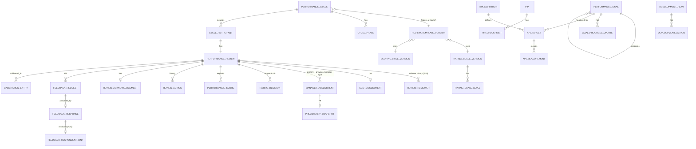

# Performance Management: Architecture Gate

**Date:** 2026-11-14
**Status:** DRAFT. Awaiting approval. **No Phase 1 work starts until this document is approved.**
**Product requirements:** [`docs/product/18_SRS_Phase2_Phase3_Modules.md`](../../product/18_SRS_Phase2_Phase3_Modules.md) §1 (FR-PRF-001 to FR-PRF-011)
**Permission naming source:** [`docs/product/19_RBAC_and_Permission_Matrix.md`](../../product/19_RBAC_and_Permission_Matrix.md) line 103

This document is the approval gate for the Employee Performance Management module. It records:

- the seven architecture-shaping decisions that are **approved**;
- the defaults that are **proposed** and still need sign-off, and by which phase;
- **existing bugs and gaps** found while auditing the current HRMS;
- the **cross-module work** that must happen before or alongside Phase 1;
- the data model, access model, state machines, API boundaries, migration and merge gates, rollback approach, and phase entry and exit criteria.

Where this document and an approved decision disagree, the decision wins and this document gets corrected.

---

## Contents

1. [Scope and principles](#1-scope-and-principles)
2. [Approved decisions](#2-approved-decisions)
3. [Cross-module invariants](#3-cross-module-invariants)
4. [Existing bugs and gaps found in the audit](#4-existing-bugs-and-gaps-found-in-the-audit)
5. [Cross-module remediation work items](#5-cross-module-remediation-work-items)
6. [Module architecture and API boundaries](#6-module-architecture-and-api-boundaries)
7. [Data model](#7-data-model)
8. [Access model and permission matrix](#8-access-model-and-permission-matrix)
9. [State-transition matrix](#9-state-transition-matrix)
10. [Notifications, email and reminders](#10-notifications-email-and-reminders)
11. [Feature flags](#11-feature-flags)
12. [Migrations, merge gates and rollback](#12-migrations-merge-gates-and-rollback)
13. [Phase entry and exit criteria](#13-phase-entry-and-exit-criteria)
14. [Policy decision register](#14-policy-decision-register)
15. [Sign-off](#15-sign-off)

---

## 1. Scope and principles

**What is being built.** A configurable, multi-company performance module covering:

- goals and KPIs, cascading company → department → team → individual;
- review cycles: self-review, manager review, finalisation, release and acknowledgement;
- an explainable scoring engine;
- check-ins and recognition;
- 360 feedback, competency frameworks and calibration;
- development plans and PIPs;
- analytics, and optional reward recommendations later.

**Principles.** Every phase must hold to these:

| # | Principle | Source |
|---|---|---|
| PR-1 | Every automated score is explainable, traceable and reproducible: same inputs plus same rule and engine version give the same output. | Blueprint §10 |
| PR-2 | Performance outcomes are corrected by **adding** new attributable decisions, never by rewriting earlier ones. | P15 |
| PR-3 | Attendance is an operational record, not an assessment. There is **no automatic path** from attendance data into performance scoring, now or later. | P21 |
| PR-4 | A relationship (reporting line, department headship, reviewer-of-record, nomination) decides *who*. A role bundle decides *what*. A record-level check decides *on which record*. All three must pass. | P34, P35 |
| PR-5 | Changing the org chart never silently rewrites an in-progress workflow. Moves happen by rule, at a confirmed action, with history kept. | P19 |
| PR-6 | People are told the visibility rules before they write anything. | P9, P21, P25 |
| PR-7 | Anonymity is enforced in the database schema, not only hidden in the API. | P25 |
| PR-8 | Performance never writes to payroll or compensation. Reward outcomes are proposals a different person approves. | Blueprint §15 |
| PR-9 | Configuration (scales, templates, scoring rules, 360 weights) is versioned and **frozen** when a cycle launches. | Blueprint §6, P25 |

**Out of scope for every phase until separately decided:**

- automatic salary changes;
- forced ranking enabled by default;
- attendance as a scored input (permanently excluded, PR-3);
- external 360 reviewers;
- AI-generated ratings.

---

## 2. Approved decisions

All seven were approved on 2026-11-14.

### P34: reporting-manager capability is derived from the hierarchy

| Item | Decision |
|---|---|
| Mechanism | Derived **when permissions are checked**. No `user_role` rows and no sync job. |
| Who qualifies | A user with an active login linked to an employee who is the `reporting_manager_id` on at least one *current* assignment (see INV-1). |
| What they get | The company's existing `REPORTING_MANAGER` role bundle, unchanged. Manual assignment of the role still works, and the two combine. |
| Where it applies | Every permission lookup: `RbacService.get_permission_codes` (feeds `/me` and leave's approver-eligibility check) **and** `RbacService.resolve_data_scope`. |
| Dotted-line managers | No automatic capability. They join as per-review reviewers in Phase 4. |
| Existing modules | Leave, regularization and overtime are included. This is an **accepted change to shipped behaviour**: needs regression tests, a release note and a security review. |
| Losing the last report | Rights end immediately. Open items follow their module's rules (leave: HR reassignment; performance: P19). |
| Security note | Setting `reporting_manager_id` now grants access, so it is a security-sensitive action. Today only `EMPLOYEE.TRANSFER` holders (HR and admins) can do it. |
| Layering | `hrms.core.rbac` defines a derived-role provider interface. The employee module implements and registers it. This keeps to the import-linter layering contract. |

### P35: department heads get tiered access

| Item | Decision |
|---|---|
| Derived role | New system role `DEPARTMENT_HEAD`, derived from `Department.head_employee_id` at check time. Active login required. |
| New scope | `DEPARTMENT` = departments the caller heads, plus **all sub-departments**, merged across several headships. The caller is never in their own set. |
| Opt-in rule | `DEPARTMENT` exists in core, but **no module gets it automatically**. Each module opts in explicitly. |
| Leave | `LEAVE.APPLICATION_APPROVE` at `DEPARTMENT` scope. Fixes the department-head stage returning 403 and requests not appearing in the decision center (B2). Approving still requires being the named head. |
| Performance | Manage department objectives (headed departments only). **Read-only** individual goals: title, description, status, progress, target or measurement, weight, due date. Cycle monitoring that shows **status only**. Aggregated analytics with a **minimum group of 5, applied after any filtering**. |
| Never through this relationship | Review narratives, individual ratings, self- or manager-assessment content, evidence attached to reviews, PIPs, 360 responses, private check-in notes, compensation, reward decisions. |
| Organisation fixes | Setting a head rejects inactive or exited employees. Existing inactive heads appear in a cleanup report for HR; they are **not silently cleared**. |

### P19: manager changes mid-cycle

| Item | Decision |
|---|---|
| Reviewer at launch | The manager on the cycle's reference date. No manager, or one who can't act, sends the review to the **HR fallback queue**. |
| Where the change is confirmed | The existing manager-change confirmation ([`employee/service.py` `_pending_manager_change_impact`](../../../apps/api/src/hrms/modules/employee/service.py)) gains a fourth count: open performance reviews. |
| Not started, self-review, manager draft | Moves to the new manager. An old manager's draft, and its P9 preliminary snapshot, become **previous-manager input**. They are never presented as the new manager's work. |
| Manager submitted or later | **Stays** with the original reviewer. Applies to skip-level, calibration, finalised and released reviews. |
| Previous-manager input | Requested if the old manager supervised **≥ 30%** of the period elapsed so far (a company setting; 30% is the system default). Optional, attributed, unchangeable once submitted, **hidden from the employee by default**, and written **without** access to the self-review or 360 results. |
| Future-dated changes | Take effect on their effective date, through a daily job. |
| Reviewer can't act | Goes to the new eligible manager if there is one, otherwise the HR queue. Uses the same eligibility test as leave. |
| HR reassignment | `PERFORMANCE.REVIEW.REASSIGN` at company scope. Needs a reason and is audited. History is kept. |
| Related rules | Self-review is never reset. Skip-level is recalculated. Pending goal approvals follow the review. Shared check-in history becomes visible to the new manager; private notes stay with their author. |

### P9: managers see context first, self-ratings later

| Item | Decision |
|---|---|
| Template setting | `self_review_visibility_mode` = `CONTEXT_FIRST` (default) or `OPEN`. No other modes in v1. |
| Drafts | A self-review draft is never visible to the manager. |
| Narrative | Visible to the reviewer-of-record once the employee submits: achievements, challenges, evidence, goal comments. |
| Self-ratings | Revealed only after a **complete preliminary assessment**: every required scored item plus the overall rating, checked against the template. |
| Preliminary snapshot | Unchangeable and kept permanently. **Never visible to the employee.** |
| Changing the rating | If the final rating differs from the preliminary by **more than one band**, a note is required. Distance is counted on the ordered scale, not on numeric values. |
| Missing self-review | The manager proceeds. The review is flagged `SELF_REVIEW_NOT_SUBMITTED`. A late self-review is accepted only through an authorised deadline extension. |
| Other viewers | HR sees submitted content, subject to permissions. Skip-level access is deferred to P12 and P13. Department heads get none (P35). |
| Workflow | `PRELIMINARY_RECORDED` is a milestone, **not** a new state. |
| Audit | Self-review submitted; manager's first access to the narrative; preliminary recorded; self-ratings revealed; preliminary-to-final changes and their notes. |

### P15: rating overrides

| Item | Decision |
|---|---|
| Rating layers | `COMPUTED` → `MANAGER_FINAL` → `CALIBRATED` → `OVERRIDE`. The P9 preliminary rating is reference only, never official. |
| Official rating | The most recent **approved** of `MANAGER_FINAL`, `CALIBRATED` or `OVERRIDE`. The computed rating is always kept for explanation. |
| Manager departure (model Z) | ≤ 1 band from the computed band: allowed with a note. > 1 band: needs HR approval before the manager review can be submitted. |
| What can be overridden | The **overall rating only**. A wrong component is fixed by returning or reopening the assessment and recomputing. |
| Codes | `PERFORMANCE.RATING.OVERRIDE` and `PERFORMANCE.RATING.OVERRIDE_APPROVE`, company scope, granted to `HR_ADMIN` and `COMPANY_ADMIN`. |
| Separation of duties (per record) | Proposer ≠ approver. Neither may be the employee being reviewed. The approver may not be that review's reviewer-of-record. |
| Reasons | An internal reason, plus an employee-facing explanation whenever the official rating differs from the manager's final rating. |
| What the employee sees | Official rating, manager's written assessment, an "adjusted after review" indicator, and the explanation. Not the original number, internal reason, identities or history. |
| Small companies | Single-approver mode only when **exactly one eligible active** approver exists. Permanently flagged, audited, and visible in analytics. Platform admins never approve. |
| Timing | Manager submitted → finalised: override with approval; a pending decision blocks finalisation. Finalised or released: only through reopen (creates a new revision, cancels the acknowledgement, notifies the employee). Cycle closed: HR proposes and a different `COMPANY_ADMIN` approves. |
| Bulk overrides | Not in v1. |

### P21: attendance stays separate from performance

| Item | Decision |
|---|---|
| v1 | Fully separate. No attendance score component, data feed, review display, analytics, or configuration path that could add one. |
| Permanent rule | Attendance is never an automatic scoring input (PR-3). |
| Phase 6 (optional) | An "Operational Context Panel", **off by default**, turned on per company. |
| What the panel may show | **Unplanned absence days** (not covered by approved leave, an approved regularization, or another valid resolution). **Late arrivals beyond the shift's grace period**, after corrections. |
| Never shown | Early departures (left for a later decision), worked hours, punch times, breaks, overtime, geofence, face verification, any approved leave, protected leave. |
| Who sees it | Reviewer-of-record and HR, during the manager-review phase only. Not department heads, analytics, reward rules, calibration (by default) or skip-level reviewers (P12 and P13 decide). |
| The employee | Sees the same figures and is told in advance. The panel is labelled "Operational context, not a performance measure, not in the rating". |
| Snapshot | Stores a reference, period, timestamp, policy version and access log, enough to reproduce what was shown. **No raw attendance data is copied.** |
| Protected leave | `MATERNITY` and `PATERNITY` are always protected and can't be turned off. `SICK` is protected by default and changeable only within legal and policy rules; legal review is required first. Companies may add other types. |
| Effects of protected leave | Counts toward eligibility. Never reduces a rating. Never appears as absence or lateness. Goals are adjusted only through an explicit HR action. |
| Attendance-related goals | Only from an HR-approved KPI library entry flagged `ATTENDANCE_RELATED`: visible to the employee, set at goal-setting, measured manually. No free-text attendance metrics. No attendance-to-KPI feed, ever. |

### P25: 360 anonymity

| Item | Decision |
|---|---|
| Modes | **Identified**: authorised viewers see the respondent. **Confidential**: the subject can't identify the respondent, but authorised HR can. **Anonymous with emergency reveal**: no normal application path can identify the respondent. |
| Default per group | Manager: Identified. Peers: Confidential. Direct reports: Anonymous with emergency reveal. External: not in v1. |
| Changing protection | Companies may make a group **stricter**, never weaker. |
| Minimum responses | **3 submitted responses** per visible group, applied after filtering. An "Others" group must itself reach 3. Direct-report results are never folded into another group. Totals are built only from groups that are shown, so hidden groups can't be recovered by subtraction. The subject sees "enough" or "not enough", never counts. |
| Comments | Shown word for word, shuffled, not linked to the respondent's ratings, and without timestamps. HR moderation **required for direct reports**, optional for peers. HR may release or hide (with a reason, audited, original kept), and **never edits**. |
| Emergency reveal | Only on an abuse report. HR proposes and a **different `COMPANY_ADMIN`** approves, with per-record separation. Requires a reason, permanently audited, **respondent notified**. **No single-approver mode**: if separation can't be met, identity can't be revealed. |
| Effect on rating | Weight defaults to **0%**, configurable up to **20%**. Ratings only, from groups meeting the minimum. Comments never count. Groups below the minimum are excluded from scoring structurally. **The weight is fixed before feedback opens and can't change afterwards.** |
| Reviewer-of-record access | Sees 360 results together with the self-ratings, only after the preliminary assessment (extends P9). |
| Nomination | The employee uses a purpose-built colleague picker (name, designation, department; active, same company, eligible only). The manager approves and may add reviewers, and those additions are hidden from the subject. **Employees do not get general directory access** (`EMPLOYEE.VIEW_ALL`). |
| Responses | Editable by the responder until the deadline, then unchangeable. Declining is allowed; who declined is visible only to HR. |
| Schema | Anonymous `feedback_response` rows hold **no responder ID** and only a **date-level** timestamp. The response-to-author link lives in `feedback_respondent_link`, which the app's database role **cannot read**; only the emergency-reveal function can. |
| Timing leaks | The subject's notifications about responses are batched at the deadline, never sent per response (§10). |

---

## 3. Cross-module invariants

These apply to the whole HRMS, not only performance. They are adopted by this gate.

| # | Invariant |
|---|---|
| **INV-1** | **The current assignment is the one whose effective range covers the business date in the company's time zone.** Never just "no end date" (`effective_to IS NULL`). Applies to derived manager rights, reportee and reportee-tree scopes, department scope, reviewer assignment, and future-dated transfers. |
| INV-2 | Approval and review actions require *both* the permission gate *and* a record-level identity or relationship check. A scope level alone never authorises an action on a specific record. |
| INV-3 | A request's approver or reviewer is fixed when the request is created. Moving it is an explicit, audited action. |
| INV-4 | Notifications never carry ratings, scores, PIP wording, feedback text or respondent identities. The forbidden-key guard in [`notification/types.py`](../../../apps/api/src/hrms/modules/notification/types.py) already blocks "score". |
| INV-5 | Finalised performance records are protected by database triggers as well as application checks. This follows the payroll and audit-log pattern (migrations `20261009090000`, `20261013090000`). |

---

## 4. Existing bugs and gaps found in the audit

These exist **today**, independent of performance. Items marked *suspected* must be confirmed before fixing.

| ID | Finding | Evidence | Fixed by |
|---|---|---|---|
| **B1** | Someone set as `reporting_manager_id` but without the `REPORTING_MANAGER` role can't approve leave, regularization or overtime for their reports. Requests wait in the manager stage until HR reassigns them, and the approval screens are hidden because the apps filter by `/me` permissions. | [`leave/service.py:3215`](../../../apps/api/src/hrms/modules/leave/service.py) resolves the manager from the hierarchy only; [`leave/router.py:832`](../../../apps/api/src/hrms/modules/leave/router.py) requires `LEAVE.APPLICATION_APPROVE`; new logins get only `EMPLOYEE` ([`account_invite/service.py:127`](../../../apps/api/src/hrms/modules/account_invite/service.py)) | R1 (P34) |
| **B2** | Leave's department-head stage: (a) a head without `LEAVE.APPLICATION_APPROVE` gets 403; (b) the decision center lists requests for employees in the caller's *scope*, not requests *waiting on the caller*, so a request from outside the head's reportee tree doesn't appear. | [`leave/service.py:3395`](../../../apps/api/src/hrms/modules/leave/service.py); [`leave/router.py:754`](../../../apps/api/src/hrms/modules/leave/router.py) | R2 (P35) |
| **B3** *(suspected)* | Hierarchy queries treat "current" as "no end date". A manager change closes the old row the day before the new one starts ([`employee/service.py:2143`](../../../apps/api/src/hrms/modules/employee/service.py)), and no check was found that stops a future-dated change. So a change dated next month may already count as current, affecting reportee scopes today. | [`employee/repository.py:555`, `:652`, `:713`](../../../apps/api/src/hrms/modules/employee/repository.py) | R3 (INV-1) |
| **B4** | A department head can be an inactive or exited employee. Validation only checks that the employee exists in the same company. | [`organisation/service.py:1579`](../../../apps/api/src/hrms/modules/organisation/service.py) | R4 (P35) |
| **B5** | The reporting hierarchy has no loop check. The reportee-tree query caps depth and silently cuts off a loop. | [`employee/repository.py:652`](../../../apps/api/src/hrms/modules/employee/repository.py) docstring | R9 |
| **B6** | An approver with no login is still chosen as approver at submission. HR can reassign leave (`APPROVER_HAS_NO_LOGIN`), but the request is stuck until then. Regularization and overtime equivalents still need checking. | [`leave/service.py:3546`](../../../apps/api/src/hrms/modules/leave/service.py) | R5 |
| B7 | The transactional email outbox lives inside the onboarding module, so other modules can't reuse it cleanly. | [`onboarding/email_outbox.py`](../../../apps/api/src/hrms/modules/onboarding/email_outbox.py) | R7 |
| B8 | Companies have no audit viewer; only the platform console does. | [`platform/router.py:207`](../../../apps/api/src/hrms/modules/platform/router.py) | Phase 6 |
| B9 | `company_feature_flag` and `plan_feature` exist, but the only consumer found is the seat limit. | [`organisation/service.py:1092`](../../../apps/api/src/hrms/modules/organisation/service.py) | R8 |
| B10 | No push notifications. The mobile app fetches notifications only while it's open (app start, resume, opening the notifications screen, pull-to-refresh). | [`unread_count.dart`](../../../apps/mobile/lib/features/notifications/state/unread_count.dart); no messaging dependency in `apps/mobile/pubspec.yaml` | Accepted limitation (§10) |
| B11 | The notification category list is fixed in code and has no `PERFORMANCE`. | [`notification/types.py`](../../../apps/api/src/hrms/modules/notification/types.py) `CATEGORIES` | Phase 1 |

---

## 5. Cross-module remediation work items

Each is its own pull request with its own tests, ahead of or alongside the phase noted. R1 and R2 change shipped behaviour and need a release note.

| ID | Work item | Needed before | Migration? (manual merge) | Notes |
|---|---|---|---|---|
| **R1** | Derived role provider in `core.rbac`; employee module supplies "current reporting manager → `REPORTING_MANAGER`". Feeds `get_permission_codes` and `resolve_data_scope`. Cached per request. | Phase 1 | Possibly an index on `employee_assignment (company_id, reporting_manager_id)` if not already present | Regression tests across leave, regularization and overtime approval and the decision center; security review. |
| **R2** | `DEPARTMENT` scope level; department-tree helper (all sub-departments); `DEPARTMENT_HEAD` role rows plus derived membership; leave grant at `DEPARTMENT` scope; decision center also lists requests waiting on the caller. | Phase 1 | **Yes**: role-row and grant backfill for existing companies (pattern: `20260923090000_branch_manager_role`) | Module opt-in only (P35). |
| **R3** | Shared authorization correctness audit for INV-1: confirm B3, then make every "current assignment" read use the as-of-today rule. | Phase 1 | No | Covers employee scopes, R1, R2, and leave and attendance approver resolution. |
| **R4** | Reject inactive or exited department heads; cleanup report for existing ones. | Phase 1 | No | Report only; nothing cleared automatically. |
| **R5** | Approval resilience: a chosen approver with no active login is treated as unresolved, so that stage falls to the next stage or HR. Leave, regularization, overtime. | Phase 2 | No | Separate decision record needed (registered under P34). |
| **R6** | HR view of workflow items assigned to someone who can't act right now (all modules). | Phase 2 | No | Operational reliability. |
| **R7** | Move the email outbox from `modules/onboarding` to `core` or `shared`; onboarding and account invites call it from its new home. | Phase 2 (reminders) | No (table unchanged) | Pure refactor, behaviour unchanged. |
| **R8** | Wire feature flags: resolve plan features plus company overrides; server-side guard; expose enabled features in `/me`. | Phase 1 | Possibly a `plan_feature` seed | §11. |
| **R9** | Reporting-hierarchy loop check: at least when a cycle launches; preferably when an assignment is written. | Phase 2 | No | B5. |

---

## 6. Module architecture and API boundaries

### 6.1 Module layout

A new backend module `apps/api/src/hrms/modules/performance/`, following the standard module files (`models`, `schemas`, `repository`, `service`, `router`, `permissions`, `exceptions`, `tasks`), split into sub-areas:

```
config/        rating scales, review templates, scoring rules, competency frameworks (all versioned)
goals/         goals, contributors, progress updates, KPI library/targets/measurements, change requests
cycles/        cycles, phases, participants, eligibility
reviews/       reviews, reviewers (P19), self/manager assessments, preliminary snapshots (P9), acknowledgements
scoring/       pure scoring engine (no I/O), versioned; rating_decision ledger (P15)
feedback/      360 requests, responses, moderation, respondent link + reveal (P25)
checkins/      check-ins, private notes (encrypted), action items, recognition
calibration/   sessions, entries
pip/           PIPs, objectives, checkpoints, outcomes
development/   development plans, skill gaps, actions, career aspirations
access.py      three-layer access resolver (§8.1)
tasks.py       reminders, deadline sweeps, P19 effective-date job, retention
```

### 6.2 Boundaries with other modules

Modules talk only through `other_module.service` (or the existing public functions). Lazy imports are used where two modules call each other, matching the existing leave/attendance ↔ employee convention.

| Direction | Interface | Purpose | Phase |
|---|---|---|---|
| performance → employee | `resolve_visible_employee_ids`, `get_assignment_as_of`, employment as-of, reviewer eligibility | Scope, reviewer-of-record, eligibility | 1–2 |
| performance → employee | **new** minimal colleague search (name, designation, department; active, same company) | 360 nomination picker (P25). Owned by the employee module. | 4 |
| performance → organisation | department tree, department head, designation and grade | Cascading, P35, competency targeting | 1 |
| performance → leave | protected-leave days in a date range | Eligibility and goal pro-rating (P21) | 2 |
| performance → attendance | operational-context metrics for a range, reproducible by reference | P21 panel only | 6 |
| performance → notification | `notification.producer.notify`, new `PERFORMANCE` types | In-app notifications | 1 |
| performance → core email outbox | `enqueue_email` (after R7) | Reminder digests | 2 |
| employee → performance | open-review count for manager-change confirmation; manager-change hook | P19 | 2 |
| core.rbac ← employee | derived role provider (registered at startup) | P34, P35 | 1 (R1, R2) |
| payroll / compensation | **none until Phase 6**. Then: approved reward decision → a human performs the compensation revision or promotion through existing routes, gated by `EMPLOYEE.UPDATE_COMPENSATION` / `EMPLOYEE.PROMOTE` | PR-8 | 6 |

Performance writes to no other module's tables. No other module writes to performance tables.

### 6.3 Endpoint groups

Final paths are fixed in each phase's implementation plan. All endpoints live under `/v1/performance/`, require the `PERFORMANCE` feature flag, use `If-Match` on every versioned write, and accept idempotency keys on create.

| Group | Examples | Phase |
|---|---|---|
| Config | rating scales, templates, scoring rules, KPI library (versioned; publish creates a version) | 1 |
| Goals | own goals, team goals, assign, approve, progress updates, change requests, department/company objectives | 1 |
| Cycles | create, schedule, launch, change phase, extend, close; participants; eligibility preview | 2 |
| Reviews | my reviews; reviews waiting on me; self-assessment; manager assessment; preliminary; submit; return; finalise; release; acknowledge; reopen; reassign | 2 |
| Rating decisions | propose and approve overrides; explanation ("How was this calculated?") | 2 |
| Check-ins and recognition | check-ins, action items, recognition | 3 |
| Feedback (360) | nominate, colleague picker, approve nominations, respond, moderate, reveal request and approve | 4 |
| Competencies and calibration | frameworks, sessions, entries | 4 |
| PIP and development | PIPs, checkpoints, outcomes; development plans | 5 |
| Analytics, exports, audit | dashboards (minimum groups), exports, performance audit viewer | 6 |
| Rewards | recommendations and approvals | 6 |

---

## 7. Data model

Every table has `company_id` with row-level security, `id`, `created_at`/`updated_at`, `created_by`, and `version` (checked with `If-Match`). `deleted_at` only where soft delete is allowed. Tables marked **AO** are append-only (database-enforced). Tables marked **IMM** are locked by triggers once their parent is finalised.

### 7.1 Entity relationships



### 7.2 Entities

| Entity | Purpose | Notes |
|---|---|---|
| `rating_scale` / `_version` / `_level` | Ordered scales (3, 4, 5 or 10 points) with labels and descriptions | Bands are compared by **order** (P9, P15) |
| `review_template` / `_version` / `_section` / `_question` | Form structure; `self_review_visibility_mode` (P9) | Versioned and frozen at launch |
| `scoring_rule` / `_version` / `_component` | Component weights, normalisation, missing-data rule, rounding; feedback weight ≤ 20% (P25) | Has **no attendance component type** (P21) |
| `competency`, `competency_framework` / `_version`, `competency_level_descriptor` | Core, leadership and role competencies | Phase 4 |
| `kpi_definition` | KPI library: unit, direction, aggregation, source, `ATTENDANCE_RELATED` flag (HR-approved) | P21 |
| `kpi_target` / `kpi_measurement` | Targets per period; measurements **AO** (a correction is a new row that supersedes the old one) | Manual or CSV in v1 |
| `performance_goal`, `goal_contributor`, `goal_progress_update` (**AO**), `goal_change_request` | Goals at any level | Locked when manager review starts |
| `performance_cycle`, `cycle_phase`, `cycle_participant` | Cycle, phase dates and switches, eligibility snapshot | Participant stores department, designation and manager **as of the reference date** |
| `performance_review` | One per participant per cycle; points at the current official `rating_decision` | Flags: `SELF_REVIEW_NOT_SUBMITTED`, `PRELIMINARY_RECORDED` |
| `review_reviewer` (**AO**) | Role `PRIMARY` / `PREVIOUS_MANAGER_INPUT` / `SKIP_LEVEL` / `HR_FALLBACK`; start and end; reason `LAUNCH` / `MANAGER_CHANGE` / `HR_REASSIGN` / `INELIGIBLE`; source assignment; who made the change | P19 |
| `self_assessment` (**IMM**) | Narrative and ratings stored **separately** | P9 |
| `manager_assessment` (**IMM**) | Per reviewer; ratings, comments, strengths, improvements; `self_ratings_revealed_at` | P9, P19 |
| `preliminary_snapshot` (**AO**) | Ratings at the preliminary milestone | Never visible to the employee |
| `rating_decision` (**AO** except status) | Layer, scale level, numeric score (computed), explanation ID, internal and employee-facing reasons, proposer, approver, status, `single_approver` flag | P15. Trigger allows only PROPOSED → APPROVED/REJECTED and → SUPERSEDED |
| `performance_score` (**IMM** after finalise) | Inputs used, rule version, engine version, intermediate values, missing-data handling, output | PR-1 |
| `review_acknowledgement` | Acknowledged, optional disagreement note, auto-acknowledged flag | — |
| `review_action`, `goal_action`, `pip_action` (**AO**) | Per-entity transition history | Same pattern as `leave_application_action` |
| `feedback_request` | Subject, responder, group, anonymity mode (fixed), status, **no exact submitted time** | P25 |
| `feedback_response` (**IMM** after deadline) | Ratings and comments; **no responder ID** and **date-only** time when anonymous | P25 |
| `feedback_respondent_link` | Response ↔ author; **no SELECT for the app's database role**; read only through the reveal function | P25, PR-7 |
| `feedback_moderation`, `feedback_reveal` (**AO**) | Hide decisions; reveal proposals and approvals | P25 |
| `check_in`, `check_in_action_item`, `recognition` | Continuous performance; private notes encrypted with `PiiCryptoService` | Phase 3 |
| `calibration_session`, `calibration_entry` (**AO**) | Before and after ratings, reasons | Phase 4 |
| `pip`, `pip_objective`, `pip_checkpoint`, `pip_outcome` | PIP workflow | Phase 5; narrative encrypted |
| `development_plan`, `development_goal`, `development_action`, `career_aspiration` | Development | Phase 5 |
| `performance_attachment` | Evidence in MinIO under a restricted key prefix; access follows the owning record | Uses `core/storage.py` |
| `protected_leave_setting` | Company's protected leave types, seeded from `statutory_category`; maternity and paternity can't be removed | P21 |
| `operational_context_snapshot` | Reference, period, timestamp, policy version; access log | Phase 6, P21 |
| `reward_recommendation` | Phase 6 proposals | PR-8 |

The existing `audit_log` receives a before/after record for every performance write. Reading sensitive data is logged too (§8.5).

---

## 8. Access model and permission matrix

### 8.1 Three-layer check

Every endpoint that reads or acts on another person's performance data must pass all three layers:

1. **Permission:** the caller holds the code, through manual or derived roles (P34, P35).
2. **Scope:** the target employee is inside the caller's scope (`resolve_visible_employee_ids`, extended with `DEPARTMENT`).
3. **Relationship:** the caller's relationship to *this record* allows *this field*. Examples: reviewer-of-record, previous-manager input author, nominated responder, PIP participant, calibration participant, or HR.

`access.py` is the single place that combines the three. Scope alone never grants access to review content, 360 responses or PIPs (INV-2).

### 8.2 Permission catalogue

Format: `PERFORMANCE.<RESOURCE>.<ACTION>`. Earlier names in `19_RBAC_and_Permission_Matrix.md` map as `.CALIBRATE` → `PERFORMANCE.CALIBRATION.MANAGE`, `.RATING.VIEW_ALL` → `PERFORMANCE.REVIEW.VIEW_ALL`, `.PIP.MANAGE` unchanged.

| Code | Purpose | Phase |
|---|---|---|
| `PERFORMANCE.CONFIG.MANAGE` | Scales, templates, scoring rules, KPI library, competency frameworks, protected-leave setting | 1 |
| `PERFORMANCE.GOAL.MANAGE_OWN` | Own goals and progress | 1 |
| `PERFORMANCE.GOAL.VIEW_TEAM` | Read goals in scope | 1 |
| `PERFORMANCE.GOAL.ASSIGN` | Assign or approve goals for people in scope | 1 |
| `PERFORMANCE.GOAL.ORG_MANAGE` | Company and department objectives (department heads: only departments they head) | 1 |
| `PERFORMANCE.CYCLE.MANAGE` | Cycles and participants | 2 |
| `PERFORMANCE.CYCLE.MONITOR` | Completion status only | 2 |
| `PERFORMANCE.REVIEW.SUBMIT` | Own self-review and acknowledgement | 2 |
| `PERFORMANCE.REVIEW.MANAGER` | Act as reviewer (plus the relationship check) | 2 |
| `PERFORMANCE.REVIEW.VIEW_ALL` | HR read access to review content | 2 |
| `PERFORMANCE.REVIEW.REOPEN` | Reopen with a reason | 2 |
| `PERFORMANCE.REVIEW.REASSIGN` | Reassign the reviewer-of-record (P19) | 2 |
| `PERFORMANCE.RATING.OVERRIDE` | Propose an override or approve a manager departure (P15) | 2 |
| `PERFORMANCE.RATING.OVERRIDE_APPROVE` | Approve an override (P15) | 2 |
| `PERFORMANCE.CHECKIN.MANAGE` | Check-ins for people in scope | 3 |
| `PERFORMANCE.RECOGNITION.GIVE` | Give recognition | 3 |
| `PERFORMANCE.FEEDBACK.NOMINATE` | Nominate 360 reviewers, **including the colleague picker**; the picker is only reachable within a nomination | 4 |
| `PERFORMANCE.FEEDBACK.ADMIN` | Approve nominations (HR), moderate, see declines | 4 |
| `PERFORMANCE.FEEDBACK.IDENTITY_REVEAL` | Propose or approve an emergency reveal (P25) | 4 |
| `PERFORMANCE.CALIBRATION.MANAGE` | Run calibration | 4 |
| `PERFORMANCE.PIP.MANAGE` | Create and manage a PIP in scope | 5 |
| `PERFORMANCE.PIP.APPROVE` | Approve a PIP and its outcome | 5 |
| `PERFORMANCE.DEVPLAN.MANAGE` | Development plans in scope | 5 |
| `PERFORMANCE.ANALYTICS.VIEW` | Aggregated dashboards in scope (minimum groups) | 6 |
| `PERFORMANCE.EXPORT` | Bulk exports | 6 |
| `PERFORMANCE.AUDIT.VIEW` | Performance audit viewer | 6 |
| `PERFORMANCE.REWARD.PROPOSE` / `.REWARD.APPROVE` | Reward recommendations | 6 |

The colleague picker uses `FEEDBACK.NOMINATE` instead of a separate code. The search is useful only while nominating, and one code keeps the picker from becoming a general directory permission. If a second consumer appears later, it gets its own code.

### 8.3 Default grants

Legend: ● granted · ◐ granted with the restriction stated · — not granted. Scope in brackets. **REL** means the action also needs the record-level relationship.

| Code | EMPLOYEE | REPORTING_MANAGER (derived or manual) | DEPARTMENT_HEAD (derived) | BRANCH_MANAGER | HR_ADMIN | COMPANY_ADMIN |
|---|---|---|---|---|---|---|
| CONFIG.MANAGE | — | — | — | — | ● [COMPANY] | ● [COMPANY] |
| GOAL.MANAGE_OWN | ● [SELF] | ● [SELF] | ● [SELF] | ● [SELF] | ● [SELF] | ● [SELF] |
| GOAL.VIEW_TEAM | — | ● [REPORTEES]¹ | ● [DEPARTMENT], read-only | ◐ [BRANCH], status only² | ● [COMPANY] | ● [COMPANY] |
| GOAL.ASSIGN | — | ● [REPORTEES] | — | — | ● [COMPANY] | ● [COMPANY] |
| GOAL.ORG_MANAGE | — | — | ◐ headed departments only | — | ● [COMPANY] | ● [COMPANY] |
| CYCLE.MANAGE | — | — | — | — | ● [COMPANY] | ● [COMPANY] |
| CYCLE.MONITOR | — | ● [REPORTEES], status only | ● [DEPARTMENT], status only | — | ● [COMPANY] | ● [COMPANY] |
| REVIEW.SUBMIT | ● [SELF] | ● [SELF] | ● [SELF] | ● [SELF] | ● [SELF] | ● [SELF] |
| REVIEW.MANAGER | — | ● [REPORTEES] + **REL** | — | ◐ + **REL** only | ◐ HR fallback + **REL** | ◐ HR fallback + **REL** |
| REVIEW.VIEW_ALL | — | — | — | — | ● [COMPANY] | ● [COMPANY] |
| REVIEW.REOPEN, REVIEW.REASSIGN | — | — | — | — | ● [COMPANY] | ● [COMPANY] |
| RATING.OVERRIDE / _APPROVE | — | — | — | — | ● [COMPANY], separation per record | ● [COMPANY], separation per record |
| CHECKIN.MANAGE | — | ● [REPORTEES] | — | — | ● [COMPANY] | — |
| RECOGNITION.GIVE | ● | ● | ● | ● | ● | ● |
| FEEDBACK.NOMINATE | ● [SELF] | ● [REPORTEES] | — | — | ● [COMPANY] | — |
| FEEDBACK.ADMIN | — | — | — | — | ● [COMPANY] | ● [COMPANY] |
| FEEDBACK.IDENTITY_REVEAL | — | — | — | — | ● propose | ● approve |
| CALIBRATION.MANAGE | — | — | — | — | ● [COMPANY] | ● [COMPANY] |
| PIP.MANAGE | — | ● [REPORTEES] + **REL** | — | — | ● [COMPANY] | — |
| PIP.APPROVE | — | — | — | — | ● [COMPANY] | — |
| DEVPLAN.MANAGE | own plan only | ● [REPORTEES] | — | — | ● [COMPANY] | — |
| ANALYTICS.VIEW | own | ● team, min group 5 | ● department, min group 5 | ◐ branch completion only | ● [COMPANY] | ● [COMPANY] |
| EXPORT, AUDIT.VIEW | — | — | — | — | ● [COMPANY] | ● [COMPANY] |

¹ Whether a reporting manager's scope covers the **whole reportee tree** (skip-level) for performance is **P12**, still to be decided. The default is direct reports only.
² The branch manager row is **P36**, proposed and not yet approved.

**Never granted through any role scope alone:**
- PIP details (participants and HR only);
- raw 360 responses (HR, under the group's mode);
- private check-in notes (author only; HR in formal disputes is **P28**);
- preliminary snapshots (HR, and calibration under P13);
- the respondent link (emergency reveal only).

### 8.4 Field-level visibility for the employee being reviewed

| Data | Visible to the subject? |
|---|---|
| Own goals, progress, check-in shared notes | Yes |
| Manager's written assessment and official rating | After **release** |
| Rating "adjusted" indicator and employee-facing explanation | After release (P15) |
| Computed score explanation | After release |
| Preliminary snapshot, internal override reason, approver identities | Never |
| Previous-manager input | Hidden by default (P19) |
| 360 aggregates and moderated comments meeting the minimum | After release (P25) |
| 360 response counts, respondent identities | Never |
| Operational context panel (Phase 6, if on) | Yes, the same figures (P21) |

### 8.5 Auditing reads

The current `audit_log` records writes only. Performance adds read events for:
- opening another person's review content or a PIP;
- viewing raw 360 responses;
- viewing the operational context panel;
- any export;
- any emergency reveal.

They go into `audit_log` with a `*_VIEWED` action and no before/after content.

---

## 9. State-transition matrix

Every transition writes a `*_action` row and an `audit_log` entry.

### 9.1 Cycle

`DRAFT → SCHEDULED → ACTIVE (phase: GOAL_SETTING | SELF | MANAGER | FEEDBACK) → CALIBRATION → FINALIZING → RELEASED → CLOSED → ARCHIVED`; `CANCELLED` only from DRAFT or SCHEDULED.

| Transition | Who | Validation | Reversible |
|---|---|---|---|
| DRAFT → SCHEDULED | `CYCLE.MANAGE` | Config versions published; ≥ 1 participant; participants' reporting lines have no loops (R9); 360 weight fixed (P25) | Back to DRAFT before launch |
| SCHEDULED → ACTIVE | System at start date, or `CYCLE.MANAGE` | Reviewers-of-record fixed (P19) | No |
| Phase change | `CYCLE.MANAGE` or system | Phase rules, e.g. goal weights = 100 | Deadline extension with a reason |
| → CALIBRATION | `CYCLE.MANAGE` | Calibration turned on (P13) | Back to ACTIVE with a reason |
| → RELEASED | `CYCLE.MANAGE` | All included reviews finalised, or explicitly excluded | No; individual reviews reopen instead |
| → CLOSED | `CYCLE.MANAGE` | All released reviews acknowledged or auto-acknowledged (P22) | **No** (post-close correction only, P15) |

### 9.2 Review

`NOT_STARTED → SELF_IN_PROGRESS → SELF_SUBMITTED → MANAGER_IN_PROGRESS → MANAGER_SUBMITTED → [SKIP_LEVEL_REVIEW] → [IN_CALIBRATION] → FINALIZED → RELEASED → ACKNOWLEDGED → CLOSED`. Side exits: `EXCLUDED`, `WITHDRAWN`.

| Transition | Who | Validation | Reversible |
|---|---|---|---|
| Submit self-review | Subject | Required sections complete; within deadline or extension | Returned by the manager or HR (P11) |
| Self deadline passes | System | — | Sets `SELF_REVIEW_NOT_SUBMITTED` (P9) |
| Record preliminary | Reviewer-of-record | Every required item plus overall rated | Snapshot can't change (P9) |
| Submit manager review | Reviewer-of-record | All scored items rated; > 1 band from preliminary → note (P9); > 1 band from computed → approved departure (P15) | Returned by skip-level or HR |
| Finalise | HR | Score computed; no pending `rating_decision` | `REVIEW.REOPEN` with a reason (P16) |
| Release | HR (bulk allowed) | Finalised | Reopen only, creating a new revision |
| Acknowledge | Subject | — | No; a reopen cancels it |
| Reassign reviewer | System (P19) or `REVIEW.REASSIGN` | Only before MANAGER_SUBMITTED, unless the reviewer can't act | History kept |

### 9.3 Other entities

| Entity | States | Key rules |
|---|---|---|
| Goal | `DRAFT → PENDING_APPROVAL → ACTIVE → COMPLETED / CANCELLED / DEFERRED`; locked when manager review starts | Changes after lock go through `goal_change_request` (P4) |
| Rating decision | `PROPOSED → APPROVED / REJECTED`; `APPROVED → SUPERSEDED` | Separation per record; single-approver flag (P15) |
| Feedback request | `NOMINATED → PENDING_APPROVAL → REQUESTED → ACCEPTED / DECLINED → SUBMITTED / EXPIRED / WITHDRAWN` | Response can't change after the deadline (P25) |
| Feedback reveal | `PROPOSED → APPROVED / REJECTED` | HR + different `COMPANY_ADMIN`; never single-approver (P25) |
| PIP | `DRAFT → PENDING_HR_APPROVAL → ACTIVE → [EXTENDED → ACTIVE] → FINAL_REVIEW → CLOSED_SUCCESSFUL / CLOSED_UNSUCCESSFUL / CANCELLED / WITHDRAWN` | HR approves activation and every outcome; never created automatically from a rating (P33) |
| Reward recommendation | `DRAFT → PROPOSED → APPROVED / REJECTED → APPLIED / VOIDED` | Cancelled by any later reopen or override (Phase 6) |

---

## 10. Notifications, email and reminders

- **Category:** add `PERFORMANCE` to `CATEGORIES` in [`notification/types.py`](../../../apps/api/src/hrms/modules/notification/types.py) (B11).
- **Types:**
  - goal assigned, goal awaiting approval, goal decided;
  - cycle launched;
  - self-review due, manager review waiting on you, review returned, review released;
  - acknowledgement due;
  - feedback requested, nomination waiting on you, feedback window closing;
  - check-in due;
  - override waiting on you, reveal waiting on you;
  - PIP action needed (**neutral wording**: "A document needs your review").
- **Content rules:** INV-4. No ratings, scores, PIP wording, feedback text or names of respondents.
- **Timing rule (P25):** the subject is never notified per 360 response. Status changes for the subject are batched at the window deadline.
- **Email:** reminders go out as a **daily digest** through the email outbox after R7 (P44). Notifications that need action also go by email, because mobile has no push (B10).
- **Mobile limitation (accepted):** until push exists, a phone shows in-app notifications only while the app is open. Reminder requirements must be met by email plus in-app notifications, not by push.
- **Escalation:** a missed deadline adds the item to the HR workload view (R6). There's no automatic escalation to the manager's manager in v1.

---

## 11. Feature flags

Built on `plan_feature` and `company_feature_flag` once R8 is done.

| Flag | Gates | Default |
|---|---|---|
| `PERFORMANCE` | The whole module (routes, navigation, background jobs) | Off. Turned on per company, plan mapping proposed |
| `PERFORMANCE_360` | Feedback (Phase 4) | Off |
| `PERFORMANCE_CALIBRATION` | Calibration (Phase 4) | Off |
| `PERFORMANCE_PIP` | PIPs (Phase 5) | Off |
| `PERFORMANCE_ATTENDANCE_CONTEXT` | P21 panel (Phase 6) | **Off**, and stays off unless a company enables it |
| `PERFORMANCE_REWARDS` | Reward recommendations (Phase 6) | Off |

Flags are enforced on the server for every route and job. `/me` exposes enabled features so the web and mobile navigation can hide menu entries. Turning a flag off hides the feature but **never deletes data**.

---

## 12. Migrations, merge gates and rollback

### 12.1 Merge gates

Under [`AGENTS.md`](../../../AGENTS.md), any pull request touching `apps/api/alembic/` is **not auto-merged**. The repository owner merges it with `gh pr merge --merge`, then `test` is fast-forwarded to `main`.

- **Every phase that adds tables therefore has at least one manual merge.** To keep this manageable, each phase's migrations go in **one** pull request, separate from its application code.
- **Order inside a phase:** migration PR (manual merge) → application PRs (auto-merge when CI passes).
- Application code must work when its migration has been applied but the feature flag is off.

| Phase / item | Migration content | Manual merge |
|---|---|---|
| R2 | `DEPARTMENT_HEAD` role rows plus grants for existing companies | Yes |
| R1, R8 | Possibly an index; possibly a `plan_feature` seed | Yes, if present |
| Phase 1 | Config, goal and KPI tables; RLS; performance permission rows plus backfill grants for existing companies | Yes |
| Phase 2 | Cycle, review, reviewer, assessment, rating-decision and score tables; finalisation and append-only triggers | Yes |
| Phase 3 | Check-in and recognition tables | Yes |
| Phase 4 | Feedback tables, respondent link and its privilege revoke, calibration and competency tables | Yes |
| Phase 5 | PIP and development tables | Yes |
| Phase 6 | Context snapshot, reward tables | Yes |

### 12.2 Backfill for existing companies

Default roles and grants are created when a company registers ([`organisation/service.py:636`](../../../apps/api/src/hrms/modules/organisation/service.py)). Each phase therefore needs two halves:

- **(a)** add its grants to registration, for new companies;
- **(b)** a migration granting the same codes to every existing company's roles, following `20260920090000_default_roles_backfill` and `20260923090000_branch_manager_role`.

A test asserts that the grants for a newly registered company and a backfilled company are identical.

### 12.3 Rollback

| Lever | Use | Effect |
|---|---|---|
| 1. Feature flag off | First response to any incident | Feature disappears for that company; data kept |
| 2. Revert the application PR | A code defect | Migrations stay; the module goes dark behind the flag |
| 3. Migration downgrade | Only before any company holds real data in the affected tables | Drops tables, triggers and the permission rows **that migration** added (listed by code) |
| 4. Never | — | Down-migrating tables that hold real performance data. Fix forward instead. |

All migrations are additive: they never change or drop existing module tables. R-items that change behaviour (R1, R2) are reverted by reverting their application PR; R2's role rows are harmless if left in place.

---

## 13. Phase entry and exit criteria

| Phase | Entry criteria | Exit criteria | Testing |
|---|---|---|---|
| **0. Gate** | — | This document approved; P-items marked "by Ph1" signed off | — |
| **1. Foundation** (goals, KPIs, config, access layer) | Phase 0 done; R1, R2, R3, R4 and R8 merged | Employee manages own goals; manager assigns and approves for direct reports; department head reads the department and manages its objectives; cross-tenant and cross-employee access denied; every write audited; flag gates everything | Access-matrix tests per role, **including derived roles**; RLS isolation; cascade and weight unit tests; web and mobile component tests |
| **2. Review cycles** | Phase 1 done; R5, R7, R9 merged; P-items "by Ph2" signed off | A full cycle runs end to end: self → preliminary → reveal → manager → finalise → release → acknowledge; P19 reassignment works, including future-dated changes; P15 ledger and separation enforced; the score explanation reproduces exactly; finalised data can't be changed by the app's database role | State-machine tables; scoring property tests (determinism, redistribution, ordered-band distance); trigger tests under `hrms_app`; manager-change integration tests; end-to-end clicks on web |
| **3. Continuous** | Phase 2 done; "by Ph3" signed off | Check-ins and recognition live; private notes readable only by their author; check-ins appear as review evidence | Visibility tests; encryption round-trip |
| **4. Advanced** | Phase 2 done; P12, P13, P14 signed off | 360 meets every P25 rule; calibration keeps before and after; competency frameworks live | **Anonymity tests**: small groups, subtraction attacks, timestamp matching, `hrms_app` cannot read the link table; reveal separation tests |
| **5. Development and PIP** | Phases 3 and 4 done; P31–P33 signed off; legal review of PIP templates | PIP access limited to participants and HR; skip-level denied; outcomes HR-approved | Access tests with a skip-level manager (must be denied) |
| **6. Analytics and integrations** | Phases 2–5 done; P37, P39 signed off; legal review of P21 protected-leave configuration | Dashboards apply minimum groups after filtering; panel matches the P21 allowed list; no pay change happens without a different approver | Analytics privacy tests; reward ↔ compensation reconciliation tests |

**Release rule:** passing CI is not release readiness. Each phase is tried in the web app, and on a device for mobile, before the flag is turned on for any real company.

---

## 14. Policy decision register

Status: **APPROVED** (decided), **SET BY** (fixed as a side effect of an approved decision), **PROPOSED** (recommended default, needs sign-off by the phase shown).

| # | Question | Status | Recommended default / decision | By phase |
|---|---|---|---|---|
| P1 | Who can create goals? | PROPOSED | Employee and manager | Ph1 |
| P2 | Do employee-created goals need approval? | PROPOSED | Manager approval | Ph1 |
| P3 | Must an employee accept an assigned goal? | PROPOSED | Acknowledge only | Ph1 |
| P4 | Can goals change mid-cycle? | PROPOSED | Free until manager review; after that, change request | Ph2 |
| P5 | Weight rules | PROPOSED | Total 100; 5–40% per goal; 3–8 goals (template-configurable) | Ph1 |
| P6 | Do OKRs count toward the rating? | PROPOSED | No (progress only) | Ph2 |
| P7 | Default rating scale | PROPOSED | 5-point, whole numbers | Ph1 |
| P8 | Self-rating weight in the score | PROPOSED | 0 | Ph2 |
| **P9** | Self-review visibility to the manager | **APPROVED** | Context first, numbers later (§2) | — |
| P10 | Does the employee see the manager review before release? | PROPOSED | No | Ph2 |
| P11 | Editing a self-review after submission | PROPOSED | Only through a manager or HR return | Ph2 |
| P12 | Skip-level review and visibility | PROPOSED | Off by default; read-only if a company turns it on | Ph4 (Ph2 if wanted earlier) |
| P13 | Calibration | PROPOSED | Off for < 50 employees; optional otherwise | Ph4 |
| P14 | Forced distribution | PROPOSED | Off; guideline only if on | Ph4 |
| **P15** | Rating overrides | **APPROVED** | §2 | — |
| P16 | Who reopens a finalised review? | PROPOSED | HR with a reason, audited | Ph2 |
| P17 | Joiners mid-cycle | PROPOSED | Excluded if joined after the cutoff (e.g. last 90 days) | Ph2 |
| P18 | Leavers mid-cycle | PROPOSED | `WITHDRAWN`; `ON_NOTICE` completes if the manager chooses | Ph2 |
| **P19** | Manager changes mid-cycle | **APPROVED** | §2 | — |
| P20 | Long leave | SET BY P21 (partly) | Protected leave never reduces rating or eligibility; non-protected long leave pro-rates goals | Ph2 |
| **P21** | Attendance in performance | **APPROVED** | §2 | — |
| P22 | Acknowledgement | PROPOSED | Required; automatic after 14 days, marked as automatic | Ph2 |
| P23 | Disagreement | PROPOSED | Comment in v1; formal appeal later | Ph2 |
| P24 | Who nominates 360 reviewers? | SET BY P25 | Employee nominates, manager approves and may add hidden reviewers | — |
| **P25** | 360 anonymity | **APPROVED** | §2 | — |
| P26 | 360 minimum responses | SET BY P25 | 3 per visible group | — |
| P27 | External reviewers | SET BY P25 | Not in v1 | — |
| P28 | Private manager notes visible to HR? | PROPOSED | Only in formal disputes, audited | Ph3 |
| P29 | Peer recognition visibility | PROPOSED | Team | Ph3 |
| P30 | Recognition in the rating | PROPOSED | Evidence only, never scored | Ph3 |
| P31 | Who starts a PIP? | PROPOSED | Manager proposes, HR approves | Ph5 |
| P32 | PIP length and check-in frequency | PROPOSED | 60 days, every two weeks | Ph5 |
| P33 | Can a rating trigger a PIP? | PROPOSED | Suggest only | Ph5 |
| **P34** | Automatic manager role | **APPROVED** | §2 | — |
| **P35** | Department-head access | **APPROVED** | §2 | — |
| P36 | Branch manager access | PROPOSED | Goal completion status in their branch only; no content, no ratings | Ph1 |
| P37 | Manager sees their team's rating distribution? | PROPOSED | Yes, own team, minimum group 5 (consistent with P35) | Ph6 |
| P38 | Retention periods | PROPOSED | Reviews 7 years after exit; raw 360 text 2 years; private notes 1 year after the author changes role | Ph2 (before real data) |
| P39 | Reward integration | PROPOSED | None before Phase 6; then recommendation only (PR-8) | Ph6 |
| P40 | Turning the module on | PROPOSED | Company flag tied to plan (§11) | Ph1 |
| P41 | Team entity | PROPOSED | "A manager's direct reports" in v1; no Team table | Ph1 |
| P42 | Probation review → confirmation | PROPOSED | Recommendation into `EMPLOYEE.CONFIRM`; never automatic | Ph2 |
| P43 | Mobile scope for v1 | PROPOSED | Employee flows plus manager check-ins | Ph1 |
| P44 | Email reminders | PROPOSED | Daily digest | Ph2 |
| P45 | Early departures in the P21 panel | DEFERRED | Excluded; separate decision if ever wanted | Ph6 |
| P46 | Making sick leave's protection configurable | DEFERRED | Protected by default; configurable only after legal review | Ph6 |
| P47 | Approver with no login (R5) | PROPOSED | Treat the stage as unresolved, falling to the next stage or HR | Ph2 |

---

## 15. Sign-off

| Role | Name | Decision | Date |
|---|---|---|---|
| Product owner | | | |
| Engineering | | | |
| HR / policy | | | |
| Legal (P21 protected leave, P25 reveal, P31–P33 PIP) | | | |

Approving this document approves §2, §3 and §5–§13. The PROPOSED items in §14 stay open until they're signed off by the phase shown.
