# Staff Spectrum HRMS: Visual Product Blueprint

**Date:** 13 Nov 2026 · **Source:** the `test` branch at `3cf857d`, traced from the code (API routers and services, web nav and pages, mobile nav and screens). Existing design docs were not treated as the truth.

**Who this is for:** product, HR and engineering readers who want to see how the product behaves without reading the code. Diagrams are Mermaid, so they render on GitHub and in the VS Code Markdown preview.

**Status labels used throughout**

| Label | Meaning |
|---|---|
| ✅ **Implemented** | End to end: API, plus a web or mobile screen |
| 🟡 **Partial** | Works, but part of the journey is missing or works on one client only |
| ❌ **Missing** | No code path exists |
| ❓ **Needs verification** | The code suggests it; confirm on a running build |

> **Note:** the working tree also holds uncommitted attendance-engine changes (engine v11–12: overnight-shift punches on a week-off; showing "checked in, not yet out" as present). They are not on `test` yet. Where they change behaviour, the text says so.

---

## Contents

1. [Executive product overview](#1-executive-product-overview)
2. [Users and roles](#2-users-and-roles)
3. [Module map](#3-module-map)
4. [Major user journeys](#4-major-user-journeys)
5. [Scenario library](#5-scenario-library)
6. [Decision and business-rule maps](#6-decision-and-business-rule-maps)
7. [Module dependency map](#7-module-dependency-map)
8. [Exception and edge-case flows](#8-exception-and-edge-case-flows)
9. [Critical UX risks](#9-critical-ux-risks)
10. [Missing scenarios](#10-missing-scenarios)
11. [Appendix: background jobs, permissions, status values](#11-appendix)

---

## 1. Executive product overview

Staff Spectrum is a multi-company (multi-tenant) HRMS for Indian employers. It has three client surfaces and one backend:

| Surface | Who uses it | What it is |
|---|---|---|
| **Web app** (`apps/web`, Next.js) | Company admins, HR, managers, employees | Full admin console plus an employee self-service view |
| **Mobile app** (`apps/mobile`, Flutter) | Mostly employees and managers; admins can use it too | Punching (with face and location), leave, payslips, approvals, most admin screens |
| **Platform console** (`/platform` on web) | The SaaS operator's staff | Approves and suspends companies, manages plans, reads email and log records |
| **API** (`apps/api`, FastAPI, with Celery for scheduled jobs) | All of the above | One modular backend. Postgres row-level security keeps each company's data separate |

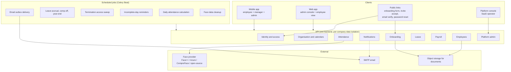

**The core monthly loop, in one picture**

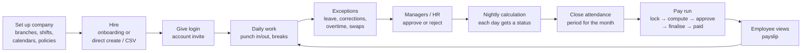

---

## 2. Users and roles

### 2.1 How access works

- Every company gets **five built-in roles** when it registers (`organisation/service.py → register_company`). A person can hold several roles at once.
- Each permission carries a **data scope**: `SELF`, `REPORTEES`, `REPORTEE_TREE`, `BRANCH` or `COMPANY`. The scope decides *whose* records the permission reaches.
- **Approvals check identity, not just permission.** At the manager stage, only the exact manager recorded on the request can approve. At the department-head stage, only that head can. At the HR stage, anyone holding the approve permission at `COMPANY` scope can.
- Roles can be **assigned but not authored**. Users → Roles can only pick among the five built-in roles (`account_invite/service.py: ASSIGNABLE_ROLE_CODES`).
- The **platform operator** is separate. It has its own login and tokens (`/platform/auth/login`) and cannot see company data through tenant endpoints.

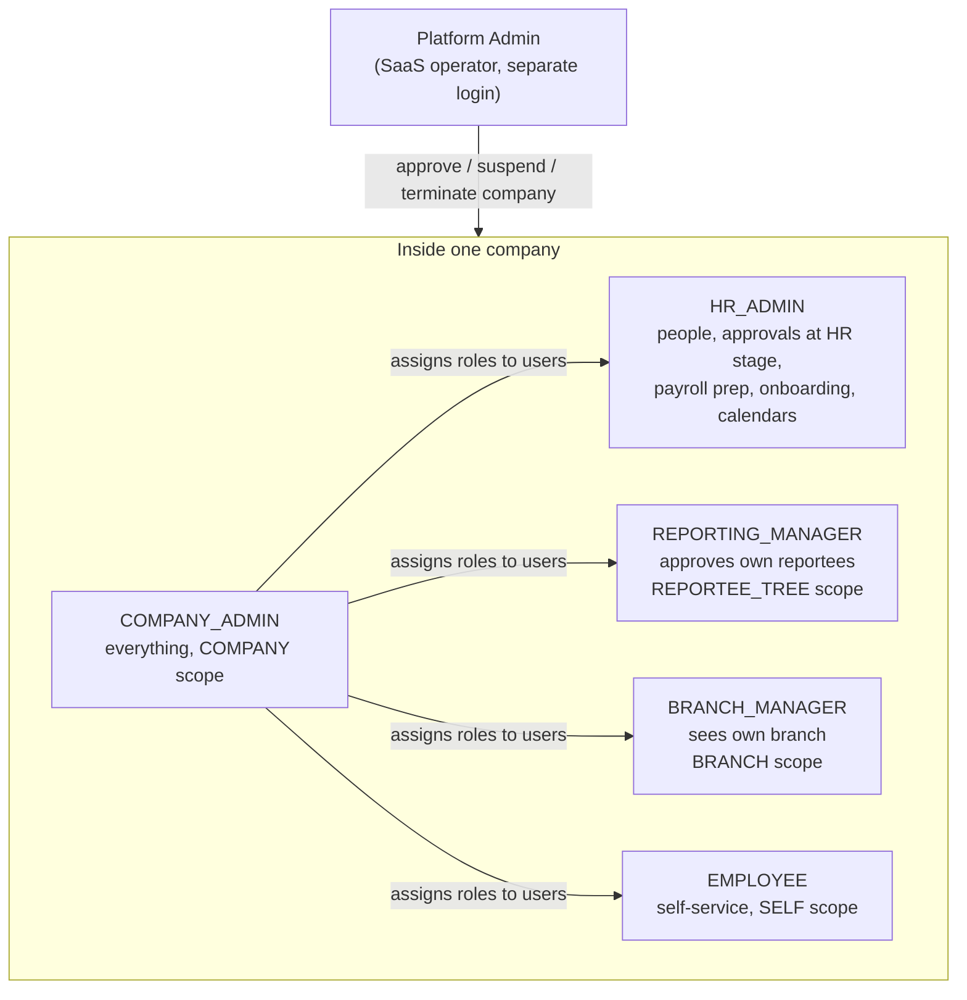

### 2.2 Role × capability matrix (default grants)

| Capability | Company Admin | HR Admin | Reporting Mgr | Branch Mgr | Employee |
|---|:-:|:-:|:-:|:-:|:-:|
| Company setup (org, branches, depts, shifts) | ✅ | — | — | — | — |
| Work / holiday calendars, weekly offs | ✅ | ✅ | — | — | — |
| Attendance / OT / correction **policies**, rosters, geofences | ✅ | — | — | — | — |
| Leave types and policies | ✅ | — | — | — | — |
| View employees | ✅ all | ✅ all | reportee tree | own branch | self |
| Create / edit / terminate / confirm employees | ✅ | ✅ | — | — | — |
| View own PAN, bank, statutory, documents | ✅ | ✅ | — | — | ✅ self |
| Onboarding (create, review, activate, cancel) | ✅ | ✅ | — | — | — |
| Invite employee to log in | ✅ | ✅ | — | — | — |
| Manage users and roles | ✅ | — | — | — | — |
| Punch own attendance | ✅* | — * | — * | — * | ✅ |
| View attendance | ✅ all | ✅ all | — ** | own branch | self |
| Approve corrections / overtime / leave | ✅ HR stage | ✅ HR stage | ✅ manager stage | ✅ only if also the recorded manager | — |
| Approve shift swaps, publish rosters | ✅ | — | — | — | — |
| Lock / unlock attendance period | ✅ | — | — | — | — |
| Adjust / encash leave balances, apply leave on behalf | ✅ | ✅ | — | — | — |
| Salary setup, pay-run prepare / compute | ✅ | ✅ | — | — | — |
| Approve / finalise / mark pay run paid | ✅ | — | — | — | — |
| Download bank advice | ✅ | — | — | — | — |
| View own payslips | ✅* | — * | — * | — * | ✅ |

\* A manager or HR person who is also an employee usually holds the **EMPLOYEE** role as well, which brings the self-service rights. Nothing assigns it automatically, so it has to be given at invite time or later. ❓ Confirm how real tenants are set up.

\** `REPORTING_MANAGER` is **not** granted `ATTENDANCE.VIEW`. A reporting manager can approve a reportee's correction, but by default cannot open that reportee's attendance days. See [Risk R4](#9-critical-ux-risks).

### 2.3 Personas

#### 👤 Employee
- **Goals:** punch in and out quickly, take leave without friction, fix mistakes, see pay.
- **Can:** punch in and out (plain, face, or location-checked), take breaks, apply for or withdraw leave, request corrections, request and consent to shift swaps, view own calendar, attendance, overtime, balances, payslips and profile (including PAN, bank and documents, read-only).
- **Cannot:** edit their own profile or bank details, approve anything, see anyone else, cancel approved leave once it has started.
- **Most-used journeys:** [J-ATT-1 Punch](#j-att-1-punch-in--out-self-service), [J-LV-1 Apply leave](#j-lv-1-apply-for-leave), [J-ATT-3 Correction](#j-att-3-regularization-correction-request), payslip view.

#### 👥 Reporting Manager
- **Goals:** keep the team's requests moving, approve fairly, see who is in.
- **Can:** approve or reject leave, corrections and overtime at the **manager stage**, but only on requests where they are the recorded approver. Can view reportees' leave balances and employee records (reportee tree).
- **Cannot:** approve shift swaps, see reportees' attendance days (no `ATTENDANCE.VIEW` by default), reassign a request, change policies.
- **Most-used journeys:** decision centres for leave and corrections, overtime list.

#### 🏢 Branch Manager
- **Goals:** run one office.
- **Can:** see the branch roster, branch attendance and branch employee list.
- **Cannot:** approve requests unless they are *also* the recorded reporting manager. The approve permission exists, but the identity check ignores branch scope.

#### 🧑‍💼 HR Admin
- **Goals:** run day-to-day HR: hiring, records, approvals, payroll prep.
- **Can:** do all employee CRUD, onboarding end to end, account invites, company-wide attendance view, HR-stage approvals, reassign stuck leave approvals, cancel approved leave (even after it starts, with a reason), adjust and encash balances, salary setup, prepare and compute pay runs, set statutory rates, manage calendars.
- **Cannot:** approve or finalise a pay run (maker-checker), manage attendance or leave policies, lock attendance periods, publish rosters, approve swaps, manage users and roles.

#### 🛡️ Company Admin
- **Goals:** configure the company, approve and finalise payroll.
- **Can:** do everything inside the company. Often has **no employee record** (the person who registered the company).
- **Cannot:** approve at manager or HOD stages without being that person; approve a pay run they computed themselves.

#### 🌐 Platform Admin (SaaS operator)
- **Goals:** let legitimate companies in, keep the platform healthy.
- **Can:** approve, reject, suspend, reactivate and terminate companies; change plan or trial; unlock a company admin's account; resend verification; manage other platform admins; read the audit log, email log and application logs.

#### 🆕 Candidate (no account)
- Uses a **public tokenized link** to fill in onboarding sections, upload documents and submit.

---

## 3. Module map

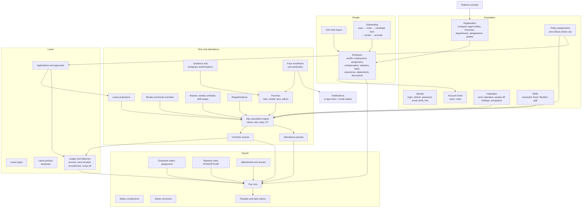

### Module status at a glance

| Module | Status | Notes |
|---|---|---|
| Company registration and platform approval | ✅ | Trial length is 14 days, but expiry is **not enforced** (see M-1) |
| Org structure (entities, branches, depts, designations, grades) | ✅ | |
| Shifts (versioned; fixed, flexible, split) | ✅ | Deletion check before delete |
| Work calendars, weekly off, holidays, change preview | ✅ | Change impact preview, then confirm |
| Employee master and sub-records | ✅ | No employee self-edit (see M-4) |
| Bulk CSV import | ✅ | Runs in background on the `reports_exports` queue |
| Onboarding | ✅ | `EXPIRED` case status is never set (see R9) |
| Account invite and role assignment | ✅ | Five fixed roles only |
| Punching: web | 🟡 | No location, no face path (see R2, R3) |
| Punching: mobile (location, face, liveness) | ✅ | |
| Breaks and overrides | ✅ | |
| Rosters, weekly schedule, shift swaps | ✅ | Only Company Admin can approve swaps |
| Day calculation engine | ✅ | Nightly at 09:30 plus right after a punch |
| Regularization | ✅ | No reassign for a stuck approver (see M-6) |
| Overtime | ✅ | No reassign for a stuck approver |
| Attendance period close and reopen | ✅ | Reopen refused after payroll is finalised |
| Leave (types, policies, applications, ledger, accrual, comp-off, encashment, combinations, statutory minimums) | ✅ | |
| Payroll (components, structures, salary setup, pay runs, payslips, bank advice, statutory, adjustments and arrears) | ✅ | No full-and-final settlement run (see M-3) |
| In-app notifications | 🟡 | **Only one event type exists**: face enrollment requested |
| Email notifications | 🟡 | Account / onboarding / platform / attendance-reminder emails only |
| Reports and exports | 🟡 | Dashboards and insights exist; ❓ no general report builder found |

---

## 4. Major user journeys

### J-AUTH-1 Company sign-up to first login

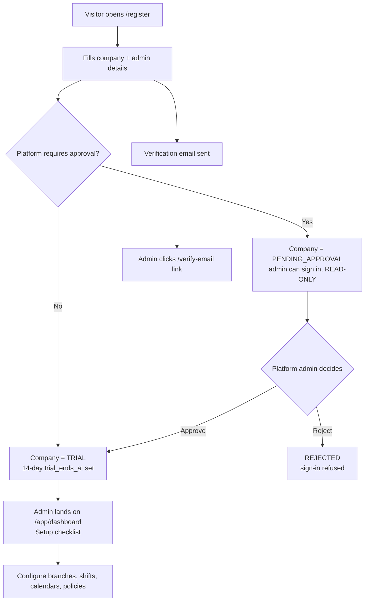

**Company status rules** (`core/auth/company_access.py`, enforced on every request):

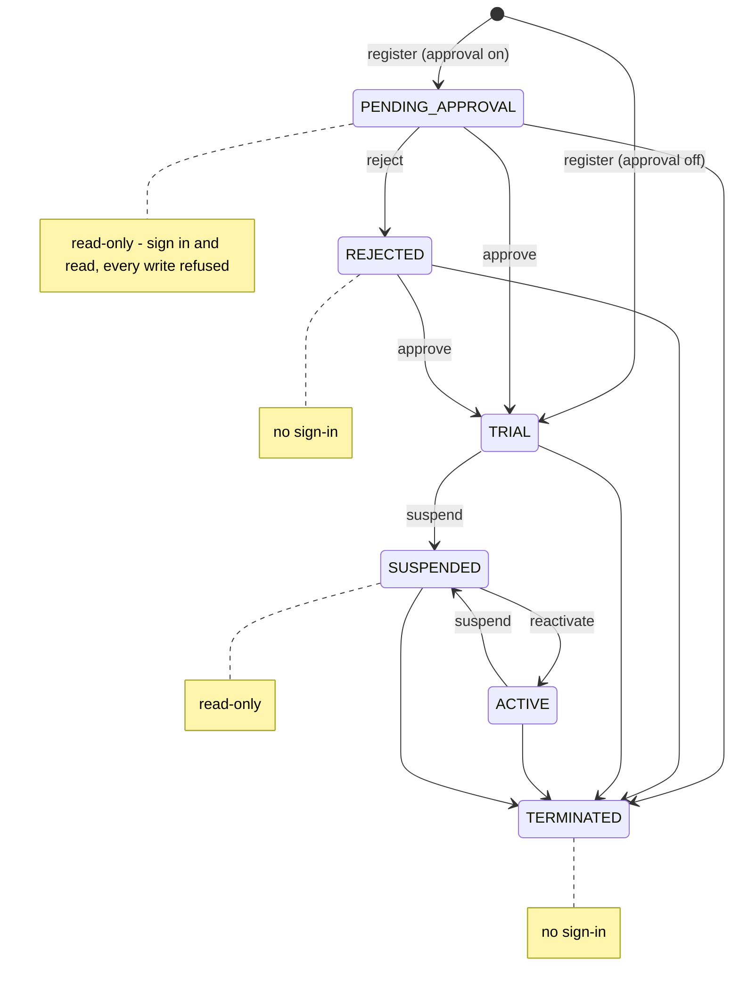

> ⚠️ Nothing moves a company from `TRIAL` to `ACTIVE` except "reactivate" after a suspension. **TRIAL → ACTIVE (paid)** is ❌ missing, and a trial that has run out is not blocked. The platform dashboard only *counts* expiring trials.

### J-EMP-1 Hiring paths

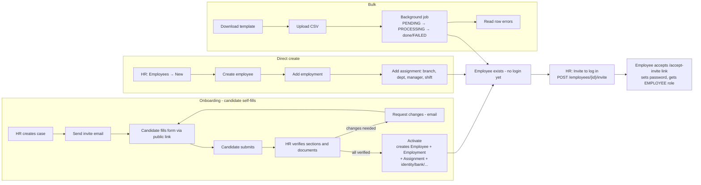

**Onboarding case states** (`onboarding/schemas.py`, `service.py`):

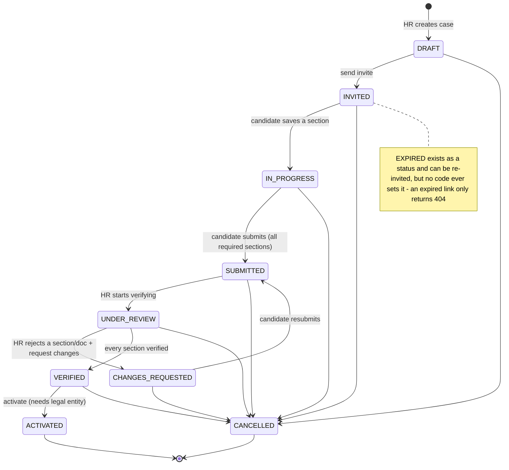

### J-EMP-2 Employment lifecycle

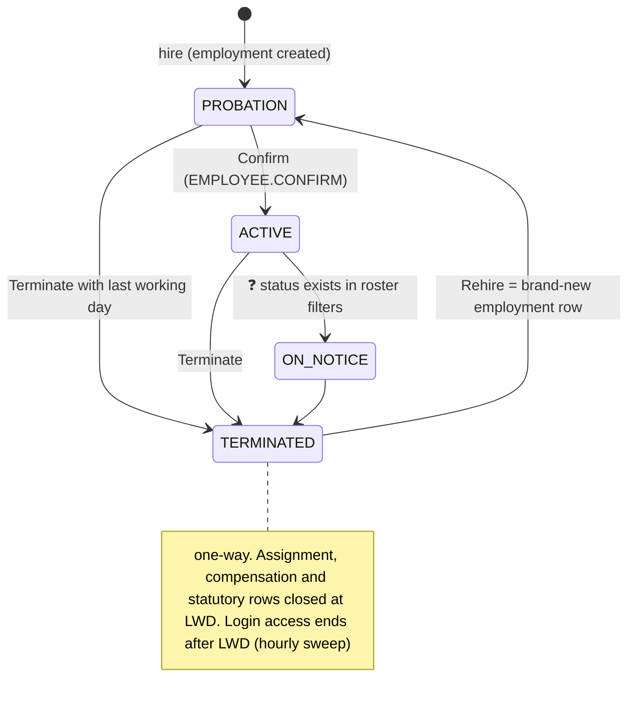

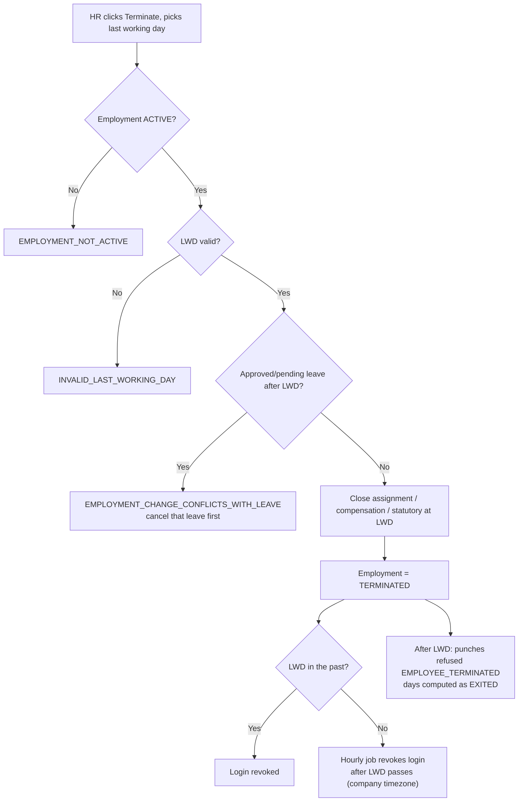

### J-ATT-1 Punch in / out (self-service)

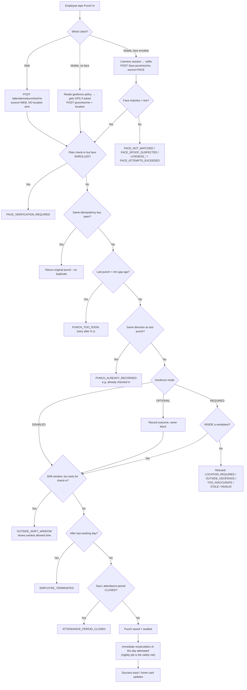

Rules worth knowing:
- The **server clock** sets the self-punch time. Clients cannot send a time.
- **Check-out is never face-gated.** Only check-in needs a face when a profile is `ENROLLED`.
- The repeat-direction check only looks back a limited window (`attendance_punch_order_lookback_hours`). Yesterday's forgotten check-out does not lock today's check-in.
- HR "on-behalf" punches (`source=ADMIN`) skip the face, geofence, gap and shift-window checks. They need a reason and a time that is not in the future.

### J-ATT-2 How a day gets its status (calculation engine)

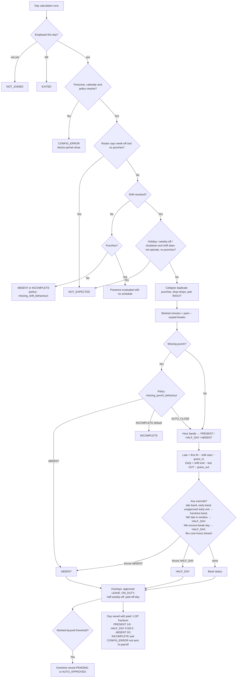

- **When it runs:** right after each punch and each approval, and nightly at **09:30** for the last 3 days. HR can also trigger a recompute for a day or a range.
- **A locked day never recomputes.** Calculation refuses days inside a closed period.

### J-ATT-3 Regularization (correction) request

Types: `MISSING_PUNCH`, `WRONG_PUNCH`, `WRONG_SHIFT`, `WRONG_STATUS`, `WFH`, `ON_DUTY`, `EXCESS_BREAK`, `FULL_DAY`, `BREAK_CORRECTION`, `EARLY_DEPARTURE_APPROVAL` (the only type that can be dated in the future).

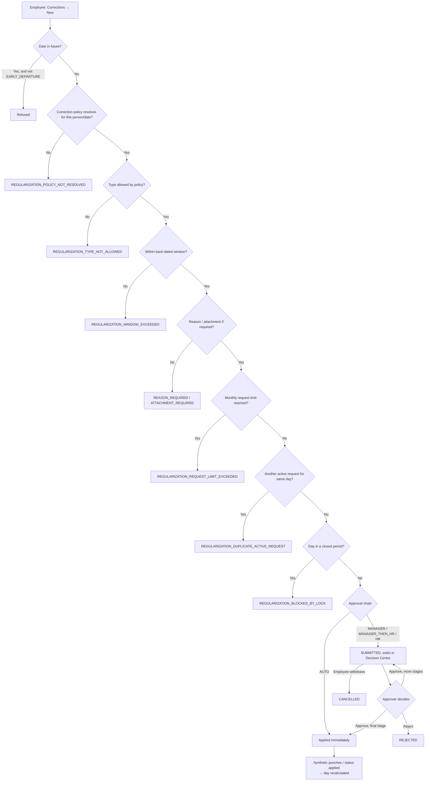

### J-LV-1 Apply for leave

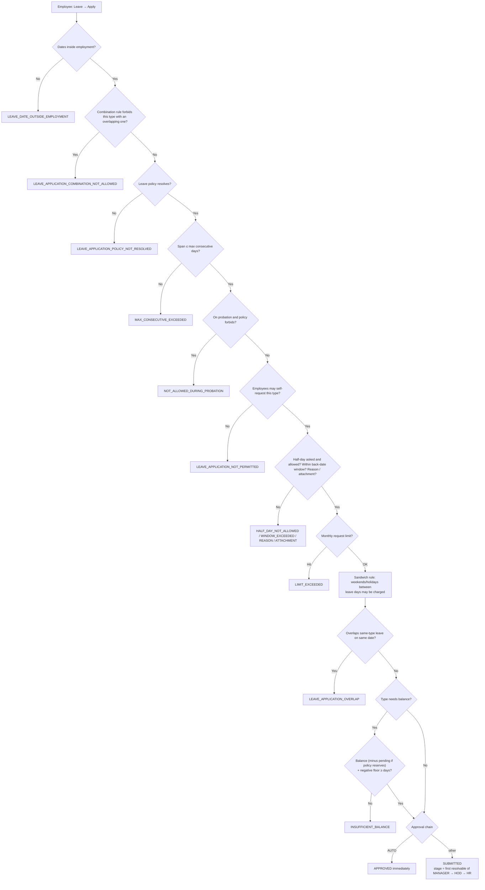

### J-LV-2 Leave approval, rejection and cancellation

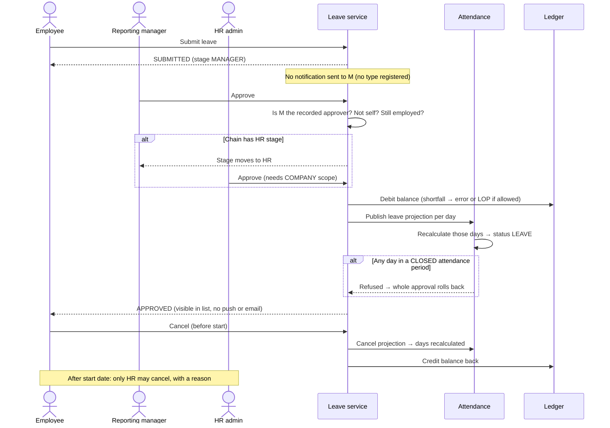

### J-PAY-1 Monthly payroll

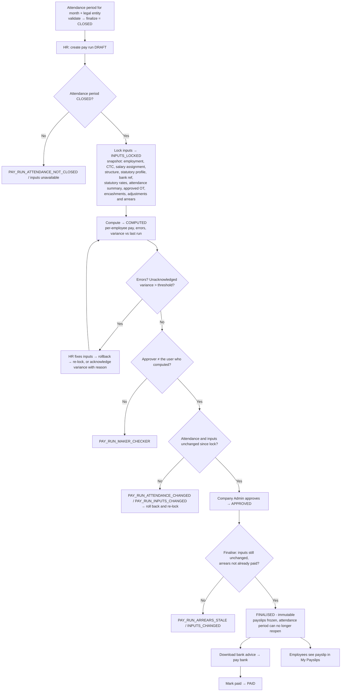

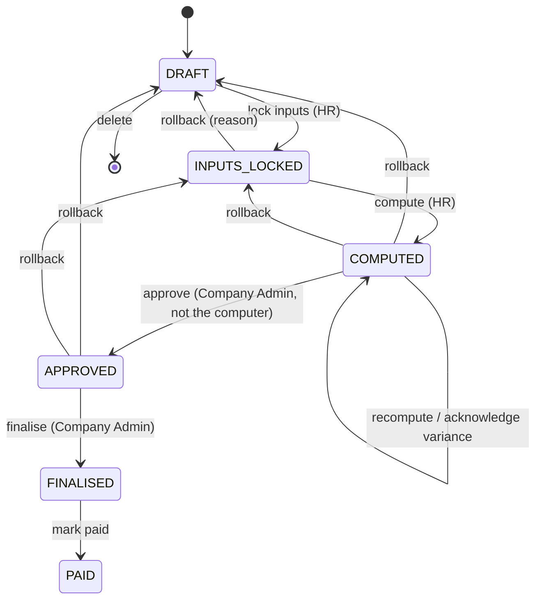

---

## 5. Scenario library

Each row gives the trigger, what the system does, and what the user sees. ✅ means the behaviour is confirmed in code.

### 5.1 Attendance

| # | Scenario | System behaviour | User sees | Status |
|---|---|---|---|---|
| A1 | Normal check-in on mobile inside office | All checks pass, punch saved, day recalculated | Success, home card shows "Checked in" | ✅ |
| A2 | Double-tap check-in (same request retried) | Same idempotency key → original punch returned | One punch, no error | ✅ |
| A3 | Second check-in a minute later (new tap) | `PUNCH_TOO_SOON` within the gap, otherwise `PUNCH_ALREADY_RECORDED` | Error with last punch time | ✅ |
| A4 | Check-in from home, geofence REQUIRED | `OUTSIDE_GEOFENCE`; attempt logged for HR (`/geofence-attempts`) | Refused with distance info | ✅ |
| A5 | Same, but HR gave a workplace authorization | Authorized place counts as a workplace | Accepted | ✅ |
| A6 | GPS off / permission denied, REQUIRED | `LOCATION_UNAVAILABLE_CLIENT` → refused | Refused | ✅ |
| A7 | Check-in at 06:00 for a 10:00 shift with 60-min early allowance | `OUTSIDE_SHIFT_WINDOW` (earliest 09:00) | Refused, shows earliest time | ✅ |
| A8 | Enrolled-face employee uses **web** to check in | `FACE_VERIFICATION_REQUIRED`; web has no face flow | Generic error, cannot check in on web | 🟡 (R3) |
| A9 | Any employee on **web** with geofence REQUIRED | Web sends no location → `LOCATION_REQUIRED` | Cannot check in on web | 🟡 (R2) |
| A10 | Forgot to check out | Day = INCOMPLETE (default policy). 10:00 reminder email to employee plus HR digest | Reminder email; must raise MISSING_PUNCH correction | ✅ |
| A11 | Arrives 20 min late, grace 10, 3rd late in window with "3 lates = half day" | Late 10 min; cumulative rule forces HALF_DAY | Day shows Half Day | ✅ |
| A12 | Leaves 1 h early with policy "early exit needs approval" and no approval | Forced to harshest early band | Half Day / Absent | ✅ |
| A13 | Same, with an approved `EARLY_DEPARTURE_APPROVAL` | Graduated band only | Present / per band | ✅ |
| A14 | Punches on an approved full-day leave | Day flagged `work_on_leave`; blocks period close until HR picks "keep leave" or cancels leave | HR sees blocker | ✅ |
| A15 | Night shift 22:00–06:00 | Punches attributed to shift start date; nightly job at 09:30 is after the punch pad | Correct day | ✅ (week-off edge fixed in uncommitted v11) |
| A16 | No shift assigned | ABSENT or INCOMPLETE per `missing_shift_behaviour` | Needs HR fix | ✅ |
| A17 | No policy / calendar resolves | CONFIG_ERROR; blocks period close | Admin must fix assignments | ✅ |
| A18 | Shift swap | Requester → colleague consents → Company Admin approves | Roster updates | ✅ (approval role narrow, R6) |

### 5.2 Leave

| # | Scenario | System behaviour | Status |
|---|---|---|---|
| L1 | Enough balance, MANAGER chain | SUBMITTED → manager approves → debit + projection → days show LEAVE | ✅ |
| L2 | Not enough balance | `INSUFFICIENT_BALANCE` at submit; at approval, `BALANCE_SHORTFALL` unless HR chooses excess as LOP | ✅ |
| L3 | Employee has no manager on record | Manager stage dropped → goes straight to HR | ✅ |
| L4 | Manager left company / lost login | Request stuck at MANAGER stage; HR uses **Reassign approver** (only if the old approver is truly ineligible) | ✅ |
| L5 | Employee is their own department head | HOD stage skipped → HR | ✅ |
| L6 | Self-approval attempt (HR applies for own leave) | `SELF_APPROVAL_NOT_ALLOWED` | ✅ |
| L7 | Friday + Monday applications, sandwich on | Weekend charged to Monday's application | ✅ |
| L8 | Cancel pending leave | Always allowed for own / submitter | ✅ |
| L9 | Cancel approved leave before start | Employee may; balance credited, days recalculated | ✅ |
| L10 | Cancel approved leave after start | Employee refused ("ask HR"); HR may, with reason | ✅ |
| L11 | Cancel approved leave in a closed month | Refused | ✅ |
| L12 | Approve pending leave whose dates are in a now-closed month | Projection refused → approval rolls back; request stays stuck SUBMITTED | 🟡 (R7) |
| L13 | Comp-off | Approved OT on a comp-off policy → hourly job credits comp-off leave; daily job expires it | ✅ |
| L14 | Monthly accrual missed due to outage | Daily job catches up; idempotent | ✅ |
| L15 | Year end | Daily job runs per employee's leave-year start; carry-forward caps enforced | ✅ |
| L16 | Encashment | HR records → ledger debit → paid in pay run | ✅ |

### 5.3 Payroll

| # | Scenario | Behaviour | Status |
|---|---|---|---|
| P1 | Happy path | Draft → lock → compute → approve (other person) → finalise → paid | ✅ |
| P2 | Same person computes and approves | `PAY_RUN_MAKER_CHECKER` | ✅ |
| P3 | HR edits a salary after lock | Approve/finalise refused `PAY_RUN_INPUTS_CHANGED` → roll back, re-lock | ✅ |
| P4 | Attendance period reopened after lock | `PAY_RUN_ATTENDANCE_CHANGED` | ✅ |
| P5 | Attendance correction after payroll finalised | Period cannot reopen → correction becomes a **payroll adjustment / arrears** in the next run | ✅ |
| P6 | Net pay swings > variance threshold | Flag; HR must acknowledge with reason before approve | ✅ |
| P7 | OT minutes with no multiplier in policy | Employee error in compute → blocks approval | ✅ |
| P8 | Structure has no BASIC but OT/encashment present | Employee error | ✅ |
| P9 | Statutory rate edited | Must be verified by a different user (`STATUTORY_RATE_SELF_VERIFICATION`) | ✅ |
| P10 | Employee exits mid-month | Not-employed days are neither paid nor LOP (proration) | ✅ |
| P11 | Full-and-final settlement | ❌ No dedicated F&F run | ❌ |

### 5.4 People, access and onboarding

| # | Scenario | Behaviour | Status |
|---|---|---|---|
| E1 | Seat limit reached on plan | `EMPLOYEE_SEAT_LIMIT_EXCEEDED` on create | ✅ |
| E2 | Duplicate employee code | `DUPLICATE_EMPLOYEE_CODE` | ✅ |
| E3 | Change manager while reportee has pending requests | `MANAGER_CHANGE_REQUIRES_CONFIRMATION` with counts; on confirm, pending requests **stay with old manager** | 🟡 (R8) |
| E4 | Invite employee with no email | `EMPLOYEE_MISSING_EMAIL` | ✅ |
| E5 | Invite employee who already has an account | `EMPLOYEE_ALREADY_HAS_ACCOUNT` | ✅ |
| E6 | Admin removes own admin role | `SELF_ROLE_CHANGE_NOT_ALLOWED` | ✅ |
| E7 | Candidate link expired | Public endpoints return 404; HR resends invite (new token) | ✅ (status never shows EXPIRED) |
| E8 | Two HR users click Activate at once | Row lock: first wins, second gets "not ready" | ✅ |
| E9 | Activate without legal entity | `ONBOARDING_CASE_MISSING_LEGAL_ENTITY` | ✅ |
| E10 | Company suspended mid-day | Next request becomes read-only; writes refused | ✅ |

---

## 6. Decision and business-rule maps

### 6.1 Approval-chain routing (leave, corrections, overtime)

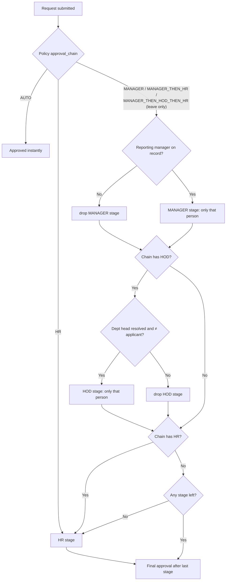

**Who passes each stage**

| Stage | Router gate | Identity gate |
|---|---|---|
| MANAGER | holds `*.APPROVE` (any scope) | caller's employee = `resolved_approver_manager_id` snapshotted at submit |
| HOD | holds `*.APPROVE` | caller's employee = `resolved_department_head_id` |
| HR | holds `*.APPROVE` | scope includes `COMPANY` |
| Always | — | caller ≠ applicant (no self-approval) |

### 6.2 Geofence decision

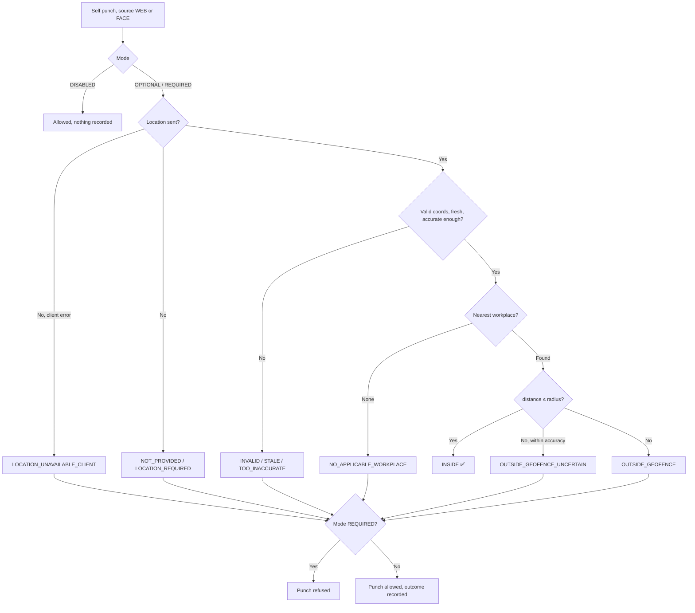

### 6.3 Face enrollment

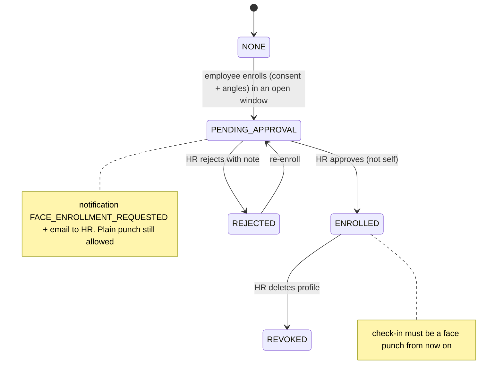

### 6.4 Attendance period close

```mermaid
flowchart TD
    A[Admin: Validate period] --> B{Blockers?}
    B --> B1[EMPLOYEES_WITHOUT_ATTENDANCE - days never calculated]
    B --> B2[CONFIG_ERROR days]
    B --> B3[WORK_ON_LEAVE_UNRESOLVED]
    B --> B4[PAID_LOP_MISMATCH]
    B --> B5[INCOMPLETE days where policy = KEEP_INCOMPLETE]
    B --> B6[PENDING_REGULARIZATION]
    B --> B7[PENDING_OVERTIME_APPROVAL]
    B --> B8[UNPUBLISHED_ROSTER]
    B -- none --> C["Finalize → CLOSED<br/>other INCOMPLETE resolved as absent/present per policy<br/>summary frozen for payroll"]
    C --> D{Reopen requested?}
    D -- Payroll FINALISED for it --> X[ATTENDANCE_PERIOD_PAYROLL_FINALISED]
    D -- Otherwise --> E[OPEN again, needs ATTENDANCE.UNLOCK]
```

> Pending **leave** applications are **not** a blocker. See [R7](#9-critical-ux-risks).

### 6.5 Policy versioning (shifts, attendance / OT / correction / leave policies, salary structures)

```mermaid
stateDiagram-v2
    [*] --> DRAFT: create version (one open draft per policy)
    DRAFT --> DRAFT: edit
    DRAFT --> PUBLISHED: publish (must be complete, no date overlap)
    DRAFT --> [*]: delete draft
    PUBLISHED --> PUBLISHED: a newer version with later effective_from takes over from its date
    note right of PUBLISHED: Each day is judged by the version effective on that date. Already-locked days never change
```

---

## 7. Module dependency map

```mermaid
flowchart LR
    ORG[Organisation<br/>branches, legal entities] --> EMP[Employee]
    CAL[Calendars + holidays] --> ATT[Attendance calc]
    SH[Shifts] --> ATT
    RO[Rosters + swaps] --> ATT
    PA[Policy assignments] --> ATT
    PA --> LV[Leave]
    EMP -- "employment dates, status,<br/>manager, branch, shift" --> ATT
    EMP -- "probation, manager, dept head,<br/>employment window" --> LV
    LV -- "approved leave → projections" --> ATT
    ATT -- "approved OT (comp-off policy)" --> LV
    REG[Regularization] --> ATT
    ATT -- "closed period summary:<br/>paid days, LOP, OT" --> PAY[Payroll]
    LV -- "encashments, balances on payslip" --> PAY
    EMP -- "CTC, statutory, bank, salary assignment" --> PAY
    PAY -- "finalised → period cannot reopen" --> ATT
    EMP -- "termination → access sweep,<br/>blocks leave after LWD" --> ID[Identity / login]
    ONB[Onboarding] -- activate --> EMP
    PLAT[Platform] -- "company status → read-only/blocked" --> ID
```

**Where one module's decision changes another**

| Decision in… | Changes… | How |
|---|---|---|
| Leave approved / cancelled | Attendance | Projection published or cancelled → affected days recalculated to/from LEAVE |
| Leave approval in a closed period | Leave | Refused; the whole approval rolls back |
| Approved overtime (comp-off policy) | Leave balance | Hourly job credits comp-off; daily job expires it |
| Approved overtime (pay policy) | Payroll | Minutes × policy multiplier × base rate at compute |
| Shift / roster / calendar change | Attendance | Future days use the new rules; past unlocked days change on recompute. Calendar change has an impact preview |
| Holiday added | Attendance | Day becomes NOT_EXPECTED or paid off-day (daily-wage: only PUBLIC/SUBSTITUTE paid) |
| Attendance period CLOSED | Punches, corrections, leave approvals, payroll | Writes refused; payroll may now lock inputs |
| Pay run FINALISED | Attendance | Period can no longer reopen; later fixes become arrears |
| Termination | Attendance, leave, login | Punches after LWD refused; days EXITED; leave after LWD must be cancelled first; login revoked after LWD |
| Probation confirm | Leave | Policies with `allowed_during_probation=false` now allow requests |
| Manager change | Approvals | New requests go to new manager; **pending ones stay with old** |
| Company suspended | Everyone | Read-only from the next request |

---

## 8. Exception and edge-case flows

### X1 Employee forgets to check out

```mermaid
flowchart TD
    T[No OUT punch] --> D[Nightly calc 09:30: missing punch]
    D --> P{missing_punch_behaviour}
    P -- INCOMPLETE --> I[Day INCOMPLETE]
    P -- ABSENT --> A[Day ABSENT]
    P -- AUTO_CLOSE --> AC[Auto-closed, status from bands]
    I --> R[10:00 reminder email to employee + HR digest]
    R --> C[Employee raises MISSING_PUNCH correction]
    C --> AP{Approved before month close?}
    AP -- Yes --> F[Day recalculated]
    AP -- No, still pending --> B[Blocks period close: PENDING_REGULARIZATION]
    I -- never fixed --> L{At lock: incomplete_at_lock_behaviour}
    L -- TREAT_ABSENT/PRESENT --> RES[Resolved at finalize]
    L -- KEEP_INCOMPLETE --> BL[Blocks close]
```

### X2 Approval stuck because the approver can't act

```mermaid
flowchart TD
    T["Request at MANAGER stage,<br/>manager terminated / no login / lost role"] --> S[Request sits SUBMITTED]
    S --> K{Which request type?}
    K -- Leave --> L[HR: Reassign approver]
    L --> L1{Old approver really ineligible?}
    L1 -- No --> LX[LEAVE_APPROVER_STILL_ELIGIBLE]
    L1 -- Yes --> L2[New approver set → can approve]
    K -- Correction / Overtime --> R["❌ No reassign endpoint<br/>stuck until manager regains access<br/>or employee cancels and re-raises"]
    R --> P[Period close blocked by PENDING_REGULARIZATION / PENDING_OVERTIME_APPROVAL]
```

### X3 Data corrected after payroll processing

```mermaid
flowchart TD
    T[HR finds wrong attendance for a paid month] --> D{Pay run state}
    D -- "DRAFT … APPROVED" --> R1[Reopen period → fix → close] --> R2[Pay run detects ATTENDANCE_CHANGED → rollback → re-lock → recompute]
    D -- FINALISED / PAID --> F1[Period reopen refused]
    F1 --> F2[HR records a payroll adjustment / day correction]
    F2 --> F3["Next month's run pays arrears, applied exactly once"]
```

### X4 Policy changes mid-month

```mermaid
flowchart TD
    T[Admin publishes new attendance policy version effective 15th] --> S["Days 1-14 keep old version, 15+ use new"]
    S --> C{Days 15+ already calculated?}
    C -- Yes --> R["Not changed until a recompute runs<br/>(nightly covers only last 3 days)"]
    R --> H[HR runs calculate-range for the month]
    C -- No --> N[Calculated with new version]
    H --> L{Any day locked?}
    L -- Yes --> X[Locked days refused - unchanged]
```

> ❓ Check whether publishing a policy version triggers its own recompute. No trigger was found, so older days stay as they are until HR runs a range recompute.

### X5 External service unavailable

| Service | Detection | System action | User sees |
|---|---|---|---|
| Face provider down | `FACE_PROVIDER_FAILED` / `FACE_VERIFICATION_UNAVAILABLE` / `FACE_LIVENESS_UNAVAILABLE` | Punch not recorded | Error; an ENROLLED employee **cannot check in** (no fallback) |
| Email (SMTP) down | Outbox delivery fails | Retried by the outbox sweep every minute | Delayed email |
| Job queue (Redis/Celery) down | `ATTENDANCE_QUEUE_UNAVAILABLE` on range recompute | Request refused | Error to HR |
| Celery Beat stopped | Heartbeat goes stale (`ops/job_health`) | Ops alert | Days stop recalculating nightly; reminders and accruals pause until restart (jobs catch up) |
| Object storage down | Upload error | Document upload refused | Error |

### X6 Employee joins or leaves mid-month

```mermaid
flowchart LR
    J[Join on 10th] --> J1[1st–9th = NOT_JOINED] --> J2[Not paid, not LOP]
    X[LWD on 20th] --> X1[21st–31st = EXITED] --> X2[Not paid, not LOP]
    X --> X3[Leave after 20th must be cancelled before termination]
    X --> X4[Login revoked after 20th by hourly sweep]
```

---

## 9. Critical UX risks

Ranked by impact. Each was found in code and should be checked by hand on a running build.

| # | Risk | Evidence | Impact |
|---|---|---|---|
| **R1** | **On web, HR admins and managers who have an employee record get only the employee menu.** Web "employee mode" is `employee_id && !DASHBOARD.COMPANY.VIEW`, and only COMPANY_ADMIN holds that dashboard permission. HR loses the menu links to Employees, Onboarding, Payroll and Settings. Mobile shows these extra items to the same person (`settings_hub_screen.dart`). | `web/src/lib/auth/use-employee-mode.ts`, `sidebar-nav.tsx`; `organisation/service.py` HR_ADMIN grants | HR can't find their work on web; pages only reachable by typing the URL ❓ |
| **R2** | **Web self-punch never sends a location.** With geofence REQUIRED, every web check-in and check-out fails `LOCATION_REQUIRED`, and the web never reads the geofence policy to warn first. | `punch-entry-dialog.tsx`; `geofence_service.py GEOFENCED_SOURCES={WEB,FACE}` | Web punch button that always fails |
| **R3** | **Face-enrolled employees cannot check in on web.** Web has no face punch flow and no special handling of `FACE_VERIFICATION_REQUIRED`. | `service.py _ensure_plain_punch_allowed`; no `face-punches` call in web | Confusing error, must use phone |
| **R4** | **Reporting managers can approve corrections and overtime but can't view the reportee's attendance day** (no `ATTENDANCE.VIEW` grant). | `register_company` REPORTING_MANAGER grants | Approving blind; mobile "Team attendance" hidden for them |
| **R5** | **Approvals depend on a manually assigned role.** Making someone a `reporting_manager_id` does not give them `REPORTING_MANAGER`. Requests route to them, but the approve call fails the permission gate. | Router `require_permission(*.APPROVE)`; no auto-grant | Silent stuck requests; leave can be reassigned, corrections and OT cannot |
| **R6** | **Only Company Admin can approve shift swaps and publish rosters.** Managers and HR can't. | `schedule_router.py` → `ATTENDANCE.ROSTER_MANAGE` | Swap requests pile up on one person |
| **R7** | **Pending leave is not a period-close blocker,** but approving it afterwards fails because the period is closed. | `_validate` blockers; `_apply_approval` docstring | Leave stuck SUBMITTED forever for a closed month |
| **R8** | **Manager change keeps pending requests with the old manager** after HR confirms the warning. | `employee/service.py` manager-change confirm | Old manager must still act, or (leave only) HR reassigns |
| **R9** | **Onboarding `EXPIRED` status is never set.** An expired candidate link returns 404 while HR still sees INVITED / IN_PROGRESS. | No writer of `EXPIRED` in `onboarding/` | HR doesn't know the candidate is locked out |
| **R10** | **Nobody is told about decisions.** No in-app or email notification exists for leave, correction, overtime, swap or payroll events. Only face enrollment notifies. | `notification/types.py REGISTRY` has 1 type | Employees must keep checking; managers don't know work is waiting |
| **R11** | **The trial never ends,** and there is no TRIAL → ACTIVE (paid) path. | `trial_ends_at` only counted on platform dashboard | Commercial gap; UI may show a countdown that does nothing ❓ |
| **R12** | **Branch Manager holds approve permissions that never work** unless they are also the recorded manager. | Comment in `register_company` | Visible-but-failing approve buttons ❓ |
| **R13** | **Policy edits don't recalculate past unlocked days.** The nightly job only covers the trailing 3 days. | `attendance/tasks.py TRAILING_DAYS` | Statuses for the month may disagree with current policy until HR recomputes |

---

## 10. Missing scenarios

| # | Scenario | Today |
|---|---|---|
| M-1 | Trial expiry and conversion to paid (TRIAL → ACTIVE) | ❌ Not enforced, no path |
| M-2 | Notifications for request submitted / approved / rejected / cancelled (leave, corrections, OT, swaps), pay run ready, payslip published | ❌ Registry has one type; no emails for these |
| M-3 | Full-and-final settlement on exit (notice recovery, leave encashment on exit, gratuity) | ❌ Banking kept "for F&F", but no F&F run |
| M-4 | Employee self-service profile or bank change request with HR approval | ❌ Employee is read-only on own data |
| M-5 | Resignation initiated by the employee (notice period workflow) | ❌ Only HR-initiated termination; `ON_NOTICE` status has no workflow ❓ |
| M-6 | Reassign approver for corrections and overtime | ❌ Leave only |
| M-7 | Approval escalation / SLA (auto-escalate after N days) | ❌ |
| M-8 | Delegation while a manager is on leave | ❌ |
| M-9 | Auto-assign REPORTING_MANAGER when someone becomes a manager | ❌ |
| M-10 | Custom roles / role authoring | ❌ Five fixed roles by design (Decision P5) |
| M-11 | Pending leave handling at month close (block, or auto-handle) | ❌ |
| M-12 | Onboarding case expiry job and "link expired" status for HR | ❌ |
| M-13 | Face provider outage fallback (e.g. HR on-behalf or temporary plain punch) | ❌ Only HR on-behalf punch, manual |
| M-14 | Offline punching on mobile | ❓ A design doc exists (`docs/api/OFFLINE_ATTENDANCE_DESIGN.md`); check whether it is built |
| M-15 | Recalculate the affected range automatically when a policy, shift or calendar version is published | 🟡 Calendar change has preview/confirm; others ❓ |
| M-16 | Swap approval by the employee's manager | ❌ |
| M-17 | Employee-facing explanation of why a day is Half Day / Absent (which rule fired) | 🟡 Snapshot stored on the day; ❓ how much the UI explains |

---

## 11. Appendix

### 11.1 Background jobs (Celery Beat, `core/celery_app.py`)

| Job | When | What it does | If it fails |
|---|---|---|---|
| `attendance.run_daily_calculation` | Daily 09:30 | Recalculates the trailing 3 days for every company | Next run catches up within 3 days; older gaps need a manual range recompute |
| `attendance.run_incomplete_reminders` | Daily 10:00 | Emails employees with incomplete days, plus an HR digest | Missed reminder |
| `leave.run_monthly_accrual` | Daily 01:00 | Accrues in the first days of the month; catches up skipped months | Idempotent catch-up |
| `leave.run_comp_off_credit_sweep` | Hourly | Turns approved OT into comp-off leave | Idempotent |
| `leave.run_comp_off_expiry_sweep` | Daily 01:30 | Expires lapsed comp-off | Idempotent |
| `leave.run_year_end_sweep` | Daily 02:00 | Year-end accrual and carry-forward per employee's leave year | Idempotent |
| `employee.run_termination_access_sweep` | Hourly :15 | Revokes login after last working day | Access lingers until next run |
| `attendance.run_face_cleanup` | Daily 03:15 | Face data retention (no-op until configured; dry-run by default) | — |
| `attendance.run_face_deletions` | Every 2 min | Deletes provider face data queued by approve / reject / revoke | Retried |
| `email_outbox.sweep` | Every 60 s | Delivers or retries queued emails | Retried |
| `health.scheduler_heartbeat` | Every 60 s | Proves Beat → worker path is alive | Ops alert |
| `employee_import.process_batch` | On upload | Processes CSV import (`reports_exports` queue) | Batch FAILED with errors |

### 11.2 Status values

| Record | Values |
|---|---|
| Company | PENDING_APPROVAL, TRIAL, ACTIVE, SUSPENDED, REJECTED, TERMINATED |
| Attendance day | NOT_JOINED, EXITED, NOT_EXPECTED, PRESENT, HALF_DAY, ABSENT, LEAVE, ON_DUTY, WFH, INCOMPLETE, CONFIG_ERROR |
| Regularization | SUBMITTED, APPROVED, REJECTED, CANCELLED |
| Overtime record | PENDING, AUTO_APPROVED, APPROVED, REJECTED |
| Attendance period | OPEN, CLOSED (validation: READY / BLOCKED) |
| Roster entry | DRAFT, PUBLISHED |
| Shift swap | PENDING (+ colleague consent flag), APPROVED, DECLINED (withdraw also = DECLINED) |
| Leave application | SUBMITTED, APPROVED, REJECTED, CANCELLED |
| Onboarding case | DRAFT, INVITED, IN_PROGRESS, SUBMITTED, UNDER_REVIEW, CHANGES_REQUESTED, VERIFIED, ACTIVATED, CANCELLED, EXPIRED (unused) |
| Pay run | DRAFT, INPUTS_LOCKED, COMPUTED, APPROVED, FINALISED, PAID |
| Policy / shift / structure version | DRAFT, PUBLISHED |
| Face profile | PENDING_APPROVAL, ENROLLED, REJECTED, REVOKED |
| Import batch | PENDING, PROCESSING, completed / FAILED |

### 11.3 Where to look in code

| Topic | File |
|---|---|
| Default roles and grants | `apps/api/src/hrms/modules/organisation/service.py` (`register_company`) |
| Permission codes | `apps/api/src/hrms/modules/*/permissions.py` |
| Punch rules | `apps/api/src/hrms/modules/attendance/service.py` (`record_punch_outcome`) |
| Geofence decision | `apps/api/src/hrms/modules/attendance/geofence.py` (`decide`) |
| Day status engine | `apps/api/src/hrms/modules/attendance/calculation.py` (`evaluate_day`) |
| Period close blockers | `apps/api/src/hrms/modules/attendance/service.py` (period `_validate`) |
| Leave submit / approve / cancel | `apps/api/src/hrms/modules/leave/service.py`, `approval_chain.py` |
| Pay-run lifecycle | `apps/api/src/hrms/modules/payroll/service.py` |
| Company access gate | `apps/api/src/hrms/core/auth/company_access.py` |
| Web role switch | `apps/web/src/lib/auth/use-employee-mode.ts`, `components/layout/nav-items.ts` |
| Mobile role switch | `apps/mobile/lib/core/auth/surface.dart`, `core/nav/nav_entries.dart` |
