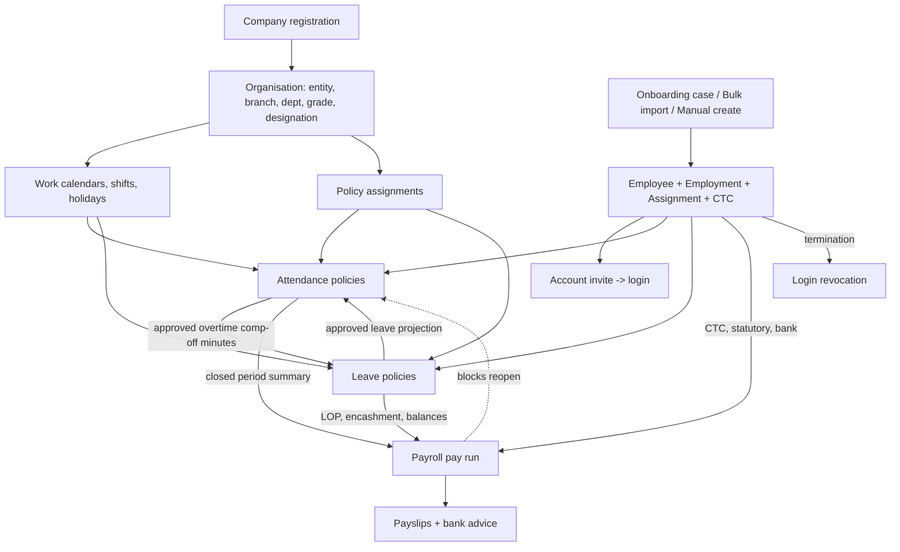

# Staff Spectrum HRMS — Functional Documentation

**Basis:** repository `main` at the working-tree state of 2026-10-17 (includes uncommitted face-attendance hardening, `face_cleanup`, migration `20261017090000`). Source of truth = implemented code, migrations, tests and the dev database's configuration tables; existing design docs are cited as *intent*, never as proof of behaviour. Nothing was executed against real data; no application code, schema, migration, test or infrastructure was changed.

**How this documentation is organised.** Because the product is large, this file is the index plus Parts A and B; Part C (module-by-module detail, in the 11-section template: overview, roles & permissions, screens, features, rules & calculations, lifecycle, data, integrations, limitations, acceptance criteria, evidence) lives in `modules/`:

| # | Module document | Status |
|---|---|---|
| 01 | [Platform: identity, roles & permissions, tenancy, security](modules/01_PLATFORM_IDENTITY_RBAC.md) | Implemented and verified |
| 02 | [Organisation & workforce calendar configuration](modules/02_ORGANISATION.md) | Implemented and verified |
| 03 | [Employee lifecycle & records](modules/03_EMPLOYEE.md) | Implemented; lifecycle partial |
| 04 | [Onboarding, account provisioning, bulk import](modules/04_ONBOARDING_AND_BULK_IMPORT.md) | Implemented; cancel/expiry absent |
| 05 | [Leave management](modules/05_LEAVE.md) | Implemented and verified (backend) |
| 06 | [Attendance (incl. face attendance)](modules/06_ATTENDANCE.md) | Implemented; many policy fields unevaluated; face pilot-only |
| 07 | [Payroll](modules/07_PAYROLL.md) | Implemented; compliance not established |
| 08 | [Web application](modules/08_WEB_APPLICATION.md) | Implemented, not E2E-verified |
| 09 | [Mobile application](modules/09_MOBILE_APPLICATION.md) | Implemented, not E2E-verified |
| 10 | [Operations & deployment tooling](modules/10_OPERATIONS_AND_DEPLOYMENT.md) | Implemented; alert target unset |

Supporting: [Module catalog](STAFF_SPECTRUM_HRMS_MODULE_CATALOG.md) · [Workflow catalog](STAFF_SPECTRUM_HRMS_WORKFLOW_CATALOG.md) · [Functional gaps register](STAFF_SPECTRUM_HRMS_FUNCTIONAL_GAPS.md).

**Status vocabulary** (as requested): *Implemented and verified* (code + tests), *Implemented, not fully verified*, *Partially implemented*, *UI-only*, *Backend-only*, *Disabled or unconfigured*, *Not implemented*, *Unclear / requires investigation*. Passing automated tests are not treated as end-to-end verification.

---

# Part A — Product overview

## A.1 What the product is
Staff Spectrum HRMS is a **multi-tenant, India-oriented HR and payroll system**: a company registers, defines its organisation, calendars and policies, adds employees (manually, by CSV, or via a candidate self-service onboarding link), tracks attendance (web/mobile punches, optional mobile face verification), manages leave on a ledger with approval chains, and runs monthly payroll per legal entity with PF/ESI/PT/LWF and new-regime TDS. Defaults assume India (INR, `Asia/Kolkata`, April–March FY, PAN/Aadhaar/UAN); the timezone allow-list is configuration.

## A.2 Functional areas
Platform & access · Organisation structure · Workforce calendar (shifts, holidays, weekly offs) · Employee records & lifecycle · Onboarding / bulk import · Attendance (punches, daily calculation, regularization, overtime, periods) · Face attendance (mobile) · Leave (types, policies, ledger, accrual, comp-off, year-end) · Payroll (structures, pay runs, statutory, payslips, bank advice, arrears) · Web and mobile clients · Operations tooling.

**Not present in the product (verified absent):** recruitment/ATS (jobs, candidates, interviews, offers, resume parsing, ranking), AI features, performance/appraisal, training, expenses/reimbursements, loans/advances, F&F settlement, exit management, helpdesk/support tickets, document templates/letters, billing/subscription management UI, notification centre/push, reporting/export engine (other than bank-advice CSV, import template), audit-log viewer, super-admin/platform console, geofencing, biometric devices. These appear in roadmap docs (`docs/product/*`) only.

## A.3 Users
Company Administrator, HR Administrator, Reporting Manager, Branch Manager, Employee (five fixed roles); candidates (token-based, no account); operators (outside the app). No Payroll-Administrator or Super-Administrator role exists; payroll permissions are carved from Company/HR Admin.

## A.4 How modules connect

Source-of-truth: CTC → `employee_compensation`; leave balance → `leave_ledger` sum; attendance facts → `attendance_day` (frozen in `attendance_period_summary` at close); pay → finalised `pay_run_line` rows.

## A.5 Major end-to-end workflows
See the [Workflow catalog](STAFF_SPECTRUM_HRMS_WORKFLOW_CATALOG.md): onboarding→employee, leave→attendance→payroll, attendance→regularization→period→payroll, salary setup→pay run→payslip, termination→access revocation, face enrolment→punch.

## A.6 Platform / plan / configuration dependence
| Capability | Web | Mobile | Depends on |
|---|---|---|---|
| Plain punch | ✔ (record-punch dialog) | ✔ | `ATTENDANCE.PUNCH` (not in default Employee role) |
| Face enrolment & punch | ✘ (HR review card only) | ✔ | `FACE_VERIFICATION_PROVIDER=facepp`, `FACE_LIVENESS_ENGINE=minifasnet`, Face++ credentials, HR window |
| Payslip PDF | print | generate/share | finalised run |
| Bulk employee import | ✘ (API only) | ✘ (API only) | `EMPLOYEE.BULK_IMPORT`, Celery worker, MinIO |
| Email features | ✔ | ✔ | `EMAIL_PROVIDER` ≠ logging |
| Seat limit | both | both | plan (FREE 5 / STARTER 25 / PROFESSIONAL 100 / ENTERPRISE ∞) |
| Statutory deductions | both | both | verified rate rows + employee statutory profile |

## A.7 Permission model in one page
Permissions are flat codes (`DOMAIN.ACTION`) granted to roles with a **data scope** (SELF, REPORTEES, REPORTEE_TREE, BRANCH, COMPANY). Approvals add *identity* rules (the named manager/HOD) and *separation-of-duty* rules (no self-approval; payroll maker≠checker). The default matrix is in [Platform §2](modules/01_PLATFORM_IDENTITY_RBAC.md); the most consequential default-role findings are: Employee has no attendance permissions; HR Admin has no organisation, onboarding, or dashboard permissions; roles cannot be edited.

---

# Part B — Complete module inventory

| Module | Purpose | Submodules | Primary users | Main capabilities | Dependencies | Platforms | Status | Evidence |
|---|---|---|---|---|---|---|---|---|
| Identity & access | authenticate, tenant, RBAC | registration, login/refresh, reset, verify, invites, user roles | all | secure sessions, 5 roles, data scope | Redis, email | web, mobile | Implemented and verified | `modules/identity`, `account_invite`, `core/{auth,rbac,tenancy}`; [01](modules/01_PLATFORM_IDENTITY_RBAC.md) |
| Subscription / plans | seat entitlement | plans, features, trial | admin | seat limit only | org | backend, dashboard display | Partially implemented (no billing/expiry) | `seed/plan_catalogue.py`, `organisation/service.py` |
| Organisation | master data | company, legal entity, branch, department, designation, grade | admin | CRUD, hierarchy, in-use guards | — | web, mobile | Implemented and verified | [02](modules/02_ORGANISATION.md) |
| Workforce calendar | what kind of day | shifts+versions, holiday calendars, weekly-off, work calendars, exceptions, policy assignment/resolution | admin | versioned schedules, precedence | org | web, mobile | Implemented and verified | [02](modules/02_ORGANISATION.md) |
| Employee | people records | employee, employment, assignment, compensation, statutory, bank, identity, experience, education, dependants, documents | HR | effective-dated history, termination, confirm | org, plan | web, mobile | Implemented; status lifecycle partial | [03](modules/03_EMPLOYEE.md) |
| Onboarding | candidate self-service hiring data | cases, public wizard, review, activation | admin | verified-to-employee creation | employee, email, storage | web, mobile | Implemented; no cancel/expiry | [04](modules/04_ONBOARDING_AND_BULK_IMPORT.md) |
| Account invite | login provisioning | employee invite, user invite, role assign | admin/HR | invite→account | identity | web, mobile | Implemented and verified | [01](modules/01_PLATFORM_IDENTITY_RBAC.md) |
| Employee bulk import | mass hiring | template, upload, batch status, errors | HR | CSV→employees (1000 rows) | Celery, MinIO | API only | Backend-only (no UI), verified by tests | [04](modules/04_ONBOARDING_AND_BULK_IMPORT.md) |
| Attendance | time & presence | punches, daily calc engine, rosters, regularization, overtime, periods, leave projection, reminders | all | status, LOP, OT, close | calendar, employee, leave | web, mobile | Implemented; policy fields partly unevaluated | [06](modules/06_ATTENDANCE.md) |
| Face attendance | biometric punch | enrol, liveness, match, cleanup | employee, HR | mobile punch w/ liveness | Face++, ONNX | mobile (+HR web card) | Implemented, **disabled by default; not production-ready** | [06 §4.8](modules/06_ATTENDANCE.md) |
| Leave | leave & balances | types, policies, ledger, applications, accrual, year-end, comp-off, combination rules, statutory minimums | all | ledger-based leave | calendar, employee, attendance | web, mobile | Implemented and verified (backend) | [05](modules/05_LEAVE.md) |
| Payroll | monthly pay | components, structures, salary assignment, pay runs, statutory rates, TDS, payslips, bank advice, arrears | HR, admin, employee | compute→approve→finalise | attendance, leave, employee | web, mobile | Implemented; compliance unverified; scope partial | [07](modules/07_PAYROLL.md) |
| Dashboards / reporting | insights | company dashboard, attendance dashboards | admin, HR, managers | KPIs on-screen | various | web, mobile | Partial (no exports) | `app/dashboard`, `components/attendance/dashboard` |
| Web app | client | — | all | — | API | web | Implemented | [08](modules/08_WEB_APPLICATION.md) |
| Mobile app | client | — | all | face, PDF | API | mobile | Implemented | [09](modules/09_MOBILE_APPLICATION.md) |
| Ops tooling | run the system | health, job_health, import_backlog, monitor, backups, CI | operators | monitoring | infra | backend | Implemented; alerts unset | [10](modules/10_OPERATIONS_AND_DEPLOYMENT.md) |
| Recruitment/ATS, appraisal, expenses, loans, F&F, exit, helpdesk, notifications, billing, audit viewer, super-admin | — | — | — | — | — | — | **Not implemented** | repository-wide search |

Counts: **10 documented module groups, 17 functional modules, ~60 submodules/resources** (the catalog lists them).

---

# Part C — Detailed functional documentation

Part C is the set of ten module documents above. Each follows the requested structure (overview → roles/permissions → screens → features with inputs/validation/outcomes/errors → rules & calculations with formulas and worked examples → lifecycle with Mermaid → data → integrations/automation → limitations → acceptance criteria → evidence).

Highest-value reading order for a new reader: Platform (roles) → Organisation → Employee → Leave → Attendance → Payroll.

# Part D — Cross-module workflows
See [Workflow catalog](STAFF_SPECTRUM_HRMS_WORKFLOW_CATALOG.md).

# Part E — Gaps and decisions
See [Functional gaps register](STAFF_SPECTRUM_HRMS_FUNCTIONAL_GAPS.md).

# Part F — Method, coverage and limits of evidence
* **Read in depth:** all API routers and services for identity, account invite, organisation (profile, structure, calendars, assignment resolution), employee (all sub-resources, termination), onboarding, employee import, leave, attendance (punch, engine, regularization, overtime, periods, leave projection, face, liveness, cleanup, reminders), payroll (engine, breakup, statutory, TDS, run lifecycle, payslip, bank advice, adjustments), core platform (auth, tenancy, crypto, idempotency, rate limit, celery), plus web navigation/auth/attendance page, mobile router/shell/auth/attendance, CI and compose.
* **Sampled, not exhaustively read:** web page components (field-level validation of every form), mobile generic form specs, DB RLS policies (relied on code comments), migration SQL, most test bodies (counts and names only), `docs/**` audits.
* **Database evidence:** role/permission grant tables of the local dev database (configuration data only; no employee data read).
* **Not verified:** runtime behaviour of any UI; Face++ and MiniFASNet accuracy; email deliverability; statutory-rate correctness; production configuration; iOS build.
