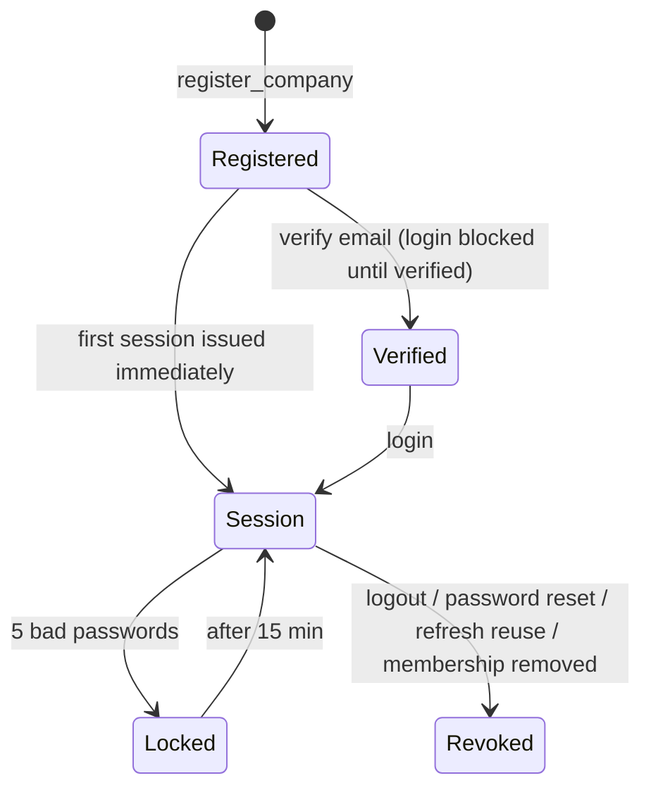
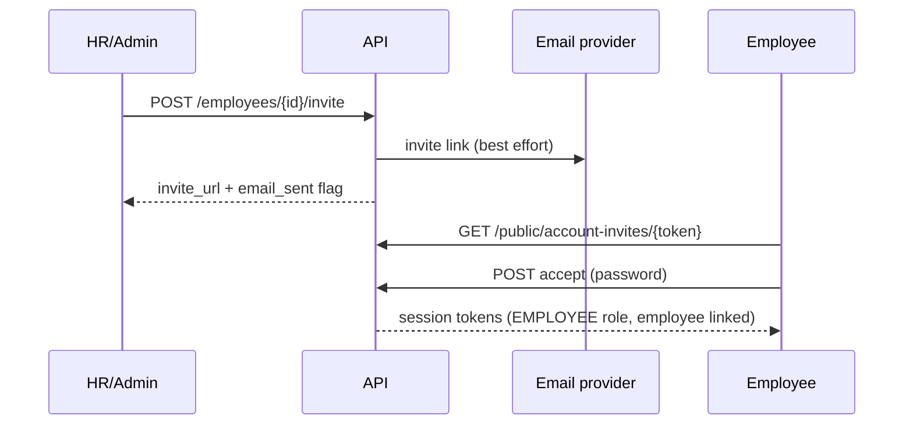

# Module 01 — Platform: Identity, Roles & Permissions, Tenancy, Security and Shared Services

> Part of [Staff Spectrum HRMS Functional Documentation](../STAFF_SPECTRUM_HRMS_FUNCTIONAL_DOCUMENTATION.md) · [Module catalog](../STAFF_SPECTRUM_HRMS_MODULE_CATALOG.md) · [Workflow catalog](../STAFF_SPECTRUM_HRMS_WORKFLOW_CATALOG.md) · [Gaps](../STAFF_SPECTRUM_HRMS_FUNCTIONAL_GAPS.md)

**Covers:** company self-registration entry (the tenant boundary), login / sessions / password reset / email verification, the user-account invitation flow and user-role assignment (`account_invite`), the permission & data-scope model, row-level-security tenancy, audit log, idempotency, rate limiting, upload guards, PII encryption, email delivery, health endpoints.

**Status:** Implemented and verified (identity: auth flows covered by `tests/unit/core/*`, integration tests under `tests/integration/modules/account_invite` and the platform tests); **no UI for role editing, audit-log viewing, tenant switching, or user deactivation** (see §9).

---

## 1. Overview

### 1.1 Tenant model
* One **company** (tenant) per registration; every business row carries `company_id` and PostgreSQL **row-level security** (RLS) policies filter by the session variable `app.company_id`, set per request after the tenant context is verified (`core/tenancy/dependencies.py::get_tenant_context`, `core/db/session.py::set_rls_company_id`).
* A **user** (global email) may belong to several companies through `user_company` memberships (status `ACTIVE|INACTIVE`), each carrying its own roles. Login picks the **primary** membership unless `company_id` is supplied in the login body. **No company-switcher UI was found in web or mobile** (`apps/web/src/components/layout/company-context.tsx` only displays the active company name).
* Tenant isolation checks: the `X-Company-Id` request header, if sent, must equal the company bound in the access token (otherwise a 404 "Resource not found" + security log). A user whose membership is not `ACTIVE` is rejected. Cross-tenant IDs return 404 rather than 403.
* Product rule: initially **one legal entity ("Company" in the nav) per tenant** (`max_legal_entities_per_company = 1`; `0` removes the cap); any number of branches under it. Evidence: `core/config/settings.py`, `OrganisationService.create_legal_entity`.

### 1.2 Subscription / plans (limited)
Plans `FREE` (5 employee seats), `STARTER` (25), `PROFESSIONAL` (100), `ENTERPRISE` (unlimited) are seeded (`seed/plan_catalogue.py`). A new company starts on `FREE` with a `TRIALING` subscription, `trial_ends_at = now + 14 days`, company `status = TRIAL`. **The only enforced entitlement is `EMPLOYEE_SEATS`** (checked on employee create and reactivate; counts active employees). Per-company feature flags (`company_feature_flag`) are read when resolving the subscription summary but **no code gates any feature on them**, and **nothing enforces trial expiry, billing, or plan change** (no endpoint changes plan/status; `SUSPENDED` company status only blocks company-profile edits). There is no billing integration.

---

## 2. Roles and permissions

### 2.1 Roles
Five system roles are created per company at registration (`organisation/service.py::register_company`) and are the only assignable roles (`account_invite/service.py::ASSIGNABLE_ROLE_CODES`):

| Role code | Name | Created with |
|---|---|---|
| `COMPANY_ADMIN` | Company Administrator | **every** permission (72 codes in the dev DB) at `COMPANY` scope; assigned to the registering user |
| `HR_ADMIN` | HR Administrator | 32 grants — all `EMPLOYEE.*` (COMPANY), leave admin (approve, cancel-approved, reassign, adjust, view-all, submit-on-behalf), attendance **approve** (regularization & overtime), payroll `SETUP_MANAGE`, `RUN_VIEW`, `RUN_PROCESS`, `STATUTORY_MANAGE` |
| `REPORTING_MANAGER` | Reporting Manager | 5 grants at `REPORTEE_TREE`: `EMPLOYEE.VIEW`, `LEAVE.APPLICATION_APPROVE`, `LEAVE.BALANCE_VIEW_ALL`, `ATTENDANCE.REGULARIZATION_APPROVE`, `ATTENDANCE.OVERTIME_APPROVE` |
| `BRANCH_MANAGER` | Branch Manager | 7 grants at `BRANCH`: `EMPLOYEE.VIEW`, `EMPLOYEE.VIEW_ALL`, `ATTENDANCE.VIEW`, plus the same four approve/view-all grants as the manager |
| `EMPLOYEE` | Employee | 11 grants at `SELF`: `EMPLOYEE.VIEW`, `…VIEW_BANKING/COMPENSATION/DOCUMENTS/EXPERIENCE/NOMINEE/SENSITIVE/STATUTORY`, `LEAVE.APPLICATION_SUBMIT`, `LEAVE.BALANCE_VIEW`, `PAYROLL.PAYSLIP_VIEW_OWN` |

(Counts verified against the dev database's `role_permission` rows for the most recently registered tenant and the register code. Older tenants were backfilled by migrations and may differ slightly — e.g. the face-enrolment migration also gave `HR_ADMIN` `ATTENDANCE.FACE_ENROLLMENT_MANAGE` for tenants that existed then.)

**Role = permission set + data scope per permission**, stored in `role_permission(role_id, permission_id, data_scope)`. Data scope levels: `SELF`, `REPORTEES` (direct reports), `REPORTEE_TREE` (all downline), `BRANCH` (colleagues sharing the holder's current branch assignment), `COMPANY`. Scope is resolved by the consuming module (`EmployeeService.resolve_visible_employee_ids`): union of granted levels; `COMPANY` short-circuits to no filter; an empty result fails closed. A user with **no linked Employee record** (e.g. the registering admin) gets only company-wide grants; non-company scopes resolve to nothing.

### 2.2 Cross-module permission matrix (defaults)
| Domain | Employee | Reporting Mgr | Branch Mgr | HR Admin | Company Admin |
|---|---|---|---|---|---|
| Employee records (list/view) | self only | reportee tree (view single) | branch (list+view) | company | company |
| Employee create/update/terminate/transfer/promote/compensation/sensitive/bulk import/invite/confirm | ✘ | ✘ | ✘ | ✔ | ✔ |
| Organisation setup (company, entity, branch, dept, designation, grade, shift, calendars, holidays) | ✘ | ✘ | ✘ | **✘** | ✔ |
| Onboarding (create/review/activate/cancel) | ✘ | ✘ | ✘ | **✘** (`ONBOARDING.*` not granted to HR_ADMIN by `register_company`) | ✔ |
| Users & roles (`SETTINGS.USER.MANAGE`, `SETTINGS.ROLE.MANAGE`) | ✘ | ✘ | ✘ | ✘ | ✔ |
| Leave / Attendance / Payroll | see module docs | | | | |
| Company dashboard (`DASHBOARD.COMPANY.VIEW`) | ✘ | ✘ | ✘ | **✘** | ✔ |

**Findings (verified):**
* **PL-1** HR Admin has no `ORG.*`, `ONBOARDING.*` or `DASHBOARD.COMPANY.VIEW` grant, so by default HR Admin cannot create branches/departments/designations/shifts, start or review onboarding cases, or open the company dashboard (the web landing logic sends non-dashboard users to `/app/me`). Evidence: live `role_permission` rows + `register_company`. *Potential consequence (not reproduced):* HR forms that list branches/departments/designations for employee assignment call `ORG.*`-gated list endpoints.
* **PL-2** Employee role lacks all `ATTENDANCE.*` permissions (see Attendance module A-1).
* **PL-3** The product has **no role-editing UI or API**; role permission sets are fixed in code and in the database. Assignment is a full replace among the five codes via `PATCH /users/{user_id}/roles` (`SETTINGS.ROLE.MANAGE`); changing **your own** roles is blocked (`SELF_ROLE_CHANGE_NOT_ALLOWED`); at least one role is required. There is no "last admin" guard other than that self-change rule.

### 2.3 Separation of duties found in the platform
Cannot approve own leave / regularization / overtime / face profile; payroll maker≠checker; self role-change blocked; invite acceptance for an existing account requires the existing password (SEC-08).

---

## 3. Screens (web / mobile)
Public: `/` (landing redirect), `/login`, `/register`, `/forgot-password`, `/reset-password/[token]`, `/verify-email/[token]`, `/accept-invite/[token]`, `/onboarding/[token]` (candidate wizard — see Onboarding). Authenticated: `/app/**` layout guard redirects to `/login`; `/app/settings` hub; `/app/users` (user list, invite, role assignment — `SETTINGS.USER.MANAGE`/`ROLE.MANAGE`); `/app/setup` (setup progress); `/app/me` (profile). Mobile mirrors: Splash, Login, Register, Forgot/Reset password, Verify email, Accept invite, public onboarding, "More"/Settings hub, Users, Setup. Web navigation is **not permission-filtered** (every user sees the same sidebar) — pages call `usePermissions().can(...)` to hide actions/render 403 states; the API is the authority.
Landing after login: `DASHBOARD.COMPANY.VIEW` → `/app/dashboard`; else linked employee → `/app/me`; else dashboard.

---

## 4. Features

### 4.1 Company registration (`POST /companies/register`, public, rate-limited 10/min/IP)
**Inputs:** `name`, optional `industry_code`, `country_code` (default IN), `currency` (default INR), `timezone` (default `Asia/Kolkata`; must be in `allowed_company_timezones`, default only `Asia/Kolkata`), `fy_start_month` (1–12, default 4), optional `company_size` band, admin first/last name, admin email (must be globally unused), admin password.
**Rules:** password 8–`PASSWORD_MAX_LENGTH` chars, at least one letter and one digit, not in the bundled common-password list (no special-character rule, no forced rotation — by design). 
**System:** creates user, company (`status=TRIAL`, `trial_ends_at` +14 d, `version=1`), primary membership, all permissions (idempotent `get_or_create`), the five roles and grants, assigns `COMPANY_ADMIN`, setup progress row, FREE trial subscription, audit `COMPANY_REGISTERED`, issues tokens (immediate session, no email check), then emails a verification link (best effort).
**Not created:** legal entity, branches, leave/attendance policies, calendars, shifts — everything must be set up by the admin (the "Setup" screen tracks one step only: company profile completeness).
Public helper `GET /companies/registration-config` returns the allowed timezones.

### 4.2 Login, tokens and sessions
* `POST /auth/login {email, password, company_id?}` (rate-limited 10/min per IP **and** per email). Failure responses are identical (`INVALID_CREDENTIALS`) for: unknown email, wrong password, inactive account, no membership, non-member company. **5 consecutive failures lock the account for 15 minutes** (`ACCOUNT_LOCKED`). **Login is refused until the email is verified** (`EMAIL_NOT_VERIFIED`) — checked after the password is confirmed — except that registration and invite-acceptance issue a session directly.
* **Access token:** JWT, 15 minutes (`jwt_access_ttl_minutes`), claims `sub`, `company_id`, `session_id`, `employee_id`. Every request re-checks user status, session not revoked, membership active (so logout, deactivation and membership removal take effect immediately).
* **Refresh:** 30 days (`jwt_refresh_ttl_days`), opaque token stored hashed, delivered to browsers as an **HttpOnly cookie `hrms_refresh`** (path-scoped to `/v1/auth`); the mobile app keeps it in a persisted cookie jar. Rotation on each use; **re-use of a rotated token revokes the whole family and the session** (`security.refresh_token_reuse_detected`). Refresh rechecks session/user/membership.
* `POST /auth/logout` revokes the session and its refresh tokens. `GET /auth/me` returns user, company id, employee id, **flat permission list** and company timezone.
* Web stores the access token + metadata in `localStorage`; refresh happens on 401 with a cross-tab single-flight lock; mobile uses secure storage.

### 4.3 Password reset
`POST /auth/password/forgot` always answers 202 (no account enumeration); for an active user emails a single-use link valid **2 hours**. `POST /auth/password/reset {token, password}` validates strength, sets the password, **revokes every session of the user in every company**, marks the token used. No audit row (no company context).

### 4.4 Email verification
Registration emails a link valid **24 hours**; `POST /auth/email/verify`; `POST /auth/email/resend-verification` (202 always). Accepting an account invite marks the email verified.

### 4.5 Account invitations and user management (`account_invite`)
| Action | Endpoint | Permission | Notes |
|---|---|---|---|
| Invite an existing employee | `POST /employees/{id}/invite` | `EMPLOYEE.INVITE` | Employee must have **no linked account** and a `personal_email`; role forced to `EMPLOYEE`; invite is emailed to the personal email |
| Invite a non-employee user (second admin / HR) | `POST /users/invite {email, role_code}` | `SETTINGS.USER.MANAGE` | role ∈ 5 codes; no Employee record required |
| List users of the company | `GET /users` | `SETTINGS.USER.MANAGE` | email, names, status, role codes |
| Replace a user's roles | `PATCH /users/{user_id}/roles` | `SETTINGS.ROLE.MANAGE` | see PL-3 |
| Preview invite | `GET /public/account-invites/{token}` | public | shows email, company, expiry, `existing_account` |
| Accept invite | `POST /public/account-invites/{token}/accept {password, first_name?, last_name?}` | public, rate-limited | see below |
Invite token: random 32-byte url-safe, SHA-256 stored, **TTL 7 days**; a new invite revokes live ones for the same employee/email; every invalid/expired/used/revoked token gives the same 404. Accept: row-locked; if the email already has an account, the **existing password is required** (verified with the same lockout) and a second membership (non-primary) is added (`USER_ALREADY_IN_COMPANY` if already a member); otherwise a new user is created (password strength check, email auto-verified), a membership + the role are created, the employee is linked (`Employee.user_id`), invite marked accepted, tokens issued (audit `ACCOUNT_INVITE_ACCEPTED`). Onboarding activation auto-issues an employee invite (best-effort, in a savepoint).
**No user deactivation / removal endpoint exists** except employee deactivation (`DELETE /employees/{id}`), which sets the membership inactive and revokes sessions, and termination, which ends access (see Employee module). Non-employee users (second admin) cannot be deactivated through the product.

### 4.6 Audit log
Every business mutation writes `audit_log(company_id, actor_user_id, action, entity_type, entity_id, before_json, after_json, ip, user_agent, request_id)` in the same transaction; a slim operational event is also emitted after commit (identifiers and status transition only). **There is no API or UI to read the audit log** (no route in any router); it is available only through direct database access. PII is redacted by `core/audit/redact.py`; leave audit rows deliberately avoid free text.

### 4.7 Concurrency and idempotency primitives
* Optimistic concurrency: `version` column + `If-Match` on most mutations; stale → 409 `STALE_RESOURCE` with current state.
* `Idempotency-Key` header (8–128 chars `[A-Za-z0-9._:-]`) required on leave application submit, leave ledger adjustment/encashment; stored per (company, operation, key) with a payload fingerprint; same key + same payload replays the stored response; different payload → 409 `IDEMPOTENCY_KEY_CONFLICT`; failed attempts do not poison a key (`core/idempotency.py`). Punches and face punches carry their own keys.

### 4.8 Rate limits and abuse controls
Login 10/min per IP and per email; refresh 10/min; password/auth endpoints 10/min/IP; email verification 10/min; registration 10/min; public onboarding upload 30/min/IP and 10/min/token (Redis sliding window; if Redis is down the call returns `RATE_LIMITER_UNAVAILABLE` 503). Global setting `rate_limit_max=100/min` exists. Security headers middleware; trusted-proxy-aware client IP; request-id echo.

### 4.9 Uploads and storage
Object storage is S3-compatible (self-hosted MinIO in the production compose); files are accepted only by **content sniffing** (type derived from bytes, not the client header), size caps enforced by middleware before parsing: onboarding documents and employee documents 10 MB (+2 MB overhead), employee-import CSV 5 MB (+1 MB), face enrolment 5 images, face punch frames. Presigned GET URLs are short-lived. Document download disposition is forced to attachment. No antivirus scanning (explicitly out of scope in code comments).

### 4.10 PII encryption
`pan_number_enc`, `aadhaar_number_enc`, `employee_bank.account_number_enc`, dependent Aadhaar and the same keys inside onboarding JSON are AES-GCM encrypted with a per-record AAD (table, column, record id), using DEKs wrapped by an application master key (`PII_MASTER_KEY`; AWS KMS was removed); decrypted only inside permission-checked service methods. `Employee.uan_number` and statutory ids are stored in plain text. Development uses a fixed dev key; non-development refuses to boot with default secrets (`_guard_non_development_config`).

### 4.11 Email delivery
Providers: `logging` (default; **refuses to boot staging/production**), `smtp`, `mailtrap` (HTTP API), `hostinger` (HTTP API). Sent emails: company-admin email verification, password reset, onboarding invite / changes-requested / activated, account invite, attendance incomplete-day reminders (employees + HR digest). All sends are best-effort: failure is logged and never fails the request (the API response flags `email_sent=false` for invites; the invite URL is returned so HR can copy it). **No retry queue, delivery-status tracking, templates editor, or notification centre.** In-app and push notifications: **not implemented** (no code; mobile has no push dependency).

### 4.12 Health and operations endpoints
`GET /health` (database ping), `GET /health/live` (process only; used by Docker `HEALTHCHECK`), `GET /health/ready` (Postgres + Redis + storage configured; 503 when not ready). Details in [Operations module](10_OPERATIONS_AND_DEPLOYMENT.md).

---

## 5. Rules summary
| Rule | Value |
|---|---|
| Password | 8+ chars, letter + digit, not in common list; no max-age |
| Lockout | 5 failures → 15 min |
| Access / refresh TTL | 15 min / 30 days |
| Reset link / verify link / invite link TTL | 2 h / 24 h / 7 d |
| Trial | 14 days (not enforced) |
| Seat limit | FREE 5, STARTER 25, PROFESSIONAL 100, ENTERPRISE ∞ (enforced on employee create/reactivate) |
| Cross-tenant access | 404 |
| Roles | 5 fixed codes |

## 6. Lifecycles

## 7. Data
`company`, `user` (global email, password hash, status, failed_login_count, locked_until, email_verified_at), `user_company`, `role`, `permission` (code, domain), `role_permission(data_scope)`, `user_role`, `session`, `refresh_token` (hashed, family id), `password_reset_token`, `email_verification_token`, `account_invite`, `audit_log`, `idempotency_key`, `encryption_key` registry, `plan`, `plan_feature`, `subscription`, `company_feature_flag`, `company_setup_progress`. Sensitive: password hashes, tokens (hashed), audit before/after JSON (redacted).

## 8. Integrations and automation
Email providers (above); object storage; Redis (rate limiting, Celery broker/result, scheduler heartbeat); Celery worker + beat (see each module's job list); optional Face++ and local ONNX liveness. Configuration of note: `ENVIRONMENT`, `DATABASE_URL`, `REDIS_URL`, `JWT_*`, `PII_MASTER_KEY`, `EMAIL_PROVIDER`+provider credentials, `WEB_APP_BASE_URL`, `S3_*`, `ALLOWED_COMPANY_TIMEZONES`, `TRUSTED_PROXY_HOSTS`, `CORS_ALLOWED_ORIGINS`, `MAX_LEGAL_ENTITIES_PER_COMPANY`. Values are never reproduced here.

## 9. Edge cases and limitations
| # | Finding | Type |
|---|---|---|
| PL-1 | HR Admin default role lacks ORG/ONBOARDING/dashboard grants. | Verified |
| PL-2 | Employee role lacks ATTENDANCE grants. | Verified |
| PL-3 | No role editor; only 5 fixed roles; no multi-branch manager scope; no DEPARTMENT/LEGAL_ENTITY scope levels. | Verified |
| PL-4 | No audit-log read API/UI. | Verified |
| PL-5 | No user deactivation/removal for non-employee users; no company switcher; no "last admin" safeguard beyond self-role-change block. | Verified |
| PL-6 | Trial expiry, plan upgrade, billing, feature-flag gating: not implemented (only seat limit). | Verified |
| PL-7 | No retry/delivery tracking for email; no in-app/push notifications. | Verified |
| PL-8 | `/auth/admin/users-check` is a permission-probe endpoint with no UI. | Verified (backend-only) |
| PL-9 | Employee login identity is `personal_email` (no separate work-email field). | Verified |
| PL-10 | Password-reset audit not written (no company context). | Verified |
| PL-11 | Web nav not permission-filtered; users may click into pages that show 403 states. | Verified |
| PL-12 | Registration issues a session before email verification; later logins are blocked until verified. | Verified |

## 10. Acceptance criteria
1. Register with valid data → 201 + token pair; five roles exist; registering user holds `COMPANY_ADMIN`; subscription FREE/TRIALING; weak or common password → 422 `WEAK_PASSWORD`; duplicate email → 409.
2. 5 wrong passwords → 6th attempt (even with the right password) → `ACCOUNT_LOCKED` for 15 min.
3. Login before email verification → `EMAIL_NOT_VERIFIED`; after verify → success.
4. Re-using a rotated refresh token → 401 and the whole family/session revoked.
5. Password reset revokes all sessions; reused/expired token → generic invalid error.
6. Invite for an employee with no personal email → `EMPLOYEE_MISSING_EMAIL`; for one already linked → `EMPLOYEE_ALREADY_HAS_ACCOUNT`; accept with a weak password (new user) → `WEAK_PASSWORD`; accept for an existing account with a wrong password → `INVALID_CREDENTIALS`.
7. `PATCH /users/{self}/roles` → `SELF_ROLE_CHANGE_NOT_ALLOWED`; unknown role code → `INVALID_ROLE_CODE`; empty list → rejected.
8. Another tenant's resource ID → 404; `X-Company-Id` different from token → 404.
9. 6th employee on FREE plan → `EMPLOYEE_SEAT_LIMIT_EXCEEDED`.
10. `Idempotency-Key` replay returns the same body; different payload with same key → 409.

## 11. Evidence
`apps/api/src/hrms/core/{auth,rbac,tenancy,db,audit,crypto,errors,observability,idempotency.py,uploads.py,storage.py,celery_app.py,config/settings.py}`, `modules/identity/*`, `modules/account_invite/*`, `modules/organisation/service.py::register_company`, `seed/{bootstrap,plan_catalogue}.py`, migrations `20260803200000_b1_auth_audit`, `20260807160000_plan_and_plan_feature`, `…170000_subscription`, `…180000_company_feature_flag`, `20260815120000_role_permission_data_scope`, `20260920090000_default_roles_backfill`, `20260921090000_account_invite`, `20260922090000_password_reset_token`, `20261004112000_email_verification`, `20261011090000_idempotency_key`, `20260927090000_encryption_key_registry`. Tests: `apps/api/tests/unit/core/*`, `tests/unit/shared/*`, `tests/integration/modules/account_invite/*`, `tests/integration/modules/organisation/*`. Web: `lib/auth/*`, `lib/api/client.ts`, `middleware.ts` (CSP with per-request nonce). Mobile: `lib/core/auth/*`, `lib/features/auth/*`. Design: `docs/architecture/RBAC_DATA_SCOPE_DECISIONS.md`, `docs/security/Auth_Architecture.md`, `docs/product/19_RBAC_and_Permission_Matrix.md`.
