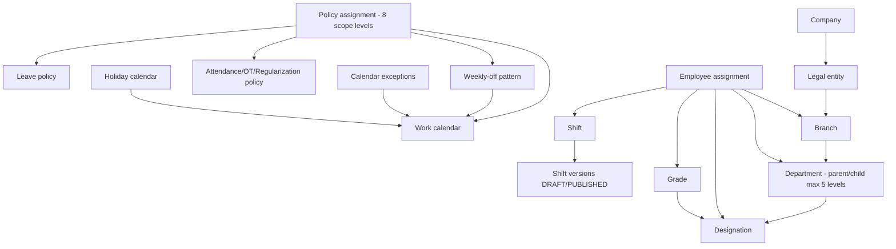

# Module 02 — Organisation & Workforce Calendar Configuration

> Part of [Staff Spectrum HRMS Functional Documentation](../STAFF_SPECTRUM_HRMS_FUNCTIONAL_DOCUMENTATION.md) · [Catalog](../STAFF_SPECTRUM_HRMS_MODULE_CATALOG.md) · [Workflows](../STAFF_SPECTRUM_HRMS_WORKFLOW_CATALOG.md) · [Gaps](../STAFF_SPECTRUM_HRMS_FUNCTIONAL_GAPS.md)

**Status:** Implemented and verified (23 integration + 11 unit test files under `tests/*/modules/organisation`). Web UI present for every entity; mobile via generic resource screens. Some company-profile fields are stored but not consumed (§9).

## 1. Overview
Defines the master data every other module reads: **Company profile, Legal entity ("Companies" in the nav), Branch, Department (hierarchy), Designation, Grade, Shift (versioned), Holiday calendars + holidays, Weekly-off patterns, Work calendars (+ exceptions), Policy assignments** (one shared assignment mechanism for work calendar, weekly off, attendance/overtime/regularization and leave policies), plus the **company dashboard** and **setup progress**. Registration/subscription/plan live in [Platform](01_PLATFORM_IDENTITY_RBAC.md).

## 2. Roles and permissions
All org entities are guarded by one **manage** permission each (view and manage are the same code): `ORG.COMPANY.MANAGE`, `ORG.LEGAL_ENTITY.MANAGE`, `ORG.BRANCH.MANAGE`, `ORG.DEPARTMENT.MANAGE`, `ORG.DESIGNATION.MANAGE`, `ORG.GRADE.MANAGE`, `ORG.SHIFT.MANAGE`, `ORG.CALENDAR.MANAGE` (work calendars, weekly-off, exceptions, policy-assignment preview/resolution), `ORG.HOLIDAY.MANAGE`, `DASHBOARD.COMPANY.VIEW`. Default holder: **Company Admin only**; HR Admin, managers and employees hold none (Platform finding PL-1). Policy assignments: `ORG.CALENDAR.MANAGE` for `WORK_CALENDAR`/`WEEKLY_OFF`; `ATTENDANCE.POLICY_MANAGE` for attendance/overtime/regularization policy; any other kind (incl. `LEAVE_POLICY`) or an unfiltered list needs **both**. `GET /leave-types`-style read access for submitters exists in Leave, not here.

## 3. Screens
Web: `/app/company` (profile), `/app/legal-entities`(+`/[id]`), `/branches`, `/departments`, `/designations`, `/grades`, `/shifts`(+`/[id]` version editor), `/holiday-calendars`(+`/[id]` holidays), `/weekly-off-patterns`, `/work-calendars`(+`/[id]` composition, exceptions, day-type lookup), `/policy-assignments`, `/policy-resolution`, `/app/dashboard`, `/app/setup`. All under Settings except dashboard. Mobile: `CompanyProfileScreen`, `DayTypeLookup`, generic `ResourceListScreen` for branch/department/designation/grade/legal-entity/shift/holiday-calendar/weekly-off/work-calendar, policy assignment and resolution screens. List endpoints for these entities return all rows (no server pagination except policy assignments).

## 4. Features and rules
**Company profile** (`GET/PATCH /companies/current`, `If-Match`): name, legal name, registration number, industry, size, country, currency, timezone, contact, address, locale, fiscal year, working days, business hours, branding. Rules: edits blocked when company `SUSPENDED` (`LOCKED`); **currency can change only while status is `TRIAL`**; **timezone change blocked once any computed attendance exists** (`TIMEZONE_CHANGE_BLOCKED`); timezone must be in the allow-list (default only `Asia/Kolkata`); at least one working day (`INVALID_WORKING_DAYS`). Audit `UPDATED`.
**Setup progress** (`GET /companies/current/setup-progress`): a single step "Company Profile" (complete when profile fields are filled); completing it sets `onboarded_at`. It is a hint, never a gate.
**Subscription summary** (`GET /companies/current/subscription`): plan, status, trial end, seat limit (override > plan), effective feature flags. **Dashboard** (`GET /dashboards/company`): setup progress, subscription block, counts of branches, departments, employees (the web/mobile dashboards add more from other APIs).
**Legal entity:** name, registered address, PAN, TAN, CIN, GSTIN, PF code, ESI code, LWF reg, signatory name/designation/signature URL. Tenant cap `max_legal_entities_per_company` (default 1 → `COMPANY_LIMIT_REACHED`). Cannot deactivate while active branches exist. Payroll runs and attendance periods are per legal entity; payslip header uses its PAN/TAN.
**Branch:** legal entity (required, same tenant), name, code, address, optional own timezone, latitude/longitude/geofence radius (**stored only**). Deactivation blocked by active departments and by active employees assigned. Timezone change guarded like the company's, for every employee ever assigned there.
**Department:** optional branch, optional parent (cycle → `DEPARTMENT_CYCLE_DETECTED`; depth > 5 → `DEPARTMENT_MAX_DEPTH_EXCEEDED`), name, code, `head_employee_id` (must be an existing employee; used as **HOD approver** in Leave). Deactivation blocked while active employees are assigned (`MASTER_DATA_HAS_ACTIVE_EMPLOYEES`); sub-departments do not block.
**Designation:** title, code, optional department and grade. **Grade:** unique code, name, level, min/max CTC (minor units; `INVALID_CTC_RANGE` if min > max), notice period days, probation days, approval limit — **notice/probation/approval limit are stored but no code reads them** (probation end date is entered per employment). Both block deactivation while in use.
**Shift / ShiftVersion:** creating a shift also creates an empty DRAFT version. Types FIXED / FLEXIBLE / SPLIT, breaks, duty blocks, flags (`is_night_shift`, `is_ot_eligible`, `operates_on_holiday`, `operates_on_weekly_off`), optional weekly-off pattern, timezone. Publish validations in [Attendance §4.3](06_ATTENDANCE.md); the publish date must lie in an **open attendance period**; new `effective_from` must be after the previous published version's; previous version closed day-before; one open draft per shift; published versions are immutable. Legacy columns on `shift` are frozen placeholders.
**Holiday calendar:** name, code, kind `NATIONAL|REGIONAL|COMPANY|LOCATION`, state, validity range. **Holiday:** date (unique per calendar → `HOLIDAY_DATE_ALREADY_EXISTS`), name, type `PUBLIC|COMPANY|OPTIONAL|RESTRICTED|WORKING_HOLIDAY`, `is_paid`, `is_working`, optional replaced holiday. No bulk import and no per-year copy feature found.
**Weekly-off pattern:** kind `FIXED_WEEKDAYS` (weekday only), `NTH_WEEKDAY` (`nth_in_month` 1–n or −1 for last; required), `ALTERNATE` (`cycle_start_date`, `week_parity` EVEN/ODD default EVEN), `CUSTOM` (any combination); per-rule `off_fraction` (1.00 full, 0.50 half day); if several rules match a date the largest fraction wins.
**Work calendar:** optional weekly-off pattern + ordered holiday calendars + `restricted_holidays_are_off_by_default` (default false: optional/restricted holidays are working days). Cannot be deactivated while assigned. **Calendar exception** (one per date): `SPECIAL_WORKING`, `SHUTDOWN`, `SUBSTITUTE_HOLIDAY`, `CANCEL_HOLIDAY`; corrected by deactivate-and-recreate.
**Day-type classification** (`classify_work_calendar_date`): exception > holiday union (first calendar wins) > weekly off > WORKING. Results: `WORKING`, `SPECIAL_WORKING`, `HOLIDAY`, `WEEKLY_OFF` (+fraction, + flag when a holiday lands on a weekly off — it stays WEEKLY_OFF, no auto-substitution), `SHUTDOWN`. WORKING_HOLIDAY → working; OPTIONAL/RESTRICTED → working unless the calendar flag says otherwise.
**Policy assignment:** `policy_kind` ∈ `WORK_CALENDAR, WEEKLY_OFF, ATTENDANCE_POLICY, OVERTIME_POLICY, REGULARIZATION_POLICY, LEAVE_POLICY`; scope ∈ `COMPANY, LEGAL_ENTITY, BRANCH, DEPARTMENT, GRADE, DESIGNATION, SHIFT, EMPLOYEE` (`scope_id` required except COMPANY); `leave_type_id` required iff LEAVE_POLICY; insert-new/close-previous (needs `If-Match` when an open assignment exists at the same scope; `effective_from` must be later). **Resolution** (`resolve_policy_assignment`) walks EMPLOYEE > SHIFT > DESIGNATION > GRADE > DEPARTMENT > BRANCH > LEGAL_ENTITY > COMPANY using the employee's assignment on the date; no match → "config incomplete" and consumers **fail closed** (attendance `CONFIG_ERROR`, leave `POLICY_NOT_RESOLVED`). `GET /calendar-resolution` and `/attendance-policy-resolution` preview this.
Audit actions are written for every create/update/deactivate. All deactivations are soft (`is_active=false`), never hard deletes; every PATCH requires `If-Match`.

## 5. Calculation/lifecycle notes
* Weekly-off match: weekday equal; if `nth_in_month` → nth occurrence `(day−1)//7+1` (−1 = last: `day+7 > days_in_month`); if `cycle_start_date` → `weeks_since = (date−cycle_start).days//7`, parity EVEN when even.
* Shift/policy versions: DRAFT → PUBLISHED (immutable) with `effective_to` auto-set on supersession.
* Timezone precedence: shift version > branch > company.

## 6. Data
`company`, `company_setup_progress`, `plan`, `plan_feature`, `subscription`, `company_feature_flag`, `legal_entity`, `branch`, `department`, `designation`, `grade`, `shift`, `shift_version`, `shift_break`, `shift_duty_block`, `holiday_calendar`, `holiday`, `weekly_off_pattern`, `weekly_off_rule`, `work_calendar`, `work_calendar_holiday_calendar`, `calendar_exception`, `policy_assignment`. Money in minor units. No personal data except legal-entity statutory identifiers and signatory.

## 7. Automation
None (no jobs). Timezone-change guard and in-use checks call Attendance/Employee services synchronously.

## 8. Limitations
| # | Finding |
|---|---|
| O-1 | Company `working_days`, `business_hours`, fiscal-year month, locale/date format are stored and editable but **no module outside Organisation reads them** (search of `apps/api/src`); day classification uses work calendars only. |
| O-2 | Branch geofence/lat-long stored, never enforced. Grade notice/probation/approval limit and designation `next_designation_id` unused. |
| O-3 | Trial/plan/feature flags: see Platform PL-6. |
| O-4 | HR Admin cannot manage any org entity by default (PL-1). |
| O-5 | One legal entity per tenant by default (config). |
| O-6 | Department deactivation does not cascade to or check children/designations. |
| O-7 | Holiday calendars have no import/copy-forward tooling. |

## 9. Acceptance criteria
Create department with parent chain of depth 6 → `DEPARTMENT_MAX_DEPTH_EXCEEDED`; set parent to own descendant → `DEPARTMENT_CYCLE_DETECTED`; deactivate branch with active department → `BRANCH_HAS_ACTIVE_DEPARTMENTS`; deactivate grade in use → `MASTER_DATA_HAS_ACTIVE_EMPLOYEES`; change company currency when `ACTIVE` → `CURRENCY_LOCKED`; change timezone after attendance exists → `TIMEZONE_CHANGE_BLOCKED`; second legal entity with default cap → `COMPANY_LIMIT_REACHED`; duplicate holiday date → conflict; stale `If-Match` → 409; day-type for a date with `CANCEL_HOLIDAY` exception ignores the holiday; two policy assignments same scope without `If-Match` → version required; overlapping dates → `POLICY_ASSIGNMENT_OVERLAP`.

## 10. Evidence
`apps/api/src/hrms/modules/organisation/{router,service,calendar_resolution,repository,schemas,models,permissions,exceptions}.py`; migrations `20260807140000…20260819130000`, `20260813120000…20260819`; tests `tests/integration/modules/organisation/*`, `tests/unit/modules/organisation/*` (incl. `test_calendar_resolution.py`); web `app/app/{company,legal-entities,branches,departments,designations,grades,shifts,holiday-calendars,weekly-off-patterns,work-calendars,policy-*}`; mobile `lib/features/organisation/**`. Docs: `docs/modules/{company,branch,department,designation,grade,legal-entity,shift-rules,shift-version}/`, `docs/architecture/WORKFORCE_ATTENDANCE_ARCHITECTURE.md`.
