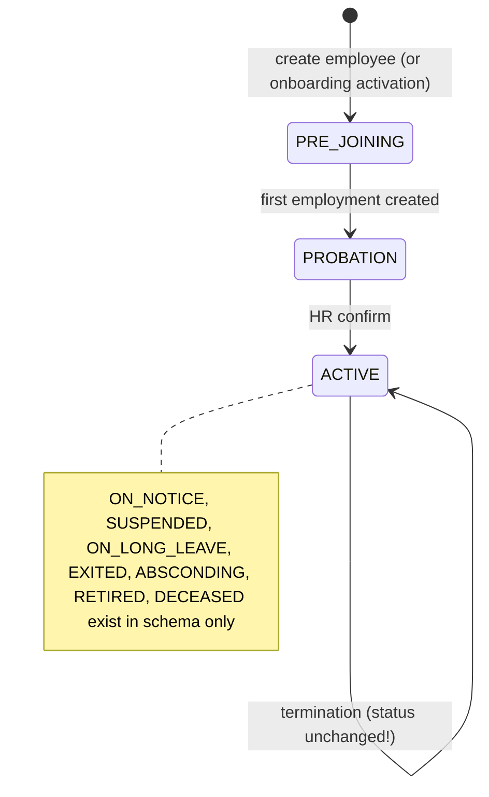
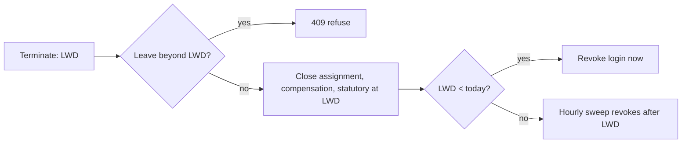

# Module 03 — Employee Lifecycle & Records

> Part of [Staff Spectrum HRMS Functional Documentation](../STAFF_SPECTRUM_HRMS_FUNCTIONAL_DOCUMENTATION.md) · [Catalog](../STAFF_SPECTRUM_HRMS_MODULE_CATALOG.md) · [Workflows](../STAFF_SPECTRUM_HRMS_WORKFLOW_CATALOG.md) · [Gaps](../STAFF_SPECTRUM_HRMS_FUNCTIONAL_GAPS.md)

**Status:** Implemented and verified for CRUD, employment/assignment/compensation/statutory/bank history, termination and access revocation (15 integration + 9 unit test files). **Partially implemented:** employee status lifecycle (only `PRE_JOINING → PROBATION → ACTIVE` ever occurs), offboarding (no exit workflow, F&F, notice period), search/filter on the list API.

## 1. Overview
The employee record is split into a permanent identity and several **effective-dated** histories, so past payroll/attendance can be reproduced:

| Record | Purpose | History model |
|---|---|---|
| `employee` | permanent identity (code, names, DOB, gender, contacts, addresses, emergency contact, PAN/Aadhaar (encrypted), UAN, status, `user_id` login link) | single row, `version` |
| `employment` | one continuous spell at a legal entity: joining date, probation end date, last working day, pay basis (`MONTHLY`/`DAILY_WAGE`), status `ACTIVE`/`TERMINATED` | new row per rehire (`previous_employment_id`), GiST no-overlap |
| `employee_assignment` | branch, department, designation, grade, reporting manager, dotted-line manager, shift, work-location type (`OFFICE`… default), change type (`INITIAL`, `TRANSFER`, `PROMOTION`, `MANAGER_CHANGE`, `SHIFT_CHANGE`) | insert-new/close-previous |
| `employee_compensation` | annual CTC (minor units), currency, revision type/reason | same |
| `employee_statutory` | PF/VPF/ESI/PT state/LWF applicability, PF & ESI numbers, tax regime, director/international flags | same |
| `employee_bank` | account holder, encrypted account number, IFSC, bank, payment mode, verification status | same |
| `employee_experience`, `employee_education`, `employee_dependent` (PF/gratuity nominees with %, ESI dependants, minor/guardian), `employee_document` | supporting data | append / soft delete |

Codes are generated from a per-company number series (`number_series`); bulk import can supply its own code. `employee.status` values (CHECK): `PRE_JOINING, PROBATION, ACTIVE, ON_NOTICE, SUSPENDED, ON_LONG_LEAVE, EXITED, ABSCONDING, RETIRED, DECEASED`.

## 2. Roles and permissions
| Capability | Permission | Employee | Rep. Mgr | Branch Mgr | HR Admin | Co. Admin |
|---|---|---|---|---|---|---|
| List employees (`GET /employees`) | `EMPLOYEE.VIEW_ALL` | ✘ | ✘ | ✔ BRANCH | ✔ | ✔ |
| View one employee | `EMPLOYEE.VIEW` | self | reportee tree | branch | company | company |
| Create / update basic | `EMPLOYEE.CREATE` / `.UPDATE` | ✘ | ✘ | ✘ | ✔ | ✔ |
| Deactivate (account lock) | `.DEACTIVATE` | ✘ | ✘ | ✘ | ✔ | ✔ |
| Confirm probation | `.CONFIRM` | ✘ | ✘ | ✘ | ✔ | ✔ |
| Terminate employment | `.TERMINATE` | ✘ | ✘ | ✘ | ✔ | ✔ |
| Transfer (non-promotion assignment change) / Promote | `.TRANSFER` / `.PROMOTE` (chosen by `change_type=PROMOTION`) | ✘ | ✘ | ✘ | ✔ | ✔ |
| Compensation view / write | `.VIEW_COMPENSATION` / `.UPDATE_COMPENSATION` | view self | ✘ | ✘ | ✔ | ✔ |
| Statutory view | `.VIEW_STATUTORY` (COMPANY-only for non-self) | self | ✘ | ✘ | ✔ | ✔ |
| Bank view | `.VIEW_BANKING` | self | ✘ | ✘ | ✔ | ✔ |
| Identity (PAN/Aadhaar/UAN) view | `.VIEW_SENSITIVE` | self | ✘ | ✘ | ✔ | ✔ |
| Experience/education, dependants, documents view | `.VIEW_EXPERIENCE` / `.VIEW_NOMINEE` / `.VIEW_DOCUMENTS` | self | ✘ | ✘ | ✔ | ✔ |
| Write statutory, bank, identity, experience, education, dependants, documents; verify documents | `.UPDATE_SENSITIVE` | ✘ | ✘ | ✘ | ✔ | ✔ |
| Invite to create login | `.INVITE` | ✘ | ✘ | ✘ | ✔ | ✔ |
| Bulk import | `.BULK_IMPORT` | ✘ | ✘ | ✘ | ✔ | ✔ |
Notes: an employee **cannot edit their own profile** (no self-service write permission; `EMPLOYEE.UPDATE*` not granted). A manager sees **only the basic record** of reportees (`EMPLOYEE.VIEW`) — no list endpoint for Reporting Managers (`VIEW_ALL` not granted), no compensation/statutory/bank. Self-elevation guard: an assignment cannot name the acting user's own employee id as reporting manager (`InvalidReportingManagerError`), because `reporting_manager_id` drives data-scope.
Sub-resource reads are scope-narrowed through the same visible-id resolver; out-of-scope → 404.

## 3. Screens
Web: `/app/employees` (list: server pages; filters/search in the page), `/app/employees/[id]` (tabs for overview, employment, assignments, compensation, statutory, bank, identity, experience, education, dependants, documents, salary (payroll), attendance panel, face enrolment card), `/app/me` (own profile, same components read-only), `/app/users`. Dialogs for create employee, start employment, assignment change, terminate, confirm and invite (bulk import has no UI). Mobile: `EmployeesScreen`, `ProfileScreen`, `employee_record_sections.dart`, `EmployeeDocumentsPanel` (upload/verify), `EmployeeSalaryPanel`. List API supports **pagination only** — no server-side search/sort/filter parameters (`GET /employees` takes only page params).

## 4. Features and rules
**Create employee** (`POST /employees`): first name required; optional names, DOB (≥1900), gender, blood group, marital status, nationality, father/husband name, personal email/mobile (pattern-validated), present/permanent address (+`permanent_same_as_present`), emergency contact, photo URL, `custom_fields` JSON. System allocates `employee_code`, sets `status=PRE_JOINING`, `is_active=true`, audit `EMPLOYEE_CREATED`. **Seat limit** check (plan `EMPLOYEE_SEATS` vs active employees, serialised by a company lock) → `EMPLOYEE_SEAT_LIMIT_EXCEEDED`. A bare employee has no employment yet.
**Start employment** (`POST /employees/{id}/employments`, `EMPLOYEE.CREATE`): legal entity (same tenant), joining date, optional probation end date, pay basis. Overlap with another spell → `EMPLOYMENT_DATES_OVERLAP`. First employment moves `PRE_JOINING → PROBATION` (audit `EMPLOYEE_PROBATION_STARTED`); later spells = **rehire** (`EMPLOYMENT_REHIRED`) and re-open a previously ended login membership if the employee is active.
**Confirm** (`POST /employees/{id}/confirm`): only `PROBATION → ACTIVE`; otherwise `EMPLOYEE_NOT_ON_PROBATION`. No automatic confirmation, reminders, manager recommendation or letter. Probation affects Leave only (`allowed_during_probation`, `accrue_during_probation`).
**Assignment change** (`POST /employees/{id}/assignments`): needs an employment covering `effective_from`; first assignment requires branch, department, designation; subsequent ones inherit unspecified fields; `effective_from` must be after the current one; `If-Match` version required when a current exists; `SHIFT_CHANGE` requires `shift_id`; references validated for tenant ownership and active status; manager cannot equal the employee and **reporting cycles are rejected**. Permission: `PROMOTION` ⇒ `.PROMOTE`, anything else ⇒ `.TRANSFER` (the route has no static dependency; checked in the router).
**Compensation:** currency must equal company currency; CTC > 0 (DB check); history rule as above. **Statutory:** a **tax-regime change inside the same financial year is refused** (`TAX_REGIME_SWITCH_NOT_ALLOWED`; FY starts 1 April). **Bank:** `verification_status` is always `PENDING` — no verification (penny-drop reference column unused). Account number encrypted. **Dependants:** PF-nominee shares must total ≤ 100 %, gratuity shares ≤ 100 % separately. **Experience/education:** create/soft-delete. 
**Documents:** types `PHOTO, PAN, AADHAAR, ADDRESS_PROOF, EDUCATION_CERTIFICATE, PREVIOUS_EMPLOYMENT_PROOF, BANK_PROOF, OTHER`; ≤ 10 MB; content sniffed (JPEG/PNG/PDF as implemented in `document_validation.py`); stored as `employee/...` objects; status `PENDING → VERIFIED | REJECTED` (reason) by HR; downloads via presigned URLs with attachment disposition. Delete removes object and row (hard). Documents from onboarding are **copied** into this store at activation.
**Deactivate** (`DELETE /employees/{id}`): soft — `is_active=false`, linked login membership set `INACTIVE`, company sessions revoked (immediate cutoff); reactivation re-checks the seat limit and restores membership. Distinct from termination.
**Terminate employment** (`POST /employees/{id}/employments/{eid}/terminate`, `last_working_day`): one-way `ACTIVE → TERMINATED`; LWD ≥ joining date; **refused (409) if any SUBMITTED/APPROVED leave extends beyond LWD** (never auto-cancelled); closes the open assignment, compensation and statutory rows at LWD (if they started on/before it); then **access ends the day after LWD (company-local)**: immediately if LWD is already in the past, otherwise by the **hourly sweep** `employee.run_termination_access_sweep` (:15 each hour) which sets the membership inactive and revokes sessions (audit `EMPLOYEE_ACCESS_REVOKED`). **Termination does not change `employee.status`** (stays PROBATION/ACTIVE; statuses `ON_NOTICE`, `EXITED`, etc. are never set by any code), and nothing triggers final settlement, notice-period tracking, asset return or exit documents.
**Invite / user link:** see Platform §4.5. **Bulk import:** see Onboarding module §5.

## 5. Calculations
None financial. Visibility sets: REPORTEES = employees whose current assignment's `reporting_manager_id` is the caller; REPORTEE_TREE = transitive (bounded `REPORTEE_TREE_MAX_DEPTH`); BRANCH = employees currently sharing the caller's branch. Employment coverage (`evaluate_employment_coverage`) answers "is every date in this range inside **one** spell" for Leave/Attendance.

## 6. Lifecycle

## 7. Data and privacy
Encrypted: PAN, Aadhaar, bank account number, dependant Aadhaar. Plain: UAN, PF/ESI numbers, CTC (permission-gated, "RESTRICTED"). History tables are append-only for the runtime DB role. No hard deletes except employee documents and experience/education/dependants soft-delete. Audit events: `EMPLOYEE_CREATED/UPDATED/DEACTIVATED/REACTIVATED/CONFIRMED/IDENTITY_UPDATED`, `EMPLOYMENT_STARTED/REHIRED/TERMINATED`, `ASSIGNMENT_CHANGED`, `COMPENSATION_REVISED`, `STATUTORY_REVISED`, `BANK_REVISED`, `EMPLOYEE_DOCUMENT_*`, `EMPLOYEE_ACCESS_REVOKED/RESTORED`.

## 8. Automation
`employee.run_termination_access_sweep` hourly → `employee.enforce_terminations_company` (idempotent; per-company "today" via company timezone). `employee_import.process_batch` (queue `reports_exports`). No email is sent on employee creation or termination.

## 9. Limitations
| # | Finding |
|---|---|
| E-1 | Employee status lifecycle beyond PROBATION→ACTIVE is unimplemented; termination leaves status unchanged. |
| E-2 | No offboarding/exit workflow, notice period, F&F, exit documents, asset return, retention/purge rules. |
| E-3 | No employee self-service edit (address, bank, emergency contact). |
| E-4 | List API lacks server-side search/filter/sort; web search limited to loaded pages (leave page notes a 100-row dropdown limit). |
| E-5 | Bank verification never performed; `penny_drop_reference` unused. |
| E-6 | Reporting Manager role cannot list its reportees (no `VIEW_ALL`); managers see only single records. |
| E-7 | Grade `probation_days`/`notice_period_days` not applied to employments. |
| E-8 | No work-email field; login identity is the personal email. |
| E-9 | Document virus scanning absent; document delete is permanent. |
| E-10 | Rehire creates a new spell but statutory/bank/compensation must be re-entered if closed at termination. |

## 10. Acceptance criteria
Create employee on a full plan → seat error; employment overlap → conflict; confirm an ACTIVE employee → `EMPLOYEE_NOT_ON_PROBATION`; terminate with approved leave after LWD → `EMPLOYMENT_CHANGE_CONFLICTS_WITH_LEAVE`; LWD before joining → `INVALID_LAST_WORKING_DAY`; after termination (LWD yesterday) login refresh fails; assignment naming self as manager → rejected; PF nominee total 120 % → `NOMINEE_PERCENTAGE_EXCEEDED`; tax regime switch in same FY → refused; employee reading another's bank → 404; non-HR upload of document → 403; deactivate then reactivate restores login and re-checks seats.

## 11. Evidence
`apps/api/src/hrms/modules/employee/{router,service,repository,schemas,models,permissions,exceptions,coverage,tasks,document_validation}.py`; migrations `20260813180000…20260815140000`, `20260919090000`, `20260928…20261003*`, `20261014090000_employee_document`; tests `tests/integration/modules/employee/*`, `tests/unit/modules/employee/*`; web `app/app/employees*`, `components/employee/**`; mobile `lib/features/{employees,profile}/**`, tests `employee_record_*_test.dart`; docs `docs/modules/employee/*`.
