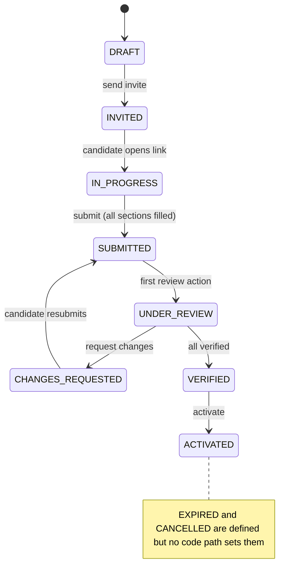

# Module 04 — Onboarding, Account Provisioning & Bulk Employee Import

> Part of [Staff Spectrum HRMS Functional Documentation](../STAFF_SPECTRUM_HRMS_FUNCTIONAL_DOCUMENTATION.md) · [Catalog](../STAFF_SPECTRUM_HRMS_MODULE_CATALOG.md) · [Workflows](../STAFF_SPECTRUM_HRMS_WORKFLOW_CATALOG.md) · [Gaps](../STAFF_SPECTRUM_HRMS_FUNCTIONAL_GAPS.md)

**Status:** Bulk import is **Backend-only** — no screen in web or mobile calls `/employee-imports` (verified by search of `apps/web/src` and `apps/mobile/lib`). Onboarding cases (create → invite → candidate wizard → review → activation): Implemented and verified (11 integration + 3 unit files). Account invite: see [Platform §4.5](01_PLATFORM_IDENTITY_RBAC.md). Bulk import: Implemented and verified (4 integration + 1 unit file). **Partial:** no cancel, expiry or reminder behaviour for cases; no onboarding checklist/task tracking; no probation/offer-letter documents.

## 1. Overview
Two ways to add people in bulk or with candidate-entered data:
1. **Onboarding case** — HR (with `ONBOARDING.*`) records a known new hire (name, personal email, proposed joining date, designation/department/branch/legal entity). The candidate receives a **public tokenised link** and fills eight sections plus document uploads **without an account**. HR reviews each section/document; when everything is verified HR **activates**, which creates the Employee, Employment, Assignment, Bank, Statutory, Compensation (if present), Experience, Education, Dependants, Documents, then emails the candidate and auto-issues a login invite.
2. **Bulk import** — a CSV (≤ 1000 rows, ≤ 5 MB) creates employees with employment, initial assignment and CTC via a background job.
There is no recruitment/ATS module: **no job postings, candidates pipeline, interviews, offers, resume parsing, ranking or AI features exist** (search of repository for those terms found only documentation/roadmap text — `docs/product/12_AI_Architecture.md`, `21_AI_and_Automation_Feature_Specification.md` describe intent, not code). The onboarding "candidate" is created manually by HR.

## 2. Roles and permissions
`ONBOARDING.CREATE`, `.VIEW`, `.REVIEW`, `.ACTIVATE`, `.CANCEL` — granted to **Company Admin only** by default (HR Admin gets none; Platform PL-1). `.CANCEL` is seeded but **no route uses it**. Public routes use only the token. Bulk import: `EMPLOYEE.BULK_IMPORT` (HR Admin, Company Admin). Account invite: `EMPLOYEE.INVITE`.

## 3. Screens
Web: `/app/onboarding` (cases list), `/app/onboarding/[id]` (detail: sections, documents with presigned preview, per-section verify/reject, request changes, activate, send/copy invite), public `/onboarding/[token]` wizard (sections + document upload + submit), `/accept-invite/[token]`. Mobile: `OnboardingCasesScreen`, `OnboardingCaseDetailScreen`, `PublicOnboardingScreen` (deep-link capable; `deep_link_test.dart`), `UsersScreen`.

## 4. Onboarding case
### 4.1 Create (`POST /onboarding-cases`, `ONBOARDING.CREATE`)
Inputs: candidate first/last name, **personal email**, mobile, proposed joining date, designation, department, branch, legal entity (references validated for tenant). Case starts `DRAFT`. Compensation can be stored on the case (`compensation_info`) but is **not** a candidate section.
### 4.2 Invite (`POST /onboarding-cases/{id}/send-invite`)
Allowed from `DRAFT, EXPIRED, INVITED, IN_PROGRESS, ACTIVATED`. Revokes previous live token, mints a 32-byte token (SHA-256 stored), **TTL 7 days**, `DRAFT/EXPIRED → INVITED`, emails the link (`/onboarding/<token>`). Email failure never rolls back: response returns `invite_url` and `email_sent`. First token use moves `INVITED → IN_PROGRESS`.
### 4.3 Candidate wizard (public, rate-limited 30/min/IP, 10/min/token)
`GET /public/onboarding/{token}`, `PATCH …/sections/{section}`, `POST …/submit`, `POST/GET/DELETE …/documents`. **Every failure (unknown, revoked, expired, cancelled/expired case) returns the same 404.** Sections (`ONBOARDING_SECTION_NAMES`): `personal_info, address_info, emergency_contact, bank_info, statutory_info, previous_employment_info, education_info, nominee_info`. Writable only in `INVITED, IN_PROGRESS, CHANGES_REQUESTED`; a section HR has VERIFIED is locked. Sensitive keys (PAN, Aadhaar, bank account number, nominee Aadhaar) are encrypted before storage. Document types: `PHOTO, PAN, AADHAAR, ADDRESS_PROOF, EDUCATION_CERTIFICATE, PREVIOUS_EMPLOYMENT_PROOF, BANK_PROOF, OTHER`, ≤ 10 MB, content sniffed. **Submit** requires all eight section columns non-empty (`ONBOARDING_INCOMPLETE_SECTIONS`) but **does not require any document**. Result `SUBMITTED` (audit `ONBOARDING_CASE_SUBMITTED`, no actor).
### 4.4 Review (`ONBOARDING.REVIEW`)
`POST …/sections/{section}/review {status VERIFIED|REJECTED, rejection_reason}` and `…/documents/{id}/review`. First review moves `SUBMITTED → UNDER_REVIEW`. When **every section is VERIFIED and every uploaded document VERIFIED** (zero documents counts as verified) the case auto-moves to `VERIFIED`. `POST …/request-changes` (needs `UNDER_REVIEW` and at least one rejected section/document) → `CHANGES_REQUESTED` and a single email listing rejected items; candidate edits only rejected sections (editing a rejected section resets it to PENDING), resubmits.
### 4.5 Activation (`POST …/activate`, `ONBOARDING.ACTIVATE`)
Requires status `VERIFIED` and a legal entity on the case. One transaction (all-or-nothing) calling the Employee services: create employee (seat check, code allocation), PAN/Aadhaar/UAN via identity update, employment (joining = proposed date, → PROBATION), initial assignment (branch/department/designation), bank (decrypt→re-encrypt), statutory (UAN stripped), compensation (if `compensation_info`), experience/education/dependant rows, **copy of all uploaded documents into the employee document store**; case → `ACTIVATED` with `employee_id`; activation email; **auto account invite** (savepoint, failure logged, never undoes activation; skipped if no actor). Not copied: pay basis (defaults MONTHLY), probation end date, grade, reporting manager, shift — HR must set these afterwards via assignment/employment screens. Salary structure is not assigned.
### 4.6 State machine

**Verified gaps:** no route cancels a case; nothing sets `EXPIRED` (an expired token simply stops working; HR re-sends); no scheduled reminder or expiry job; a second active case for the same candidate is refused (`DUPLICATE_ACTIVE_ONBOARDING_CASE`), but an existing *employee* with the same personal email is not checked at creation (only seat/code/overlap checks at activation); the review of documents has no case-status gate.

## 5. Bulk import
`GET /employee-imports/template`, `…/reference-data` (lookups), `POST /employee-imports` (multipart CSV), `GET /employee-imports/{id}`, `…/{id}/errors`.
* **Required columns:** `first_name, legal_entity, branch, department, designation, joining_date, annual_ctc_minor, currency`. **Optional:** `employee_code, middle_name, last_name, date_of_birth, gender, blood_group, marital_status, nationality, personal_email, personal_mobile, grade, reporting_manager, work_location_type` (default `OFFICE`). Header must match exactly; UTF-8 (BOM tolerated); blank → absent.
* Upload checks: ≤ 5 MB, ≥ 1 row, ≤ **1000 rows**, header valid. Then batch `PENDING` and a Celery task (`employee_import.process_batch`, queue `reports_exports`, 1 h limit) is enqueued (`IMPORT_QUEUE_UNAVAILABLE` if the broker is down).
* Processing: claims the batch atomically (idempotent against redelivery), row-by-row, each row in a savepoint: validate, resolve org references by **code first, then case-insensitive name**, resolve `reporting_manager` by employee code or personal email, create employee (optional supplied code; duplicates fail), employment, initial assignment, JOINING compensation with `revision_reason="Bulk import"`. Seat limit applies per row. Final status: `COMPLETED`, `COMPLETED_WITH_ERRORS`, `FAILED` (all rows failed or storage failure); progress flushed every 25 rows; per-row errors stored (`row_number` = file line, raw row, code, message).
* **Not imported:** statutory, bank, PAN/Aadhaar, addresses, pay basis, probation date, leave balances, attendance, salary assignment. **No dry-run/validation-only mode, no rollback of a completed batch, no login/invite creation.**
* Ops note: `hrms.ops.import_backlog` reconciles stale PENDING batches (see Operations).

## 6. Data
`onboarding_case` (JSONB sections), `onboarding_token` (hash only; no RLS by design, lookup by hash), `onboarding_document`, `onboarding_section_review`, `account_invite`, `employee_import_batch`, `employee_import_row_error`. Candidate data (including encrypted ID numbers) remains on the case after activation (retained; clearing is gated on an unrecorded compliance decision per model comments).

## 7. Emails
Invite, changes-requested, activated, account-invite; delivery best effort, no retry.

## 8. Acceptance criteria
Create a second active case for the same candidate → `DUPLICATE_ACTIVE_ONBOARDING_CASE`; send invite on `SUBMITTED` case → `ONBOARDING_CASE_NOT_INVITABLE`; open a revoked/expired token → 404 identical to unknown; submit with an empty section → incomplete-sections error naming it; edit a VERIFIED section → `ONBOARDING_SECTION_ALREADY_VERIFIED`; request-changes without rejections → `ONBOARDING_NOTHING_TO_REQUEST_CHANGES_FOR`; activate before VERIFIED → `ONBOARDING_CASE_NOT_READY_FOR_ACTIVATION`; activation failure at any step leaves no employee; upload file with fake extension → rejected by sniffing; import with a wrong header → `IMPORT_HEADER_INVALID`; 1001 rows → row-limit error; same batch message delivered twice → processed once; one bad row does not stop others and appears in `/errors`.

## 9. Evidence
`modules/onboarding/*`, `modules/account_invite/*`, `modules/employee_import/*`; migrations `20260905090000_onboarding_o1`, `…906_o2`, `20260907090000_employee_bulk_import`, `20260930…20261003 onboarding_*`; tests `tests/integration/modules/{onboarding,account_invite,employee_import}/*`; web `app/app/onboarding*`, `app/onboarding/[token]`, `components/onboarding/**`; mobile `lib/features/onboarding/**`, tests `onboarding_*_test.dart`, `public_onboarding_screen_test.dart`; docs `docs/modules/onboarding/*`.
