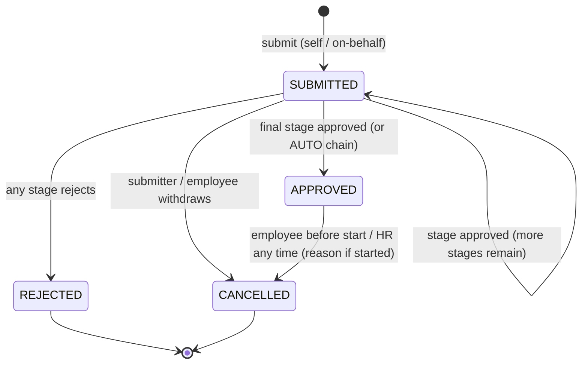
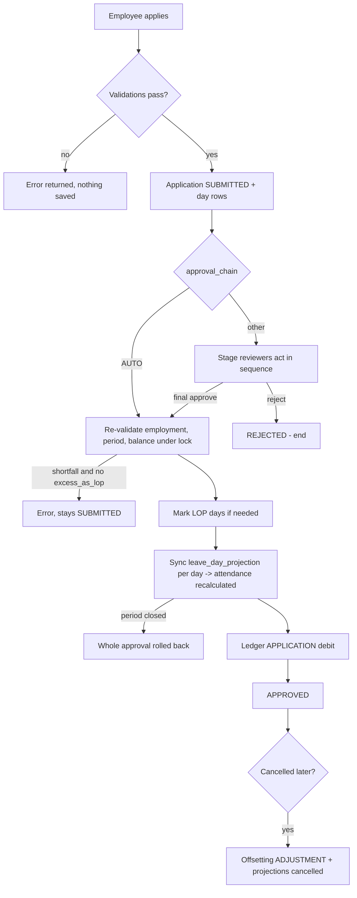
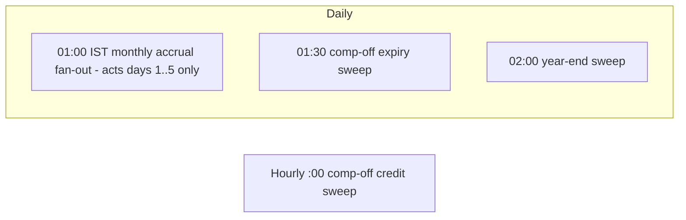

# Module 05 — Leave Management

> Part of [Staff Spectrum HRMS Functional Documentation](../STAFF_SPECTRUM_HRMS_FUNCTIONAL_DOCUMENTATION.md) · [Module catalog](../STAFF_SPECTRUM_HRMS_MODULE_CATALOG.md) · [Workflow catalog](../STAFF_SPECTRUM_HRMS_WORKFLOW_CATALOG.md) · [Gaps](../STAFF_SPECTRUM_HRMS_FUNCTIONAL_GAPS.md)

**Status: Implemented and verified (backend, 33 integration test files); web UI Implemented, not fully verified; mobile Implemented, not fully verified.**
Source of truth is the repository at the time of writing (branch `main`, working tree with uncommitted face-attendance work unrelated to Leave).

---

## 1. Module overview

### 1.1 What it does
Leave is a **ledger-based leave system**. A company defines its own leave types and policies, assigns policies to scopes (company / branch / department / …), and employees apply for leave. Each application moves through a configurable approval chain; on final approval the system (a) debits the employee's leave ledger, (b) publishes per-day "leave projections" into Attendance so those days show as `LEAVE`/`HALF_DAY`, and (c) exposes any loss-of-pay (LOP) days to Payroll. Background jobs credit monthly/yearly accrual, run the leave-year-end carry-forward/lapse/encashment step and credit/expire compensatory-off.

### 1.2 Important: no leave types are built in
**The application ships with no leave types, no leave policies and no policy assignments.** Names such as "Casual Leave", "Sick Leave", "Earned Leave" appear only in code comments and tests. Every leave type is *company-defined data*. Until a company administrator (a) creates at least one leave type, (b) creates and **publishes** a leave-policy version for it, and (c) creates a `LEAVE_POLICY` policy assignment that covers the employee, **no employee can apply** (`LEAVE_APPLICATION_POLICY_NOT_RESOLVED`). Evidence: `modules/leave/service.py` `LeaveApplicationService.submit`; `seed/bootstrap.py` and `organisation/service.py::register_company` seed no leave data.

The only built-in classification is the optional **statutory category** tag on a leave type (`EARNED`, `SICK`, `CASUAL`, `MATERNITY`, `PATERNITY` — `leave/schemas.py::STATUTORY_LEAVE_CATEGORIES`), used solely to compare a policy's annual entitlement to a compliance-entered minimum (§5.10).

### 1.3 Business processes supported
* Leave request → multi-stage approval → balance debit → attendance projection.
* Monthly and yearly accrual; carry-forward / lapse / encash-excess at leave-year start.
* Compensatory off earned from approved overtime, expiring after a validity window.
* Manual balance adjustments and encashment by HR.
* Cancellation / withdrawal and reversal.
* LOP ("approve excess as loss of pay") when balance is insufficient at approval time.

### 1.4 Interaction with other modules
| Module | Interaction |
|---|---|
| Organisation | `PolicyAssignment` (kind `LEAVE_POLICY`, requires `leave_type_id`) resolves which policy applies; `WorkCalendar` resolution decides which dates consume leave; `Department.head_employee_id` supplies the HOD approver. |
| Employee | Reporting manager (from `EmployeeAssignment`) supplies the MANAGER approver; `Employee.status = PROBATION` drives probation rules; `Employment` spells bound accrual and valid leave dates; terminating an employment is **blocked** while submitted/approved leave extends past the last working day. |
| Attendance | On final approval each leave day is pushed through `LeaveProjectionService.sync` into `leave_day_projection`, then attendance is recalculated; closed attendance periods block submission/approval/cancellation; approved overtime with comp-off feeds `COMP_OFF_CREDIT`. |
| Payroll | LOP days and system-written `ENCASHMENT` ledger rows are consumed by Payroll (see [Payroll module](07_PAYROLL.md)); ledger/adjustment dates inside a finalised payroll period are refused. |
| Identity/RBAC | Permissions `LEAVE.*`, data scopes (SELF / REPORTEE_TREE / BRANCH / COMPANY). |

---

## 2. User roles and permissions

### 2.1 Permission catalogue (`modules/leave/permissions.py`)
| Code | Meaning | Gate for |
|---|---|---|
| `LEAVE.TYPE_MANAGE` | Create/edit leave types | `POST/GET/PATCH /leave-types` |
| `LEAVE.POLICY_MANAGE` | Policies and policy versions | `/leave-policies/**` |
| `LEAVE.BALANCE_VIEW` | Own balances/ledger/applications | reads (SELF) |
| `LEAVE.BALANCE_VIEW_ALL` | Balances/ledger/applications "within scope" | reads (scope-narrowed) |
| `LEAVE.BALANCE_ADJUST` | Manual ledger adjustment & encashment | `POST /leave-ledger/adjustments`, `/encashments` |
| `LEAVE.APPLICATION_SUBMIT` | Apply for own leave; withdraw own | `POST /leave-applications` (self) |
| `LEAVE.APPLICATION_SUBMIT_ON_BEHALF` | Apply for someone else | `POST /leave-applications` with another `employee_id` |
| `LEAVE.APPLICATION_APPROVE` | Approve / reject | approve & reject routes |
| `LEAVE.APPLICATION_CANCEL_APPROVED` | Cancel approved leave after it started | cancel |
| `LEAVE.APPLICATION_REASSIGN` | Reassign a stuck MANAGER/HOD stage | reassign |
| `LEAVE.COMBINATION_RULE_MANAGE` | Leave-type combination rules | `/leave-combination-rules` |
| `LEAVE.YEAR_SETTING_MANAGE` | Leave-year definition | `/leave-year-setting` |
| `LEAVE.STATUTORY_MINIMUM_MANAGE` | Statutory minimums | `/statutory-leave-minimums` |

### 2.2 What each default role can do (verified against the live permission tables of a recently registered tenant and `organisation/service.py::register_company`)
| Capability | Employee | Reporting Manager | Branch Manager | HR Admin | Company Admin |
|---|---|---|---|---|---|
| Apply for own leave | ✔ (`SUBMIT`, SELF) | ✘ (no grant) | ✘ | ✘ (own) | ✔ (all `LEAVE.*`) but needs a linked Employee record |
| Apply on behalf of others | ✘ | ✘ | ✘ | ✔ (COMPANY) | ✔ |
| See own balances/applications | ✔ | — | — | via VIEW_ALL | ✔ |
| See team/branch/company balances & applications | ✘ | ✔ REPORTEE_TREE | ✔ BRANCH | ✔ COMPANY | ✔ |
| Approve/reject | ✘ | ✔ only as the named manager/HOD (see §5.6) | ✔ same caveat | ✔ at HR stage (COMPANY scope) | ✔ |
| Cancel approved leave after start | ✘ | ✘ | ✘ | ✔ | ✔ |
| Reassign stuck approver | ✘ | ✘ | ✘ | ✔ | ✔ |
| Manual adjustment / encashment | ✘ | ✘ | ✘ | ✔ | ✔ |
| Leave types, policies, combination rules, leave year, statutory minimums | ✘ | ✘ | ✘ | ✘ ("Leave-type and policy management stay with COMPANY_ADMIN" — comment in `register_company`) | ✔ |

Notes / findings:
* A **Reporting Manager or Branch Manager role does not include `LEAVE.APPLICATION_SUBMIT`**. A manager who also needs to take leave must additionally hold the `EMPLOYEE` role (the invite flow assigns exactly one role set; multiple roles per user are supported via `PATCH /users/{id}/roles`).
* A **Company Admin without a linked employee** cannot submit leave for themself ("employee_id is required — the caller has no linked employee record").
* Roles are fixed to five codes and permissions of these roles cannot be edited in the product (see [Platform module](01_PLATFORM_IDENTITY_RBAC.md)).

### 2.3 Separation of duties
* **Self-approval is always blocked** (`LEAVE_APPLICATION_SELF_APPROVAL_NOT_ALLOWED`), including for HR and Company Admin.
* MANAGER and HOD stages require that the caller **be** the snapshotted approver (`resolved_approver_manager_id` / `resolved_department_head_id`). Holding `LEAVE.APPLICATION_APPROVE` alone is not enough. The HR stage requires the permission with **COMPANY** data scope.
* A reviewer at a non-final stage only advances the application (`STAGE_APPROVED`); a different person at the next stage must act.

---

## 3. Screens and navigation

### 3.1 Web (`apps/web/src/app/app/…`)
| Screen | Route | Notes |
|---|---|---|
| Leave Applications | `/app/leave-applications` | Tabs "My applications" / "Team applications" (team tab only if user can approve or submit on behalf). Filters: date range (default today−30 … today+90), status, employee (team tab). Paginated. Button "Apply for leave" shown only if the user has the relevant submit permission for the active tab. |
| Leave Application detail | `/app/leave-applications/[id]` | Day breakdown, action timeline, approve / reject / cancel / reassign dialogs. |
| Leave Balances | `/app/leave-balances` | Per-employee balances with reserved balance; ledger view; HR adjustment/encashment actions (`LEAVE.BALANCE_ADJUST`). |
| Leave Types | `/app/leave-types` | Settings → Leave. |
| Leave Policies (+ detail with versions) | `/app/leave-policies`, `/app/leave-policies/[id]` | Draft / publish version lifecycle. |
| Leave Combination Rules | `/app/leave-combination-rules` | |
| Leave Year | `/app/leave-year-setting` | |
| Statutory Minimums | `/app/statutory-leave-minimums` | |
| Policy Assignments | `/app/policy-assignments` | Shared with attendance policies (Organisation module). |

Sidebar shows "Leave" and "Leave Balances" to every user; configuration pages sit under **Settings** (`components/layout/nav-items.ts`). The sidebar is **not** permission-filtered; the pages and the API enforce permissions (a user without access sees a permission error or an empty state).

### 3.2 Mobile (`apps/mobile/lib/features/leave`, `core/router/app_router.dart`)
Bottom-tab "Leave" (`/app/leave-applications`), plus `/app/leave-balances`, `/app/leave-year-setting`, and generic resource screens for `/app/leave-types`, `/app/leave-policies`, `/app/leave-combination-rules`, `/app/statutory-leave-minimums` (reached via the "More"/settings hub). Application detail screen supports review actions.

### 3.3 Empty / error states
Verified in web page code: loading state, `ErrorState` for API errors, `EmptyState` ("CalendarOff") when no applications. Validation messages come from API error codes listed in §5 and §9.

---

## 4. Feature-by-feature explanation

### 4.1 Define a leave type
* **Who:** `LEAVE.TYPE_MANAGE` (Company Admin by default). **Where:** Settings → Leave → Leave Types.
* **Inputs:** `code` (unique per company), `name`, `is_paid_default` (default true), `requires_balance` (default true), `is_comp_off` (default false), optional `statutory_category`.
* **System:** inserts `leave_type` (active); audit `LEAVE_TYPE_CREATED`. At most **one active comp-off type per company** (partial unique index `leave_type_company_comp_off_idx`) → `LeaveTypeCompOffAlreadyExistsError`. Duplicate code → `LeaveTypeCodeAlreadyExistsError`.
* **Edit rule (decision 11):** `requires_balance`, `is_comp_off` and `is_paid_default` can only be changed while nothing has used the type (no applications/ledger rows); afterwards `LEAVE_TYPE_IN_USE`.
* **`requires_balance=false`** makes a type "LOP-style": no ledger debit, no balance check, no accrual.
* **Evidence:** `LeaveTypeService`, `tests/integration/modules/leave/test_leave_type_semantics.py`.

### 4.2 Define a leave policy and publish a version
* **Who:** `LEAVE.POLICY_MANAGE`. A **policy** (identity: name, code, one `leave_type_id`) has **versions**; only a PUBLISHED version drives behaviour. Versions are effective-dated; at most one open DRAFT per policy; publishing closes the previous published version at `effective_from − 1 day` (needs `expected_previous_version`). `effective_from` of a new published version must be strictly after the current published one.
* **Configurable fields of a version** (`LeavePolicyVersion`; defaults in brackets):

| Field | Meaning (as implemented) |
|---|---|
| `allow_employee_request` [true] | Self-service permitted |
| `allow_manager_request_on_behalf` / `allow_hr_request_on_behalf` [true/true] | On-behalf permitted (the service only checks that **either** is true; it does not distinguish manager from HR callers) |
| `max_backdated_days` [none] | How far before today (company-local date) `start_date` may be |
| `max_requests_per_month` [none] | Count of applications since start of company-local month |
| `reason_required` [true] / `attachment_required` [false] | Presence checks (`attachment_reference` is a free-text string ≤500 chars — no upload is tied to it, see §9) |
| `approval_chain` ["MANAGER"] | `AUTO`, `MANAGER`, `MANAGER_THEN_HR`, `MANAGER_THEN_HOD_THEN_HR`, `HR` |
| `half_day_allowed` [true] | |
| `accrual_frequency` ["NONE"] | `NONE`, `MONTHLY`, `YEARLY` |
| `accrual_rate_per_cycle` | days credited per cycle |
| `max_carry_forward_days` | carry-forward cap |
| `year_end_action` ["CARRY_FORWARD"] | `CARRY_FORWARD`, `LAPSE`, `ENCASH_EXCESS` |
| `allow_negative_balance` [false] + `negative_balance_floor` | how far below zero; floor mandatory at publish when enabled |
| `sandwich_rule_enabled` [true] | |
| `reserve_balance_on_submission` [false] | pending applications reduce available balance |
| `pre_delivery_days`, `post_delivery_days` | **informational only** (maternity); never enforced |
| `allowed_during_probation` [true], `accrue_during_probation` [true] | |
| `max_consecutive_days` [30] | calendar-day span cap per application (hard schema cap 90) |
| `encashment_allowed` [false], `max_encashment_days`, `min_balance_after_encashment` | enforced by encashment |
| `encashment_frequency`, `encashment_calculation_basis` | **informational only** |

* **Publish validations:** `effective_from` required; negative-balance floor required if negative allowed; `max_carry_forward_days` required for `ENCASH_EXCESS`; statutory-minimum check (§5.10).
* **Evidence:** `LeavePolicyService.publish_version`, `test_leave_policy.py`, `test_leave_statutory_minimum.py`.

### 4.3 Assign a policy
`POST /policy-assignments` with `policy_kind = LEAVE_POLICY`, `leave_type_id`, a scope (`COMPANY`, `LEGAL_ENTITY`, `BRANCH`, `DEPARTMENT`, `GRADE`, `DESIGNATION`, `SHIFT`, `EMPLOYEE`), `effective_from/to`, `priority`. Resolution picks the most specific scope (EMPLOYEE > SHIFT > DESIGNATION > GRADE > DEPARTMENT > BRANCH > LEGAL_ENTITY > COMPANY). Multiple leave policies may coexist at one scope because each is tied to a different leave type. **Permission to create/list a `LEAVE_POLICY` assignment:** the shared endpoint `_require_policy_assignment_permission` (`organisation/router.py`) recognises only the calendar kinds (`ORG.CALENDAR.MANAGE`) and the three attendance kinds (`ATTENDANCE.POLICY_MANAGE`); for any other kind — including `LEAVE_POLICY` — it requires **both** `ORG.CALENDAR.MANAGE` **and** `ATTENDANCE.POLICY_MANAGE`, **not** `LEAVE.POLICY_MANAGE`. By default only the Company Admin holds both, so HR Admin cannot assign leave policies (finding L-18). See [Organisation module](02_ORGANISATION.md).

### 4.4 Apply for leave
* **Who:** `LEAVE.APPLICATION_SUBMIT` (self) or `…_ON_BEHALF` (when `employee_id` names someone else). **Requires an `Idempotency-Key` header** (see §8).
* **Inputs:** `leave_type_id`, `start_date`, `end_date`, optional `half_day` (`FIRST_HALF`/`SECOND_HALF`; **single-day applications only**), `reason`, `attachment_reference`, `expected_delivery_date`, `employee_id` (on-behalf).
* **Schema validation:** `end_date ≥ start_date`; span ≤ 90 calendar days; `half_day` only if `start_date == end_date`; unknown fields rejected.
* **Server-side validation order** (`LeaveApplicationService.submit`): target employee visible and in company → leave type exists → take per-employee leave-dates lock → all dates lie within **one** employment spell → attendance period not closed for the range → combination rules vs. other active (SUBMITTED/APPROVED) overlapping applications → resolve `LEAVE_POLICY` assignment as of `start_date` and an effective published version → `max_consecutive_days` → probation restriction → on-behalf / self-service allowed → half-day allowed → backdating window → reason/attachment required → monthly request cap → compute day breakdown (calendar + sandwich) → per-date same-type overlap > 1.00 → balance sufficiency (if `requires_balance`) → resolve approvers → insert.
* **System after submission:** inserts `leave_application` (`SUBMITTED`, snapshot of policy version and approver ids), one `leave_application_day` per leave-consuming date, a `SUBMITTED` timeline action (plus `APPROVER_UNRESOLVED` actions when a stage could not be resolved), audit `LEAVE_APPLICATION_SUBMITTED`. For `approval_chain = AUTO` the application is approved in the same request.
* **Notifications:** none (§8, §9). The approver is not emailed or pushed.
* **Failure cases:** see error table §5.12.

### 4.5 Approve / reject
* **Who:** `LEAVE.APPLICATION_APPROVE` **and** stage identity rules (§2.3). Requires `If-Match` (optimistic version).
* **Approve (non-final stage):** application stays `SUBMITTED`, `approval_stage` advances, `STAGE_APPROVED` action.
* **Approve (final stage):** `APPROVED`, then §5.5 apply-approval (balance cover, LOP, projections, ledger debit). Body flag `excess_as_lop` allows approval when balance no longer covers the request.
* **Reject:** `REJECTED`, stage cleared, `rejection_reason`/`reviewer_comment` recorded. **Rejected applications cannot be edited or resubmitted;** the employee submits a new application.
* **Approval re-validation:** attendance period open, employment still covers range, balance re-checked under lock.

### 4.6 Cancel / withdraw
See §5.7 — rules differ by status and by who cancels; approved leave reversal credits the ledger and cancels projections.

### 4.7 Reassign a stuck approver
HR (`LEAVE.APPLICATION_REASSIGN`, COMPANY) can hand a pending MANAGER/HOD stage to another approver **only if** the current approver is ineligible (employee inactive / not employed today / no login / lacks `LEAVE.APPLICATION_APPROVE`) and the new approver is eligible and not the applicant; mandatory reason; `APPROVER_REASSIGNED` action.

### 4.8 HR balance adjustment and encashment
* **Adjustment** (`POST /leave-ledger/adjustments`): signed non-zero amount, effective date, reason. Effective date must be within an employment spell and in an **open** attendance period and not in a finalised payroll period (`LEAVE_LEDGER_PERIOD_CLOSED` / `LEAVE_LEDGER_PAYROLL_FINALISED`). Negative amounts take the balance lock. Audit `LEAVE_LEDGER_ADJUSTMENT_CREATED`.
* **Encashment** (`POST /leave-ledger/encashments`): requires the applicable policy to have `encashment_allowed`; `days ≤ max_encashment_days`; `balance − days ≥ min_balance_after_encashment` (default 0). Writes `ENCASHMENT` (negative) with `reference_id = NULL` (a manual encashment). **Payroll pays every `ENCASHMENT` ledger row whose `effective_date` falls in the pay-run month and whose owning legal entity matches** (`LeaveLedgerRepository.list_encashments_between` selects all `ENCASHMENT` entries — manual and year-end alike), at `days × (full-month Basic ÷ days in month)` (see [Payroll](07_PAYROLL.md)). A comment in `leave/service.py` says payroll pays only system-written (`reference_id` set) rows; the code does not filter on `reference_id` — recorded as a documentation/code conflict (L-15).

### 4.9 Combination rules, leave year, statutory minimum
* **Combination rule:** an unordered pair of types, `allowed` true/false, optional reason. Absence = allowed. Only `allowed=false` rules have effect at submit time. Delete-and-recreate to change.
* **Leave year setting:** singleton per company; `CALENDAR` (1 Jan, default when none exists), `FINANCIAL` (1 Apr), `ANNIVERSARY` (employee's joining-date month/day), `CUSTOM` (`start_month`/`start_day`). Feb 29 anchors clamp to the last valid day.
* **Statutory minimum:** (`state_code`?, `establishment_type`?, `leave_category`, `min_days_per_year`, `note`). Used only at policy-publish time.

### 4.10 Balances and ledger views
`GET /leave-balances?employee_id=` returns, per balance-backed leave type, `balance = SUM(ledger.amount)` and `reserved_balance` (sum of fractions in open SUBMITTED applications). `GET /leave-ledger` lists entries. Both are narrowed by `LEAVE.BALANCE_VIEW` ∪ `LEAVE.BALANCE_VIEW_ALL` data scope.

---

## 5. Business rules and calculations

### 5.1 Which days consume leave
For each calendar date in `[start_date, end_date]` the employee's **WorkCalendar** is resolved for that date (assignment precedence applies). Day types `WORKING` and `SPECIAL_WORKING` consume leave; `WEEKLY_OFF`, `HOLIDAY`, `SHUTDOWN` do not. If any date cannot be resolved (no calendar configured) the request fails closed (`LEAVE_APPLICATION_CALENDAR_NOT_RESOLVED`) — it never assumes "working". Optional/restricted holidays are working days unless the work calendar's `restricted_holidays_are_off_by_default` is on. A weekly off with a fractional `off_fraction` (half-day off) still resolves as `WEEKLY_OFF` for leave purposes (not consumed).

### 5.2 Sandwich rule
If `sandwich_rule_enabled`, a non-consuming date strictly **inside the same application's range** whose previous and next dates are both leave-consuming (evaluated sequentially with already-converted dates) becomes consuming and is marked `is_sandwich_generated`. No look-back across separate applications; end dates are never sandwiched.

### 5.3 Day count (`total_days`)
`total_days = Σ fraction` over consuming dates. Fraction = `1.00`, except a single-day half-day application = `0.50`. There is **no** multi-day partial boundary (half-day at start/end of a range is not supported).
*Worked example (hypothetical):* Policy has sandwich on. Employee works Mon–Fri, Sat/Sun weekly off. Applies Thu 5 → Tue 10 (hypothetical dates). Consuming: Thu, Fri, Mon, Tue = 4; Sat and Sun are bracketed by Fri and Mon → both become sandwich days → `total_days = 6.00`. With sandwich off → 4.00. A public holiday on Mon would also be absorbed by the sandwich rule (becomes consuming) as long as Tue is consuming.

### 5.4 Balance sufficiency at submission
```
available = Σ ledger(employee, type)
          − Σ fractions of open SUBMITTED applications of that type      (only if reserve_balance_on_submission)
floor     = negative_balance_floor if allow_negative_balance else 0
reject if available + floor < total_days
```
Skipped when `requires_balance = false`. Example: balance 2.00, floor 3.00 (negative allowed), request 5.00 → 2+3 = 5 ≥ 5 → accepted; balance goes to −3.00 on approval.

### 5.5 Final approval — balance cover, LOP, ledger, attendance
Under a per-(employee,type) balance lock:
```
available = balance + floor
if total_days ≤ available → covered, no LOP
else if not excess_as_lop → error LEAVE_APPLICATION_BALANCE_SHORTFALL (details: balance, available, requested, shortfall)
else → remaining = max(available, 0); walk days in order; each whole day with fraction ≤ remaining is covered,
       the first day that does not fit and ALL later days become LOP (is_lop = true). A partly-coverable day is LOP in full
       and the partial balance stays unused.
lop_days = Σ fraction of LOP days
debit    = −(total_days − lop_days)  → ledger ENTRY_TYPE=APPLICATION, effective_date = start_date, reference_id = application id
```
Then for **every** day (including LOP days) a `leave_day_projection` is synced into Attendance (identifiers only; type, fraction, half and paid flag derive from the day rows). If Attendance refuses any day (its period is closed) the whole transaction, including the `APPROVED` status, rolls back. Types with `requires_balance=false` skip balance cover and ledger debit.

### 5.6 Approval chains
| Chain | Stages (nominal) | Notes |
|---|---|---|
| `AUTO` | none | Approved at submission. Still debits ledger and syncs attendance. |
| `MANAGER` | MANAGER | |
| `MANAGER_THEN_HR` | MANAGER → HR | |
| `MANAGER_THEN_HOD_THEN_HR` | MANAGER → HOD → HR | |
| `HR` | HR | |

Stage resolution (`approval_chain.py`): MANAGER is the reporting manager from the employee's assignment **as of `start_date`**; HOD is the department head of the assignment's department (if the employee is their own department head the HOD stage is dropped). A stage whose person cannot be resolved is **dropped from that application's sequence** (an `APPROVER_UNRESOLVED` action is logged); if every identity-requiring stage drops the sequence is just `("HR",)`. HR never requires an identity. The resolved ids are snapshotted on the application, so later org changes do not re-route in-flight requests (use *reassign*).

### 5.7 Cancellation and withdrawal
| Status | Who | Rules |
|---|---|---|
| `SUBMITTED` | the submitter or the employee | No side effects; no reason required. |
| `APPROVED` | the employee, **only before `start_date`** (company-local today < start) | Period must be open. |
| `APPROVED` and already started | only `LEAVE.APPLICATION_CANCEL_APPROVED` (COMPANY) | Reason **mandatory** if started. |
| `APPROVED` | managers | Never. |
| `REJECTED` / `CANCELLED` | — | Invalid transition. |

On cancelling an approved application: an offsetting `ADJUSTMENT` equal to the original `APPLICATION` debit is written (`reference_id` = application id; idempotent), and every synced projection is cancelled (attendance recalculated). The original debit row is never edited (append-only ledger, ADR-0004).

### 5.8 Accrual
* **Monthly** (`accrual_frequency = MONTHLY`): a daily Celery job (01:00 `Asia/Kolkata`) runs `LeaveAccrualService.run_for_company(as_of = company-local today)` **only if `as_of.day ≤ leave_accrual_run_window_days` (default 5)**. It accrues for the *previous* calendar month for every employee employed for part of it, for every active balance-backed type whose resolved published version is MONTHLY with a positive rate (and not skipped for probation). Ledger entry `ACCRUAL`, `effective_date = last day of the month`, `reference_id` = policy version, one per (employee, type, month) (idempotent: `exists_for_cycle` + `insert_if_absent`).
```
amount = rate                                       if worked_days ≥ days_in_month
amount = round_half_up(rate × worked_days / days_in_month, 2)   otherwise
worked_days = Σ calendar days inside the month covered by any employment spell
```
*Example:* rate 1.50, employee joins 11 June (hypothetical), June has 30 days → worked = 20 → 1.50×20/30 = 1.00. Unpaid-leave days do **not** reduce accrual (decision 20).
* **Yearly** (`YEARLY`): credited on the leave-year start date during the year-end sweep, full `accrual_rate_per_cycle`, **no proration** for part-year joiners.
* The accrual window means a **missed run is repaired only within the first N days of a month**; accruals for earlier months are not back-filled automatically (see Gaps).
* A policy version resolved *as of* the period end (monthly) or year start (yearly) is used.

### 5.9 Leave-year end (carry-forward, lapse, encash excess)
Daily sweep 02:00 IST. For every employee whose leave-year start (per `LeaveYearSetting`) falls on the company-local date or in the previous `leave_year_end_catchup_days − 1` days (default 5) and who was employed on that date, once per (employee, year start) (`leave_year_end_run` claim):
```
balance = current ledger balance (under lock)
LAPSE:          lapse = balance (if > 0)
CARRY_FORWARD:  lapse = max(balance − max_carry_forward_days, 0)   (no cap configured → nothing lapses)
ENCASH_EXCESS:  excess = max(balance − cap, 0); encash = min(excess, max_encashment_days or excess); lapse = excess − encash
negative balance → untouched ("recovered in F&F")
```
Ledger rows dated on the year-start: `CARRY_FORWARD` (negative = forfeited), `ENCASHMENT` (negative, `reference_id` = policy version → payable by payroll), then yearly `ACCRUAL`.
*Example:* balance 14.00, cap 10.00, ENCASH_EXCESS, max_encashment 3.00 → excess 4.00, encash 3.00, lapse 1.00, carried 10.00.

### 5.10 Statutory minimum check at publish
`annual entitlement = rate×12 (MONTHLY) | rate (YEARLY) | 0 (NONE)`. If the leave type has a `statutory_category` and any minimum is configured for that category, publishing is blocked when `entitlement < MAX(min_days_per_year)` across all states/establishments (fail-safe, not scope-precise). **No statutory figures are shipped**; they are entered by the company. If no floor is configured for the category, nothing is checked. **Note:** when a floor *is* configured, a policy with `NONE` accrual computes entitlement 0 and is therefore blocked from publishing; the docstring of `_annual_entitlement_days` says NONE "never trips the floor", which is not what `_enforce_statutory_minimum` does (conflict recorded as L-10 and in the Gaps register). Tests only cover a MONTHLY policy (`test_leave_statutory_minimum.py`).

### 5.11 Compensatory off
* Designate exactly one active leave type with `is_comp_off=true`. Employees redeem it like any balance-backed type.
* **Credit** (hourly job): for each comp-off-bearing overtime record (Attendance), if the policy has `comp_off_day_length_minutes > 0` and it has not been credited (`reference_id = overtime_record_id`): `amount = round_half_up(comp_off_minutes / comp_off_day_length_minutes, 2)`, `COMP_OFF_CREDIT`, dated the attendance date. Skipped if no comp-off type exists.
* **Expiry** (daily 01:30): for each credit whose OT record's `comp_off_expiry_date ≤ today`, not yet offset, **and** only if the employee's current comp-off balance ≥ the credit amount, write an offsetting `ADJUSTMENT` of −amount (`reference_id` = credit id). If the balance has dropped below the credit (partly spent) **nothing expires** (generous; no FIFO lots).

### 5.12 Error catalogue (selected; `modules/leave/exceptions.py`)
`LEAVE_APPLICATION_POLICY_NOT_RESOLVED`, `…_CALENDAR_NOT_RESOLVED`, `…_INSUFFICIENT_BALANCE`, `…_BALANCE_SHORTFALL`, `…_OVERLAP`, `…_COMBINATION_NOT_ALLOWED`, `…_WINDOW_EXCEEDED`, `…_LIMIT_EXCEEDED`, `…_MAX_CONSECUTIVE_EXCEEDED`, `…_REASON_REQUIRED`, `…_ATTACHMENT_REQUIRED`, `…_HALF_DAY_NOT_ALLOWED`, `…_NOT_ALLOWED_DURING_PROBATION`, `…_PERIOD_CLOSED`, `…_SELF_APPROVAL_NOT_ALLOWED`, `…_APPROVER_MISMATCH`, `…_INVALID_TRANSITION`, `LEAVE_DATE_OUTSIDE_EMPLOYMENT`, `LEAVE_APPROVAL_OUTSIDE_EMPLOYMENT`, `LEAVE_LEDGER_PERIOD_CLOSED`, `LEAVE_LEDGER_PAYROLL_FINALISED`, `LEAVE_ENCASHMENT_*`, `LEAVE_POLICY_BELOW_STATUTORY_MINIMUM`, `LEAVE_TYPE_IN_USE`, stale-version 409 `STALE_RESOURCE`.

---

## 6. Workflow and lifecycle

### 6.1 Leave application state machine

(Only these four statuses exist: `SUBMITTED, APPROVED, REJECTED, CANCELLED`; `approval_stage` ∈ `MANAGER|HOD|HR|NULL`.)

### 6.2 End-to-end flow


### 6.3 Background timeline

Timezone: Celery beat runs in `app_timezone_default` (`Asia/Kolkata`); each company's "today" uses its own timezone via `business_today`.

### 6.4 Failure and recovery
* Concurrent submissions: per-employee advisory lock + `Idempotency-Key`.
* Retried jobs: tasks use `acks_late`, retry connection errors (max 3), are idempotent per cycle key.
* Missed year start beyond catch-up window: operator runs `leave.run_year_end_for_company` with an explicit `as_of` (documented in task docstring).

---

## 7. Data and relationships

| Record | Key fields | Notes |
|---|---|---|
| `leave_type` | code, name, is_paid_default, requires_balance, is_comp_off, statutory_category, is_active | No hard-delete exposed; no deactivate endpoint (see Gaps). |
| `leave_policy` / `leave_policy_version` | policy→1 leave_type; versions DRAFT/PUBLISHED, effective dates | Published rows immutable except `effective_to`. |
| `policy_assignment` (shared) | kind=LEAVE_POLICY, leave_type_id, scope | Org module. |
| `leave_ledger` | entry_type ∈ ACCRUAL, APPLICATION, ADJUSTMENT, ENCASHMENT, CARRY_FORWARD, COMP_OFF_CREDIT; signed `amount` (≠0), effective_date, reference_id | **Append-only**; balance is always `SUM(amount)`; DB-level protection against update/delete for the runtime role. |
| `leave_application` | dates, total_days, lop_days, status, approval_chain/stage, resolved ids, policy-version snapshot, reason, attachment_reference, expected_delivery_date, cancellation fields, `version` | |
| `leave_application_day` | calendar_date, fraction, half, is_sandwich_generated, is_lop, leave_day_projection_id | |
| `leave_application_action` | append-only timeline (SUBMITTED, STAGE_APPROVED, APPROVED, REJECTED, CANCELLED, APPROVER_UNRESOLVED, APPROVER_REASSIGNED, EXCESS_AS_LOP) | |
| `leave_combination_rule`, `leave_year_setting`, `statutory_leave_minimum`, `leave_year_end_run` | | |

Sensitive: reason text, attachment reference. Leave audit rows deliberately avoid free text (`test_leave_audit_privacy.py`, decision 19). Records are not hard-deleted; combination rules and statutory minimums are hard-deleted via DELETE (flat tables).

---

## 8. Integrations and automation
* **Celery tasks:** `leave.run_monthly_accrual` (fan-out, 01:00), `leave.accrue_company`, `leave.run_comp_off_credit_sweep` (hourly) / `leave.credit_comp_off`, `leave.run_comp_off_expiry_sweep` (01:30) / `leave.sweep_comp_off_expiry`, `leave.run_year_end_sweep` (02:00) / `leave.run_year_end_for_company`. Only companies with status `TRIAL` or `ACTIVE` are processed.
* **Idempotency:** `POST /leave-applications` **requires** `Idempotency-Key` (8–128 chars `[A-Za-z0-9._:-]`); same key + same fingerprint replays the stored response, different payload → `IDEMPOTENCY_KEY_CONFLICT`. Manual adjustment and encashment routes also require an `Idempotency-Key` (`leave/router.py`, `require_idempotency_key`).
* **Notifications:** **none**. There is no email, push, or in-app notification for leave submission, approval, rejection or cancellation (grep of `modules/leave` finds no sender). The Attendance module has an "incomplete attendance" reminder email; Leave has no equivalent.
* **Settings:** `leave_accrual_run_window_days` (5), `leave_year_end_catchup_days` (5), `leave_lock_wait_ms` (5000), `idempotency_wait_ms` (10000).

---

## 9. Edge cases and known limitations

| # | Finding | Type |
|---|---|---|
| L-1 | No default leave types/policies/assignments; a freshly registered company cannot take leave until configured. | Verified |
| L-2 | No notifications of any kind for leave events. | Verified |
| L-3 | No application edit/resubmission; rejected requests require a fresh application. | Verified |
| L-4 | `attachment_required` only checks a non-empty free-text reference; no upload/storage integration for leave attachments. | Verified |
| L-5 | Multi-day half-day boundaries unsupported. | Verified |
| L-6 | Reporting Manager / Branch Manager default roles cannot apply for leave themselves (no `SUBMIT` grant) unless also assigned `EMPLOYEE`. | Verified |
| L-7 | Branch Manager holds `LEAVE.APPLICATION_APPROVE` at BRANCH scope, but approval needs identity match (MANAGER/HOD) or COMPANY scope (HR), so it only works when the branch manager is *also* the named reporting manager. The code comment in `register_company` states this explicitly. | Verified |
| L-8 | `pre_delivery_days`/`post_delivery_days`, `encashment_frequency`, `encashment_calculation_basis` are stored but not enforced. | Verified |
| L-9 | Monthly accrual only acts in the first `leave_accrual_run_window_days` days; a policy published or an employee added after that window gets no accrual for the missed month. | Verified (code); impact depends on operations |
| L-10 | Statutory-minimum check: docstring says NONE-accrual never trips the floor, code computes entitlement 0 and compares to the floor. | Conflict in sources |
| L-11 | Yearly accrual is not prorated for employees joining mid-year, and credited only if the employee was employed on the leave-year start date. | Verified |
| L-12 | Comp-off expiry is skipped when the balance has fallen below the credit amount. | Verified (documented by design) |
| L-13 | `LeaveTypeUpdate` accepts `is_active`, so a type can be deactivated (inactive types are hidden from submitters' type list and skipped by accrual). Leave **policies** expose `PATCH /leave-policies/{id}` (identity update) — whether it deactivates is not separately verified here. | Partly verified |
| L-14 | Web "Team applications" employee dropdown loads max 100 employees (code comment). | Verified |
| L-15 | Code comment says payroll pays only system-written encashments; code pays **all** `ENCASHMENT` rows dated in the pay month (manual too). A manual encashment is also deducted from balance immediately, so it is paid exactly once only if it falls inside a not-yet-finalised pay-run month. | Conflict in sources (code is authoritative) |
| L-16 | Approvers are not told an application is waiting; discovery relies on opening the Team tab. | Verified |
| L-18 | Assigning a leave policy needs `ORG.CALENDAR.MANAGE` + `ATTENDANCE.POLICY_MANAGE`, not a `LEAVE.*` permission (§4.3). | Verified |
| L-17 | Probation: restrictions read `Employee.status = PROBATION`; because termination never sets status, and confirmation is manual (`POST /employees/{id}/confirm`), probation status relies on HR confirming. | Verified |

## 10. Functional acceptance criteria (derived from existing tests/behaviour)
1. *Happy path:* Given a published MONTHLY policy and COMPANY assignment, an Employee with balance 2.00 applying for 1 working day with chain MANAGER and a resolved manager → application `SUBMITTED` with `approval_stage=MANAGER`; manager approves → `APPROVED`, ledger shows −1.00 `APPLICATION`, attendance day shows leave.
2. *Validation:* half_day with a multi-day range → 422; span > 90 → 422; span > `max_consecutive_days` → `…MAX_CONSECUTIVE_EXCEEDED`; missing reason when required → `…REASON_REQUIRED`.
3. *Permission:* Employee submitting for another employee → 403 `PERMISSION_DENIED`; applicant approving own request → `SELF_APPROVAL_NOT_ALLOWED`; non-named manager approving at MANAGER stage → `APPROVER_MISMATCH`; REPORTING_MANAGER at HR stage → `APPROVER_MISMATCH`.
4. *Approval/rejection:* each stage advances; a reject at any stage ends in `REJECTED`; double-approve → `INVALID_TRANSITION`.
5. *Boundary:* request exactly equal to `balance + floor` accepted; one day more rejected. `max_backdated_days = 0` and start_date yesterday → `WINDOW_EXCEEDED`.
6. *Duplicate/concurrency:* same `Idempotency-Key` + body twice → one application, second response flagged as replay; two concurrent approvals of different applications cannot overspend one balance.
7. *Cancellation:* employee cancels own approved leave starting tomorrow → success + ledger reversal; same after start → 403; HR cancels after start without reason → `CANCEL_REASON_REQUIRED`.
8. *Period lock:* submission/approval/cancel across a CLOSED attendance period → `…PERIOD_CLOSED`.
9. *Accrual:* run monthly accrual twice for the same month → one ledger row; part-month join prorated per §5.8.
10. *Year end:* balance above cap with `LAPSE`/`CARRY_FORWARD`/`ENCASH_EXCESS` produces the rows in §5.9, once per year start.
11. *Termination interplay:* terminating an employment with approved leave after the last working day → 409 `EMPLOYMENT_CHANGE_CONFLICTS_WITH_LEAVE`.
> Proposed (not existing): notification on submit/decision; approver inbox; attachment upload.

## 11. Evidence and implementation references
* **API:** `apps/api/src/hrms/modules/leave/{router,service,schemas,models,repository,permissions,exceptions,approval_chain,year,tasks,dependencies}.py`.
* **Migrations:** `20260830090000_leave_l1`, `…0901_leave_l2_ledger`, `…0904_leave_l4_application`, `…0909_leave_l5_comp_off_type`, `…0910_leave_reserve_balance`, `…0911_leave_combination_rule`, `…0912_maternity_fields`, `…0913_probation_fields`, `…0914_encashment_fields`, `…0915_leave_year_setting`, `…0916_statutory_minimum`, `…0917_hod_approval_stage`, `20261004100000_leave_negative_floor_and_lop_split`, `…101000_ledger_idempotency_indexes`, `…102000_cancel_after_start`, `…103000_year_end_action`, `20261009091000_…day_half_width`, `20261010090000_leave_default_role_grants`, `20261010091000_leave_hardening_schema`.
* **Tests:** `apps/api/tests/integration/modules/leave/*` (33 files incl. `test_leave_application.py`, `test_leave_approval_hod.py`, `test_leave_balance_races.py`, `test_leave_rbac_matrix.py`, `test_leave_year_end_catchup.py`, `test_comp_off_employee_lifecycle.py`); `tests/unit/modules/leave/{test_approval_chain,test_year,test_leave_task_hardening}.py`. Mobile: `apps/mobile/test/leave_applications_test.dart`, `leave_decimal_parsing_test.dart`.
* **Web:** `apps/web/src/app/app/leave-*`, `components/leave-*`, `lib/leave-*`.
* **Mobile:** `apps/mobile/lib/features/leave/**`.
* **Design docs (intent, not behaviour):** `docs/architecture/LEAVE_DECISION_LOG.md`, `docs/audits/PAYROLL_BUSINESS_DECISIONS.md`.
