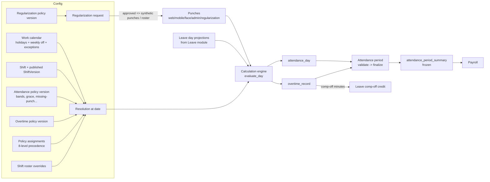
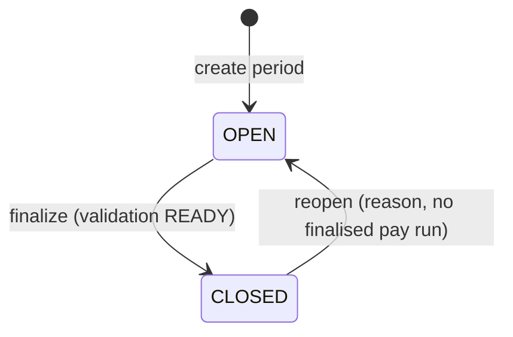
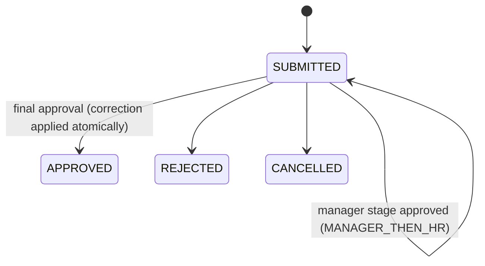
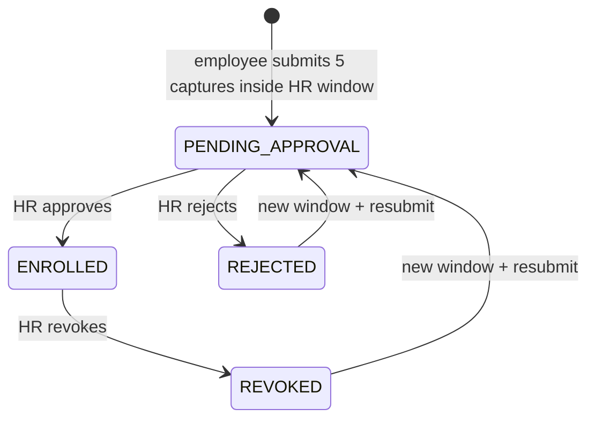
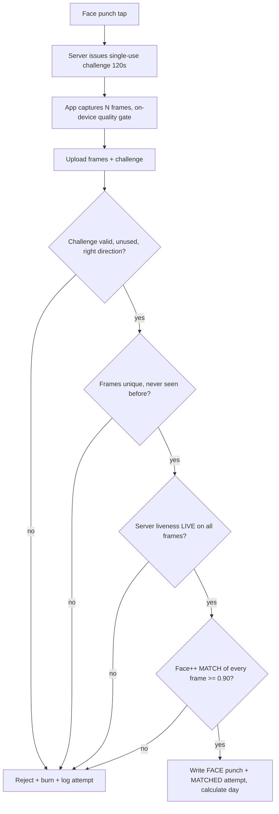

# Module 06 — Attendance Management (including Face Attendance)

> Part of [Staff Spectrum HRMS Functional Documentation](../STAFF_SPECTRUM_HRMS_FUNCTIONAL_DOCUMENTATION.md) · [Module catalog](../STAFF_SPECTRUM_HRMS_MODULE_CATALOG.md) · [Workflow catalog](../STAFF_SPECTRUM_HRMS_WORKFLOW_CATALOG.md) · [Gaps](../STAFF_SPECTRUM_HRMS_FUNCTIONAL_GAPS.md)

**Status summary**

| Area | Status |
|---|---|
| Punch capture (web self, mobile self, on-behalf) | Implemented and verified (28 integration test files, 11 unit files) |
| Daily calculation engine, shifts, calendars, rosters | Implemented and verified for the fields the engine actually reads; **several policy fields are stored but not evaluated** (see §9, "Partially implemented") |
| Regularization, overtime approval, comp-off feed | Implemented and verified |
| Attendance periods (validate / finalize / reopen / payroll summary) | Implemented and verified |
| Reporting / dashboards | Partial: web + mobile screens compute from API reads; **no export endpoint** (explicit in `reports-panel.tsx`) |
| Face attendance | Implemented, **not production-ready** by its own report: disabled by default; anti-spoof model not calibrated on real devices/attacks (`docs/audits/FACE_ATTENDANCE_LIVENESS_IMPLEMENTATION_REPORT.md`). The working tree contains uncommitted hardening work (migration `20261017090000_face_integrity_hardening`, `face_cleanup.py`) |
| GPS / geofence | **Not implemented** (branch has `latitude/longitude/geofence_radius_m` fields; nothing in Attendance reads them) |
| Biometric device / import / API punch sources | **Not implemented** as routes (the DB allows sources `DEVICE`, `IMPORT`, `API`, `MOBILE`, but no route assigns them; see §4.1) |

---

## 1. Module overview

### 1.1 What it does
Attendance turns raw IN/OUT **punches** into one computed **attendance day** per employee per date, decides a status (present, half-day, absent, leave, holiday…), measures late/early/worked/overtime minutes, lets employees request corrections (**regularization**), lets managers/HR approve **overtime**, and finally lets HR **close an attendance period** which freezes a per-employee **period summary** that Payroll reads (paid days, LOP days, overtime minutes by class, comp-off minutes).

### 1.2 Building blocks


### 1.3 Interaction with other modules
Organisation (shifts, calendars, holiday/weekly-off, policy assignment, legal entity for periods), Employee (employment spans, assignments, reporting manager, status), Leave (leave projections ↔ attendance days; comp-off), Payroll (reads closed-period summary; payroll finalisation blocks period reopen), Identity/RBAC.

---

## 2. User roles and permissions

### 2.1 Permission catalogue (`modules/attendance/permissions.py`)
`ATTENDANCE.POLICY_MANAGE`, `.VIEW`, `.VIEW_ALL`, `.PUNCH`, `.PUNCH_ON_BEHALF`, `.RECOMPUTE`, `.ROSTER_MANAGE`, `.REGULARIZATION_REQUEST`, `.REGULARIZATION_REQUEST_ON_BEHALF`, `.REGULARIZATION_APPROVE`, `.OVERTIME_APPROVE`, `.LOCK`, `.UNLOCK`, `.LEAVE_PROJECTION_SYNC`, `.FACE_ENROLLMENT_MANAGE` (15 codes).

### 2.2 Default role grants (live permission tables of a tenant registered with the current code + `register_company`)
| Capability | Employee | Reporting Manager | Branch Manager | HR Admin | Company Admin |
|---|---|---|---|---|---|
| `ATTENDANCE.PUNCH` (self punch, face punch, face self-enrolment) | **✘** | ✘ | ✘ | ✘ | ✔ |
| `ATTENDANCE.VIEW` (own/scoped days, punches, rosters, periods, OT list) | **✘** | ✘ | ✔ BRANCH | ✘ | ✔ |
| `ATTENDANCE.REGULARIZATION_REQUEST` | **✘** | ✘ | ✘ | ✘ | ✔ |
| `…REGULARIZATION_APPROVE`, `…OVERTIME_APPROVE` | ✘ | ✔ REPORTEE_TREE | ✔ BRANCH | ✔ COMPANY | ✔ |
| `…POLICY_MANAGE`, `…ROSTER_MANAGE`, `…LOCK`, `…UNLOCK`, `…RECOMPUTE`, `…PUNCH_ON_BEHALF`, `…VIEW_ALL`, `…LEAVE_PROJECTION_SYNC`, `…FACE_ENROLLMENT_MANAGE` | ✘ | ✘ | ✘ | ✘ | ✔ |

**Verified finding A-1 (high impact):** with the default roles that the product creates, the `EMPLOYEE` role holds **no** `ATTENDANCE.*` permission, so an ordinary invited employee cannot punch, see their own attendance, request a regularization or enrol their face; HR Admin cannot view attendance, manage rosters/policies, lock periods or manage face enrolment. Evidence: (a) `organisation/service.py::register_company` grants the `EMPLOYEE` role only `EMPLOYEE.VIEW*`, `LEAVE.APPLICATION_SUBMIT`, `LEAVE.BALANCE_VIEW`, `PAYROLL.PAYSLIP_VIEW_OWN`; (b) the dev database of this repository (`role_permission` for 90 tenants) shows the same; (c) the product exposes no role-editor (only assignment among five fixed roles, `account_invite/service.py::ASSIGNABLE_ROLE_CODES`). The integration tests create their own roles (`ATT_TEST_ROLE_*`) rather than relying on defaults, which is why this passes testing. A migration `20261005090000_face_attendance` did grant `ATTENDANCE.FACE_ENROLLMENT_MANAGE` to `HR_ADMIN` for tenants existing at that time, but tenants registered afterwards do not get it from `register_company`. *Not established:* whether a deployment-specific data step grants these permissions out-of-band; product-owner decision required (see Gaps register G-A1).

### 2.3 Data scope
`ATTENDANCE.VIEW`/`VIEW_ALL` reads are narrowed through `EmployeeService.resolve_visible_employee_ids` (SELF, REPORTEES, REPORTEE_TREE, BRANCH, COMPANY). Punching / requesting on behalf validates the **target** employee against the caller's scope. HR-stage approvals require COMPANY scope; MANAGER-stage approvals require the caller to be the snapshotted `resolved_approver_manager_id`. Self-approval is always blocked. Face approvals: an employee cannot approve their own face profile (`FACE_ENROLLMENT_SELF_APPROVAL_NOT_ALLOWED`).

---

## 3. Screens and navigation

### 3.1 Web
| Screen | Route | Purpose |
|---|---|---|
| Attendance (admin mode) | `/app/attendance` | Dashboard: toolbar filters (date range, entity), "Needs attention", status distribution, today/range list, trend, leave & absence, work hours, overtime, department/location/work-mode breakdowns, heatmap, reports table (search/sort/paginate; **no export**). "Record punch" button when the user holds `ATTENDANCE.PUNCH` or `…ON_BEHALF` (not shown in self mode). |
| Attendance (self mode) | `/app/attendance` | `SelfView` for the signed-in employee. |
| Attendance day detail | `/app/attendance/[id]` | Day facts, breaks, punches, "keep leave over punches" action. |
| Employee month view | `/app/attendance/employee/[employeeId]` | Calendar for one employee. |
| Regularizations | `/app/regularizations`, `/[id]` | Request / review. |
| Overtime | `/app/overtime`, `/[id]` | Review detected overtime. |
| Shift Rosters | `/app/rosters`, `/app/rosters/calendar` | Per-employee per-date overrides. |
| Attendance Periods | `/app/attendance-periods`, `/[id]` | Create, validate, finalize, reopen, summary. |
| Settings → Attendance & Time | `/app/shifts`, `/work-calendars`, `/holiday-calendars`, `/weekly-off-patterns`, `/attendance-policies`, `/overtime-policies`, `/regularization-policies` (+ detail pages with version lifecycle) | Configuration. |
| Settings → Policies | `/app/policy-assignments`, `/app/policy-resolution` | Assign and diagnose. |
| Face enrolment (HR) | embedded `FaceEnrollmentCard` on the employee page | open/cancel window, review photo, approve/reject/revoke. |

**Web has no employee face-capture screen** (no calls to `/attendance/face-punches/me` or `/attendance/face-enrollment/me` in `apps/web/src`); face enrolment by the employee and face punching exist **only on mobile**.

### 3.2 Mobile (`apps/mobile/lib/features/attendance`)
Bottom tab "Attendance" (`AttendanceSelfScreen`: Face punch card, **plain Punch in / Punch out buttons**, "This month" card, last 14 days); `AttendanceDayDetailScreen`; `TeamAttendanceScreen` (`/app/team-attendance`); `AttendanceInsightsScreen` (`/app/attendance-insights`: needs attention, trend, leave & absence, work hours, overtime, heatmap); `RostersScreen`/`RosterCalendarScreen`; `AttendancePeriodsScreen` + detail; `PolicyAssignmentsScreen`, `PolicyResolutionScreen`; requests via generic `RequestListScreen` (`/app/regularizations`, `/app/overtime`); policy/shift/calendar resources via generic `ResourceListScreen`; `FaceEnrollmentScreen` (five-pose capture), `FaceLivenessCaptureScreen`, `FaceEnrollmentAdminCard` (HR).

### 3.3 States
Loading spinner, error with Retry, "No attendance records yet", "No employee record is linked to your account." (mobile). Server messages are shown as-is.

---

## 4. Feature-by-feature

### 4.1 Punch capture
| Method | Endpoint | Permission | Source stored | Time authority |
|---|---|---|---|---|
| Employee web/mobile plain punch | `POST /attendance/punches/me` `{direction IN\|OUT, reference?, idempotency_key?}` | `ATTENDANCE.PUNCH` (SELF) | `WEB` (constant, even when called from the mobile app) | **Server clock** — the schema has no time/employee/source fields |
| On-behalf (HR correction) | `POST /attendance/punches` `{employee_id, direction, punch_time, …}` | `ATTENDANCE.PUNCH_ON_BEHALF` | `ADMIN` | Supplied time: must not be in the future, within employment, not after last working day, in an open period |
| Face punch | `POST /attendance/face-punches/me` (+ liveness session) | `ATTENDANCE.PUNCH` | `FACE` | Server clock |
| Regularization-applied | internal | — | `REGULARIZATION` | the approved requested time |

* Punches are **immutable and append-only**; a correction is a new punch. Duplicate/stale protection: optional `idempotency_key` (unique per company; same key + same direction/source replays; different employee → `DuplicatePunchIdempotencyKey`).
* After insert a best-effort immediate calculation of the day runs inside a savepoint; any failure is swallowed and logged (the daily sweep repairs it).
* Rejections: punch before employment started (`PunchTimeBeforeEmployment`), after last working day, into a closed attendance period (`_ensure_punch_date_open`), future time (on-behalf).
* The mobile app reuses one idempotency key across retries of a punch whose outcome is unknown (no response), so a retry never double-records.

### 4.2 Daily calculation (the engine)
Triggered by (a) a punch (immediately, best-effort), (b) `POST /attendance/days/calculate` (`ATTENDANCE.VIEW_ALL`), `…/recompute`, `…/calculate-range` (`ATTENDANCE.RECOMPUTE`), (c) leave projection sync/cancel, regularization approval, (d) the **daily Celery sweep** `attendance.run_daily_calculation` at **09:30 `Asia/Kolkata`** for today and the previous 3 days (`TRAILING_DAYS = 3`). Calculation is a full-row replacement under a row lock and refuses locked days (period closed).

Order of evaluation (`calculation.evaluate_day`, ENGINE_VERSION = 2):
1. **Population gate**: employee not yet joined → `NOT_JOINED`; after last working day → `EXITED`.
2. Timezone unresolvable / no calendar resolved / no attendance policy resolved → `CONFIG_ERROR` (fails closed; never defaults).
3. Roster week-off override with no punches → `NOT_EXPECTED`.
4. No shift: no punches → `INCOMPLETE` (or `ABSENT` if policy `missing_shift_behaviour=ABSENT`); punches → evaluated with no schedule.
5. Non-working day (holiday / weekly off / shutdown) with no operating shift and no punches → `NOT_EXPECTED`.
6. Punch hygiene: sort, **collapse** same-direction punches within `duplicate_punch_window_seconds` (default 60), **pair** IN→OUT (an IN followed by IN orphans the first; stray OUT orphaned; trailing IN orphaned).
7. Fixed/Flexible shift or Split-shift evaluation (below).
8. Overlays: approved **on-duty** request, approved **leave projection** (full-day leave → `LEAVE`; half-day leave → remaining half from punches).

Statuses (`attendance_day.attendance_status` CHECK): `NOT_JOINED, EXITED, NOT_EXPECTED, PRESENT, HALF_DAY, ABSENT, LEAVE, ON_DUTY, WFH, INCOMPLETE, CONFIG_ERROR`. (`WFH` is allowed by the schema; the engine never sets it — WFH remains a regularization type with no status effect.)

**Worked minutes**: `multi_punch_mode`
* `PAIR_ALL` (default): Σ of paired intervals; paid break gaps are added back; unpaid gaps are already excluded.
* `FIRST_IN_LAST_OUT`: last OUT − first IN; unpaid break gaps subtracted.
Break gaps between pairs are matched to the shift's break definitions (fixed window / flexible duration, paid/unpaid, excess minutes). A mandatory break with **no punched gap is not auto-deducted** (documented limitation in the module docstring).

**Late / early**:
```
late_minutes  = max(0, minutes(first_in − scheduled_start) − grace_in_minutes)
early_minutes = max(0, minutes(scheduled_end − last_out) − grace_out_minutes)
late_class / early_class = first matching band (min..max inclusive, open-ended top) in the policy's late / early-departure bands
```
Hypothetical example: shift 09:00, grace-in 10, band 1–30 → NONE, 31+ → HALF_DAY; first IN 09:45 → late_raw 45 − 10 = 35 → HALF_DAY.
If `early_departure_requires_approval` is on and no approved `EARLY_DEPARTURE_APPROVAL` request exists, early classification is forced to the **harshest configured** early band.

**Status resolution** (`_resolve_primary_status`): zero worked minutes: not-expected → `NOT_EXPECTED`; missing punch → `INCOMPLETE` (or `ABSENT` if `missing_punch_behaviour=ABSENT`); otherwise `ABSENT`. With worked minutes: missing punch + behaviour ABSENT → `ABSENT`; behaviour not AUTO_CLOSE → `INCOMPLETE`; else hour-band status (`PRESENT/HALF_DAY/ABSENT` from the policy's hour bands by worked minutes; **no band configured ⇒ PRESENT**). Then any of late/early class = ABSENT, or core-hours breach (policy `ABSENT`) forces `ABSENT`; any = HALF_DAY, core-hours breach `HALF_DAY`, or cumulative counters forces `HALF_DAY`.
**Cumulative counters** (`lates_to_half_day_count`, `excess_break_days_to_half_day_count`): if (prior qualifying days in the calendar month before this date + 1) ≥ threshold, this day becomes HALF_DAY. Only `MONTH` window is supported.
**Paid / LOP fractions**: PRESENT 1.00/0.00; HALF_DAY 0.50/0.50; ABSENT 0.00/1.00; NOT_EXPECTED 1.00 paid (unless an unpaid off-day, below); INCOMPLETE/CONFIG_ERROR 0/0 (not sent to payroll).
**Off-day pay** (BUS-001): a holiday flagged `is_paid=false` is unpaid for everyone; for `MONTHLY` pay basis other off days are paid; for `DAILY_WAGE` only `PUBLIC`/`SUBSTITUTE` holidays are paid (weekly offs, company holidays, shutdowns unpaid). Invariant: `paid + lop + unpaid_off = 1.00` for each employed day.
**Half-day weekly off** (e.g. alternate half Saturdays, `off_fraction 0.50`): evaluated as a working day; the off half credited paid.
**Leave overlay**: total leave fraction ≥ 1.00 ⇒ `LEAVE` (late/early/overtime zeroed; paid = paid-leave fraction, LOP = LOP-leave fraction; punches on that day set `work_on_leave_flagged`, which **blocks period close** until HR resolves via "keep leave over punches" or cancels the leave). 0 < fraction < 1 ⇒ `HALF_DAY` if punches exist else `LEAVE`; remainder contributed as flat 0.50.
**Overtime detection** (§4.5).

### 4.3 Shifts, calendars, rosters, policy assignment
* **Shift** (identity) + **ShiftVersion** (DRAFT→PUBLISHED, effective-dated, no overlapping published ranges per shift, one open draft). Types: `FIXED` (start/end; end < start ⇒ cross-midnight), `FLEXIBLE` (start window, `required_minutes`, optional core hours; core pair must be given together and core_end > core_start), `SPLIT` (≥2 non-overlapping contiguous duty blocks). Breaks: `FIXED_WINDOW` or `FLEXIBLE_DURATION`, paid/unpaid, mandatory flag. Version timezone > branch timezone > company timezone.
* **Work calendar** = optional weekly-off pattern + ordered holiday calendars + one-off exceptions (`SPECIAL_WORKING, SHUTDOWN, SUBSTITUTE_HOLIDAY, CANCEL_HOLIDAY`). Resolved order: exception > holiday union (first calendar wins ties) > weekly off > working. Details in [Organisation module](02_ORGANISATION.md).
* **Roster** (`ShiftRoster`): per employee per date shift override or week-off / holiday-working override (mutually exclusive); DRAFT→PUBLISHED; only PUBLISHED rows affect calculation. Bulk create supported. Roster overrides expectation of presence only; they never change the calendar day type.
* **Policy assignment** with 8-level precedence (see Organisation).

### 4.4 Regularization (attendance corrections)
* **Types** (`_REGULARIZATION_TYPES`): `MISSING_PUNCH, WRONG_PUNCH, WRONG_SHIFT, WRONG_STATUS, WFH, ON_DUTY, EXCESS_BREAK, FULL_DAY, EARLY_DEPARTURE_APPROVAL`. Which are allowed is configured per policy version (`allowed_types`); an empty set denies everything (fail closed).
* **Submit** (`POST /regularizations`): self (`…REGULARIZATION_REQUEST`) or on behalf (`…_ON_BEHALF`). Validation: period open; date not in the future (except `EARLY_DEPARTURE_APPROVAL`); date within employment; requested punch times within ±1 day of the date and not in the future; policy resolves; type allowed; self/on-behalf permitted by policy (the service only checks that either manager or HR on-behalf is allowed); `max_backdated_days`; reason / attachment-reference required flags; `max_requests_per_month` (**counted from the UTC month start**, whereas Leave uses company-local month); **one active request per employee per date**; day not locked (if `blocked_when_locked`).
* **Approval chain** (policy): `AUTO`, `MANAGER`, `MANAGER_THEN_HR`, `HR`. Manager = reporting manager as of the attendance date; if none, routes to HR (`APPROVER_UNRESOLVED`). No HOD stage (unlike Leave).
* **On approval** (same transaction): `WRONG_SHIFT` ⇒ create/update a PUBLISHED roster row for that date; requested punches ⇒ synthetic punches (`source=REGULARIZATION`, `reference=regularization:<id>`); recompute the day; mark day regularized; request marked applied; action `APPLIED`. If recalculation is refused (locked day) the whole approval rolls back.
* **Reject / cancel**: no correction; the pending flag on the day is cleared.
* `auto_approve_within_minutes` exists on the policy but **no code reads it** (verified by search).
* Statuses: `SUBMITTED, APPROVED, REJECTED, CANCELLED`.

### 4.5 Overtime
Detected by the engine only (no manual overtime request). For an eligible day:
```
excess = max(0, worked_minutes − scheduled_minutes)
if excess < min_ot_minutes → none
excess = round(excess, rounding_mode, rounding_minutes)          # NEAREST | UP | DOWN
excess = min(excess, daily_cap, remaining_weekly_cap, remaining_monthly_cap)   # caps from sibling-day state
day_class = HOLIDAY | WEEKLY_OFF | NIGHT | NORMAL  → rate row classification code
```
Eligibility: `NEVER` none; `SHIFT_FLAG` needs the shift's OT flag; `ALWAYS`/`GRADE_VIA_ASSIGNMENT` otherwise. Night: `SHIFT_FLAG | WINDOW | BOTH`. If `requires_post_approval` is false the OT is auto-approved at detection; otherwise `ot_pending` and an `OvertimeRecord (PENDING)` awaits review (statuses `PENDING, AUTO_APPROVED, APPROVED, REJECTED`). `comp_off_instead_of_pay` copies detected minutes into `comp_off_minutes`; expiry date = attendance date + `comp_off_expiry_days`. Review: manager (identity) → HR (COMPANY), `MANAGER_THEN_HR`; self-approval blocked; period must be open. Approval writes `ot_minutes_approved`/`comp_off_minutes_earned` onto the day directly. `requires_pre_approval` and `GRADE_VIA_ASSIGNMENT` semantic: stored; pre-approval is **not** enforced by code reviewed (no pre-approval route exists) — see Gaps. Full-day leave days never carry OT.

### 4.6 Attendance periods (lock, validate, finalize, reopen)
* **Create** `POST /attendance-periods` (`ATTENDANCE.LOCK`): per **legal entity**, `period_start..period_end`, label; opens immediately; no overlap per entity.
* **Validate** (`…/validate`) returns `READY` or `BLOCKED` with reasons: `EMPLOYEES_WITHOUT_ATTENDANCE`, `CONFIG_ERROR`, `WORK_ON_LEAVE_UNRESOLVED`, `PAID_LOP_MISMATCH`, `INCOMPLETE_ATTENDANCE` (if lock-behaviour is KEEP_INCOMPLETE), `PENDING_REGULARIZATION`, `PENDING_OVERTIME_APPROVAL`, `UNPUBLISHED_ROSTER`.
* **Finalize** (`…/finalize`, `If-Match`): re-validates fresh; flips `OPEN→CLOSED` (version-guarded); resolves remaining `INCOMPLETE` days per policy `incomplete_at_lock_behaviour` (`TREAT_ABSENT` default → LOP; `TREAT_PRESENT`; `KEEP_INCOMPLETE` blocks); builds the **frozen per-employee summary** and asserts reconciliation (buckets sum to period days; paid + LOP + unpaid-off = payable); locks all day rows. One transaction.
* **Summary** fields: present, half, absent, leave, holiday, weekly-off, on-duty, incomplete, not-employed days; paid/LOP/unpaid-off/payable days; OT minutes by class (normal / weekly-off / holiday / night); comp-off minutes; late count; worked minutes.
* **Reopen** (`…/reopen`, `ATTENDANCE.UNLOCK`, reason): only CLOSED periods; **refused if a finalised pay run exists for the period** (`ATTENDANCE_PERIOD_PAYROLL_FINALISED`); unlocks days; re-finalising regenerates the snapshot.
* While CLOSED: punches, regularizations, OT review, leave submit/approve/cancel and manual leave-ledger entries for those dates are refused. Concurrency: exclusive advisory lock vs leave approvals and payroll finalisation.
* Reminders (daily 10:00): see §8.

### 4.7 Leave projection (Attendance side of Leave)
`LeaveProjectionService.sync/cancel` are invoked **by Leave** on approval/cancellation (identifiers only; values re-derived from the approved leave day). Also exposed as `POST /leave-projections` (`ATTENDANCE.LEAVE_PROJECTION_SYNC`, held by Company Admin) but the body can only name an approved application's day; it cannot invent leave. Overlap guard: Σ active fractions on a date ≤ 1.00.

### 4.8 Face attendance (security-sensitive)
**Purpose.** Optional biometric verification of IN/OUT punches from the **mobile** app. It is *additional*: the plain punch button remains on the same screen, so face verification does **not** gate attendance (finding F-1).

**Enablement / configuration (all off by default):** `FACE_VERIFICATION_PROVIDER` (`disabled` | `facepp`), `FACEPP_API_KEY/SECRET/BASE_URL`, `FACE_LIVENESS_ENGINE` (`disabled` | `minifasnet`), `FACE_LIVENESS_MODEL_DIR` (assets under `apps/api/models/liveness`, SHA-256-pinned in `liveness.py`; requires the optional `liveness` extra with OpenCV). If either is disabled, enrolment and face punching fail closed (`FACE_VERIFICATION_UNAVAILABLE` / `FACE_LIVENESS_UNAVAILABLE`).

**Enrolment workflow**
1. HR (`ATTENDANCE.FACE_ENROLLMENT_MANAGE`) opens a **one-time window** for an employee (default **48 h**, `face_enrollment_window_hours`). Refused if already ENROLLED or PENDING_APPROVAL. A previous open window is cancelled/expired.
2. Employee (mobile `FaceEnrollmentScreen`) gives **explicit consent** and captures five images: `front, left, right, up, down` (on-device pose tracker guides: front |yaw/pitch| ≤ 10°, turns 20–45°, tilts 12–35°; opposite signs for the two turns / two tilts; angle names are capture-order labels).
3. Server: consent required; all five images must be JPEG/PNG (sniffed from bytes, ≤ `FACE_IMAGE_MAX_BYTES`); window open; enrolment-attempt limit (`face_enrollment_max_failed_attempts`, default 5); **server-side liveness on every capture**; Face++ enrols the front image; every other angle must match the front above `face_enrollment_angle_min_similarity` (default 0.80); front photo stored temporarily for HR review (`face-review/...`). Profile → `PENDING_APPROVAL`. Any failure deletes the just-created provider person and review photo (best effort).
4. HR reviews the front photo and **approves** (→ `ENROLLED`, review photo deleted) or **rejects** (provider person deleted first; if that fails the profile is unchanged; photo deleted; optional note). **An employee cannot approve their own profile.**
5. **Revoke** (HR): provider person deleted first, then profile → `REVOKED`.
Profile statuses: `PENDING_APPROVAL, ENROLLED, REJECTED, REVOKED`.
No face images are stored in the HRMS database after review; only provider person id, status, timestamps, consent instant and (until approval/rejection) the review photo key.

**Face punch workflow**
1. Employee taps face punch IN/OUT → `POST /attendance/face-punches/me/liveness-sessions` `{direction}`: a **single-use challenge** bound to employee + direction, TTL **120 s** (`face_liveness_session_ttl_seconds`), `frames_required` (default 3). Older unused challenges are superseded; issuance is limited (`face_liveness_sessions_per_window`, default 20 per window) and blocked once failed attempts reach the limit.
2. Mobile `FaceLivenessCaptureScreen` captures N frames with an **on-device quality gate** (one face; width 28–85 % of the frame; |yaw|,|pitch| ≤ 15°; eyes open ≥ 0.4; held steady for 3 readings). This gate is explicitly **not** liveness and its result is never sent.
3. `POST /attendance/face-punches/me` (multipart: challenge id, exactly N frames, direction, optional `idempotency_key` 16–64 chars `[A-Za-z0-9_-]`):
   idempotent replay check → attempt limit → challenge **burned in its own committed transaction** (expired/used/wrong-direction burn it too) → **byte-identical frame digests** within the request or seen in earlier sessions ⇒ `CAPTURE_REPLAYED` → profile must be `ENROLLED` → **server-side passive liveness (MiniFASNet fusion) on every frame**: all must be `LIVE` (`live_score ≥ 0.90`, default); `SPOOF_SUSPECTED` if `spoof_score ≥ 0.50`; otherwise `INCONCLUSIVE`; engine errors/timeouts never pass → **Face++ identity match of every frame** against that employee's own enrolled person only: each must be `MATCHED` with similarity ≥ `face_match_min_similarity` (default **0.90**), best-liveness frame first; the stored similarity is the **minimum** across frames → a `FACE`-source punch is written by the normal punch path (server clock) and a `MATCHED` attempt row is written in the same transaction.
4. Every rejection is recorded in a separate committed transaction (`face_verification_attempt` with decision, similarity, liveness score, minimal typed evidence — no raw provider body) and emits a security log event `face_punch.rejected` with a fixed reason code.
5. Lock-out: ≥ `face_punch_max_failed_attempts` (5) failures inside `face_punch_attempt_window_minutes` (10) ⇒ `FACE_ATTEMPTS_EXCEEDED` until the window passes.
Rejection decisions: `NOT_ENROLLED, CHALLENGE_REJECTED, CAPTURE_REPLAYED, SPOOF_SUSPECTED, LIVENESS_INCONCLUSIVE, LIVENESS_ERROR, NO_FACE, AMBIGUOUS_FACE, NO_MATCH, IDENTITY_INCONSISTENT, PROVIDER_ERROR`.

**Retention** (`attendance.run_face_cleanup`, daily 03:15): deletes liveness sessions (and replay digests) after `face_liveness_session_retention_days`; erases `provider_response`/`provider_person_id` on attempt rows after `face_attempt_detail_retention_days` (rows kept); deletes rejected-enrolment attempts after `face_enrollment_attempt_retention_days`. **No periods are defaulted** (a privacy/legal decision); `face_cleanup_dry_run` defaults **true**; `face_cleanup_hold_company_ids` pauses tenants. Never touches punches, days, profiles or audit logs. (Working-tree feature, uncommitted at the time of writing.)

**Implemented controls vs. unmeasured effectiveness**
| Control | Implemented | Effectiveness measured? |
|---|---|---|
| Server decides liveness; client verdicts ignored | Yes (tested) | n/a |
| Passive single-frame anti-spoof on every frame | Yes | **No** — thresholds are "uncalibrated engineering defaults"; only 3 upstream sample images checked; no device/attack evaluation |
| Active (challenge-response) liveness | **No** (the "challenge" is a server session id, not a pose/blink prompt) | — |
| Replay: single-use session, frame digests | Yes | functional tests only |
| Identity: Face++ match of all frames, 0.90 floor | Yes | provider accuracy not evaluated here |
| Injected-camera / virtual-camera / high-quality screen replay / 3D mask resistance | **Not claimed** (documented as not robust by design) | No |
| Rate limiting & lockout | Yes | — |
| Consent record, audit trail, minimal data retention | Yes | retention periods unset |
| Fallback to plain punch | **Plain punch always available** | — |
> Treat face punching as **pilot-only**. Production remains `disabled` by default, per the implementation report.

### 4.9 Reporting
No export endpoint exists. Web `reports-panel.tsx` states "Export (CSV / Excel / PDF) is not available yet — the backend has no attendance export endpoint." Period summaries are the payroll-facing "report".

---

## 5. Business rules and calculations (quick reference)
| Rule | Value / formula | Source |
|---|---|---|
| Server-authoritative punch time for self punches | always `now()` | `PunchService.record_punch_outcome` |
| Duplicate collapse | same direction within `duplicate_punch_window_seconds` (60) | `collapse_duplicate_punches` |
| Late minutes | `max(0, first_in − scheduled_start − grace_in)` | `_evaluate_fixed_or_flex` |
| Early minutes | `max(0, scheduled_end − last_out − grace_out)` | same |
| Cumulative half-day | `(prior_qualifying_days_in_month + 1) ≥ threshold` | same |
| OT | §4.5 | `detect_overtime` |
| Comp-off minutes | equal to detected OT minutes when `comp_off_instead_of_pay` | engine |
| Comp-off days credited (Leave) | `round(comp_off_minutes / comp_off_day_length_minutes, 2)` | `LeaveCompOffService` |
| Period summary reconciliation | Σ buckets = period days; paid+LOP+unpaid-off = payable | `_assert_summary_reconciles` |
| Timezone precedence | ShiftVersion > Branch > Company | `resolve_timezone` |
| Beat schedule | 09:30 IST calc (3-day trailing); 10:00 reminders; 03:15 face cleanup | `celery_app.py` |

Date boundaries: a punch's local date uses the company timezone (the immediate trigger uses the punch's **local calendar date**, then `calculate()` re-derives ownership for overnight shifts). Company timezone cannot be changed once any computed attendance exists (`TIMEZONE_CHANGE_BLOCKED`); branch timezone likewise for employees ever assigned to the branch.

---

## 6. Lifecycles




Punch → day: each punch triggers recalculation; the sweep re-runs the last 3 days; period close freezes.

---

## 7. Data
| Record | Notes |
|---|---|
| `punch` | immutable; `direction IN/OUT`; `source ∈ WEB, MOBILE, DEVICE, IMPORT, ADMIN, API, REGULARIZATION, FACE` (only WEB, ADMIN, REGULARIZATION, FACE are assigned by code); optional idempotency key |
| `attendance_day` | unique (company, employee, date); computed facts, `computation_snapshot` (inputs, policy versions, engine version), `is_locked`, `is_regularized`, `is_pending_approval`, `work_on_leave_flagged`, `calculation_version` |
| `attendance_break` | matched break gaps |
| `overtime_record` / `overtime_action` | detected/approved minutes, day class, comp-off minutes & expiry |
| `attendance_regularization_request` (+ requested punches, actions) | |
| `attendance_policy` (+ versions, hour/late/early bands), `overtime_policy` (+ versions, rate rows), `regularization_policy` (+ versions, allowed types) | immutable once published |
| `shift_roster` | |
| `attendance_period` (+ actions), `attendance_period_summary` | frozen payroll inputs |
| `leave_day_projection` | one row per leave day |
| `employee_face_profile`, `face_enrollment_window`, `face_verification_attempt`, `face_enrollment_attempt`, `face_liveness_session` | biometric workflow; **sensitive**; no images retained after review |
Append-only protections: `punch` and history tables are insert-only for the runtime role (migration `20261009091000_history_tables_append_only`).

---

## 8. Integrations and automation
| Job | Schedule | Behaviour |
|---|---|---|
| `attendance.run_daily_calculation` → `attendance.calculate_company` | daily 09:30 IST | per employee-date transaction; today + 3 trailing days; skips locked/closed |
| `attendance.run_incomplete_reminders` → `attendance.send_incomplete_reminders_company` | daily 10:00 IST | For each non-CLOSED period ending within `attendance_incomplete_reminder_lead_days` (3): **email** each employee with unlocked INCOMPLETE days (excluding today) and a digest to every `ATTENDANCE.LOCK` holder; once per period per business date (audit-row dedup); skips employees without email |
| `attendance.run_face_cleanup` | daily 03:15 | retention (see 4.8) |
| `attendance.calculate_range` | on demand (queued from `calculate-range`) | |
External: Face++ (Megvii) HTTP API for enrolment/match (`FACEPP_*`); local ONNX liveness. Email via the shared provider (`logging` default, `smtp`, `mailtrap`, `hostinger`). Idempotency: punches by key; face punches by namespaced key `face:<key>` + advisory lock; challenges single-use. There is **no push notification** and no in-app notification centre.

---

## 9. Edge cases and known limitations
**Verified (code/DB evidence)**
| # | Finding |
|---|---|
| A-1 | Default Employee/HR roles lack `ATTENDANCE.*` grants (see §2.2). |
| A-2 | **Stored but not evaluated** attendance-policy fields (no reference in `calculation.py`/`service.py` beyond persistence): `punch_rounding`/`rounding_minutes`, `half_day_split`, `half_day_boundary_minutes`, `early_out_uses_core_end`, `excess_break_behaviour`, `auto_close_after_minutes`, `auto_close_uses_shift_end` (and the `AUTO_CLOSE` missing-punch value: `auto_closed` is never set true; it behaves like "evaluate on completed pairs only"), `wfh_requires_punch`, `wfh_uses_shift_hours`, `split_shift_block_mandatory`, `split_shift_allow_hours_compensation`, `work_on_leave_behaviour` (superseded by BUS-012), `late_count_window` / `excess_break_count_window` (only `MONTH` is supported). Regularization policy `auto_approve_within_minutes` unused. Overtime `requires_pre_approval` unused (no pre-approval flow). |
| A-3 | `source=MOBILE` is never assigned; mobile self punches are recorded as `WEB`. No `DEVICE`/`IMPORT`/`API` route. |
| A-4 | Geofence / GPS: not implemented. |
| A-5 | No attendance export (CSV/Excel/PDF). |
| A-6 | Face punching is optional and parallel to plain punching; no tenant switch to require it. |
| A-7 | Regularization monthly cap counts from UTC month start; Leave uses company-local month. |
| A-8 | Mandatory-break auto-deduction absent (documented in code). |
| A-9 | SPLIT shifts: a duty block with any overlapping punch pair counts as satisfied (no partial credit); half-day leave contributes a flat 0.50 (documented simplifications). |
| A-10 | `OvertimeRecord` approval writes day fields directly, bypassing `calculate()`; guarded only by the period-open check. |
| A-11 | A day's OT can differ on recompute if sibling-day state changed (accepted, WD-29). |
| A-12 | Face: anti-spoofing effectiveness unmeasured; production disabled; uncommitted hardening changes in working tree. |
| A-13 | Immediate calculation failures are swallowed; correctness then depends on the 09:30 sweep (up to the next morning). |
**Potential risks, not reproduced:** HR role cannot be used to operate attendance until grants are fixed; time-of-day skew for overnight shifts handled by the 3-day sweep.

## 10. Functional acceptance criteria
1. *Self punch:* a user with `ATTENDANCE.PUNCH` posts `IN` → 201, punch `source=WEB`, server time; day recalculated; repeated with same `idempotency_key` returns the same punch.
2. *Permission:* a user without `ATTENDANCE.PUNCH` → 403; `POST /attendance/punches` with only `PUNCH` → 403.
3. *Validation:* on-behalf punch with a future time → validation error (`FuturePunchTimeError`); punch before joining date → `PUNCH_TIME_BEFORE_EMPLOYMENT`; punch in a CLOSED period → rejected.
4. *Engine:* late 35 min beyond grace with a HALF_DAY band → status HALF_DAY, paid 0.50/LOP 0.50; zero punches on an expected working day with default policy → `INCOMPLETE`; no calendar → `CONFIG_ERROR`.
5. *Regularization:* MISSING_PUNCH with requested OUT time, MANAGER chain, manager approves → request APPROVED+APPLIED, synthetic punch present, day regularized; second active request for the same date → duplicate error; type not in allowed list → `REGULARIZATION_TYPE_NOT_ALLOWED`; self-approval → blocked.
6. *Overtime:* worked 600 vs scheduled 540, min 15, cap 60 ⇒ detected 60; with post-approval on → PENDING; approve → day `ot_minutes_approved`=60.
7. *Period:* finalize with a PENDING regularization → `ATTENDANCE_FINALIZATION_BLOCKED` listing `PENDING_REGULARIZATION`; finalize READY → CLOSED and days locked; reopen after finalised payroll → refused.
8. *Face:* enrol without consent → `FACE_CONSENT_REQUIRED`; submission outside a window → `FACE_ENROLLMENT_NOT_OPEN`; reuse of a challenge → `FACE_LIVENESS_CHALLENGE_USED`; identical frames twice → `FACE_CAPTURE_REPLAYED`; spoof score ≥ threshold → `FACE_SPOOF_SUSPECTED`; 5 failures in 10 minutes → `FACE_ATTEMPTS_EXCEEDED` (HTTP 429); HR cannot approve own profile.
9. *Concurrency:* two concurrent finalizes → one wins (version), other 409.
> Proposed (not existing): default grants of `ATTENDANCE.PUNCH/VIEW/REGULARIZATION_REQUEST` to the Employee role; export endpoint; geofence enforcement.

## 11. Evidence
* **API:** `apps/api/src/hrms/modules/attendance/{router,service,calculation,face_service,face_verification,liveness,face_cleanup,reminders,tasks,resolution,permissions,models,schemas,repository,exceptions,email_templates}.py`; `organisation/calendar_resolution.py`.
* **Migrations:** `20260819090000…20260826090000` (policies, punch, day, roster, regularization, overtime, period, leave projection), `20260826090000_wd32_attendance_rules`, `20261004090000…20261004104000` (payroll summary/pay-basis/engine version), `20261005090000_face_attendance`, `…06_face_enrollment_window`, `…07_face_attendance_facepp_provider`, `20261015090000_face_liveness_session`, `20261017090000_face_integrity_hardening` (uncommitted).
* **Tests:** `tests/integration/modules/attendance/*` (28 files incl. `test_face_punch.py`, `test_face_enrollment.py`, `test_face_cleanup.py`, `test_face_integrity_hardening.py`); `tests/unit/modules/attendance/*` (11); mobile `face_liveness_capture_test.dart`, `face_pose_tracker_test.dart`, `face_punch_card_test.dart`, `attendance_*_test.dart`, `rosters_test.dart`.
* **Web:** `apps/web/src/app/app/attendance*`, `components/attendance/**`, `lib/attendance*`.
* **Mobile:** `apps/mobile/lib/features/attendance/**`.
* **Existing docs (intent):** `docs/architecture/WORKFORCE_ATTENDANCE_ARCHITECTURE.md`, `docs/business-rules/ATTENDANCE_V1_*.md`, `docs/audits/FACE_ATTENDANCE_*`, `docs/audits/PAYROLL_BUSINESS_DECISIONS.md`.
