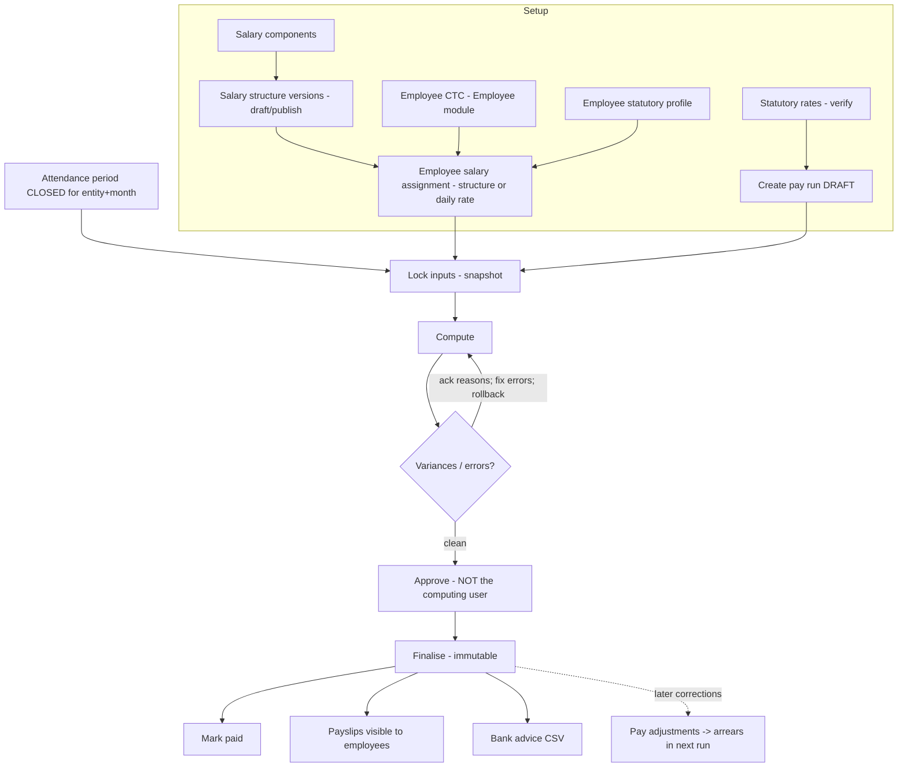

# Module 07 — Payroll Management

> Part of [Staff Spectrum HRMS Functional Documentation](../STAFF_SPECTRUM_HRMS_FUNCTIONAL_DOCUMENTATION.md) · [Module catalog](../STAFF_SPECTRUM_HRMS_MODULE_CATALOG.md) · [Workflow catalog](../STAFF_SPECTRUM_HRMS_WORKFLOW_CATALOG.md) · [Gaps](../STAFF_SPECTRUM_HRMS_FUNCTIONAL_GAPS.md)

**Status:** Monthly pay-run engine, salary structures, statutory PF/ESI/PT/LWF, TDS (new regime only), payslips, bank advice and arrears are **Implemented and verified at code + automated-test level** (12 integration + 5 unit test files). **Legal/statutory compliance is NOT established by this document.** Seeded statutory rates are explicitly "unverified" data until a company's compliance user signs them off. No end-to-end run with real payroll data was observed by this review.

Not implemented (verified by search of `modules/payroll`): reimbursements, loans/salary advances, bonuses/incentives as recurring or one-off earnings, full-and-final settlement, off-cycle/special runs, Form 16 / Form 24Q / PF ECR / ESI return files, payment-gateway integration or bank reconciliation, year-end processing, payroll reports/exports beyond the bank-advice CSV and payslips.

---

## 1. Module overview

### 1.1 What it does
Monthly payroll **per legal entity**: HR sets up salary components and structures, assigns each employee a structure (monthly pay) or a daily rate (daily wage), then each month creates a **pay run** that takes a frozen snapshot of closed attendance, salary, statutory profile, overtime and leave encashment, computes every employee's pay line by line, flags unusual changes, requires a **different** person to approve, then **finalises** (immutable) and marks **paid**. Employees read their own payslips; HR can download a bank-transfer CSV.

### 1.2 Process


### 1.3 Dependencies
Organisation (legal entity), Employee (employment spans, pay basis `MONTHLY|DAILY_WAGE`, CTC, statutory profile, bank, PAN/UAN, DOB, gender), Attendance (closed period + frozen summary + payable overtime), Leave (system ledger `ENCASHMENT` rows, month-end balances on payslip), RBAC.

---

## 2. Roles and permissions (`payroll/permissions.py`)
| Code | Granted by default to | Gates |
|---|---|---|
| `PAYROLL.SETUP_MANAGE` | Company Admin, HR Admin (COMPANY) | components, structures, employee salary assignment, bulk assign, payroll settings |
| `PAYROLL.RUN_VIEW` | Company Admin, HR Admin | list/get pay runs, employees, payslip preview, adjustments list |
| `PAYROLL.RUN_PROCESS` | Company Admin, HR Admin | create/update/delete DRAFT run, lock inputs, compute, acknowledge variance, **rollback**, create/withdraw adjustments |
| `PAYROLL.RUN_APPROVE` | **Company Admin only** | approve, finalise, mark paid |
| `PAYROLL.STATUTORY_MANAGE` | Company Admin, HR Admin | create/edit/verify statutory rates |
| `PAYROLL.PAYSLIP_VIEW_OWN` | Employee (SELF) | `/me/payslips` |
| `PAYROLL.BANK_ADVICE_DOWNLOAD` | **Company Admin only** | bank advice CSV (full account numbers) |
| `EMPLOYEE.VIEW_COMPENSATION` (Employee module) | HR Admin, Company Admin, Employee (SELF) | read an employee's salary assignments and breakup |

Separation of duties: **maker ≠ checker** — the user who last computed a run cannot approve it (`PAY_RUN_MAKER_CHECKER`), whatever permissions they hold. Consequence: a tenant with a single Company Admin who computes cannot approve; typical split is HR Admin computes, Company Admin approves. There is **no independent finalise/mark-paid reviewer** (the approver can also finalise and mark paid), and **HR Admin can both edit and verify statutory rates** (`STATUTORY_MANAGE` covers both) — no second-person control on rate verification.
Employees see only their **own finalised** payslips (a non-final or someone else's run is indistinguishable from not found).

---

## 3. Screens
**Web:** `/app/payroll/pay-runs` (list/create), `/app/payroll/pay-runs/[id]` (status, step actions, per-employee table, variance acknowledgement, issues, rollback, bank advice download, adjustments), `/app/payroll/pay-runs/[id]/payslips/[employeeId]` (HR payslip view/preview), `/app/payroll/salary-components`, `/app/payroll/salary-structures` (+ `/[id]` version editor with preview), `/app/payroll/statutory-rates`, employee page salary panel (assign structure / daily rate; bulk assign), `/app/me/payslips`, `/app/me/payslips/[runId]`. The sidebar entry "Payroll" and Settings → Payroll group.
**Mobile:** `PayRunsScreen`, `PayRunDetailScreen`, `PayRunEmployeeScreen`, `StatutoryRatesScreen`, salary components/structures via resource screens, `EmployeeSalaryPanel`, `BulkAssignSalaryDialog`, `MyPayslipsScreen`, `PayslipScreen` with **client-side PDF generation** (`payslip_pdf.dart`, `pdf`+`printing` packages) and share.
The web payslip view has a Print button (`window.print()`); there is no server-side PDF endpoint.

---

## 4. Features

### 4.1 Salary components
System components are seeded per company on first use: `BASIC` (EARNING, PF wage, ESI wage), `HRA` (EARNING, ESI wage), `SPECIAL_ALLOWANCE` (EARNING, ESI wage), `EMPLOYER_PF`, `EMPLOYER_ESI` (EMPLOYER_CONTRIBUTION). HR can add components (`code`, `name`, `component_type ∈ EARNING|DEDUCTION|EMPLOYER_CONTRIBUTION`, flags `is_taxable`, `is_pf_wage`, `is_esi_wage`, `is_prorated` [default true], `show_on_payslip`, `display_order`). System components cannot change code/type. **Reserved codes** (cannot be used): `OVERTIME, LEAVE_ENCASHMENT, DAILY_WAGES, ROUNDING, PF_EMPLOYEE, VPF, EPF_EMPLOYER, EPS_EMPLOYER, PF_EDLI, PF_ADMIN, ESI_EMPLOYEE, ESI_EMPLOYER, PT, LWF_EMPLOYEE, LWF_EMPLOYER, TDS_EMPLOYEE`, and anything starting `ARR_`.
> `is_taxable` is stored, but the TDS engine taxes **total gross** (not taxable components only) — see §5.7.

### 4.2 Salary structures (templates)
Versioned like policies: one editable DRAFT; PUBLISHED versions immutable and effective-dated; publishing closes the previous open version the day before. Two default structures are seeded per company on first use (effective 2000-01-01): `STANDARD` (Basic 50 % of gross; HRA 40 % of Basic; Special allowance balancing; Employer PF 12 % of Basic capped ₹1,800/month, applies when PF applicable) and `STANDARD_METRO` (HRA 50 % of Basic).
**Line calculation types:** `FIXED`, `PERCENTAGE_OF_CTC`, `PERCENTAGE_OF_GROSS`, `PERCENTAGE_OF_COMPONENT`, `BALANCING`. `applies_when`: `ALWAYS`, `PF_APPLICABLE`, `ESI_APPLICABLE`. Optional monthly cap per line.
**Publish rules:** exactly one BALANCING line and it is an EARNING; deductions are not allowed in structures; each line carries its needed fields; component base must be a non-balancing earning; no cycles; no duplicate components; no reserved codes.

### 4.3 CTC → monthly breakup (`breakup.compute_breakup`)
```
monthly_ctc = round_half_up(annual_ctc ÷ 12)                      (paise)
gross + employer_contributions(gross) = monthly_ctc               (employer contributions are INSIDE CTC, D2)
find the largest whole-paise gross g with g + employer(g) ≤ monthly_ctc   (bisection)
every computed line rounds to the whole rupee; the BALANCING earning absorbs the remainder (may carry paise)
reject if balancing amount < 0 ("CTC too small for the structure")
```
*Worked example (hypothetical):* annual CTC ₹12,00,000 → monthly ₹1,00,000; PF applicable; structure STANDARD. Employer PF = min(12 % × Basic, ₹1,800). Largest gross with gross + 1,800 ≤ 1,00,000 is ₹98,200 → Basic ₹49,100; HRA ₹19,640 (40 % of Basic); Special allowance ₹29,460 (balance); Employer PF ₹1,800.

### 4.4 Employee salary assignment
`POST /employees/{id}/salary` (`SETUP_MANAGE`): a monthly employee needs `salary_structure_id`; a `DAILY_WAGE` employee needs `daily_rate_minor` (exactly one, DB CHECK). Requires an employment covering `effective_from`, a CTC on that date (for structure pay), and a successful breakup. `effective_from` must be after the open assignment's start; a new row closes the open one. Bulk assign: `POST /payroll/salary-assignments/bulk` returns assigned and skipped (with reasons).

### 4.5 Pay run lifecycle
Statuses: `DRAFT → INPUTS_LOCKED → COMPUTED → APPROVED → FINALISED → PAID`. One run per (legal entity, calendar month) (`PAY_RUN_ALREADY_EXISTS`). Default `pay_date` = first weekday (Mon–Fri) after month end (holidays not consulted); editable until finalised, not before month end.
1. **Create** (`RUN_PROCESS`): legal entity active; month `YYYY-MM`.
2. **Lock inputs** (`DRAFT→INPUTS_LOCKED`): requires the legal entity's attendance period for **exactly that month** to be `CLOSED` (`PAY_RUN_ATTENDANCE_NOT_CLOSED` otherwise). Per employee snapshot of: attendance summary (paid/LOP/payable days), salary **segments** (month split wherever employment, CTC, statutory profile, salary assignment or structure version change), payable overtime with multipliers, system+manual leave encashments owned by the entity, bank reference (last 4 only), statutory profile and the PF/ESI/PT/LWF/TDS rates in force at month-end, YTD income-tax totals, and **arrears** items (§4.8). Snapshot problems become issues (`EMPLOYMENT_MISSING`, `SALARY_MISSING`, `SALARY_BASIS_MISMATCH`, `CTC_MISSING`, `BREAKUP_FAILED`, `NOT_IN_ATTENDANCE`).
3. **Compute** (`INPUTS_LOCKED|COMPUTED → COMPUTED`; repeatable): `engine.compute_employee` over each snapshot only; stores lines with trace; computes variance against the entity's **previous finalised run** (§5.8); who computed is recorded.
4. **Acknowledge variance** (`RUN_PROCESS`): a reason per flagged employee; an acknowledgement survives recompute only if net pay is unchanged.
5. **Approve** (`RUN_APPROVE`): blocked if any employee has an ERROR issue, any flagged variance lacks a reason, the attendance period is no longer `CLOSED` at the snapshotted version (reopened), or any snapshot input has changed since lock (re-built from live data and fingerprint-compared: employment/pay basis, CTC, statutory profile, salary, structure version, component flags, bank reference, rates, attendance summary, employee set) → `PAY_RUN_INPUTS_CHANGED` listing sections; and the approver ≠ computer.
6. **Finalise** (`RUN_APPROVE`): takes advisory locks (payroll-finalise per entity, shared attendance-period lock); re-checks attendance unchanged, arrears not paid elsewhere meanwhile (`PAY_RUN_ARREARS_STALE`), inputs unchanged; marks adjustments/arrears applied (unique index guards double payment); freezes each payslip's header facts and month-end leave balances; sets `FINALISED`. DB triggers make `FINALISED/PAID` rows immutable (migration `20261013090000_payroll_finalised_immutable`). **After finalisation the attendance period can no longer be reopened.**
7. **Mark paid** (`RUN_APPROVE`): `FINALISED→PAID`. This is a **manual status flag**; no bank/payment integration or reconciliation exists.
8. **Rollback** (`RUN_PROCESS`, reason required): to `DRAFT` (deletes snapshot) or `INPUTS_LOCKED` (resets computed values), allowed only from `INPUTS_LOCKED/COMPUTED/APPROVED`; **never** after `FINALISED`. **Delete**: only `DRAFT`.
Optimistic concurrency via `If-Match` on transitions.

### 4.6 Payslips
`GET /me/payslips`, `/me/payslips/{run_id}` (own, finalised only). HR: `GET /payroll/pay-runs/{run}/employees/{emp}/payslip` for any computed run (preview until final; `is_final` flag). Content: company/legal entity (name, address, PAN, TAN), employee code/name, designation, department, joining date, masked PAN (last 4 visible), UAN, ESI IP number (if ESI applies), payment mode/bank/last-4 account, days in month, paid & LOP days, earnings, deductions, employer contributions, gross, total deductions, net, net in words (Indian rupees), month-end leave balances. Header facts captured at finalise never change afterwards.

### 4.7 Bank advice
`GET /payroll/pay-runs/{run}/bank-advice` (`BANK_ADVICE_DOWNLOAD`, Company Admin) — CSV for FINALISED/PAID runs: employees with `net > 0` and `payment_mode = BANK`; columns Employee code, name, account holder, **full account number**, IFSC, bank, amount, narration "Salary <Mon YYYY>". Built on demand from the encrypted bank record (never stored); CSV-injection neutralised for text cells; download audited without account numbers. Generic format, not bank-specific.

### 4.8 Corrections and arrears
* **Pay adjustment** (`POST /payroll/adjustments`, `RUN_PROCESS`): a signed `paid_days_delta` against a **finalised** run (`FINALISED/PAID`); resulting paid days must stay within `[0, payable_days]` considering earlier adjustments (concurrency-locked). `PENDING` until the entity's next run is finalised, then `APPLIED`. Withdrawable while `PENDING` (`DELETE`). To correct before finalisation, reopen the attendance period instead.
* **Arrears** (automatic): at lock, for each earlier finalised month of the same entity within **12 months** (`ARREARS_LOOKBACK_MONTHS`) where (a) a pending adjustment exists or (b) any salary input (CTC, statutory profile, salary assignment, structure version) covering that month was recorded **after that run's finalisation** and produces a different snapshot, the month is recomputed in full and the difference per component becomes `ARR_<code>` lines (earnings add to gross; deductions such as PF on arrears add to deductions). Statutory amounts on arrears use that month's own recompute. TDS is not recomputed for historical months.

---

## 5. Business rules and calculations (as implemented)

All money in integer paise; each line rounds half-up to the paisa (net pay is **not** rounded to the rupee — decision D8; the `ROUNDING` line exists but is zero).

### 5.1 Proration (decision 17)
```
prorated component amount = monthly amount × paid_days ÷ days_in_month
paid_days (from attendance summary) = payable days − LOP days − unpaid-off days
```
LOP is therefore already inside paid days; **no separate LOP deduction line** exists. Components with `is_prorated=false` pay the full monthly amount. Mid-month changes: month split into segments; `paid_days_for_segment = paid_days × (segment employed days ÷ total employed days)`.
*Worked example (hypothetical):* Basic ₹25,000, HRA ₹10,000, Special ₹5,000; 30-day month; paid 27 → Basic 22,500.00; HRA 9,000.00; Special 4,500.00; gross ₹36,000.00.
Guards: `PAID_DAYS_INVALID` (negative), `PAID_DAYS_EXCEED_EMPLOYED`, `PAID_DAYS_EXCEED_PAYABLE`, `COMPONENT_CODE_RESERVED`, `NOT_EMPLOYED`, `SUMMARY_UNUSABLE` → ERROR (no pay computed).

### 5.2 Daily-wage employees
`DAILY_WAGES = daily_rate × paid_days` (PF and ESI wage). Overtime hourly = `daily_rate ÷ 8`; encashment day rate = daily rate. Daily-wage off-day pay follows attendance rules (only PUBLIC/SUBSTITUTE holidays paid).

### 5.3 Overtime (D3)
```
hourly rate = full-month BASIC ÷ (days_in_month × 8)      (no Basic → gross, with BASIC_MISSING warning)
OT pay      = (approved OT minutes ÷ 60) × hourly rate × multiplier(day class)
```
Multiplier comes from the overtime policy rate row matched for the day class; none configured → `OT_MULTIPLIER_MISSING` ERROR (never guessed). OT is an ESI wage, not a PF wage. *Example:* Basic ₹25,000; 30-day month → hourly ₹104.1667; 90 min at 1.5 → 1.5 h × 104.1667 × 1.5 = ₹234.375 → ₹234.38 (23,438 paise).

### 5.4 Leave encashment (D4)
`days × (full-month Basic ÷ days_in_month)` per ledger encashment entry dated within the month and owned by the entity. *Example:* 2 days, Basic ₹25,000, 30-day month → ₹1,666.67. Not PF/ESI wage.

### 5.5 PF (`statutory.compute_statutory`)
Defaults (data, editable; seeded `PF` effective 2014-09-01): employee 12 %, employer 12 %, EPS 8.33 %, wage ceiling ₹15,000, EDLI 0.5 %, admin 0.5 %, EPS age limit 58.
```
PF wages W = Σ earned components flagged is_pf_wage (BASIC by default; daily wages)
capped = min(W, ceiling);  base = W if employee opted out of ceiling (pf_wage_ceiling_opt_out) else capped
employee PF = round_half_up_to_rupee(base × employee%)
employer total = round_to_rupee(base × employer%)
EPS = 0 if age ≥ 58 (on month end) else min(round_to_rupee(capped × EPS%), employer total)
EPF (employer) = employer total − EPS
EDLI = round_to_rupee(capped × 0.5%);  admin = round_to_rupee(base × 0.5%)
VPF = fixed monthly vpf_amount, or vpf_percentage × base      (deduction, employee only)
```
*Worked example (hypothetical):* earned Basic ₹22,500 → capped ₹15,000 → employee PF ₹1,800; employer total ₹1,800; EPS 8.33 % × 15,000 = 1,249.50 → ₹1,250; EPF ₹550; EDLI ₹75; admin ₹75. Warning `UAN_MISSING` if no UAN.

### 5.6 ESI, professional tax, LWF
* **ESI** (only if the statutory profile marks ESI applicable): ESI wages = earned components flagged `is_esi_wage` + overtime. Employee share and employer share **round up** to the next rupee; defaults employee 0.75 %, employer 3.25 %, ceiling ₹21,000 (a gross above the ceiling is only a warning `ESI_ABOVE_CEILING`); if average daily ESI wage (`wages ÷ paid_days`) ≤ ₹176 (default exempt limit) the employee share is zero but employer share stays. Warning if no ESI IP number.
* **Professional tax**: by the profile's PT state; slab on the month's gross (optionally gender-specific; per-month overrides, e.g. February). No rate row for the state → `PT_RATE_MISSING` **warning** and **no PT is deducted** (an empty slab list means the state levies none). Seeded examples: Maharashtra (MH, 2023-07-01) and Karnataka (KA, 2025-04-01).
* **LWF**: only if the profile marks LWF applicable and the month appears in the rate's `months`; slab on gross gives employee and employer amounts. No rate → `LWF_RATE_MISSING` ERROR.
* **Verification gate:** any used rate not verified → `STATUTORY_UNVERIFIED` ERROR (blocks approval). Editing a rate clears its verification.
* All statutory figures in the seeded data are **starting values only** ("Verify before use"). Whether they match current law is **not established**.

### 5.7 Income tax (TDS) — new regime only (`income_tax.compute_tds`)
```
remaining = months from this month through March (inclusive)
projected_annual = YTD taxable earnings (this entity's finalised runs this FY) + this_month_gross × remaining
taxable = max(0, projected_annual − standard_deduction)              (seeded ₹75,000)
tax = 0 if taxable ≤ rebate limit (seeded ₹12,00,000 taxable; no marginal relief) else Σ slab% × band
annual_tax = round_to_rupee(tax × (1 + cess 4 %))
this_month_TDS = round_to_rupee(max(0, annual_tax − YTD TDS) ÷ remaining)
```
Seeded slabs (FY 2025-26, from 2025-04-01): 0–4 L 0 %, 4–8 L 5 %, 8–12 L 10 %, 12–16 L 15 %, 16–20 L 20 %, 20–24 L 25 %, >24 L 30 %.
*Worked example (hypothetical):* month 1 of FY (April): remaining 12; this-month gross ₹1,00,000; YTD 0 → projected ₹12,00,000; taxable ₹11,25,000 ≤ ₹12,00,000 → rebate → TDS 0. With gross ₹1,50,000: projected ₹18,00,000; taxable ₹17,25,000; tax = 4L×0 + 4L×5 % (20,000) + 4L×10 % (40,000) + 4L×15 % (60,000) + 1.25L×20 % (25,000) = ₹1,45,000; cess 4 % → ₹1,50,800; ÷ 12 → ₹12,567 (round to rupee) this month.
Limitations (documented in code): **old regime blocks the run** (`TDS_OLD_REGIME_NOT_SUPPORTED`); missing regime defaults to NEW with a warning; **no Chapter VI-A/HRA/LTA exemptions, no previous-employer income, no surcharge (warning above ₹50L)**; the whole month's gross (including non-taxable-flag components, arrears) counts as taxable; **no PAN with tax due blocks approval** (`PAN_MISSING_FOR_TDS`), no Section 206AA penal rate; YTD uses only this legal entity's finalised runs.

### 5.8 Variance check (D10)
```
variance % = (net − previous_net) ÷ previous_net × 100          (2 dp, half-up)
flagged if |variance %| > variance_threshold_percent (company setting, default 15 %)
if previous_net = 0: flagged if net ≠ 0
```
Previous = the entity's most recent earlier finalised run. A first-ever run has no variance. Flagged employees need a typed reason before approval.

### 5.9 Net pay and validation
```
gross = Σ EARNING lines (including ARR_ earnings);  deductions = Σ DEDUCTION lines;  net = gross − deductions
```
Employer contributions (EPF, EPS, EDLI, admin, employer ESI, employer LWF) are reported but not part of net. Errors: `NEGATIVE_NET`, `BANK_MISSING` (net > 0 and no bank/payment details), `BANK_ACCOUNT_MISSING` (bank mode without account). Warnings: `ZERO_NET`, `UAN_MISSING`, `ESI_IP_MISSING`, `ESI_ABOVE_CEILING`, `PT_RATE_MISSING`, `BASIC_MISSING`, `TDS_*` warnings.

---

## 6. Lifecycle diagrams

```mermaid
stateDiagram-v2
  [*] --> DRAFT
  DRAFT --> INPUTS_LOCKED: lock inputs (attendance period CLOSED)
  INPUTS_LOCKED --> COMPUTED: compute
  COMPUTED --> COMPUTED: recompute / acknowledge variance
  COMPUTED --> APPROVED: approve (not the computer; no errors; variances acked; inputs unchanged)
  APPROVED --> FINALISED: finalise (immutable)
  FINALISED --> PAID: mark paid
  INPUTS_LOCKED --> DRAFT: rollback
  COMPUTED --> DRAFT: rollback
  COMPUTED --> INPUTS_LOCKED: rollback
  APPROVED --> DRAFT: rollback
  APPROVED --> INPUTS_LOCKED: rollback
```

Correction after finalise: `PayAdjustment (PENDING) → next run finalised → APPLIED`; or backdated salary revision → automatic arrears.

---

## 7. Data
`salary_component`, `salary_structure`, `salary_structure_version`, `salary_structure_line`, `employee_salary` (effective-dated, no overlap), `payroll_setting` (one row per company: variance threshold), `pay_run`, `pay_run_employee` (snapshot JSONB, totals, issues, variance fields, `payslip_details`), `pay_run_line` (per component with `trace`), `pay_run_arrear`, `pay_adjustment`, `statutory_rate` (scheme `PF|ESI|PT|LWF|TDS`, state, effective dates, JSON parameters, `is_seeded`, `verified_at/by`). CTC stays on `employee_compensation` (single source of truth). **Sensitive:** salary, bank account numbers (encrypted at rest; plaintext only in the bank advice CSV), PAN (masked on payslip). Finalised runs are immutable at DB level; no deletion of finalised data.

## 8. Integrations and automation
No Celery jobs in Payroll; all actions are user-triggered. Cross-module reads: Attendance period summary (`AttendancePeriodService.closed_period_for_month`), Leave ledger (`list_encashments_between`, `balances_as_of`), Employee services. Locks (`core/db/locks.py`): payroll-finalise per entity, attendance-period-close (shared), pay-adjustment. No email/notification is sent when a payslip is published. No external payment or tax-authority integration.

## 9. Edge cases and limitations
| # | Finding | Type |
|---|---|---|
| P-1 | Not implemented: reimbursements, loans/advances, bonuses, F&F settlement (negative leave balance "recovered in F&F" but no F&F exists), off-cycle runs, Form 16/24Q/ECR/ESI returns, payment/bank reconciliation, year-end processing, payroll reports/exports. | Verified |
| P-2 | Seeded statutory data unverified by design; legal correctness not established. PT seeded only for MH and KA; other states produce a warning and **no PT deduction**. | Verified |
| P-3 | TDS: new regime only, no exemptions/declarations, no prior-employer income, no surcharge, no marginal relief; `is_taxable` flag ignored by TDS. | Verified |
| P-4 | Approve, finalise and mark-paid share one permission held by Company Admin; no independent finalise/payment reviewer. HR can edit and verify its own statutory rates. | Verified |
| P-5 | Single-admin tenants cannot satisfy maker≠checker if the same user computes. | Verified |
| P-6 | Mark-paid is a manual flag; no payment confirmation. | Verified |
| P-7 | Bank advice is a generic CSV with plaintext account numbers; Company Admin only; audited. | Verified |
| P-8 | Payslips: no notification on publication; PDF generated client-side only (mobile); web payslip view has a Print button (`window.print()` in `components/payroll/payslip-view.tsx`). | Verified |
| P-9 | One run per legal entity per month; the attendance period must be closed for exactly that month. | Verified |
| P-10 | Arrears look back at most 12 months; TDS not recomputed for historical months. | Verified |
| P-11 | Payroll only auto-detects changes after finalisation by comparing `updated_at`/`published_at` to `finalised_at`; manual adjustments cover day corrections only (not money amounts). | Verified |
| P-12 | `pay_date` default ignores holidays. | Verified |
| P-13 | Employee `Employee.status` is never set to exited by termination; payroll uses employment spans, so final month proration is span-based. | Verified |
| P-14 | Variance compares against the previous finalised run of the same entity even if months are skipped. | Verified |

## 10. Acceptance criteria
1. *Lock requires closed attendance:* locking a DRAFT run when the entity's attendance period for the month is OPEN → `PAY_RUN_ATTENDANCE_NOT_CLOSED`.
2. *Proration:* employee with Basic 25,000, 27 paid days of 30 → Basic line 22,500.00 (trace formula `monthly amount × paid days ÷ 30 days`).
3. *PF cap:* earned Basic 22,500, PF applicable, verified PF rate → PF_EMPLOYEE 1,800.00; EPF_EMPLOYER 550.00; EPS_EMPLOYER 1,250.00.
4. *Unverified rate:* PF applicable and PF rate unverified → employee has `STATUTORY_UNVERIFIED` ERROR; approve → `PAY_RUN_BLOCKED` with `EMPLOYEE_ERRORS`.
5. *Maker–checker:* the user who computed approves → `PAY_RUN_MAKER_CHECKER`.
6. *Variance:* previous net 50,000, new net 60,000, threshold 15 % → +20 % flagged; approve before acknowledging → `VARIANCE_UNACKNOWLEDGED`.
7. *Input drift:* change an employee's CTC after lock → approve → `PAY_RUN_INPUTS_CHANGED` naming sections; rollback to DRAFT, relock, recompute.
8. *Finalise immutability:* after FINALISED, updating a line or deleting the run fails; attendance period reopen → `ATTENDANCE_PERIOD_PAYROLL_FINALISED`.
9. *Employee access:* employee GET of own finalised payslip → 200; another employee's or non-final run → 404.
10. *Arrears:* backdated CTC revision recorded after a month finalised → next run's snapshot contains an arrears item and `ARR_<component>` lines equal recomputed − paid.
11. *Adjustment bounds:* delta making paid days > payable → `PAY_ADJUSTMENT_INVALID`.
12. *Bank advice:* non-Company-Admin → 403; Company Admin → CSV excluding net ≤ 0 and non-bank payments.
> Proposed (not existing): F&F settlement, reimbursements, loans, Form 16/24Q, payment integration, notification of payslip publication, second-person control on rate verification.

## 11. Evidence
* **API:** `apps/api/src/hrms/modules/payroll/{router,service,engine,breakup,statutory,income_tax,words,permissions,models,schemas,repository,exceptions}.py`, `core/db/locks.py`, `core/db/models`.
* **Migrations:** `20261004105000_payroll_salary_structure`, `…106000_payroll_pay_run`, `…107000_payroll_statutory_rate`, `…108000_payroll_payslip`, `…109000_payroll_arrears`, `…110000_payroll_income_tax`, `20261004093000_employment_pay_basis`, `20261008090000_compensation_ctc_positive`, `20261012090000_pay_run_arrear_applied_sequence`, `20261013090000_payroll_finalised_immutable`.
* **Tests:** `apps/api/tests/integration/modules/payroll/*` (12 files), `tests/unit/modules/payroll/*` (5 files); mobile `payroll_test.dart`, `payroll_config_test.dart`, `setup_and_bulk_assign_test.dart`.
* **Web:** `apps/web/src/app/app/payroll/**`, `app/app/me/payslips/**`, `components/payroll/**`, `lib/payroll/**`. **Mobile:** `apps/mobile/lib/features/payroll/**`.
* **Decisions:** `docs/audits/PAYROLL_BUSINESS_DECISIONS.md`, `docs/modules/payroll/00_PAYROLL_IMPLEMENTATION_PLAN.md`, `docs/adr/0005-payroll-snapshot-immutability.md`, `docs/adr/0006-money-as-integer-minor-units.md`, `docs/adr/0011-statutory-rates-as-data.md`.
