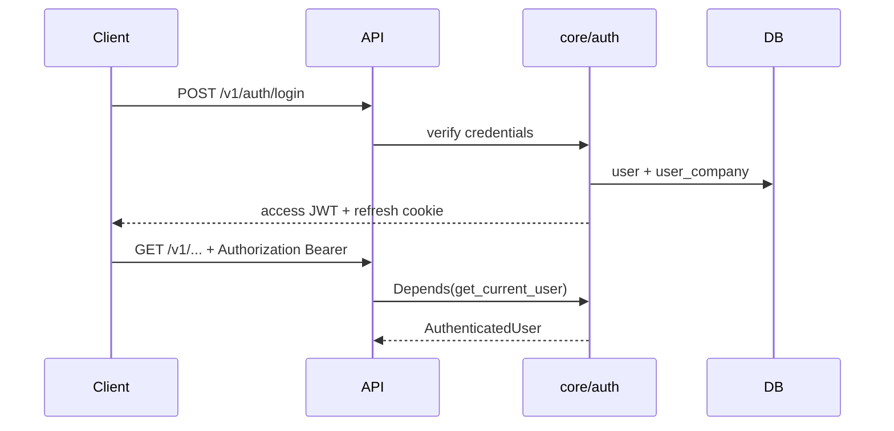

# Authentication & Authorization Architecture

**Developer guide** — full spec: `docs/product/10_Authentication_Architecture.md`, `docs/product/19_RBAC_and_Permission_Matrix.md`

**Implementation status:** Block B1 complete — `core/auth/`, `core/rbac/`, `core/audit/`, `modules/identity/`.

---

## 1. Authentication model

| Mechanism | Detail |
|-----------|--------|
| Primary | Email + password (argon2 hash via `argon2-cffi`) |
| Alternative | Mobile + OTP (planned) |
| Tokens | JWT access (15 min) + rotating opaque refresh (30 days) |
| Access token claims | `sub` (user_id), `company_id`, `employee_id`, `session_id` — **no permissions in JWT** |
| Refresh storage | Server: hash only + `token_family_id` for reuse detection |
| Web refresh | HttpOnly, Secure, SameSite=Strict cookie |
| Mobile refresh | Encrypted secure storage (`X-Client-Type: mobile`) |

Permissions resolved **per request** from DB/Redis — role changes apply immediately.

---

## 2. JWT flow

Refresh rotation: each refresh invalidates previous token; reuse of old token revokes entire family (theft detection).

---

## 3. Multi-company access

1. User may belong to multiple companies (`user_company`).
2. After login, if >1 company → company picker (API: `GET /v1/auth/companies`).
3. Client sends `X-Company-Id` on every request.
4. `get_tenant_context` validates membership; mismatch → **404**.
5. `TenancyMiddleware` + session RLS apply `company_id`.

---

## 4. RBAC

| Concept | Implementation |
|---------|----------------|
| Permission codes | `MODULE.RESOURCE.ACTION` — catalogue in `docs/product/19` |
| Roles | Per-company `role` + `user_role` |
| Route guard | `Depends(require_permission("EMPLOYEE.VIEW"))` |
| Data scope | `DataScope` — self, team, branch, company (`docs/product/19` §4) |
| Field security | RESTRICTED fields masked unless explicit permission |
| Cache | Redis permission bitmap per user+company (TTL short) |

---

## 5. FastAPI implementation map

| NestJS (removed) | FastAPI |
|------------------|---------|
| `@UseGuards(JwtAuthGuard)` | `Depends(get_current_user)` |
| `@RequirePermission()` | `Depends(require_permission(code))` |
| Passport strategies | `core/auth/jwt.py`, `authlib` for OIDC |
| Request-scoped DI | `Depends(get_session)`, `Depends(get_tenant_context)` |

---

## 6. MFA (future — interface now)

- TOTP + SMS OTP (`docs/product/10` §2).
- Mandatory for Super Admin / Company Admin.
- `mfa_enabled` on `user`; secrets encrypted at column level.
- Login flow: password OK → `mfa_required` response → second step.

---

## 7. SSO — SAML 2.0 / OIDC (Phase 2+)

- Per-tenant IdP configuration.
- Libraries: `authlib`, `python3-saml`.
- JIT provisioning with default role mapping.
- Same session model after SSO assertion.

---

## 8. API keys / integrations

- Scoped keys per tenant for ERP, devices.
- OAuth2 client-credentials pattern for machine clients.
- Rotation and revocation in `modules/integration/`.

---

## 9. Security rules (non-negotiable)

- Lockout after 5 failures / 15 min — no account enumeration.
- Impersonation: audited, time-limited, blocked on payroll finalise (`docs/product/10` §7).
- Deactivated user: sessions revoked within 60 seconds.
- Cross-tenant resource ID → 404 always.

---

## 10. Related documents

- `docs/product/14_Security_Architecture.md`
- [ADR-001 FastAPI backend](../adr/ADR-001-FastAPI-as-Core-Backend.md)
- [Module standard](02_Module_Standard.md) — `permissions.py` per module
