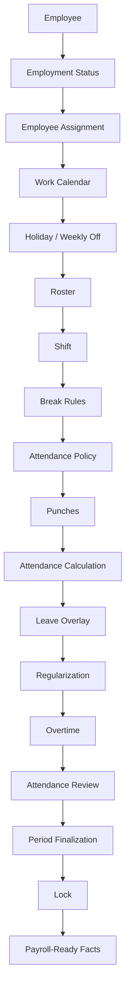

# Attendance Engine — Complete Guide

**What this document is:** a single, self-contained explanation of the Attendance module — how it works end to end, what HR can configure, which rule wins when two rules could apply to the same day, and a real month-long walkthrough showing the rules in action. This replaces the earlier multi-document set with one document covering the same ground.

**Audience:** HR, product owners, and client stakeholders. No database, API, or code knowledge is assumed.

---

## Contents

1. [How the engine works](#1-how-the-engine-works)
2. [What's configurable](#2-whats-configurable)
3. [What overrides what](#3-what-overrides-what)
4. [A day (and a month) in the life](#4-a-day-and-a-month-in-the-life)
5. [Summary reference](#5-summary-reference)

---

## 1. How the engine works

Every employee, on every date, is run through the same question in three parts:

1. **Was the employee expected to work?** — decided by the calendar, holidays, weekly-off pattern, and roster.
2. **What schedule were they expected to follow?** — decided by their shift and its break rules.
3. **Based on what actually happened, what's the final result?** — decided by their punches, judged against the Attendance Policy, then adjusted for approved leave, corrections, and overtime.

### 1.1 The end-to-end flow



### 1.2 What each stage decides

| Stage | What it decides | Who controls it | What can override it |
|---|---|---|---|
| Employment status | Was the employee actually employed on this date? | HR (joining/exit dates) | Nothing — checked first, absolute |
| Employee assignment | Branch, department, designation, grade, manager, default shift — as of that date | HR | A published roster can replace the shift for scheduling |
| Work calendar | Which holiday list and weekly-off pattern apply | HR, via calendar assignment | More specific assignment wins (§3.1) |
| Holiday / weekly-off | What kind of day is it — working, holiday, or weekly off | Calendar + weekly-off pattern | A date-specific exception beats a holiday; a holiday beats weekly-off, except one documented carve-out (§3.2) |
| Roster | Has this specific employee been scheduled differently for this specific date? | HR/manager with roster access | Must be **published** to count; never changes the calendar's day-type, only whether presence is expected |
| Shift | Actual work timings and hours expected | HR | Roster can substitute a different shift for a given date |
| Break rules | What breaks are scheduled and how they affect worked hours | HR (on the shift) | Only breaks matching an actual punch gap are deducted |
| Attendance policy | How lateness, absence, half-days, and missing punches are judged | HR | The most specific policy assignment wins (§3.1) |
| Punches | What the employee actually recorded | Employee, device, HR/manager, or a regularization | Never edited or deleted — only added to |
| Attendance calculation | Turns the day's expectations and punches into Present / Half-Day / Absent / Incomplete | The engine, automatically | Late/early bands can force a worse status than hours worked alone would (§3.3) |
| Leave overlay | Reflects approved leave onto the day | Leave system (external), synced in | Leave wins by default; never changes the calendar's day-type |
| Regularization | The correction workflow for a wrong or missing punch | Employee submits, manager/HR approves | Adds new punches, never edits history; day is recalculated from scratch |
| Overtime | Detects, classifies, and (if required) routes extra worked time for approval | Policy + approver | Never changes the day's Present/Absent/Half-Day status — always a separate fact |
| Attendance review | HR checks for gaps before closing the period | HR/Admin | — |
| Period finalization & lock | Freezes the month's results for payroll | HR/Admin with lock permission | Blocks any further change until explicitly reopened |
| Payroll-ready facts | Final paid/unpaid fraction and approved OT minutes per employee, per day | — | This module hands off facts only — it does not calculate money |

### 1.3 What kind of day is it?

Every date is classified in this strict order:

1. A **specific date-level exception**, if HR created one (e.g., "this Saturday is a special working day," "this holiday is cancelled this year")
2. Otherwise, a **holiday**, if listed in the employee's holiday calendar
3. Otherwise, **weekly off**, if it matches the employee's weekly-off pattern
4. Otherwise, a **normal working day**

**The one documented exception:** if a public holiday falls on an employee's weekly-off day (e.g., a holiday lands on a Sunday, already the standing weekly off), the day **stays classified as Weekly Off** — it does not automatically create a substitute working day elsewhere. The coincidence is recorded and visible to HR, but nothing is automatically compensated. If the business wants a substitute day off in this case, HR must manually add a **Substitute Holiday** exception on a different date. This is called out because many Indian HR policies expect an automatic substitute — it needs explicit confirmation from the client as a business decision, not a system default to assume.

### 1.4 The shift system

Shift defines the **timetable** — when someone should work, what breaks apply, whether the shift is eligible for overtime. It does not define how lateness or absence is judged; that is the Attendance Policy's job.

| Shift type | How it works |
|---|---|
| **Fixed** | Same start/end every day (e.g., 09:00–18:00). Lateness measured against the fixed start; early departure against the fixed end. |
| **Flexible** | Employee can arrive/leave within a window, as long as required hours are completed (e.g., arrive 08:00–11:00, complete 8 hours). A "core hours" mandatory-presence window can be entered but is **not currently enforced**. |
| **Split** | Two or more separate work blocks in a day (e.g., 06:00–10:00 and 14:00–18:00 for field/security staff). Each block needs its own complete punch pair. A missed block's outcome (ignore / half-day / absent / require correction) is configurable. Lateness/earliness are not calculated for split shifts — only whether required hours were met. |
| **Night / cross-midnight** | Starts one day, ends after midnight (e.g., 22:00–06:00). The entire shift is attributed to the date it **started** — never split across two calendar days. |

### 1.5 Break rules

Breaks are defined on the shift as fixed or flexible-duration windows, paid or unpaid.

**Currently active:** matching a punch gap to a defined break window; deducting unpaid break time from worked minutes; adding paid break time back so it still counts as worked; flagging when a break runs longer than its configured maximum.

**Not currently active:** a "mandatory" break is not force-deducted if the employee's punches show no matching gap (the system does not invent a break that wasn't actually taken); minimum-duration limits on flexible breaks; any automatic consequence for exceeding the maximum break duration beyond recording the excess as a fact.

### 1.6 Leave, regularization, and overtime — how they connect

- **Leave** is not a feature of this module — Attendance receives a signal from the Leave system ("this employee has approved leave, this fraction of a day, paid or unpaid") and reflects it. By default, leave wins over punches; a "flag work-on-leave" mode instead keeps the punch-based status and flags the discrepancy. Leave never changes the calendar's day-type — a holiday stays a holiday underneath.
- **Regularization** is the correction workflow: an employee requests a fix, a manager/HR approves or rejects it, and an approval **adds new punches** (originals are never edited or deleted) which triggers a full recalculation using the normal rules. Nothing is ever hand-edited into a final status.
- **Overtime** is detected once worked minutes exceed scheduled minutes, subject to eligibility, a minimum threshold, rounding, and daily/weekly/monthly caps. It is classified as Normal, Holiday, Weekly-Off, or (in limited cases) Night, then routed for approval per policy. It is always a fact recorded **alongside** the day's status — overtime never changes whether a day is Present, Half-Day, or Absent.
- **Period lock** outranks all of the above: once a period is closed, no punches, corrections, overtime decisions, or leave syncs can touch those dates until HR explicitly reopens the period.

---

## 2. What's configurable

Every number and rule below is set by HR — nothing here is hard-coded for a specific company. Each policy area can be assigned at different scopes (see §3.1), so different teams can run under different rules entirely.

### 2.1 Work calendar & weekly off

| Setting | Example | Active today? |
|---|---|---|
| Calendar identity, holiday list composition | "India — Standard Calendar" with an ordered list of holiday calendars | Yes |
| "Optional holidays are hard holidays" flag | On/Off, company-wide | Yes |
| Calendar exceptions (dated overrides) | Shutdown, Special Working Day, Substitute Holiday, Cancel Holiday | Yes — highest priority, overrides everything else |
| Weekly-off pattern | Weekday, Nth-weekday-in-month, last-weekday, alternate-week rules | Yes — all patterns supported (e.g., 1st/3rd Saturday, alternate Saturdays) |

### 2.2 Shift

| Setting | Example | Active today? |
|---|---|---|
| Shift type, timing, required minutes | Fixed / Flexible / Split, 09:00–18:00, 480 min | Yes |
| Cross-midnight flag | On for night shifts | Yes |
| OT-eligible flag | On/Off | Yes, when eligibility mode is "shift decides" |
| Operates-on-holiday / weekly-off flags | On/Off | Yes |
| Timezone (per shift) | IANA timezone name | Yes — highest-priority timezone source |
| Core hours (mandatory presence window) | 11:00–16:00 | **No — stored only, not enforced** |
| Draft vs Published | — | Yes — only Published shift versions are used in calculation |

### 2.3 Break

| Setting | Example | Active today? |
|---|---|---|
| Break window (fixed or flexible) | 13:00–14:00 | Yes |
| Paid / Unpaid | Unpaid lunch | Yes |
| Maximum duration | 60 min | Yes — excess is recorded |
| Mandatory / Optional | Mandatory | **No — not force-deducted without a matching punch gap** |
| Action on exceeding maximum | Flag / other consequence | **No — excess is recorded as a fact only** |

### 2.4 Attendance policy

| Setting | Example | Active today? |
|---|---|---|
| Grace-In / Grace-Out minutes | 15 min / 10 min | Yes |
| Late bands (lateness → status) | 30+ min late → Half-Day | Yes — and it overrides hours worked (§3.3) |
| Early-departure bands | 60+ min early → flag | Yes |
| Hour bands (worked minutes → status) | ≥480 = Present, 240–479 = Half-Day, <240 = Absent | Yes |
| Missing-punch behaviour | Incomplete (default) / Absent / Require Correction | Yes, for those three. **"Auto-close" is a known naming trap — it does not actually synthesize a clock-out; it behaves like the default.** |
| Multi-punch mode | Sum all pairs / first-in-last-out | Yes |
| Duplicate-punch window | 60 seconds | Yes |
| Split-shift missed-block behaviour | Ignore / Half-Day / Absent / Require Correction | Yes |
| Work-on-leave behaviour | Leave wins (default) / Flag and keep punch status | Yes |
| Incomplete-at-lock behaviour | Treat as Absent (default) / Present / keep Incomplete | Yes — applied only at period finalize |
| Punch rounding | Round to nearest 15 min | **No** |
| Core-hours breach behaviour | — | **No** |
| WFH / On-Duty as a distinct status | — | **No — see note below** |
| Auto-close-after-minutes | — | **No** |
| Repeated-lateness-to-half-day conversion | "3 lates in 30 days = 1 half-day" | **No** |

**Note on WFH / On-Duty:** these exist as request *types* for a regularization, and can be submitted and approved — but approval by itself does not produce a distinct WFH or On-Duty attendance status. It only has an effect if the approval also adds punches or changes the assigned shift. Treat these as not fully available until confirmed as a requirement.

### 2.5 Overtime policy

| Setting | Example | Active today? |
|---|---|---|
| Eligibility mode | Never / Shift decides / Always | Yes |
| Eligibility "by grade" | — | **No — behaves exactly like "Always," does not actually check grade** |
| Minimum OT minutes, rounding rule | 30 min minimum, round up to nearest 30 | Yes |
| Daily / weekly / monthly caps | 120 / 600 / 2400 min | Yes |
| Approval requirement + chain | Auto / Manager / HR / Manager-then-HR | Yes |
| Comp-off instead of pay | On, with expiry days | Yes, produces the fact — redemption against leave is a future capability |
| Rate multipliers (e.g., "2x for holiday") | — | Recorded for reference/reporting only — **never turned into actual pay** |
| Night OT classification | Shift-flag / Window / Both | **Default mode never classifies OT as Night, regardless of shift** — see §3.4 |

### 2.6 Regularization policy

| Setting | Example | Active today? |
|---|---|---|
| Who may request | Employee / manager / HR, per actor | Yes |
| Max backdated days | 7 days | Yes |
| Max requests per month | 3 | Yes |
| Reason / attachment required | On/Off | Yes |
| Approval chain | Auto / Manager / HR / Manager-then-HR | Yes |
| Blocked when period is locked | On (default) | Yes |
| Allowed correction types | Missing Punch, Wrong Punch, Wrong Shift, Wrong Status, WFH, On-Duty, Full-Day | Yes — though WFH/On-Duty don't produce those statuses by themselves (§2.4) |

### 2.7 Where policies apply

Every policy above can be assigned at eight different scopes — see §3.1 for how the system picks which one applies to a given employee.

---

## 3. What overrides what

### 3.1 Policy specificity — the most specific level wins

Work calendars, weekly-off patterns, and the Attendance / Overtime / Regularization policies can each be assigned at eight levels. The system checks from most specific to least specific and stops at the first match:

```
EMPLOYEE  →  SHIFT  →  DESIGNATION  →  GRADE  →  DEPARTMENT  →  BRANCH  →  LEGAL ENTITY  →  COMPANY
```

Each policy family resolves **independently** — an employee-level Attendance Policy says nothing about which level of Overtime Policy applies to them.

**Worked examples:**

| Scenario | Winner | Why |
|---|---|---|
| Company Grace-In = 15 min; nothing more specific set | Company (15 min) | Only level with an assignment |
| Company = 15 min; Department "Sales" = 10 min | Department (10 min) for Sales; Company for everyone else | Department is more specific |
| Company = 15 min; Department = 10 min; Employee = 5 min | Employee (5 min) | Employee is the most specific level |
| Shift "Night A" has its own Overtime Policy; Department "Security" has a different one | Shift-level policy | Shift outranks Department |
| Branch "Mumbai" has a Work Calendar; Legal Entity "ABC Pvt Ltd" also has one | Branch's calendar | Branch outranks Legal Entity |
| No policy assigned at any level | **Configuration Error** | No silent default — fails closed, blocks period close |
| Employee transferred from Dept A to Dept B mid-month, each with different Regularization Policies | Requests before transfer use A's rules; after, B's | Policy resolution is always as of the relevant date |

**A documented mismatch worth knowing:** if a policy is assigned at the **Shift** level, and an employee is temporarily moved to a different shift via a published roster, the system still looks up the Shift-level policy using the employee's **originally assigned** shift — not the roster's shift — for that date. This is an open product decision, not a bug, and is worth a specific client sign-off if shift-scoped policies and temporary roster reassignments are both in use.

### 3.2 Calendar precedence

| Priority | Rule | Result |
|---|---|---|
| 1 (highest) | Date-specific exception (Shutdown, Special Working Day, Substitute Holiday, Cancel Holiday) | Exception's day-type wins outright |
| 2 | Listed holiday | Holiday / soft-holiday, per its type |
| 3 | Weekly-off pattern match | Weekly Off |
| 4 (lowest) | Nothing else matched | Working Day |

Special case: a **hard holiday landing on a weekly-off day stays Weekly Off**, flagged as a coincidence — the one place this order has a documented carve-out (see §1.3).

### 3.3 Attendance status precedence — inside a single day's calculation

Checked in order; the first applicable rule decides, with the leave overlay always running last:

1. **Employment gate** — Not Joined / Exited, absolute, no exceptions
2. **Configuration Error** — missing calendar or Attendance Policy
3. **Roster week-off with no punches** → Not Expected
4. **Missing shift** → follows the missing-shift rule
5. **Not-expected day with no punches** (holiday/week-off/shutdown, nobody forced work) → Not Expected
6. **Punch-based evaluation** → Present / Half-Day / Absent / Incomplete, including late/early classification
7. **Leave overlay** — runs last, can still change the outcome

**The rule most worth explaining to a client directly:** a late-arrival classification of Half-Day or Absent from step 6 **overrides** whatever the hours-worked bands alone would have said. An employee who arrives 35 minutes late (past grace) and then stays late to make up the time is still marked Half-Day — punctuality and total hours are judged independently, and the less favorable outcome applies. See the walkthrough in §4 (Thursday) for a full worked example.

### 3.4 Overtime precedence

| Topic | Rule |
|---|---|
| Eligibility | Policy setting, plus a shift-level flag check only when eligibility is "shift decides" |
| Minute calculation order | Minimum threshold → rounding → daily cap → weekly cap → monthly cap |
| Day classification | Holiday → else Weekly-Off → else Night (only if the shift crosses midnight **and** the night-classification setting is in a mode that checks it — the default mode never produces Night) → else Normal |
| vs. Attendance status | Never overrides Present/Absent/Half-Day — always a separate, parallel fact |
| vs. Period lock | Approve/reject actions are blocked once locked |

### 3.5 Leave precedence

| Topic | Rule |
|---|---|
| vs. Calendar | Never changes the day-type — a holiday stays a holiday even with leave on top |
| vs. Not-Expected days | A full-day leave can still turn an otherwise Not-Expected day into a Leave day |
| vs. Punches, default mode | Leave wins outright; punch-based late/early flags are cleared |
| vs. Punches, "flag work-on-leave" mode | Punch-based status is kept; day is flagged so HR can see the employee worked despite being on leave |
| vs. Overtime | **Known limitation:** in "leave wins" mode, overtime already calculated from punches is not automatically cleared |
| vs. Period lock | Any leave sync/cancellation is refused once locked |

### 3.6 Regularization precedence

| Topic | Rule |
|---|---|
| vs. original punches | Corrections are always additive — new punches added, originals never edited or deleted |
| vs. day result | Triggers a full recalculation using the normal rules — never a direct status overwrite |
| vs. lock | Submitting a new request is blocked once the period is locked |
| vs. finalize | Any request still awaiting a decision blocks period close |

### 3.7 Period lock — outranks everything

Lock outranks every other mutating action for dates inside the locked range: punches, recalculation, roster changes, regularization submission, overtime approval/rejection, and leave sync/cancellation are all refused. Configuration masters (calendars, policies, shifts) outside the locked range remain editable as normal. Reopening a period restores mutability but does **not** automatically recalculate anything — changes made after reopening must be manually triggered to recompute.

### 3.8 Quick answers — "Can X override Y?"

| Question | Answer |
|---|---|
| Can an Employee-specific policy override the Company policy? | Yes |
| Can a Shift-specific policy override a Department policy? | Yes |
| Can a Roster entry override the employee's assigned shift? | Yes, for scheduling |
| Does a Roster entry also change which Shift-scoped policy applies? | No — documented mismatch, see §3.1 |
| Can a Calendar Exception override a Holiday? | Yes |
| Can a Holiday override a Weekly Off? | No — the day stays Weekly Off, with a flag |
| Can Leave override an Absence or a Not-Expected day? | Yes, for the day's status |
| Can Leave override a Holiday's day-type? | No — the calendar is never changed by leave |
| Can a Punch override Leave? | Only conditionally — only in "flag work-on-leave" mode |
| Can Regularization override an original Punch? | Only by adding new punches — never edits or deletes one |
| Can Overtime override the Attendance status? | No — always a separate, parallel fact |
| Can a Period Lock override all mutating actions? | Yes |
| Can a Draft roster override the live schedule? | No — only Published entries count |

---

## 4. A day (and a month) in the life

The rules above are abstract until they're applied to a real month. The scenarios below follow one employee through a representative set of situations — late mornings, an early departure, a forgotten punch, a leave day, a shift on a weekly off — showing exactly what the system determines at each step, and why.

### Employee setup used in this walkthrough

| Setting | Value |
|---|---|
| Shift | General Shift, 09:00–18:00 (9 hours) |
| Lunch break | 13:00–14:00, unpaid, 1 hour |
| Required work | 480 minutes (8 hours), net of lunch |
| Grace period (late arrival) | 15 minutes — a punch-in by 09:15 is treated as on time |
| Grace period (early departure) | 10 minutes — a punch-out from 17:50 onward is treated as on time |
| Late band | Arrival 30+ minutes late (past 09:45) forces Half-Day, regardless of hours subsequently worked |
| Hours band | 8+ hours worked → Present · 4–8 hours → Half-Day · under 4 hours → Absent |
| Weekly off | Sunday |
| Overtime | Requires manager approval before it counts; minimum 30 minutes to qualify |

These figures are configured by HR for this walkthrough's example team — a different team could run entirely different numbers (see §2).

### Monday — a standard day

The employee punches **IN at 08:57**, takes the lunch break, and punches **OUT at 18:03**.

On time, full day worked, nothing to flag. **Result: Present. Payroll fact: 1.00 paid day.** No configuration or approval is involved — this is the default case that resolves silently for most of the workforce on most days.

### Tuesday — late arrival within grace

The employee punches **IN at 09:10** — 10 minutes after the 09:00 start, but within the 15-minute grace period. The system does not register this as late; 09:10 is treated identically to 09:00.

**Result: Present, not flagged. Payroll fact: 1.00 paid day.** No exception appears on either the employee's or HR's view — this is the purpose of a grace period: it absorbs ordinary variation in arrival time without anyone needing to notice, flag, or approve anything.

### Wednesday — late arrival beyond grace, no status impact

The employee punches **IN at 09:25**. Raw lateness is 25 minutes; minus the 15-minute grace period, that's 10 minutes of chargeable lateness — under the 30-minute Half-Day late band, so the day's status is unaffected. The employee punches out normally at 18:00.

**Result: Present, flagged "late" (10 min). Payroll fact: 1.00 paid day** — the flag is informational and has no effect on pay by itself, though it's useful for HR to spot a pattern of lateness over time.

### Thursday — lateness overriding hours worked

The employee punches **IN at 09:50** — 50 minutes after the 09:00 start — and, to make up the time, stays back and punches **OUT at 18:45**.

This is the scenario worth explaining to the client directly, since it is not intuitive on first read:

- Chargeable lateness: 50 − 15 (grace) = **35 minutes**, crossing the 30-minute late band.
- Hours worked, excluding lunch, exceed 8 hours — on hours alone, this would be a Present day.
- The system evaluates the **late band first**. Once lateness crosses 30 minutes, the day is forced to Half-Day, irrespective of hours subsequently worked.

**Result: Half-Day, despite a full and extended day of hours logged. Payroll fact: 0.50 paid, 0.50 unpaid.**

The rule evaluates punctuality independently of total hours — working extra hours later does not offset a late arrival. The only correction path is an approved regularization request; without one, the Half-Day stands.

### Friday — early departure

The employee punches **OUT at 16:40** — 80 minutes before the 18:00 end time, well beyond the 10-minute early-departure grace. The IN punch was on time. The early-departure band is set at "60+ minutes early = flag"; at 80 minutes early (70 past grace), this crosses that band.

**Result: flagged for early departure — Present-flagged or Half-Day, depending on how far the departure crosses the configured bands** — the same tiered logic as late arrival, applied to the end of the day. Correction path: the same regularization workflow, reviewed by the manager.

### Following Monday — a missed punch

The employee goes directly to a client site and forgets to punch IN, but does punch **OUT at 18:05**. With one OUT punch and no matching IN, hours worked cannot be computed. The missing-punch policy defaults to **Incomplete**, not an automatic Absent.

**Result: Incomplete — neither paid nor unpaid until resolved.** The employee submits a regularization request ("Forgot to punch in; on-site with a client from approximately 09:00"), within the 7-day backdating window. The manager reviews and approves; the system adds the missing IN punch and recalculates the day, typically resolving to Present.

**Result after approval: Present. Payroll fact: 1.00 paid day**, once approved — but if the request isn't submitted before the period locks, the correction is refused until HR reopens the period, which is why timely submission matters more as month-end approaches.

### Wednesday — half-day approved leave

The employee takes approved half-day leave for the morning, then punches **IN at 14:05** and **OUT at 18:10**. The Leave module has already approved 0.5 day of leave for this date and synced it to Attendance, which combines the leave credit with the afternoon's worked hours.

**Result: Half-Day — planned, not a penalty. Payroll fact: ~1.00 paid day (0.50 leave + 0.50 worked).** This is a different kind of Half-Day from Thursday's: that one was a consequence of lateness; this one is an approved outcome and requires no review.

### Thursday — full-day approved leave, no punches

The employee is on approved sick leave and records no punches at all. Because Leave has already confirmed approved leave for this date, the system does not evaluate the absence of punches as a gap — the leave overlay takes precedence over an empty punch record.

**Result: Leave — not Absent, not Incomplete. Payroll fact: paid or unpaid per the leave type's own configuration.** If leave is approved a few days after this date's attendance was already calculated, the system automatically recalculates the day once the leave syncs in, provided the period isn't yet locked.

### Sunday — work on a weekly off

Normally off on Sundays, the employee is rostered in for this specific Sunday to handle a client shipment, punching **IN at 09:05** and **OUT at 15:30** (6 hours). Because the manager explicitly rostered the day, it is evaluated normally rather than treated as a weekly off. All hours worked on a weekly-off day are evaluated as overtime, classified specifically as **"Weekly-Off overtime."** Because the overtime policy requires manager approval, it's recorded as **Pending** until reviewed.

**Result: Present + Pending Overtime (6 hrs, Weekly-Off). Payroll fact: 1.00 paid day + OT minutes once approved.** If this approval is still Pending when HR attempts to close the month, period close is **blocked** until it's decided — the system neither drops the request nor lets it through automatically.

### Month-end — locking a payroll-ready result

Before HR can lock the period:

1. **Every pending regularization** must be decided — approved or rejected.
2. **Every pending overtime request** must be decided.
3. Any day still marked **Incomplete** is resolved per the "incomplete-at-lock" setting — by default, treated as Absent, unless configured otherwise.
4. Once all outstanding items are resolved, HR locks the period.

After the lock: no new punches, leave syncs, regularizations, or overtime requests can affect that period. Every day for every employee has a final, unambiguous paid fraction and unpaid (loss-of-pay) fraction — this is what's handed to payroll. A correction needed after lock requires HR to explicitly reopen the period first.

For this month, the resulting handoff to payroll looks approximately like:

| Day | Status | Paid | Unpaid |
|---|---|---|---|
| Mon | Present | 1.00 | 0.00 |
| Tue | Present (grace absorbed) | 1.00 | 0.00 |
| Wed | Present (late flagged, no cost) | 1.00 | 0.00 |
| Thu | Half-Day (late band, despite extra hours) | 0.50 | 0.50 |
| Fri | Present / Half-Day (early-departure band) | per band | per band |
| Mon (wk 2) | Present (missed punch, regularized) | 1.00 | 0.00 |
| Wed (wk 3) | Half-Day (planned leave) | ~1.00 | ~0.00 |
| Thu (wk 3) | Leave (full day) | per leave type | per leave type |
| Sun | Present + OT (rostered) | 1.00 + OT | 0.00 |

Every row is traceable to a specific punch, leave record, or approval — this is the figure payroll actually consumes.

---

## 5. Summary reference

| Situation | Governing rule | Typical result |
|---|---|---|
| Arrival within grace period | Grace-in minutes | Present, not flagged |
| Late arrival beyond grace, under the Half-Day late band | Late band (lower tier) | Present, flagged late |
| Late arrival crossing the Half-Day late band | Late band (upper tier) — overrides hours worked | Half-Day, regardless of hours subsequently worked |
| Early departure within grace | Grace-out minutes | Present, not flagged |
| Early departure beyond grace and beyond the early band | Early-departure band | Present-flagged or Half-Day, by severity |
| Missed punch | Missing-punch policy (default: Incomplete) | Incomplete, resolved via regularization |
| Half-day approved leave, worked the remaining half | Leave overlay combined with worked hours | Half-Day (planned, not a penalty) |
| Full-day approved leave, no punches | Leave overlay takes precedence over punches | Leave |
| Work on a weekly off or holiday | Roster plus overtime detection | Present, plus Overtime (Pending until approved) |
| No policy assigned at any level | Fails closed | Configuration Error — blocks period close |
| Outstanding item at month-end (pending OT, pending regularization, Incomplete day) | Period finalization checks | Blocks lock until resolved |
